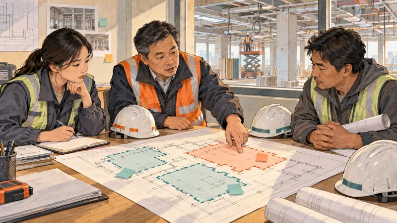
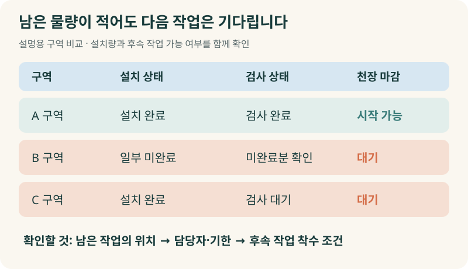
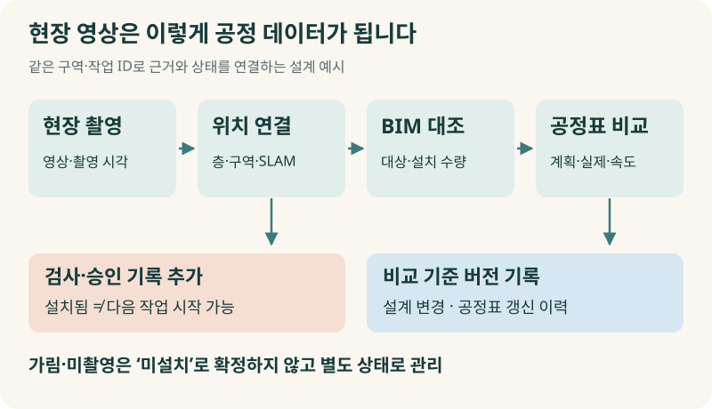
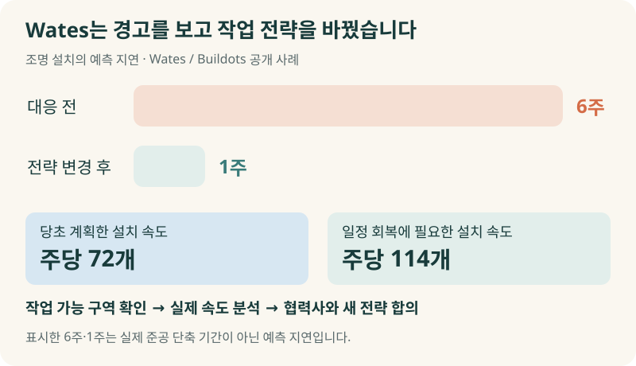
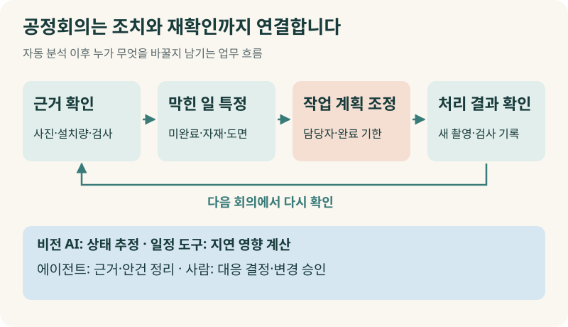
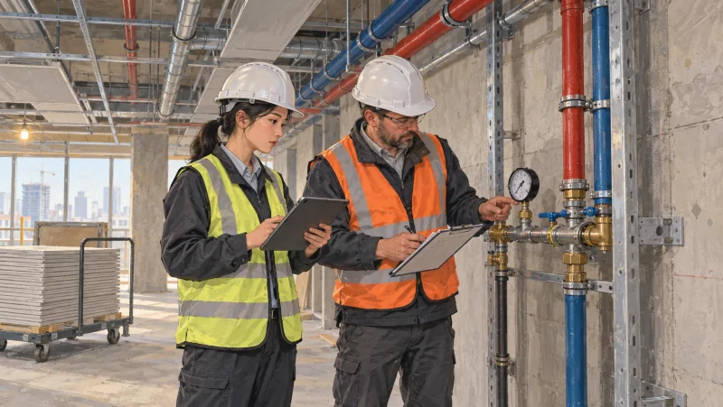
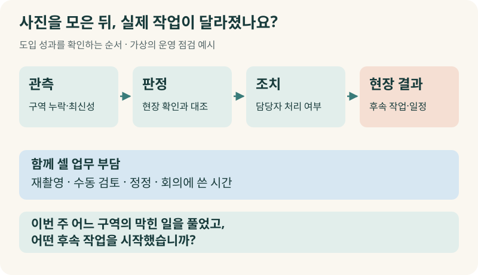
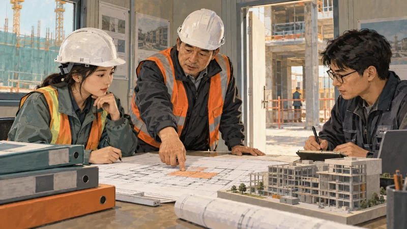

+++
date = '2026-10-14T00:00:00+09:00'
draft = false
title = '매주 “거의 끝났다”는데, 준공일은 왜 자꾸 밀릴까요?'
description = '현장 사진과 BIM, 공정표를 연결하면 무엇이 달라질까요? 건설사 사례를 통해 미완료 작업을 찾아 협력사 계획과 후속 공정을 조정하는 공정 관리 AX를 살펴봅니다.'
tags = ['ax', 'ai', 'construction', 'bim', 'progress-management']
authors = ['geoff']
featured_image = 'thumbnail.webp'
images = ['thumbnail.webp']
slug = 'construction-progress-management-ax'
audio = []
vedios = []
series = []
toc = true
+++

## 들어가며

어떤 건설 현장의 주간 공정회의를 상상해 보겠습니다. 전기 담당자는 배선 작업이 거의 끝났다고 합니다. 설비 담당자도 배관 설치는 대부분 마쳤다고 보고합니다. 다음 주에는 천장 마감팀이 들어갈 예정입니다.

현장소장이 묻습니다.

> 그러면 월요일부터 천장을 닫을 수 있는 구역이 어디입니까?

그제야 보고 내용이 달라집니다. 한 구역은 배관을 설치했지만 압력시험이 남았습니다. 다른 구역은 배선 일부를 마무리해야 합니다. 천장 마감팀은 인력을 배치하려는데 어느 구역부터 작업할 수 있는지 확답을 받지 못합니다.

각 담당자의 말이 전부 틀린 것은 아닙니다. 자기 공종에서는 대부분 끝낸 상태일 수 있죠. 하지만 다음 작업을 맡을 사람에게는 아직 시작할 수 없는 현장입니다. 경영진이 높은 진척률을 보고 안심하는 동안 후속 작업은 계속 밀릴 수 있습니다.

건설 현장의 공정 관리 AX는 이런 차이를 줄이는 일입니다. **어디까지 시공했는지 근거를 확인하고, 다음 작업을 막는 조건을 찾아 실제 작업 계획을 바꾸는 것**이죠. 사진을 많이 찍고 보고서를 빨리 만드는 데서 끝나면 현장은 그대로 바쁩니다.

현장 영상과 도면, 공정표를 어떻게 연결해야 할까요? 이미 도입한 건설사들은 데이터를 보고 무엇을 바꿨을까요? 이 글에서는 그 사례와 기술을 살펴보고 우리 현장에서 어디부터 시작하면 좋을지 정리해 보겠습니다.

## 90%가 끝났는데도 다음 층으로 못 넘어가는 이유

아파트 한 세대에서 전기와 배관 작업을 대부분 마쳤다고 해봅시다. 천장을 닫기 전에 확인해야 할 설비가 한 곳 남아 있습니다. 설치 물량으로 보면 작은 부분이지만 마감팀은 그 확인을 기다려야 합니다. 남은 물량의 비중과 일정에 미치는 영향은 다를 수 있습니다.

Buildots가 공개한 Multiplex 사례에도 비슷한 문제가 나옵니다. 현장팀은 보를 감싸는 작업이 약 90% 수준에서 멈춘 채 다음 층으로 이동하는 패턴을 발견했습니다. 층마다 조금씩 남긴 작업을 추적한 뒤 협력사와 마무리 계획을 세웠습니다. [Multiplex 사례](https://pages.buildots.com/hubfs/Use-Cases/Multiplex/Multiplex-Case-study.pdf?hsLang=en)

경영진이 전체 진척률만 보면 대부분 끝낸 작업으로 받아들이기 쉽습니다. 현장에서는 남은 곳을 찾아 다시 인력을 보내고 후속 작업과 순서를 맞춰야 합니다. 같은 방식으로 여러 층을 진행했다면 마무리할 구역도 함께 늘어납니다.

그래서 공정회의에서는 진척률과 함께 남은 작업의 위치와 상태를 확인해야 합니다. 어느 층의 어느 구역에 무엇이 남았는지, 그 때문에 다음에 누가 작업하지 못하는지까지 알아야 협력사와 일정을 조정할 수 있습니다.

## 현장을 찍은 영상이 공정 데이터가 되기까지

현장 사진은 이미 많이 찍고 있을 겁니다. 그런데 사진 폴더만 열어서는 지난주보다 얼마나 시공했는지 알기 어렵습니다. 촬영한 위치를 찾고 도면과 비교하고 같은 구역의 이전 사진까지 꺼내야 하니까요.

이 과정을 줄이려면 촬영부터 일정 비교까지 여러 기술을 연결해야 합니다.

### 언제, 어디를 찍었는지 연결합니다

실내 현장에서는 안전모 등에 장착한 360도 카메라로 이동하며 촬영하는 방법을 씁니다. 외부 부지나 토공 현장은 드론을 검토할 수 있고 정밀한 형상 측정이 필요하면 레이저 스캔 등을 선택합니다. 무엇을 확인하려는지에 따라 수집 방법이 달라집니다.

촬영 이후에는 영상 속 장소를 도면의 위치와 맞춥니다. 여기에 쓰는 기술 중 하나가 SLAM입니다. 이동하면서 주변 공간의 지도와 자신의 위치를 함께 추정하는 방식입니다. OpenSpace가 공개한 Balfour Beatty 사례에서도 촬영 경로와 위치를 연결하는 데 이 기술을 활용합니다. 담당자가 사진마다 위치를 일일이 지정하던 일을 줄이는 겁니다. [촬영과 현장 기록 활용 사례](https://www.openspace.ai/resources/case-studies/balfour-beatty-openspace-case-study/)

위치와 시각을 알아야 같은 구역을 전후로 비교할 수 있습니다. 비슷하게 생긴 다른 층의 사진을 가져와서는 그 구역의 작업이 끝났는지 판단할 수 없겠죠.

### 설계에 있어야 할 것과 실제 설치한 것을 비교합니다

BIM은 건물을 입체적으로 표현하면서 벽·배관·설비 등의 위치와 속성도 담는 건설 정보 모델입니다. 비전 AI로 현장 영상에서 설치 대상을 찾고 BIM과 대조하면 어느 구역에 무엇을 얼마나 설치했는지 추정할 수 있습니다. Doxel도 360도 영상과 BIM을 비교해 설치 수량과 시공 단계를 추적하는 방식을 설명합니다. [Doxel 기술 설명](https://doxel.ai/faqs)

이때 현업과 개발팀은 미설치와 보이지 않음을 구분해야 합니다. 자재 뒤에 가려진 배관을 영상에서 찾지 못했다고 해서 설치하지 않았다고 처리하면 다시 확인할 일이 생깁니다. 촬영하지 못한 구역도 따로 남겨야 합니다.

설치 이후의 상태도 구분합니다. 배관이 영상에 보여도 압력시험을 통과했는지는 검사 기록을 확인해야 알 수 있습니다. 처음의 천장 마감 사례처럼 다음 작업을 시작하려면 설치 여부에 검사·승인 결과까지 붙여야 하는 경우가 있습니다.

### 공정표의 어느 작업인지 맞춥니다

BIM 요소와 공정표의 작업을 연결하면 계획한 시점에 어느 구역까지 시공해야 하는지 비교할 수 있습니다. 모델에 일정을 연결하는 방식을 4D BIM이라고 합니다. [Autodesk의 공정·일정 관리 설명](https://www.autodesk.com/learn/ondemand/course/construction-scheduling-and-cost-control)

가령 사진에서 확인한 배관을 공정표의 배관 작업에 연결하되 설치, 시험, 후속 작업 착수 조건을 따로 관리하는 식입니다. 사진 위치만 맞추고 공정표와 연결하지 않으면 어느 작업의 일정이 밀리는지 다시 사람이 찾아야 합니다.

설계 변경도 반영해야 합니다. 현장에서는 변경 도면대로 시공했는데 AI가 이전 모델과 비교하면 정상 작업을 누락이나 오류로 볼 수 있습니다. 어느 모델과 어느 공정표를 기준으로 비교했는지 기록해야 담당자가 결과를 확인할 수 있습니다.

## 지연 경고를 받은 뒤, Wates는 무엇을 바꿨을까요?

Wates 현장 책임자는 Buildots가 공개한 발표에서 경고 이후 어떻게 대응했는지 구체적으로 설명했습니다. 2024년 3월 한 프로젝트에서 조명 기구를 당시 속도로 계속 설치하면 6주 지연될 것이라는 예측이 나왔습니다.

현장팀은 곧바로 인력 부족이라고 결론 내리지 않았습니다. 우선 작업할 수 있는 구역이 충분한지 확인했습니다. 그런 다음 과거 설치 속도를 살펴보니 계획한 주당 72개를 계속 충족하지 못하고 있었습니다. 밀린 일정을 회복하려면 주당 114개를 설치해야 한다는 계산을 확인하고 해당 협력사와 새 작업 전략에 합의했습니다. 이후 예측 지연은 1주로 줄었습니다. [Wates 현장 책임자의 발표](https://buildots.com/blog/wates-project-manager-using-ai-on-site/)

단순히 늦는다고 알려주는 경고였다면 회의에서 독촉 한 번 하고 끝났을 수도 있습니다. 이 현장팀은 작업할 장소가 있는지, 실제로 얼마나 설치하고 있는지, 회복하려면 어느 속도가 필요한지를 확인했습니다. 협력사와 계획을 다시 논의할 근거가 있었던 것이죠.

우리 현장에서도 지연 경고에 이런 근거가 붙어야 합니다. 작업 장소를 확보하지 못했는데 인력만 더 보내면 대기하는 사람이 늘어납니다. 자재가 오지 않았거나 도면을 확정하지 못한 상황이라면 그 문제부터 담당자와 해결해야 합니다.

일정 계산에서는 작업 사이의 관계도 봐야 합니다. 어떤 작업은 조금 늦어도 다음 일정까지 여유가 있지만 다른 작업은 하루만 늦어도 후속 공정을 밀어냅니다. 이런 선후행 관계를 따져 준공일을 좌우하는 작업 경로를 찾는 것이 주공정 분석입니다. 경영진은 경고 건수와 함께 준공에 영향을 주는 작업이 무엇이고 언제까지 대응해야 하는지 확인할 필요가 있습니다.

## AI가 주간 공정회의에서 할 일

지연을 발견한 다음에는 협력사와 다음 주 작업을 정해야 합니다. 이때도 전체 공정률만 공유하면 어느 구역에서 무엇을 끝내겠다는 약속을 받기 어렵습니다.

Suffolk는 미국 Estates at Acqualina 현장에서 OpenSpace의 진행 추적 기능을 시험했습니다. 주로 드라이월 설치를 추적했는데 2021년 공개한 사례에 따르면 현장팀은 설치 진척을 협력사의 주간 작업 약속과 비교했습니다. 뒤처지는 작업은 인력 등 변수를 조정하는 데 이 데이터를 활용했습니다. [Suffolk의 주간 계획 활용](https://www.openspace.ai/blog/how-openspace-progress-tracking-helps-suffolk/)

이를 우리 현장에 적용한다면 회의 안건을 다음처럼 준비할 수 있습니다. 아래는 설명을 위한 예시입니다.

| 회의에서 확인할 내용 | 준비할 근거와 조치 |
|---|---|
| 다음 주 천장 마감에 들어갈 구역 | 구역별 배선·배관 설치 상태와 검사 결과 |
| 아직 시작할 수 없는 구역과 사유 | 미완료 위치, 자재 대기, 검사 일정 |
| 이번 주에 해결할 일 | 담당 협력사, 완료 기한, 확인할 사람 |
| 지난 회의에서 약속한 일의 처리 결과 | 새 현장 기록과 담당자의 완료 확인 |

생성형 AI 에이전트는 이런 안건을 준비하는 일을 도울 수 있습니다. 공정 담당자가 사진과 검사 기록을 확인할 수 있도록 연결하고 회의록에서 미결 사항을 찾아 관련 담당자에게 확인을 요청하는 식입니다. 변경 도면에 대한 질의가 아직 답변을 받지 못했는지도 함께 정리할 수 있겠죠.

역할은 나누어 구현하는 편이 좋습니다. 비전 AI는 시공 상태를 추정하고 일정 분석 도구는 선후행 관계와 지연 영향을 계산합니다. 에이전트는 그 결과와 관련 문서를 모아 사람이 대응을 결정하도록 돕습니다. 공정표 변경이나 협력사와의 약속 확정은 정해진 권한과 승인 절차를 거쳐야 합니다.

회의를 마친 뒤에는 담당자와 기한을 남기고 다음 촬영·검사 기록으로 처리 결과를 확인합니다. 매주 같은 미완료 목록을 다시 읽고 있다면 경고를 만든 뒤 실제 조치까지 연결했는지 살펴볼 필요가 있습니다.

## 현장소장의 판단 기준도 함께 정리해야 합니다

같은 사진을 보고도 숙련자는 다음 작업을 시작할 수 있는지, 잠시 기다려야 하는지 다르게 판단합니다. 어떤 설비를 먼저 확인해야 하는지, 가려지기 전에 어떤 검사를 마쳐야 하는지 알고 있기 때문입니다.

이런 노하우를 반영하려면 완료 기준을 구체적인 조건으로 정리해야 합니다. 배관을 설치한 상태와 시험을 마친 상태를 구분하고 천장을 닫아도 되는 조건을 검사 기록과 연결하는 식입니다. 현장 담당자가 AI의 판정을 고쳤다면 왜 고쳤는지도 남겨 다음 판정과 검수에 활용합니다.

앞선 [암묵지 자산화 글](https://tech.epsilondelta.ai/posts/ax-tacit-knowledge-assetization/)에서 다룬 내용을 현장 공정 관리에 적용하는 겁니다. 숙련자에게 노하우를 전부 문서로 써 달라고 하기보다 실제로 판단이 갈린 구역과 그 이유를 함께 살펴보면 더 구체적으로 정리할 수 있습니다.

초기 도입 때는 공정 담당자와 BIM 담당자, 협력사가 함께 이런 판단 기준을 살펴보며 작업 단위를 맞춰야 합니다. 공정표에는 한 줄인 작업이 현장에서는 여러 구역과 검사 단계로 나뉠 수 있습니다. 카메라를 설치하기 전에 무엇을 어느 단위로 확인할지 합의해야 결과를 업무에 쓸 수 있습니다.

## 도입 성과는 사진 수보다 다음 작업에서 확인합니다

처음부터 현장 전체를 자동 관리하려고 하면 모델과 공정표를 정리하다가 정작 해결하려던 문제가 흐려질 수 있습니다. 반복적으로 마무리가 늦는 공종이나 후속 작업의 대기가 잦은 구역부터 범위를 정하는 편이 좋겠습니다.

선택한 구역에서 현장 담당자의 확인과 AI의 추정을 대조합니다. 잘 찾는 작업과 놓치는 작업을 구분하고 재촬영이나 수동 확인에 얼마나 시간이 드는지도 봅니다. 촬영 자료의 양을 늘리는 동안 현장 업무 부담까지 늘리지 않는지 확인하는 과정입니다.

운영을 시작하면 지연을 얼마나 일찍 알았는지, 담당자가 조치했는지, 기다리던 후속 작업이 실제로 시작했는지 따라가야 합니다. 예측 준공일이 좋아졌다는 보고와 실제 마일스톤을 제때 마쳤다는 결과도 구분해서 봅니다.

경영진이 현장에 던질 질문도 구체적이면 좋겠습니다.

> 이번 주에는 어느 구역의 막힌 일을 풀었고, 그 덕분에 어떤 후속 작업을 시작했습니까?

현장에서는 이 질문에 답할 수 있도록 사진과 설치량, 검사 결과, 담당자의 조치 이력을 같은 구역·작업에 연결합니다. 그래야 보고서를 빨리 만든 효과와 현장에서 대기·재작업을 줄인 효과를 각각 확인할 수 있습니다.

## 나가며

처음의 공정회의로 돌아가 보겠습니다. 전기와 설비 작업을 대부분 마쳤다는 보고를 받은 현장소장은 월요일부터 천장을 닫을 구역을 알고 싶었습니다. 그 답을 하려면 구역별 남은 작업과 검사 여부, 처리할 담당자와 기한까지 확인해야 합니다.

공정 관리 AX에서는 현장 상태를 측정하는 기술과 그 결과를 보고 작업을 조정하는 운영을 함께 갖춰야 합니다. 촬영·분석은 자동화했는데 협력사 계획과 검사 일정은 그대로라면 다음 주 회의에서도 같은 이야기를 반복하게 될 수 있습니다.

우리 엡실론델타는 현장 데이터와 기존 시스템을 살펴보고 어떤 작업부터 AI로 확인할지 정하는 일부터 함께할 수 있습니다. 현업의 완료 기준을 정리하고 사진·BIM·공정표·검사 기록을 연결한 뒤 실제 업무에서 결과를 검증하고 운영하는 과정까지 도와드리겠습니다.

매주 대부분 끝났다는 보고를 받는데도 공기가 계속 밀린다면 [contact@epsilondelta.ai](mailto:contact@epsilondelta.ai)로 연락 주세요. 최근 공정회의에서 어떤 안건을 해결하지 못했나요? 그중 하나를 골라 관련 기록부터 함께 살펴보겠습니다. 어느 구역의 무엇을 확인하고 누가 어떤 조치를 해야 다음 작업을 시작할 수 있는지 구체적으로 정리해 보겠습니다.
