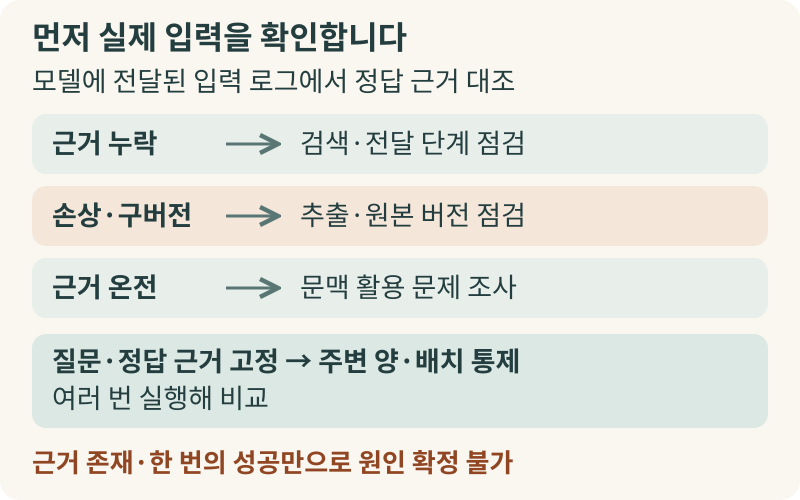
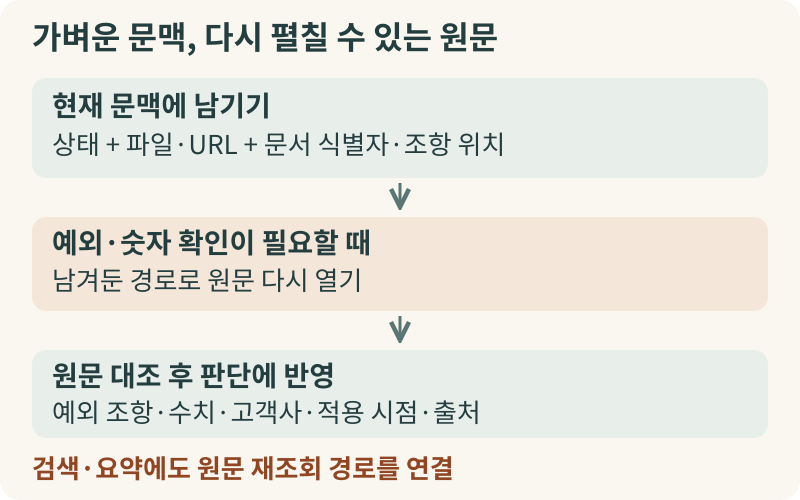
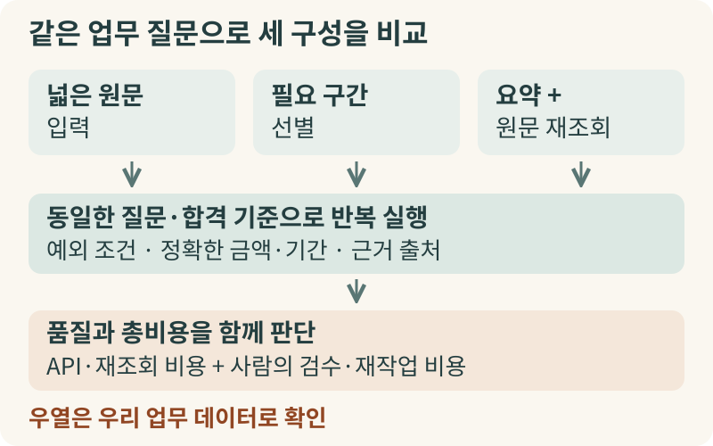

+++
date = '2026-10-16T00:00:00+09:00'
draft = false
title = '자료를 더 넣어줬는데 AI 답변이 왜 더 나빠질까요'
description = '컨텍스트 윈도우가 커져도 입력한 자료를 온전히 활용하지 못하는 컨텍스트 부패(Context Rot) 현상과 사내 AI 운영을 위한 진단·설계 기준을 살펴봅니다.'
tags = ['ax', 'context-rot', 'context-engineering', 'rag', 'ai-operations']
authors = ['geoff']
featured_image = 'thumbnail.webp'
images = ['thumbnail.webp']
slug = 'context-rot'
audio = []
vedios = []
series = []
toc = true
+++

## 들어가며

설비 제조사의 고객지원팀에서 겪을 법한 상황을 하나 가정해 보겠습니다. 기업 고객이 보증 수리를 문의할 때마다 담당자가 AI에게 관련 문서를 주고 무상 수리 대상인지 확인하게 하는 업무입니다. 특정 고객사와 맺은 특별 약정서 한 장만 입력 창에 넣어주고 물었을 때는 AI가 면책 예외 조항과 보증 연장 조건을 정확히 찾아내 깔끔한 답변 초안을 작성했습니다.

그러자 담당자는 참고할 배경 자료를 더 넣어주면 AI가 한층 완성도 높은 답변을 내놓을 것이라 기대했습니다. 이번에는 특별 약정서와 함께 표준 설비 매뉴얼과 그동안 쌓인 유사 보증 문의 이력들을 한꺼번에 입력 창에 넣어주었습니다. 결과는 예상과 정반대였죠. 방금 전까지 정확히 짚어내던 고객 특약 조항을 놓친 채 표준 매뉴얼의 일반 보증 기준이나 이미 종료된 과거 거래 조건을 끌어와 틀린 답변을 내놓기 시작했습니다.

사내 AI를 운영할 때는 자료가 부족해서 틀리는 일 못지않게 이런 오류에도 주의해야 합니다. 정답에 필요한 자료가 입력 안에 분명히 들어 있는데도 주변 문맥이 길어지고 비슷한 자료가 섞였다는 이유로 모델이 핵심 근거를 제대로 활용하지 못하는 현상입니다. 앤스로픽(Anthropic)의 [공식 한국어 문서](https://platform.claude.com/docs/ko/build-with-claude/context-windows)와 연구자들은 이를 컨텍스트 부패(Context Rot)라고 부릅니다. 입력 창에 자료가 들어가는 용량과 그 자료를 실제 판단에 흔들림 없이 쓰는 능력을 구분해야 불필요한 시스템 재구축 비용을 아끼고 우리 업무에 맞는 문맥 구성을 결정할 수 있습니다.

## 입력 창이 넓어졌다고 넣은 자료를 다 쓰지는 못합니다

AI 모델을 도입할 때 흔히 컨텍스트 윈도우(Context Window)의 크기를 모델의 업무 처리 능력과 동일시하곤 합니다. 하지만 컨텍스트 윈도우는 모델이 한 번 응답할 때 참조할 수 있는 전체 텍스트의 물리적 한도일 뿐입니다. 여기에는 우리가 방금 첨부한 문서뿐 아니라 시스템 지시문과 이전 대화 기록, 도구 호출 결과, 모델이 작성하는 답변까지 모두 포함됩니다.

입력 창이 넓어졌다는 것은 회의실에 더 큰 책상을 들여놓은 상황에 비유할 수 있습니다. 서류 뭉치를 한꺼번에 올려놓을 수 있게 된 것이죠. 책상 위에 서류 수백 장을 펼쳐 놓을 수 있다고 해서 실무자가 모든 페이지 구석의 단서 조항과 숫자까지 처음부터 끝까지 똑같은 집중력으로 대조하지는 못합니다. 시스템이 오류를 내지 않고 텍스트를 받아들이는 용량과 그 안에 들어간 근거를 찾아 연결하는 활용 능력은 별개의 문제입니다.

이런 차이는 실제 실험에서도 확인됩니다. 2025년 크로마(Chroma)는 여러 언어 모델을 대상으로 [Context Rot 연구](https://www.trychroma.com/research/context-rot)를 수행했습니다. 그 결과 정답에 필요한 근거가 입력 안에 그대로 들어 있어도 전체 입력 길이가 길어질수록 과업 성능이 고르지 않게 떨어지는 양상이 나타났습니다. 특히 대화 기록을 바탕으로 질문에 답하는 실험에서 연구진은 정답에 필요한 근거만 짧게 추려 넣은 경우와 전체 대화 기록을 그대로 넣은 경우를 비교했습니다. 시험 대상 모델들의 성적은 근거만 추려 넣었을 때 전반적으로 더 높았습니다.

분량 증가 말고도 이 연구에서 눈여겨볼 부분이 있습니다. 질문과 주제는 비슷하지만 정답이 아닌 방해 정보(distractor)가 함께 들어갈 때 모델의 판단이 쉽게 흔들렸습니다. 기업 업무에 비춰 보면, 특정 고객사의 계약 조건을 검토할 때 다른 고객사의 유사한 계약서나 과거 개정 전 규정이 함께 들어가면 모델이 두 조건을 혼동할 위험이 커진다는 뜻입니다. 필요한 자료가 입력에 들어 있다는 사실만으로는 정확한 활용을 장담할 수 없습니다.

## 문서를 못 찾은 실패와 읽고도 못 쓴 실패부터 가려내야 합니다

사내 AI가 문서를 두고도 틀린 답을 내놓았을 때 원인을 곧바로 컨텍스트 부패로 단정하는 것은 위험합니다. 입력된 규정집 자체가 이미 폐기된 구버전이거나 검색 단계에서 정답 문서를 아예 가져오지 못했다면, 입력 길이를 아무리 줄여도 오답은 사라지지 않습니다. 원본 PDF의 표나 단위가 텍스트로 변환되는 과정에서 깨진 경우 역시 문맥 활용 이전에 문서 추출 단계를 고쳐야 할 문제입니다.

장애 원인을 파악할 때는 가장 먼저 모델에게 실제로 전달된 입력 로그를 열어 최신 정답 근거가 깨지지 않은 상태로 들어 있었는지 확인해야 합니다. 정답 근거가 온전히 포함되어 있었는데도 틀렸다면 그때 문맥 과부하나 방해 정보의 영향을 의심해 볼 수 있습니다.

이 과정에서는 새 대화 창을 열어 정답 조항 한 문단만 복사해 다시 물어보곤 합니다. 여기서 AI가 정답을 맞혔다고 해서 문맥 길이 때문이었다고 확신하는 것은 흔한 실수입니다. 한 번의 재실행 성공은 유용한 단서이지만 그 자체로 원인을 확정해 주지는 않습니다. 자료를 추려 새 창에 넣는 순간, 전체 분량뿐 아니라 정답과 경쟁하던 유사 조항과 문서 배치가 함께 바뀌고 모델 자체의 확률적인 답변 변동도 섞이기 때문입니다.

원인을 정확히 좁히려면, 질문과 핵심 정답 근거는 그대로 고정한 채 함께 넣는 주변 문서의 양이나 배치만 바꿔가며 여러 번 반복 실행해 결과를 비교해야 합니다. 이 순서를 거쳐야 검색기를 손볼지, 문서 전처리를 고칠지, 아니면 모델에 전달하는 문맥 구성을 줄이고 분리할지 올바른 투자 결정을 내릴 수 있습니다.

## 무조건 줄이면 예외 조항이 사라지기에 원문 복구 경로가 필요합니다

긴 문맥이 부담스럽다고 해서 모든 문서를 무조건 잘게 쪼개 검색(RAG)하거나 짧게 요약해서 넣는 방식도 능사는 아닙니다. 실무 문서에서는 본문 일반 규정보다 부록 구석에 적힌 단서 조항이나 예외 조건, 표 안의 세부 수치가 의사결정을 좌우하는 경우가 많기 때문입니다.

문서를 일정한 길이로 잘라 일부만 검색해 넣으면 원래 문서가 어느 고객사 계약서인지, 어느 시점의 기준인지 알려주는 상위 맥락이 떨어져 나가기 쉽습니다. 여러 문서에 걸친 조건을 놓치기도 쉽습니다. 대화나 문서를 요약해 넣는 방식 역시 당장 토큰 사용량은 줄여주지만 요약 과정에서 예외 조건이나 정확한 숫자, 출처 정보가 먼저 생략되는 손실을 피하기 어렵습니다. 여러 문서의 내용을 종합해야 하는 업무에서는 다소 긴 입력을 감수하더라도 원문을 넓게 넣는 쪽이 단편적인 검색보다 나은 결과를 내기도 합니다.

그래서 에이전트 시스템을 설계할 때는 무작정 내용을 요약해 버리기보다, 평소에는 문맥을 가볍게 유지하되 필요할 때 언제든 원문을 다시 펼쳐 볼 수 있는 구조를 만드는 편이 안전합니다. 범용 AI 에이전트 마누스(Manus) 개발팀은 [컨텍스트 엔지니어링 사례](https://www.manus.im/blog/Context-Engineering-for-AI-Agents-Lessons-from-Building-Manus)에서 이런 실무 선택을 공개했습니다.

에이전트가 웹페이지를 읽거나 파일을 열람하며 작업을 이어가면 관찰 결과가 빠르게 누적되어 입력 창이 금세 복잡해집니다. 이때 마누스 팀은 읽어들인 긴 본문을 대화 이력에서 덜어내되 내용을 돌이킬 수 없게 요약해 버리지는 않았습니다. 대신 해당 파일 경로나 웹 주소(URL)를 문맥에 그대로 남겨두는 방식을 택했습니다. 당장 다음 단계 판단에는 가벼운 상태 정보만 쓰더라도, 세부 수치나 원문 확인이 다시 필요해지면 에이전트가 남겨진 경로를 따라가 원본 문서를 다시 읽을 수 있게 한 것입니다.

이처럼 무엇을 문맥에서 빼낼지 결정할 때는 원문 복구 방법도 함께 설계해야 합니다. 그 정보가 나중에 다시 필요해질 수 있기 때문입니다. 사내 계약 검토나 기술 지원 AI에서도 마찬가지입니다. 모든 과거 문서를 한 번에 다 넣거나 요약본만 남기는 대신, 문서 식별자와 조항 위치를 남겨두고 예외 조항 확인이 필요한 순간 해당 원문을 정확히 다시 호출하게 만들면 문맥 과부하와 정보 손실을 동시에 줄일 수 있습니다.

## 우리 회사 업무에 맞는 문맥 구성을 결정하는 기준

외부 실험 결과나 타사의 구현 사례는 좋은 참고 자료이지만 우리 회사의 계약서나 사내 규정, 설비 매뉴얼에서 어떤 문맥 구성이 가장 잘 작동하는지는 실제 업무 데이터로 확인해야 합니다. 문서 양식과 예외 조항이 적히는 방식이 기업마다 다르기 때문입니다.

먼저 현업에서 자주 묻거나 틀렸을 때 손실이 큰 업무 질문들을 추려냅니다. 그런 다음 답변에 반드시 포함되어야 할 금액, 기간, 면책 예외 조건, 근거 문서 출처를 합격 기준으로 적어둡니다. 전체 답변이 매끄럽게 읽히는지만 종합 점수로 평가하면 본문 요약은 그럴듯하게 하면서 정작 부록의 핵심 단서를 빼먹는 실패를 걸러낼 수 없습니다.

기준이 정해지면 동일한 질문 세트를 두고 관련 문서를 넓게 넣는 방식, 필요한 구간만 선별해 넣는 방식, 요약본과 원문 재조회 경로를 결합한 방식을 나란히 반복 실행해 비교합니다. 이때 경영진과 리더의 최종 판단 기준은 총비용입니다. API 토큰 요금뿐 아니라 답변 품질과 실무자의 재검토 시간까지 함께 고려해야 합니다.

입력 문맥을 공격적으로 줄여 호출당 토큰 비용을 아꼈더라도, AI가 특약 조건이나 예외 수치를 자주 놓쳐 실무자가 매번 원본 문서 수십 개를 직접 열어 대조해야 한다면 조직 전체가 치르는 비용은 오히려 커집니다. 반대로 핵심 원문을 보존하거나 재조회 단계를 한 번 더 거치느라 토큰 비용이 조금 더 들더라도, 세부 조건과 출처를 정확히 지켜내 실무자의 검수 시간을 확실히 줄여준다면 그쪽이 훨씬 경제적인 설계입니다.

## 나가며

AI에게 자료를 더 많이 넣어준다고 해서 꼭 더 안전해지는 것은 아닙니다. 입력 창이 커졌다는 이유로 정리되지 않은 과거 이력과 유사 문서를 한꺼번에 밀어 넣으면, 비용과 응답 지연은 늘어나는데 정작 중요한 예외 조건에서 판단이 흔들릴 수 있습니다. 거꾸로 맥락을 고려하지 않고 문서를 무작정 쪼개거나 요약하면 실무에서 가장 중요한 세부 숫자와 단서 조항이 사라집니다.

결국 사내 AI의 성패는 문서를 얼마나 많이 연결했느냐보다 이번 판단에 꼭 필요한 근거가 손실 없이 전달되고 실제로 활용되었는지를 확인하는 운영 체계에 달려 있습니다. 오류가 발생했을 때 문서 자체의 문제와 검색 누락, 컨텍스트 부패를 정확히 구분하고 우리 업무의 핵심 예외 조항을 지켜내는 문맥 구조를 실험으로 찾아가야 합니다.

엡실론델타는 기업의 실제 문서 구조와 업무 흐름에 맞춰 어떤 정보를 문맥에 남기고 어떻게 원문을 재조회할지 설계하고 현업 질문 기반의 평가 체계와 에이전트 운영 환경을 함께 구축하고 있습니다. 사내 AI의 답변 품질 개선이나 컨텍스트 설계, 에이전트 운영 방식으로 고민하고 계신다면 언제든 contact@epsilondelta.ai로 문의해 주시기 바랍니다.
