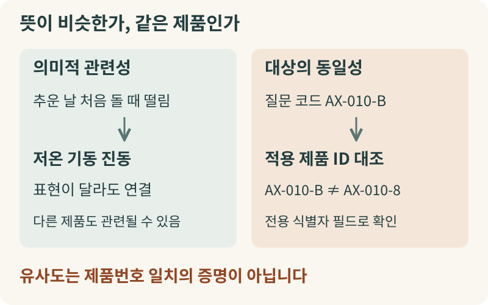
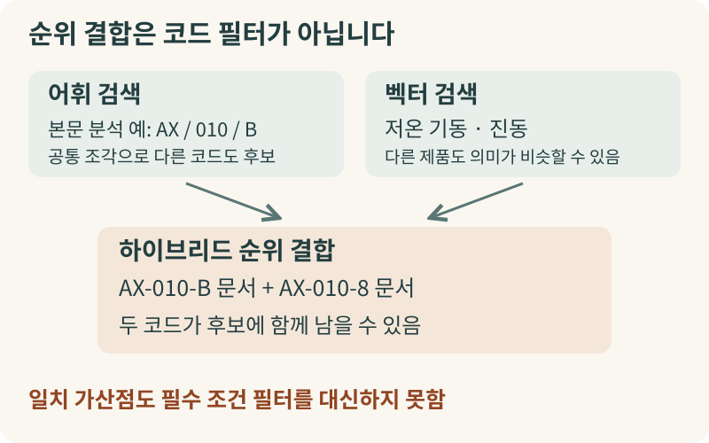
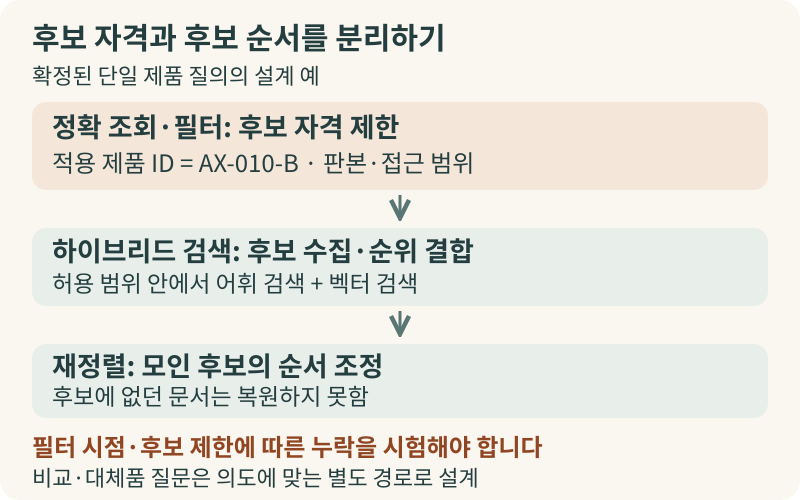

+++
date = '2026-10-17T00:00:00+09:00'
draft = false
title = '사내 검색 AI는 왜 제품번호를 자꾸 틀릴까요?'
description = '비슷한 문서를 찾는 의미 검색과 정확한 제품·계약 코드를 지키는 설계의 차이, 그리고 하이브리드 검색의 올바른 활용법'
tags = ['ax', 'hybrid-search', 'rag', 'enterprise-search']
authors = ['geoff']
slug = 'hybrid-search'
featured_image = 'thumbnail.webp'
images = ['thumbnail.webp']
audio = []
vedios = []
series = []
toc = true
+++

## 들어가며

이해를 돕기 위해 산업용 펌프를 만드는 어느 제조 기업의 가상 상황을 떠올려 보겠습니다. 날씨가 추워진 아침, 현장 정비 엔지니어에게 겨울철 장비를 처음 가동할 때 진동이 심하다는 고객사 문의가 들어왔습니다. 엔지니어는 사내 검색 AI 창을 열고 "`AX-010-B` 모델이 추운 날 처음 돌 때 진동이 심한데, 점검 기준과 볼트 조임 토크 수치를 알려줘"라고 질문했습니다.

사내 검색 AI는 몇 초 만에 저온 기동 시 확인해야 할 밸브 위치와 규정 조임 토크 수치, 보증 조건까지 매끄럽게 정리해 주었습니다. 그런데 답변 아래에 붙은 출처 문서를 열어본 엔지니어는 아찔해졌습니다. AI가 근거로 가져온 자료는 `AX-010-B` 매뉴얼이 아니라 끝자리 한 글자가 다른 `AX-010-8`의 정비 지침서였기 때문입니다.

`AX-010-B`와 `AX-010-8`의 매뉴얼은 목차 구성도 비슷하고 '저온 기동 시 진동 점검'을 설명하는 문장 흐름도 거의 같습니다. 하지만 기업 현장의 제품번호나 부품 코드, 계약서 조항에서는 글자 하나 차이가 전혀 다른 물리적 규격과 책임 범위를 뜻합니다. 다른 제품의 조임 토크 수치와 보증 조건을 그럴듯하게 요약해 주는 답변은 현업 담당자에게 참고 자료가 아니라 작업 오류를 부르는 오답입니다.

공들여 구축한 사내 검색 AI가 제품번호나 계약 코드 앞에서 흔들릴 때는 무엇부터 살펴보아야 할까요? 모델의 성능 문제로만 단정하기 전에, 검색 시스템이 자료를 찾고 거르는 구조도 함께 점검해 볼 필요가 있습니다. 이번 글에서는 사내 검색 AI가 제품번호를 혼동할 때 확인해야 할 검색 설계의 원리와 의사결정 기준을 알아보겠습니다.

## 비슷한 뜻을 찾는 일과 정확한 대상을 지키는 일

사내 AI가 다른 제품의 수치를 답하면 흔히 "더 큰 모델로 바꿔야 하나?"라거나 "벡터 검색 때문인가?"라고 추측하기 쉽습니다. 하지만 실제 운영 환경에서 제품번호 오류가 생기는 원인은 하나가 아닙니다. 원본 문서에서 코드가 제대로 추출되지 않았을 수도 있습니다. 문서와 대상 제품의 매핑이 잘못되었거나 구버전 문서가 섞여 있을 수도 있습니다. 검색기는 올바른 문서를 찾아왔는데 생성 모델이 근거를 잘못 읽었을 가능성도 있죠. 따라서 증상만으로 원인을 단정하지 말고 원천 데이터, 색인 필드, 후보 목록, 최종 답변을 차례로 확인해야 합니다.

이 과정에서 검색 설계상 꼭 구분해야 할 개념이 **'의미적 관련성(Semantic Relevance)'**과 **'대상의 동일성 조건(Exact Identity)'**입니다. 사내 검색에는 "뜻이 비슷한 자료를 찾아라"라는 요구와 "반드시 이 제품의 자료여야 한다"라는 서로 다른 요구가 함께 들어오기 때문입니다.

최근 사내 지식 검색(RAG)에 널리 쓰이는 임베딩 기반 벡터 검색은 질문과 문서의 의미가 얼마나 가까운지를 수치로 비교합니다. 그래서 직원이 "추운 날 펌프가 처음 돌 때 덜덜거린다"라고 물어도 매뉴얼의 "저온 시 기동 진동"이라는 표현을 찾아낼 수 있습니다. 단어가 달라도 증상과 의도를 연결하는 데 강점이 있습니다.

하지만 의미가 비슷하다는 것과 대상 제품이 같다는 것은 별개의 문제입니다. 실제 유사도 점수는 사용하는 임베딩 모델과 입력 문장에 따라 달라집니다. 다만 같은 제품군에서 코드만 다른 두 매뉴얼은 다루는 증상과 문장 구조가 매우 비슷할 수 있습니다. `AX-010-B`와 `AX-010-8` 매뉴얼이 모두 저온 기동 진동과 조임 토크를 설명한다면, 의미 유사도 기준에서는 `AX-010-8` 매뉴얼도 높은 점수를 받아 상위 후보로 올라올 수 있습니다. 유사도 점수는 주제의 관련성을 뜻할 뿐, 질문한 제품번호와 일치한다는 증명이 아닙니다.

대형 설비의 부품 창고를 떠올려 보시죠. 작업자가 "겨울철 펌프 진동을 줄이는 정비 지침"을 찾을 때는 증상과 용도가 비슷한 자료를 폭넓게 찾아주는 담당자(의미 검색)가 유용합니다. 반대로 작업 지시서에 적힌 `AX-010-B` 규격서를 불출할 때는 설명 문구가 비슷한지를 따지기 전에 명판의 품번이 `AX-010-B`와 글자 그대로 일치하는지 대조해 다른 품번을 거르는 검수 절차(정확 식별자 확인)가 필요합니다. 사내 검색에서도 이 두 역할을 나누어 다루어야 합니다.

## 키워드 검색과 하이브리드 검색만으로는 부족한 이유

의미 중심 검색만으로는 제품 코드를 가려내기 어렵다 보니, 많은 조직이 키워드 검색(BM25 등 어휘 검색)과 벡터 검색을 결합한 **'하이브리드 검색(Hybrid Search)'**을 검토합니다. 마이크로소프트의 [Azure AI Search 하이브리드 검색 개요 문서](https://learn.microsoft.com/en-us/azure/search/hybrid-search-overview)에서도 제품 코드나 전문 용어처럼 글자 일치가 중요한 질의에는 키워드 검색이 유용하며 전문(full-text) 검색과 벡터 검색을 병렬로 실행해 결합하면 상호 보완 효과를 얻을 수 있다고 설명합니다.

증상 설명과 제품번호가 함께 들어오는 질문에서 하이브리드 검색은 좋은 출발점입니다. 다만 하이브리드 검색을 켜는 것만으로 제품번호 일치가 보장되지는 않습니다. 여기에는 두 가지 구조적인 이유가 있습니다.

첫째, **일반 본문 키워드 검색은 식별자 전체를 그대로 대조하는 조회와 다릅니다.** 키워드 검색이라고 하면 문자열 전체를 통째로 비교한다고 생각하기 쉽습니다. 그런데 검색 엔진은 일반 본문(`text` 필드)을 처리할 때 설정된 분석기(Analyzer) 규칙에 따라 문장을 단어 조각으로 나누고 구두점을 정리하거나 대소문자를 바꿉니다. Elastic의 [term 질의 공식 문서](https://www.elastic.co/docs/reference/query-languages/query-dsl/query-dsl-term-query)와 [keyword 필드 매핑 문서](https://www.elastic.co/docs/reference/elasticsearch/mapping-reference/keyword)에서 설명하듯, 분석기를 거친 본문 필드는 원문 문자열 전체의 동등성을 검사하는 용도가 아닙니다.

예를 들어 분석기가 하이픈(`-`)을 기준으로 문자열을 나눈다면 `AX-010-B`와 `AX-010-8`은 공통 조각인 `AX`와 `010`을 공유하므로 다른 모델 문서도 어휘 검색 후보에 오를 수 있습니다. 반대로 하이픈과 공백을 무조건 지우거나 숫자 `0`과 알파벳 `O`를 임의로 자동 교정하면 사내 코드 체계의 차이가 지워질 수 있습니다. 품목 코드 `00127`과 `127`이 별개 부품인 회사라면 선행 `0`이 보존되도록 숫자 대신 문자열로 다루어야 합니다. 따라서 제품 ID처럼 동일성이 중요한 값은 일반 본문 필드와 분리해 `keyword` 매핑과 승인된 별칭 규칙을 함께 고려하는 편이 맞습니다.

둘째, **하이브리드 검색의 순위 합산에는 '다른 제품 코드 탈락'이라는 규칙이 없습니다.** 키워드 점수와 벡터 유사도 점수는 척도가 다릅니다. 그래서 검색 엔진은 주로 각 경로의 순위를 조합하는 상호 순위 융합(RRF)이나 정규화 가중합으로 결과를 합칩니다. 이 방식은 두 검색 경로에서 상위권에 오른 문서를 종합해 순위를 매길 뿐입니다. 질문한 제품번호가 아닌 문서를 강제로 제외하지는 않습니다. 키워드 검색이 `AX-010-B` 문서를 상위에 올렸더라도 벡터 검색 상위에 있던 `AX-010-8` 문서가 병합된 후보군에 함께 남을 수 있습니다. 일치하는 코드에 가산점(Boost)을 주더라도 순위를 높일 뿐, 반드시 충족해야 하는 필터를 대신하지는 못합니다.

## 후보를 제한하는 필터와 순서를 다듬는 재정렬

자연어 증상 표현을 유연하게 찾으면서도 제품번호를 지키려면 **'후보 자격을 제한하는 단계(정확 조회·필터)'**와 **'모인 후보의 순서를 매기는 단계(하이브리드 검색·재정렬)'**를 나누어 설계해야 합니다. 질문에서 `AX-010-B`처럼 대상 코드가 확실하다면 전용 식별자 필드로 `AX-010-B` 문서만 후보로 제한한 뒤, 그 안에서 어휘·벡터 검색으로 증상 설명을 찾는 구성을 시험할 수 있습니다. 이때 세 가지 조건을 함께 살펴야 합니다.

- **필터 적용 시점 점검:** 마이크로소프트의 [벡터 검색 필터 문서](https://learn.microsoft.com/en-us/azure/search/vector-search-filters)에서는 필터 적용 시점에 따라 검색 회수율이 달라질 수 있다고 설명합니다. 전체 문서에서 벡터 유사도 상위 몇 개만 좁게 뽑은 뒤 사후 필터(postFilter)로 제품번호를 거르면, 정작 찾아야 할 `AX-010-B` 문서가 초기 순위 밖으로 밀려 누락될 수 있습니다. 탐색 과정에서 조건을 반영하는 사전 필터(preFilter)는 후필터 잘림을 피하는 데 유리하지만 데이터 규모와 선택도에 따라 속도가 달라질 수 있으므로 실제 환경에서 시험해야 합니다.
- **단순 언급과 실제 적용 대상의 구분:** `AX-010-8` 매뉴얼의 비교표에 `AX-010-B`가 적혀 있다고 해서 그 문서를 `AX-010-B` 전용 지침으로 쓰면 안 됩니다. 본문에 코드가 등장하는 것과 실제로 그 제품에 적용되는 문서인지를 구분해야 합니다.
- **질문 의도에 맞는 경로 분리:** 두 모델을 비교하는 질문은 두 식별자를 각각 보존해 제품별로 근거를 모아야 합니다. "`AX-010-B`의 대체품"을 찾는 질문은 해당 코드 문서만 남기면 목적을 달성할 수 없으므로 호환 관계 등 별도 기준이 필요합니다.

여기에 더해 초기 검색 결과를 다시 줄 세우는 **'재정렬(Reranking)'**의 경계도 명확히 알아두어야 합니다. 마이크로소프트의 [시맨틱 랭커(Semantic ranker) 문서](https://learn.microsoft.com/en-us/azure/search/semantic-search-overview)를 보면, 1차 검색(BM25 또는 RRF)의 초기 결과(열람 문서 기준 상위 50개)에 의미 기반 재정렬을 적용합니다. 재정렬은 이미 모인 후보들 사이에서 관련성 높은 문서를 위로 올리는 데 유용합니다. 직전 후보 목록에 정답 문서가 없다면 순서 변경만으로는 빠진 문서를 복원하지 못합니다. 재정렬 역시 의미적 관련성을 보는 단계이므로 제품번호 일치를 강제하는 필터를 대체하지는 못합니다.

## 운영 사례와 도입 전 점검해야 할 기준

실제 기업 환경에서는 하이브리드 검색을 어떤 장치들과 함께 운영할까요? 벡터 데이터베이스 공급사인 Weaviate가 공개한 금융 리서치 플랫폼 [Finster의 운영 사례 보고](https://weaviate.io/case-studies/finster)에서 유용한 설계 시사점을 볼 수 있습니다. 공급사 보고에 따르면 Finster는 투자은행과 리서치 업무에서 의미 검색과 키워드 검색을 결합한 하이브리드 검색을 사용합니다. 문장과 표의 셀(Cell) 단위 출처 인용, 단일·다중 테넌트 데이터 분리 구성도 함께 운영한다고 합니다.

이 자료는 공급사의 고객 사례 보고이며 제품번호 정확도 개선을 직접 측정한 비교 실험은 아닙니다. 다만 숫자와 출처가 민감한 업무에서는 의미적 유사성 탐색에만 의존하지 않고 세밀한 출처 인용과 데이터 경계 분리를 검색 구조와 함께 다룬다는 점을 보여줍니다.

우리 조직의 사내 검색 AI가 제품번호나 계약 조건을 혼동할 때도 다음 네 가지 기준을 중심으로 원인을 점검하고 평가 체계를 세우는 편이 실용적입니다.

1. **검색 로그와 단계별 기록으로 원인 분리하기:** 오류가 났을 때 곧바로 모델을 바꾸거나 특정 설정 하나를 원인으로 단정하지 말고 로그부터 확인해야 합니다. 정답 문서가 검색 후보 목록에 있었는데 생성 단계에서 잘못 인용했는지, 아니면 후보 목록 자체에 없었는지를 먼저 가려냅니다. 후보에 없었다면 원천 문서의 코드 추출 상태, 색인 필드와 분석기 설정, 필터 조건, 경로별 후보 수 제한(k) 중 어디에서 빠졌는지 순서대로 확인해야 합니다.
2. **개정 판본(Version)과 유효 시점 조건 관리하기:** 개정 전후의 매뉴얼이나 계약서는 내용이 비슷해 관련성 순위만으로는 어떤 문서가 적용 대상인지 강제하기 어렵습니다. 무조건 가장 최근에 올라온 파일을 고르는 것도 정답이 아닙니다. 예를 들어 2025년 납품 설비에 당시 적용된 지침을 묻는다면 그 시점에 유효했던 판본을 찾아야 합니다. 문서의 개정 번호, 유효 기간, 상태를 메타데이터로 남기고 답변에 판본과 출처를 함께 표시해야 합니다.
3. **인증된 접근 범위를 모든 검색 경로에 일관되게 적용하기:** 조직별로 열람 가능한 문서가 다르다면 인증된 사용자의 조회 범위를 키워드 검색과 벡터 검색, 재조회 단계에 모두 동일하게 적용해야 합니다. 허용되지 않은 문서는 모델의 입력 문맥에도 들어가지 않게 거르는 것이 안전합니다.
4. **코드 질의와 자연어 질의를 분리한 평가(Evals) 운영하기:** 제품번호 질문과 일반 자연어 질문을 섞어 평균 점수만으로 합격을 정하면 고위험 코드 혼동 오류가 평균 뒤에 가려집니다. 한 글자 차이 코드(`AX-010-B` vs `AX-010-8`), 선행 0이 포함된 코드(`00127` vs `127`), 원천에 없는 가상 코드(추측 대신 근거 없음을 표시해야 통과) 등을 별도 시험 세트로 구성해 후보 포함 여부와 최종 답변의 코드·단위·판본 일치를 따로 점검하시기 바랍니다.

## 나가며

사내 검색 AI가 제품번호나 계약 코드를 틀릴 때, 그 원인은 원천 문서 추출이나 판본 관리에 있을 수도 있고 검색·생성 단계에 있을 수도 있습니다. 그중 검색 설계를 점검할 때는 '비슷한 의미의 자료를 넓게 찾아오는 일'과 '정확히 그 제품·판본의 자료만 가려내는 일'을 하나의 관련성 점수에 뭉뚱그려 맡기지 않는 것이 핵심 원칙입니다.

키워드와 벡터를 결합하는 하이브리드 검색, 그리고 후보 순서를 다듬는 재정렬은 현업의 다양한 자연어 질문을 다루는 데 유용한 도구입니다. 여기에 정확한 식별자·판본 메타데이터 관리와 후보 필터, 코드 질의를 분리해 검증하는 평가 기준이 맞물릴 때 현업 담당자가 안심하고 참고할 수 있는 검색 시스템이 됩니다.

사내 지식 검색이나 AI 에이전트를 운영하면서 제품번호 혼동, 문서 판본 관리, 혹은 현업의 낮은 체감 신뢰도 때문에 고민하고 계신다면 언제든 저희 엡실론델타와 상의해 보시기 바랍니다. 원천 문서와 검색 로그 진단부터 메타데이터·하이브리드 검색 구조 설계, 우리 조직 업무에 맞춘 평가 체계(Evals) 구축까지 현장에 맞는 해결책을 함께 찾겠습니다. 편하게 contact@epsilondelta.ai로 메일 주시면 여러분 조직의 상황에 맞춰 성심껏 도와드리겠습니다.
