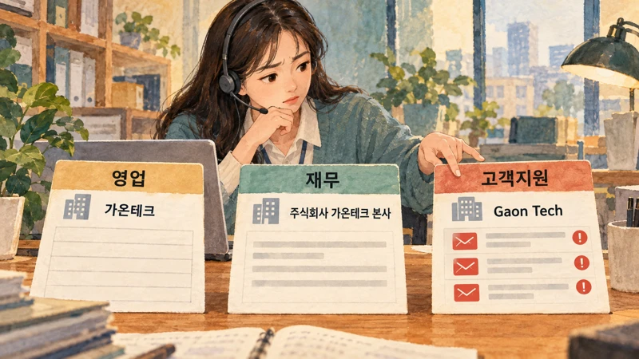
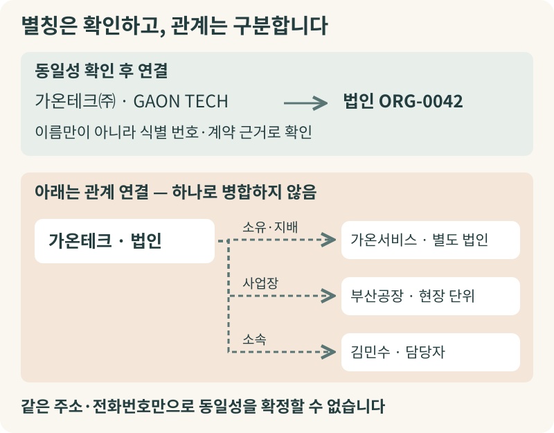
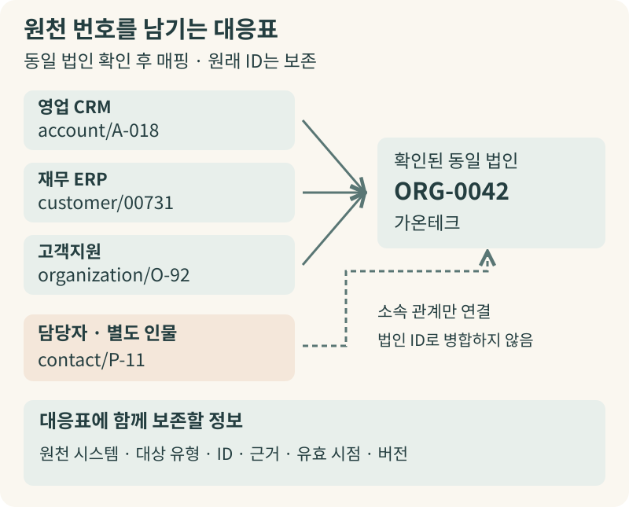
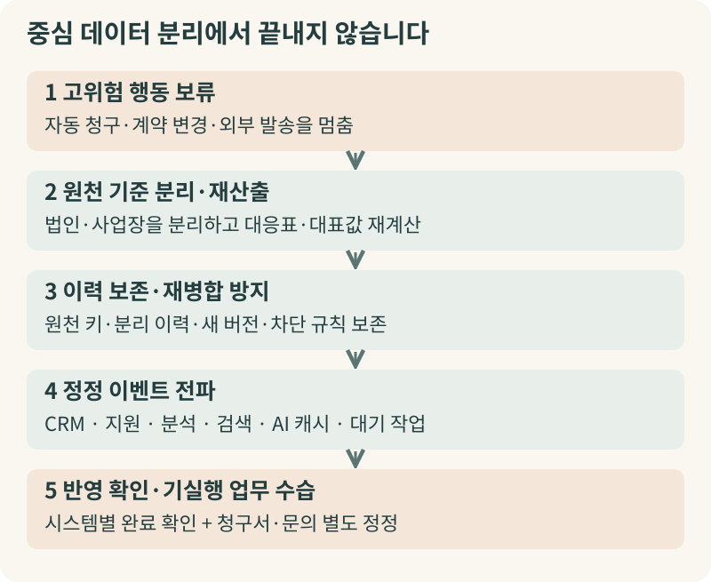

+++
date = '2026-10-18T00:00:00+09:00'
draft = false
title = '같은 고객인데 이름은 셋, 함부로 합치면 사고가 납니다'
description = 'CRM·ERP·고객지원에 흩어진 기록에서 같은 고객과 관계된 조직·사업장·담당자를 구분하고, 원천 ID 보존부터 잘못된 병합의 정정까지 설계하는 방법'
tags = ['ax', 'ai', 'master-data', 'entity-resolution', 'data-governance']
authors = ['geoff']
slug = 'master-data'
audio = []
vedios = []
series = []
toc = true
featured_image = 'thumbnail.webp'
images = ['thumbnail.webp']
+++

## 들어가며

이해를 돕기 위해 **가상의 업무 상황**을 하나 떠올려 보겠습니다.

산업용 장비를 공급하는 한 회사에서 영업과 고객지원을 돕는 사내 AI 에이전트를 도입했습니다. 월요일 아침, 영업 본부장이 주요 고객사인 ‘가온테크’와 재계약 미팅을 앞두고 에이전트에게 묻습니다. “최근 한 달간 가온테크에서 접수된 장애나 불만 문의가 있나요?” 에이전트는 곧바로 “접수된 장애 문의가 없습니다”라고 답합니다. 본부장은 안심하고 미팅에 들어갔지만 현장에서 고객사 임원에게 거센 항의를 받습니다. 일주일 전부터 장비 결함으로 세 차례나 긴급 지원 요청을 넣었는데 어떻게 모를 수가 있느냐는 것이었죠.

원인을 찾아보니 영업팀 CRM에는 고객 이름이 `가온테크`로, 재무팀 ERP에는 `주식회사 가온테크 본사`로, 고객지원 시스템에는 영문 표기인 `Gaon Tech`로 각각 다른 번호를 달고 등록되어 있었습니다. 지원 시스템에 문의를 남긴 김민수 과장의 계정이 CRM의 `가온테크`와 연결되어 있지 않다 보니 에이전트는 CRM의 빈 이력만 보고 문제없다고 답했습니다.

놀란 담당 부서는 주말 동안 이름이 비슷하거나 주소가 같은 거래처 기록을 하나로 합치는 자동 병합 작업을 돌립니다. 그러자 화요일에는 더 큰 사고가 터집니다. `가온테크 본사`로 나가야 할 정기 납품 물량이 출고 정지된 것입니다. 같은 건물을 쓰는 자회사 `가온서비스`의 미수금 연체 기록이 모회사 계정에 합쳐졌고 배송지가 따로 있는 `가온테크 부산공장`의 주문서까지 본사 주소로 덮어써진 탓이었습니다.

여기까지는 설명을 위해 만든 가상 사례입니다. 기업 AX에서는 “AI가 얼마나 자연스럽게 답하느냐”보다 “우리 시스템과 AI가 지금 어느 고객과 사업장, 어느 상품을 보고 행동하는가”를 먼저 확인해야 합니다. 기준정보와 대상 식별 설계 원칙을 짚어보겠습니다. 따로 흩어진 같은 고객은 이어 주고 관계만 있을 뿐 서로 다른 대상은 섞이지 않게 지키는 원칙입니다.

## ‘같은 대상’과 ‘관계가 있는 별개 대상’ 구분하기

기업 시스템에는 주문·입금·문의처럼 시점마다 쌓이는 거래 데이터와 그 거래들이 반복해서 참조하는 고객·사업장·상품 같은 기준정보(Master Data)가 있습니다. 이 기준정보의 생성·변경·품질·책임과 배포 절차를 관리하는 체계가 [기준정보 관리(MDM)](https://www.ibm.com/think/topics/master-data-management)입니다. 데이터를 정리할 때 흔히 ‘중복 레코드 수를 줄이는 것’을 목표로 삼지만 레코드 수를 줄이는 데만 급급하면 같은 대상의 다른 표기(별칭)와 서로 관계가 있는 별개 대상을 뒤섞게 됩니다.

병원 진료 차트를 생각하면 이해하기 쉽습니다. 아버지와 아들이 같은 주소에 살고 성씨와 집 전화번호가 같더라도 병원에서 두 사람을 ‘가족 관계’로 묶어 두는 것과 두 사람의 진료 차트를 한 사람의 파일로 합쳐 버리는 것은 전혀 다릅니다. 주소와 전화번호가 같다는 이유로 차트를 합치면 아버지의 처방전이 아들에게 나가는 사고가 납니다.

기업 데이터에서도 아래 대상들은 합치는 대신 관계를 나누어 다루어야 합니다.

- **같은 법인의 다른 표기:** `가온테크㈜`와 `GAON TECH`는 같은 법인의 별칭 후보일 수 있습니다. 단, 이름만 보지 않고 발급 체계와 적용 범위가 확인된 식별 번호나 계약 정보로 동일성을 검증해야 합니다.
- **모회사와 자회사:** `가온테크`와 자회사 `가온서비스`는 소유·지배 관계로 연결된 별도 법인입니다. 국제 법인 식별 체계인 [GLEIF의 Level 2 데이터](https://www.gleif.org/en/lei-data/access-and-use-lei-data/level-2-data-who-owns-whom)도 ‘누가 누구인가(Level 1)’와 ‘누가 누구를 소유하는가(Level 2)’를 분리합니다. 두 법인을 하나로 합치면 계약 당사자와 채무 귀속이 섞입니다.
- **본사와 지점·사업장:** `가온테크 본사`와 `부산지점`은 같은 법인 소속이라도 배송지, 현장 서비스 범위, 정산 단위가 다를 수 있어 법인 집계와 사업장 실행 단위를 구분해야 합니다.
- **조직과 담당자:** 회사와 구매담당 `김민수 과장`은 소속 관계입니다. 하나로 합치면 담당자가 퇴사하거나 이직할 때 회사의 거래 이력이 개인을 따라갑니다.
- **상품과 포장 단위:** 세정제 한 병 단품과 12개들이 상자는 연결된 상품이지만 재고·출고 단위가 다른 별개 품목입니다.

이름이나 주소, 전화번호가 일치해도 비교 후보를 좁히는 단서일 뿐 같은 대상이라는 증명은 아닙니다. 데이터 모델에는 처음부터 ‘같은 대상(same-as)’ 연결과 ‘소유·소속·사업장 같은 관계(related-to)’ 연결을 따로 두어야 합니다.

한편 AI가 대화에서 이름과 관계를 뽑아 그래프에 저장하면 되지 않느냐는 시각도 있습니다. 그래프는 본사·지점·담당자 관계를 표현하고 탐색하는 데 유용한 방식이지만 점과 선을 긋는 것만으로 원천 번호 보존, 대표 주소 선택, 승인 책임, 오류 정정 절차가 생기지는 않습니다. 반대로 공통 ID를 부여했다고 해서 부서별 지표 정의나 열람 권한까지 자동 통일되는 것도 아닙니다. AI에게 공통 ID를 줄 때는 대상 유형, 확인 상태, 원천 링크, 적용 시점도 함께 넘겨야 합니다.

## 이름을 덮어쓰지 않고 연결하는 다섯 단계 흐름

현업 데이터를 함부로 덮어쓰지 않으면서 대상을 식별하고 관리하는 과정은 **원천 보존 → 후보 생성 → 동일성 판정 → 대표값 선택 → 분리·정정**의 다섯 단계로 설계할 수 있습니다.

### 1. 원천 보존과 대응표(Crosswalk)
CRM의 `account/A-018`, ERP의 `customer/00731`, 지원 시스템의 `organization/O-92`가 같은 법인임을 확인했더라도 각 시스템의 원래 번호를 지우거나 일괄 교체하지 않습니다. 대신 원천 번호들을 공통 ID인 `ORG-0042`에 매핑하는 대응표를 두고 문의자 `contact/P-11`은 소속 인물로 따로 연결합니다. Reltio 문서에서 설명하는 [크로스워크(Crosswalk)](https://docs.reltio.com/en/objectives/model-data/data-modeling-at-a-glance/data-modeling-operation/define-crosswalks-for-data-sources/crosswalks)처럼 `(원천 시스템, 테이블·대상 유형, 원천 ID) → 공통 ID` 구조를 쓰고 판정 상태·근거·유효 시점·버전을 함께 관리하기를 권합니다. 바뀌기 쉬운 이름이나 주소는 공통 ID로 쓰지 않습니다.

영국 법무부의 [Data First 공개 기록](https://www.gov.uk/algorithmic-transparency-records/moj-data-first-splink)도 법원·교정·보호관찰 기록을 이어 줄 때 개별 시스템 ID와 영역별·영역 간 ID를 연결하는 조회표를 유지합니다. 이 데이터는 인가된 연구 전용이며 현장 운영 의사결정에는 쓰지 않습니다. 그런 전제를 감안하더라도 원본 ID를 지우지 않고 연결 표로 관리하는 방식은 기업 설계에서도 참고할 만합니다.

### 2. 정규화와 후보 추리기(Blocking)
비교 전에는 `(주)`와 `주식회사`, 공백, 대소문자 차이를 정리하는 정규화를 거치되 국가코드나 사업장 구분 코드처럼 의미 있는 차이를 지우지 않도록 유의해야 합니다. 이어서 우편번호 앞자리나 정리된 상호 일부가 겹치는 비교 후보만 추립니다. 이렇게 모든 레코드 쌍을 대조하는 대신 후보를 줄이는 과정을 블로킹이라고 합니다. 주소 변경이나 오탈자 때문에 진짜 동일 고객이 후보에서 빠지지 않도록 후보 생성 경로를 여러 개 두되 후보 생성 자체를 동일성 판정으로 취급하지는 않습니다.

### 3. 동일성 판정과 군집 점검
후보 쌍이 실제로 같은 대상인지 판정할 때는 기법별 역할을 나누어 배치합니다. 검증된 식별 번호와 명확한 조건이 있을 때는 설명하기 쉬운 규칙 기반 매칭을 우선합니다. 식별자가 없거나 표기 변형이 있을 때는 일치·불일치 관찰의 가능성을 계산하는 확률적 연결과 머신러닝 모델을 활용합니다. 클라우드 공급사 AWS가 소개한 [United Airlines 사례](https://aws.amazon.com/blogs/industries/how-to-create-a-unified-view-of-your-consumer/)에서도 예약·CRM 등 14개 후방 시스템의 고객 기록을 연결해 여정 맥락을 이어 가기 위해 규칙 기반 ID와 머신러닝 기반 확률적 ID를 함께 사용했습니다.

여기에 LLM은 비정형 문의에서 회사명·모델명 후보를 추출하거나 검토자에게 판단 이유를 읽기 쉽게 요약해 주는 보조 역할로 시험할 수 있습니다. 다만 LLM의 말투나 임베딩 유사도를 보정된 동일성 확률로 간주해서는 안 됩니다. 군집화 단계에서는 연결된 쌍들을 하나의 고객군으로 묶습니다. 이때 A–B와 B–C가 연결되었더라도 A와 C의 핵심 식별 정보가 충돌하면 전체 묶음을 다시 점검해야 합니다. 공용 전화번호 하나 때문에 다른 두 고객군이 합쳐지는 연쇄 오류를 막기 위해서입니다.

### 4. 대표값 선택(Survivorship)과 출처(Provenance)
같은 법인으로 판정한 뒤에도 업무에 쓸 주소를 고르는 일은 별개입니다. Reltio의 [대표값 선택 규칙(Survivorship)](https://docs.reltio.com/en/objectives/resolve-potential-matches/potential-matching-at-a-glance/potential-matching-navigation/design-survivorship-rules) 문서처럼 병합과 속성 선택을 분리해 법적 명칭은 검증된 등록 정보, 청구 주소는 재무·계약 시스템, 최신 연락처는 확인된 CRM 값을 쓰도록 속성별 정책을 정할 수 있습니다. 이때 도로명과 상세 호수처럼 함께 움직여야 하는 주소 조각은 한 원천에서 묶어 가져와야 엉뚱한 주소 조합을 막을 수 있습니다. 또한 선택한 값뿐 아니라 원래 값과 원천 시스템, 수집·유효 시점, 선택 이유(출처 이력)를 함께 보존해야 나중에 판단 근거를 설명하고 되돌릴 수 있습니다.

### 5. 잘못 합친 기록의 분리와 후속 정정
마지막 단계는 운영 중에 발견한 잘못된 병합을 원래 기록으로 떼어내고 연결된 업무 시스템의 데이터를 바로잡는 과정입니다. 이 단계는 자동 연결을 어디까지 허용할지 정하는 위험 기반 정책과 직결됩니다.

## 위험 기반 운영 정책과 잘못된 병합 되돌리기

식별 체계에서는 두 가지 오류가 발생합니다. 별개 고객을 하나로 묶는 오병합(False Merge)은 잘못된 계약·단가 적용이나 타사 정보 노출을 부릅니다. 같은 고객을 따로 남기는 미병합(Missed Merge)은 중복 연락이나 장애 지원 이력 누락을 일으킵니다. 어느 한쪽 비용이 언제나 더 크다고 단정할 수는 없습니다. 청구·여신·권한 부여에서는 오병합의 피해가 크지만 중대 장애 대응이나 설비 안전 점검에서는 이력을 놓치는 미병합의 대가도 크기 때문입니다.

따라서 모든 병합을 무조건 사람이 승인해야 한다는 일률적 금지나, AI는 후보만 제시해야 한다는 단정은 비현실적입니다. 검토 물량이 폭증하면 결국 아무도 근거를 살피지 않고 승인하게 됩니다. 그 대신 업무 위험에 따라 세 구간으로 나누는 운영 설계를 제안합니다.

검증된 정책과 강한 식별 근거를 충족하고 후속 위험이 낮은 구간은 **자동 연결**합니다. 반면 임계값 경계에 있거나 계약·청구처럼 영향이 큰 대상은 자동 행동을 **보류하고 사람 검토**로 넘기며 근거가 부족하면 **미연결**로 둡니다. 앞서 본 영국 법무부의 Data First 역시 단일 기준선 대신 신뢰도 임계값을 여러 개 두고 표본 레코드와 군집을 사람이 검토하며 수작업 라벨에도 불확실성이 있음을 기록합니다. 검토 화면에서는 원천 링크와 충돌 필드를 보여주고 ‘같음 / 관련된 별개 대상 / 다름 / 정보 부족’을 선택하게 합니다. ‘다름’이나 ‘별개 사업장’으로 확인된 건은 다음 자동 실행에서 다시 합쳐지지 않게 예외로 잠가 두어야 합니다.

만약 잘못 합쳐진 기록을 발견했다면 어떻게 되돌려야 할까요? 예를 들어 Reltio 같은 제품은 병합 트리와 기여자 기준의 [분리(Unmerge) API](https://docs.reltio.com/en/developer-resources/entity-management-apis/entity-management-apis-at-a-glance/merge-and-unmerge-entities-api)를 제공합니다. 그러나 중심 시스템에 분리 기능이 있다는 사실만으로 CRM, ERP, AI 검색, 발송 결과가 저절로 복구되지는 않으므로 다음 다섯 단계의 정정 절차를 함께 갖추어야 합니다.

1. **고위험 행동 보류:** 오류가 확인된 공통 ID의 자동 청구·계약 변경·외부 발송을 먼저 멈춥니다.
2. **원천 기준 분리 및 재산출:** 보존된 원천 기여자와 이력을 따라 잘못 합친 기록을 분리하고 대표값과 대응표를 다시 계산합니다.
3. **이력 보존 및 재병합 방지:** 분리 이력과 새 연결 버전을 남기고 과거 원천 키를 보존하며 자동 재병합 차단 규칙을 적용합니다.
4. **연결된 업무 시스템 전파:** CRM·지원 화면·분석 테이블·검색 색인·AI 캐시와 대기 작업에 정정 이벤트를 전달합니다.
5. **반영 확인 및 기실행 업무 수습:** 시스템별 반영 완료를 점검하고 이미 나간 청구서나 잘못 배정된 문의는 별도 정정 대상으로 처리합니다.

## 나가며

기업 AX에서 기준정보 관리의 목표는 모든 시스템의 번호를 하나로 덮어쓰는 것이 아닙니다. 같은 대상의 별칭과 모회사·자회사·사업장·담당자 관계를 명확히 구분하고 원천 ID 대응표와 속성 출처를 보존하며 잘못된 병합을 발견했을 때 연결된 업무 시스템까지 정정할 수 있는 운영 기준을 세우는 일입니다.

처음부터 전사 시스템을 모두 바꾸는 대규모 사업으로 시작할 필요는 없습니다. 한 고객군의 지원 문의와 CRM·ERP 식별 정보만 대상으로 **읽기 전용 비교**부터 시작해 보시기를 권합니다. 상호 변경, 공유 주소, 본사와 지점, 담당자 이직, 병합 후 분리 사례를 표본으로 삼아 오병합·누락 검토와 정정 전파 연습을 먼저 통과한 뒤 실제 쓰기와 에이전트 자동화를 넓혀 가는 편이 안전합니다.

다만 현업의 거래처·사업장 운영 기준을 정리하면서 대응표 설계, 매칭·검토 흐름, AI 에이전트 연동과 정정 전파까지 내부 인력만으로 한꺼번에 구현하기는 쉽지 않습니다. 엡실론델타(EpsilonDelta)는 조직의 데이터 환경과 업무 위험에 맞춰 기준정보 식별 체계와 안전한 AI 에이전트 운영 구조를 함께 설계하고 구현을 돕고 있습니다. 이런 고민이 있으시다면 언제든지 contact@epsilondelta.ai로 편하게 문의해 주세요.
