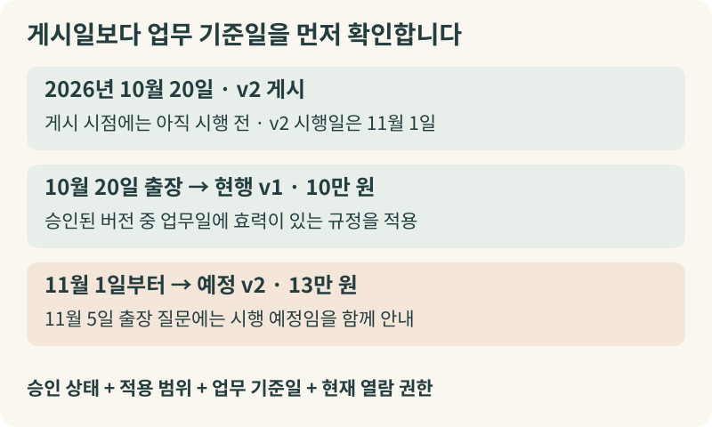
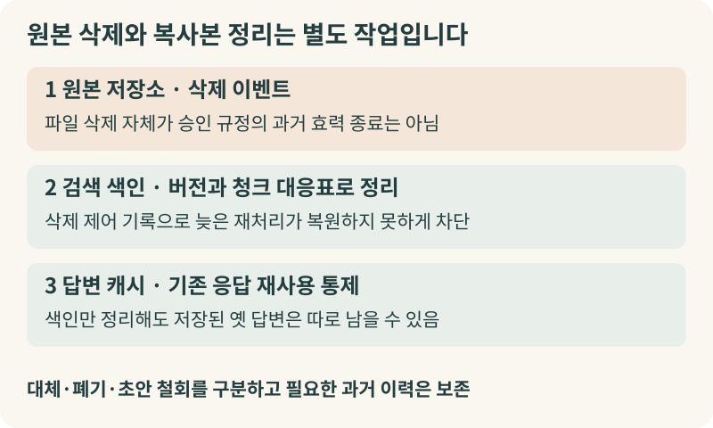
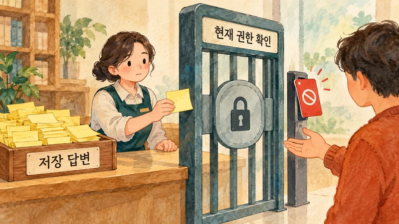
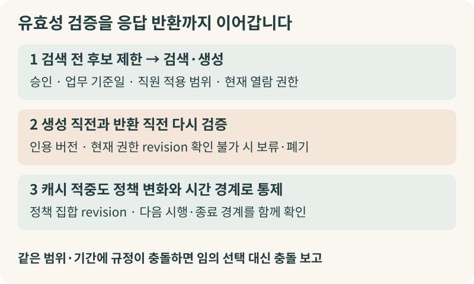

+++
date = '2026-10-20T00:00:00+09:00'
draft = false
title = '정책은 바뀌었는데 우리 회사 AI는 왜 작년 규정을 말할까요'
description = '사내 규정과 정책이 바뀔 때 AI 에이전트가 지금 이 직원에게 유효한 승인 규정을 답하게 만드는 운영 조건과 기술 구조'
tags = ['ax', 'ai', 'policy-freshness', 'rag', 'governance']
authors = ['geoff']
slug = 'policy-freshness'
audio = []
vedios = []
series = []
toc = true
featured_image = 'thumbnail.webp'
images = ['thumbnail.webp']
+++

## 들어가며

### 가상의 사례 : 10월 20일에 물어본 출장비 규정, 세 가지 엉뚱한 대답
이해를 돕기 위해 어느 기업의 하루를 가상으로 그려보겠습니다. 2026년 10월 20일 오전, 인사팀은 국내 출장 숙박비 한도를 10만 원에서 13만 원으로 올리는 '출장여비 규정 개정안(v2)'을 확정해 사내 게시판과 지식 저장소에 올렸습니다. 이 개정안의 시행일은 2026년 11월 1일입니다. 같은 날 오전 인사 담당자는 공유 폴더를 정리하다가 이미 효력이 끝난 구버전 안내문(숙박비 한도 7만 원) 파일을 폴더에서 지웠습니다. 해외 법인장 전용 체재비 지침 초안의 열람 권한에서도 지난주 타 부서로 이동한 직원 C를 제외했습니다.

같은 날 오후, 사내 AI 에이전트에게 세 직원이 차례로 질문을 던집니다.

먼저 10월 20일 당일 지방 출장을 떠나는 직원 A가 '오늘 국내 출장 숙박비 한도가 얼마인가요?'라고 묻자, AI는 오전에 올라온 문서를 근거로 '13만 원입니다'라고 답합니다. 2026년 11월 1일 시행 예정인 규정을 10월 20일 출장에 바로 적용한 것입니다.

옆자리 직원 B가 '국내 출장 숙박비 지원 기준 알려줘'라고 묻자, 이번에는 '7만 원까지 지원됩니다'라는 답이 돌아옵니다. 오전에 폴더에서 지운 구버전 파일의 조각이 검색 색인에 남아 있었거나, 이전에 저장된 답변 캐시가 재사용된 탓입니다.

마지막으로 부서를 옮긴 직원 C가 해외 체재비 기준을 묻자, AI는 방금 권한이 회수된 초안 내용을 요약해 보여줍니다. 원본 문서함에서는 접근이 막혔지만 AI가 참조하는 권한 정보나 저장 답변에는 그 변경이 아직 반영되지 않았기 때문입니다.

### 왜 이런 일이 벌어질까요?
사내 문서를 연결해 답하는 AI를 도입할 때 최신 문서를 잘 찾아오면 충분하다고 생각하기 쉽습니다. 물론 질문 의도에 맞는 조항을 정확히 짚어내고 설명하려면 검색 랭킹과 모델 품질이 중요합니다. 하지만 위 사례에서 AI가 틀린 답을 낸 것은 독해력이 부족해서가 아닙니다. 규정 상담에서 AI가 답해야 할 핵심 질문은 '어느 문서가 최근에 올라왔는가'가 아니라 **'지금 이 직원의 해당 업무일에 효력이 있는 승인 규정은 무엇인가'**이기 때문입니다. 새 문서와 유효한 규정이 왜 다른지, 원본을 고치거나 지워도 왜 시차가 생기는지, 그리고 이를 어떻게 운영해야 하는지 짚어보겠습니다.

## 최신 문서를 찾는 것과 유효한 규정을 적용하는 것은 다릅니다

이 차이를 이해하기 위해 대형 마트의 가격표 운영을 떠올려 보겠습니다. 계산대에서 적용할 가격은 '가장 최근에 인쇄된 전단지'에 적힌 금액이 아닙니다. 본사 상품팀이 승인한 가격 대장(권위 있는 원본)에 등록되어 있고 구매 시점이 행사 기간(유효 기간) 안에 들어오며 해당 매장이나 회원 등급(적용 범위)에 맞는 가격이어야 합니다. 창고에 미리 찍어 둔 다음 달 특가 전단지를 오늘 계산대에서 적용할 수 없습니다. 작년 행사 전단지의 오타를 고쳐 다시 저장했다고 해서 작년 할인이 오늘 부활하지도 않습니다.

### 1. 무엇이 공식 승인본이고 누구에게 적용되는가
사내 저장소에는 정식 결재를 마친 규정뿐 아니라 검토 중인 초안, 설명회 자료, 특정 본부용 시범 지침이 함께 섞여 있습니다. 여기서 어떤 문서가 효력을 갖는지는 조회수나 검색 점수가 아니라 **승인권자의 결재 여부, 운영 소유자, 공식 원본 시스템**에서 결정됩니다.

또한 **문서를 '열람할 수 있는 권한'과 규정이 '나에게 적용되는 범위'는 별개**입니다. 전사 게시판에 올라온 생산직 교대근무 수당 지침을 사무직 직원이 읽을 수는 있지만 본인에게 적용되지는 않습니다. 반대로 부서장이나 인사 담당자는 본인과 소속·직군이 다른 팀원의 적용 규정을 조회해야 할 때도 있습니다.

기업 현장의 인사 AI도 직원 맥락과 정책의 연결을 전제로 합니다. [IBM이 공개한 사내 HR 에이전트 AskHR 사례](https://www.ibm.com/case-studies/ibm-askhr)에 따르면, AskHR은 7,000개의 정책 페이지에 접근해 지역별 HR 정책과 급여에 맞춘 개인화 응답을 제공합니다. 이 사례는 2025년 watsonx Orchestrate 통합도 설명합니다. 다만 공급자이자 운영 기업이 보고한 접근 페이지 수나 개인화 범위 자체는 미래 시행 버전 처리나 삭제·권한 철회 지연까지 증명하는 지표가 아니므로, 시간과 상태에 따른 효력 통제는 별도로 설계해야 합니다.

### 2. 게시일·수정일과 시행일·종료일은 다릅니다
검색 시스템이 파일의 '수정일(modified_at)'이나 '게시일(published_at)'에 가중치를 주면 최신 규정을 찾아올 수 있다고 기대하기 쉽습니다. 그러나 [더블린 코어(Dublin Core) 메타데이터 표준](https://www.dublincore.org/specifications/dublin-core/dcmi-terms/)이 작성일(created), 발행일(issued), 변경일(modified), 유효 기간(valid)을 별개 속성으로 정의하듯, 사내 규정의 날짜도 역할이 서로 다릅니다.

구버전 파일의 오탈자를 고쳐 저장하면 수정일은 오늘이 되지만 규정 효력이 새로 생기지는 않습니다. 반대로 2026년 11월 1일 시행 예정인 출장비 규정(v2)을 10월 20일에 미리 게시하면 게시일은 가장 최신이지만 10월 20일 출장에는 현행 규정(v1)이 유효합니다. 물론 직원이 11월 5일 출장처럼 시행일 이후의 미래 업무 기준일을 지정해 묻거나 11월부터 달라지는 내용을 묻는다면 v2를 후보로 설명할 수 있습니다. 이때는 신청일·출장일·정산일 중 무엇이 적용 기준인지 규정 조항을 확인하고 해당 버전이 11월 1일부터 시행되는 예정 규정임을 함께 표시해야 합니다.

### 3. 과거 시점 질문에는 두 개의 시계가 필요합니다
정산이나 감사에서는 '지난 9월 25일 출장에 적용된 규정은 무엇인가'처럼 과거 시점을 기준으로 묻기도 합니다. 이를 처리하려면 질문의 업무 기준일이 시행일과 종료일 사이에 들어오는 버전을 찾아야 합니다. 만약 10월에 소급 정정이 등록되었다면 '업무상 적용 기간(effective_from ~ effective_to)'과 '시스템이 그 사실을 기록한 시각(recorded_at)'을 함께 보존해야 당시 적용 규정과 그날 시스템이 알고 있던 규정을 구분해 재현할 수 있습니다.

## 원본 파일을 지웠는데 왜 AI는 계속 옛날 답을 할까요?

공유 폴더에서 옛날 파일을 지웠는데도 AI가 계속 그 내용을 답하는 이유는 무엇일까요? 원본 저장소의 상태 변화와 검색 시스템의 반영 경로가 분리되어 있기 때문입니다.

### 대체, 폐기, 원본 삭제는 의미가 서로 다릅니다
- **대체(Supersede)** : 새 버전이 특정 시점부터 이전 버전의 효력을 이어받는 것입니다. 이전 버전을 물리적으로 파기하면 과거 기준일 정산이나 감사를 처리할 수 없으므로, 종료일과 대체 관계를 기록해 보존합니다.
- **폐기(Repeal)** : 후속 버전 없이 제도의 효력 종료가 공식 승인된 상태입니다. 색인에서 흔적만 지우면 AI가 유사 문서를 잘못 끌어올 수 있으므로, 언제 폐지되었는지 상태를 남겨 안내해야 합니다.
- **원본 삭제와 잘못 게시된 초안의 철회** : 저장소에서 파일 객체가 지워졌다는 사실만으로 과거에 승인되었던 규정의 효력이 자동 소멸하는 것은 아닙니다. 적법한 과거 이력이나 감사 조회는 별도 권한과 절차로 관리하되, 승인받지 않은 초안이 실수로 게시되었다가 삭제·철회된 경우에는 공식 규정 안내 후보에서 제외해야 합니다.

### 원본 삭제가 곧바로 검색 색인의 소멸을 뜻하지 않습니다
검색 기반 시스템은 보통 원본 문서를 몇 문단씩 나눈 '청크(조각)'와 임베딩으로 변환해 별도의 검색 색인이나 벡터 저장소에 복사해 둡니다. 따라서 원본 파일을 지우는 동작과 검색 저장소의 복사본을 지우는 동작은 별개입니다.

[OpenAI의 Retrieval 기술 문서](https://developers.openai.com/api/docs/guides/retrieval)는 파일 추가 작업 일부가 비동기로 처리되며 벡터 스토어에서 파일을 제거하더라도 최종 일관성(eventual consistency)에 따라 짧은 시간 동안 검색 결과에 남을 수 있다고 설명합니다. 삭제 호출이 성공했더라도 그 즉시 검색 결과에서 사라진다고 단정할 수 없습니다.

클라우드 검색 색인기의 설정 조건도 살펴봐야 합니다. [Microsoft의 Azure AI Search 변경 및 삭제 감지 문서](https://learn.microsoft.com/en-us/azure/search/search-how-to-index-azure-blob-changed-deleted)를 보면, Azure Storage 인덱서는 원본 수정은 타임스탬프로 자동 감지하지만 삭제는 자동 추적하지 않습니다. 최초 색인 실행부터 삭제 감지 정책을 설정해야 하며 소프트 삭제 보존 기간 안에 인덱서가 처리해야 색인 문서가 지워집니다. 또한 해당 문서에 명시된 one-to-many 색인에서는 두 소프트 삭제 방식이 적용되지 않아 별도의 색인 삭제 요청이 필요합니다.

사내 시스템을 연결하는 커넥터 역시 원본 변경과 검색 반영 사이에 시차가 있습니다. [Glean의 커넥터 갱신 주기 문서](https://docs.glean.com/connectors/crawling-refresh-rates)는 이벤트 알림이 즉각적인 검색 노출을 보장하지 않으며 콘텐츠와 그룹·권한, 색인 처리 일정이 다를 수 있음을 안내합니다.

## '캐시'와 '권한 회수'에서 벌어지는 보이지 않는 시차

원본과 검색 색인을 갱신했는데도 옛날 답이 나온다면, 검색 이후 단계인 **캐시(Cache)**와 **권한 전파 경로**를 점검해야 합니다.

### 프롬프트 캐시와 답변 캐시는 역할이 다릅니다
마트 안내데스크에 비유해 보겠습니다. 안내 직원이 인사말과 계산 절차만 미리 준비해 두고 손님이 물으면 그때그때 가져온 가격표를 보고 답을 새로 만든다면 **제공자 프롬프트 캐시(Prompt Cache)**에 가깝습니다. [OpenAI의 프롬프트 캐싱 가이드](https://developers.openai.com/api/docs/guides/prompt-caching)가 설명하듯, 프롬프트 캐시는 변하지 않은 프롬프트 앞부분의 계산 상태만 재사용하며 응답은 매번 새로 생성합니다. 그러니 프롬프트 캐시를 비운다고 해서 옛 규정 답변이 해결되지는 않습니다. 애플리케이션이 오래된 문서를 다시 입력하면 새 계산으로도 낡은 답이 나옵니다. 반대로 새 문서를 넣더라도 모델이 조항을 오해할 가능성은 별도로 관리해야 합니다.

반면 안내 직원이 한 시간 전에 다른 손님에게 답했던 문장을 포스트잇에 적어두고 비슷한 질문을 하는 다음 손님에게 그대로 읽어준다면 이는 **답변 캐시 또는 시맨틱 캐시(Semantic Cache)**입니다. [Azure API Management의 시맨틱 캐시 조회 정책 문서](https://learn.microsoft.com/en-us/azure/api-management/llm-semantic-cache-lookup-policy)는 이전 프롬프트와의 벡터 근접도로 저장된 응답을 반환하므로 부정확하거나 오래되었거나 안전하지 않은 응답을 낼 수 있다고 경고합니다. 같은 문서는 vary-by 설정으로 사용자나 그룹 구획을 분리하라고 안내합니다. 규정이 바뀐 직후 시맨틱 캐시가 이전 답변을 그대로 돌려주면 검색 색인이 최신이어도 사용자는 옛날 답을 받게 됩니다.

### 권한 회수와 과거 조회에서도 현재 권한 검증이 우선입니다
특정 규정 초안이나 대외비 지침에서 직원의 열람 권한을 회수했을 때도 마찬가지입니다. 원본 문서함에서 권한을 뺐더라도 사용자 세션, 그룹 소속 동기화, 검색 색인의 접근 제어 목록(ACL), 그리고 답변 캐시가 서로 다른 주기로 갱신되면 AI 응답에 이전 내용이 남을 수 있습니다.

정산이나 감사를 위해 과거 시점의 규정을 조회하더라도 열람 권한은 **지금 조회하는 사람의 현재 권한**을 기준으로 확인해야 합니다. 과거에 그 부서에 속해 문서를 읽을 수 있었다는 이유로 지금 철회된 자료를 일반 답변에 노출해서는 안 됩니다.

## 규정 변경이 AI 답변까지 안전하게 닿게 하는 운영 설계

규정이 바뀌고 대체되고 삭제될 때 AI가 유효한 승인 규정을 답하게 만들려면 다음 네 가지 운영 장치를 갖춰야 합니다.

### 1. 검색 전 '유효성 필터'와 충돌 보고
AI 모델이 본문 속 자연어 문장만 읽고 시행일을 추론하게 두는 대신, 규정 등록 단계부터 식별자, 버전, 승인 상태, 시행일과 종료일, 적용 범위, 대체 관계, 권한 revision을 메타데이터로 기록합니다. 질문이 들어오면 상위 몇 개 후보만 뽑은 뒤 걸러내는 방식이 아니라, **검색 전에 먼저 승인 상태, 업무 기준일(시행일 이상, 종료일 미만), 직원 적용 속성, 현재 열람 권한을 강제 필터로 제한**하고 그 안에서 검색 랭킹과 모델 추론을 수행합니다. 만약 동일 범위와 기간에 충돌하는 두 문서가 함께 검색되면 모델이 임의로 하나를 고르지 않고 충돌 사실을 보고하게 합니다.

### 2. 삭제 제어 기록(Tombstone)과 반환 직전 재검증·캐시 통제
원본 버전과 검색 청크 ID의 대응표를 유지하고 삭제·철회 시에는 대상 버전과 이벤트 순서를 담은 제어 기록(tombstone)을 남겨 늦게 도착한 재처리 이벤트가 지워진 내용을 되살리지 못하게 막습니다.

답변 캐시와 권한 통제는 반환 직전까지 이어져야 합니다. 생성 직전과 응답 반환 직전에 인용 버전과 사용자의 현재 권한 revision을 다시 확인하고 생성 도중 권한이 철회되었거나 중앙에서 현재 권한·유효 상태를 확인할 수 없다면 캐시된 답변을 제공하지 않고 응답을 보류·폐기해야 합니다. 또한 답변 캐시를 쓸 때는 기존 인용 문서의 변경만 추적해서는 부족합니다. **새로 추가된 예외 규정**은 과거 답변의 인용 목록에 들어 있지 않기 때문입니다. 따라서 해당 적용 범위의 정책 집합 revision과 다음 시행·종료 경계 시각까지 캐시 적중 조건에 포함해, 경계를 넘거나 예외 규정이 신설되면 재계산하도록 설계해야 합니다.

### 3. 답변의 근거 표시와 내부 추적 기록
사용자에게는 적용 기준일, 해당 범위, 규정 제목·버전·조항, 시행일, 원본 링크를 답변에 함께 제시해 어느 기준의 안내인지 확인할 수 있게 합니다. 내부 로그에는 검색 후보와 제외 사유, 원본 해시, 직원 속성 기준 시각, 권한 판정 revision, 캐시 적중 여부를 남겨 사후에 추적할 수 있게 합니다.

### 4. 위험도에 맞는 허용 지연 합의와 사전 점검 시나리오
벤더 문서의 일반 설명만으로 자사 환경의 반영 시간을 단정할 수는 없습니다. 규정의 위험도에 맞는 허용 지연 시간을 내부에서 합의하고 도입 전이나 규정 개편 시 다음 시험 시나리오에 따라 직접 측정해 보시길 권합니다.

- **시행일 개정 및 미래 시행 분리** : 오늘 시행된 개정안(v2)이 즉시 인용되는지, 다음 달 시행 예정안(v3)은 오늘 기준 질문에서 배제되고 미래 기준 질문에서만 예정본으로 안내되는지 점검합니다.
- **과거 기준일 및 폐기·초안 철회** : 과거 날짜 질문에 당시 시행 버전으로 답하는지, 폐지된 제도와 철회된 초안이 각각 정해진 방식대로 처리되며 색인에 고아 청크가 남지 않는지 확인합니다.
- **캐시 무효화 및 권한 회수** : 개정 직전 캐시된 질문을 개정 후 다시 물었을 때 새 답이 나오는지, 열람 권한을 회수한 직원이나 권한 없는 다른 직원의 유사 질문에 이전 답변이 노출되지 않는지 측정합니다.

## 나가며

사내 AI 에이전트가 실제 업무의 의사결정과 규정 확인에 쓰이기 시작하면, 직원은 단순 문서 요약이 아니라 회사가 오늘 내 업무에 공식 적용하는 기준을 기대합니다. 결국 규정 상담 AI의 신뢰성은 공식 원본의 승인·시행일 관리부터 검색 전 유효성 필터링, 색인 청크 정리, 답변 캐시 통제, 그리고 반환 직전의 권한 재검증까지를 하나의 운영 흐름으로 연결하는 데 달려 있습니다.

우리 조직의 AI 에이전트가 지금 이 직원에게 유효한 승인 규정으로 답하고 있는지 점검하고 싶으시다면, 혹은 규정 개정과 권한 변경이 답변까지 안전하게 반영되는 엔터프라이즈 AI 운영 구조를 설계하고 싶으시다면 엡실론델타와 상의해 보시기 바랍니다. 규정 거버넌스와 AI 검색·캐시·권한 엔지니어링을 아우르는 실무 해법으로 여러분의 AX 운영을 돕겠습니다. 언제든지 contact@epsilondelta.ai로 편하게 메일 주시면 함께 고민하겠습니다.