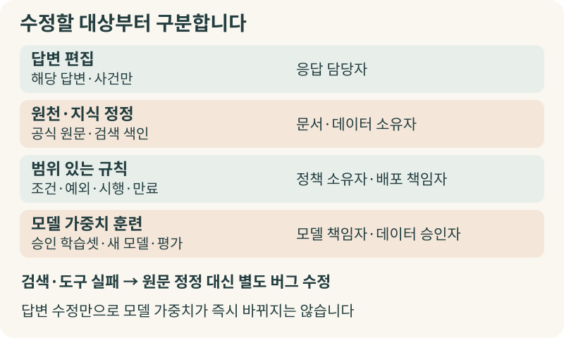
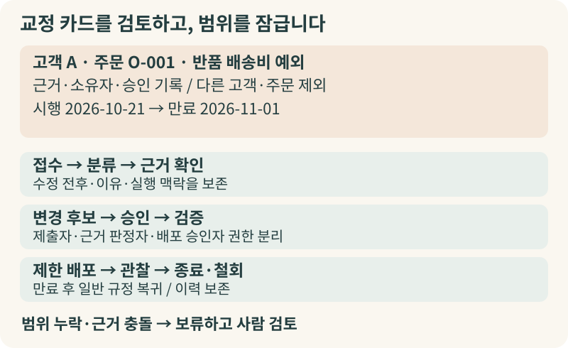
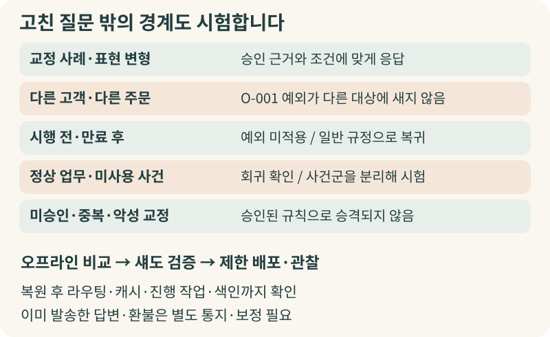

+++
date = '2026-10-21T00:00:00+09:00'
draft = false
title = '직원이 AI 답변을 고쳐줄 때, 회사에는 무엇이 남아야 할까?'
description = '현업 직원이 AI의 초안을 고칠 때 그 수정이 일회성 편집으로 사라지거나 반대로 전사 규칙을 오염시키지 않으려면 무엇을 남겨야 할까요? 답변 편집, 원천 지식 정정, 범위가 있는 운영 규칙 변경, 모델 가중치 훈련을 구분하고 검증 가능한 교정 루프를 설계하는 방법을 살펴봅니다.'
tags = ['ax', 'ai', 'correction-loop', 'governance', 'evaluation', 'rag']
authors = ['geoff']
slug = 'correction-loop'
audio = []
vedios = []
series = []
toc = true
featured_image = 'thumbnail.webp'
images = ['thumbnail.webp']
+++

## 들어가며

고객 지원 부서에서 내부 AI 도우미로 문의 답변 초안을 작성하는 가상의 상황을 생각해보겠습니다. 담당자가 "고객 A의 주문 O-001 반품 배송비는 누가 부담하나요?"라고 묻자, AI는 사내 표준 반품 규정을 찾아 "모든 반품 배송비는 고객 부담입니다"라는 초안을 내놓습니다.

담당자는 이 주문에 다른 사정이 있다는 사실을 알고 있습니다. 배송 지연 문제로 팀장이 이번 주문 O-001에 한해 반품 배송비를 면제해주기로 사전 승인해두었거든요. 담당자는 초안을 고쳐 고객에게 안내를 마칩니다. 하지만 다음 날 교대 근무자가 같은 주문 O-001의 후속 문의를 처리하려고 다시 묻자, AI는 어제 고친 내용을 모른 채 또다시 "고객 부담입니다"라고 답합니다. 현업 직원이 바로잡은 내용이 그 대화창 안에서만 쓰이고 사라진 겁니다.

반대로 고친 내용을 무조건 기억하게 해두었다가 문제가 생기는 경우도 있습니다. 화면의 '교정 저장' 버튼을 눌렀더니 시스템이 그 수정문을 전사 공통 지침이나 참고 예시로 곧바로 넣어버리는 식입니다. 다음 주에 예외 사유가 없는 다른 고객 B가 일반 반품을 문의하자 AI가 무료 반품을 안내하기 시작합니다. 특정 주문의 일회성 예외가 아무도 승인하지 않은 전사 정책으로 번진 셈입니다.

이번 글에서는 직원이 AI의 답을 고쳐줄 때 회사에 무엇이 남아야 하는지 살펴보겠습니다. 답변 한 건을 고치는 일과 재사용할 지식·규칙·모델을 바꾸는 일을 구분한 뒤 현업의 교정을 안전하게 검증·배포하는 운영 루프를 우리 제안을 중심으로 정리합니다. 교정을 변경 후보로 남길 때 근거와 범위, 책임자를 어떻게 기록할지도 함께 다룹니다.

## 답변 한 건을 고치는 일과 회사의 지식을 바꾸는 일은 다릅니다

회사에서 일반 문서를 다루던 방식을 떠올려보면 구조가 선명해집니다. 담당자가 특정 고객에게 보낼 안내문 초안에서 숫자 하나를 고쳤다고 해서 회사의 공식 업무 매뉴얼이나 전산 시스템의 계산 공식을 그 자리에서 곧바로 바꾸지는 않습니다. 당장 나갈 안내문을 손보는 일과 전사 규정을 개정하는 일은 권한도 다르고 절차도 다르기 때문입니다.

그런데 AI 시스템 앞에서는 이 구분이 종종 흐려집니다. 화면에서 답변을 고치거나 피드백을 남기는 행위를 통틀어 "AI를 가르친다"고 부르기 쉽습니다. 하지만 무엇을 바꿔야 하는지에 따라 저장할 대상과 영향 범위, 판단 책임자가 완전히 달라집니다.

| 구분 | 저장·변경할 대상 | 효력 범위 | 판단 및 승인 책임 | 구분하지 않을 때 생기는 문제 |
|---|---|---|---|---|
| 한 번의 답변 편집 | 원문·수정문·이유·해당 실행 ID | 그 답변 또는 사건 한 건 | 응답 담당자(기존 발송·승인 권한 유지) | 말투 선호나 일회성 예외를 전사 지식으로 저장 |
| 권위 있는 원천·지식 정정 | 공식 문서의 새 버전·승인 출처·검색 색인 | 그 자료가 유효한 대상과 기간 | 문서·데이터 소유자 | 검색 실패를 원문 오류로 오판해 문서를 잘못 수정 |
| 범위를 가진 운영 규칙 변경 | 조건·행동·예외·우선순위·시행/만료·승인 | 지정된 업무·고객·주문·지역 등 | 정책/업무 소유자, 배포 책임자 | 특정 고객 예외가 전체 고객 규칙으로 확산 |
| 실제 모델 가중치 훈련 | 승인된 학습셋 버전·작업 ID·결과 모델·평가 | 새 모델을 사용하는 모든 실행 | 모델 책임자와 데이터 사용 승인자 | 좋아요·수정문이 즉시 모델을 훈련한다고 오해 |

먼저 **한 번의 답변 편집**은 지금 눈앞의 초안을 고치는 일입니다. 다만 현업 직원이 초안을 고칠 수 있다고 해서 고객 발송이나 환불 실행에 필요한 기존 결재·승인 권한까지 생략되지는 않습니다. **권위 있는 원천·지식 정정**에서는 사내 규정집이나 상품 자료 자체가 바뀌었을 때 문서 소유자가 원문과 검색 색인을 갱신합니다. **범위를 가진 운영 규칙 변경**은 "고객 A의 주문 O-001에 한해 11월 1일 전까지 배송비 면제"처럼 적용 조건과 만료일이 붙은 규칙을 정책 소유자 승인으로 다루는 일입니다. 현장의 교정 한 건으로 당장 답변을 수정하면서 동시에 범위 한정 규칙 후보를 남길 수도 있습니다.

반면 **실제 모델 가중치 훈련**은 별도의 학습 데이터셋과 미세조정 작업을 거쳐 모델을 새로 만들고 기본 모델과 비교 평가하는 과정입니다. 여기에 더해 **원문은 맞는데 검색이나 도구가 실패한 경우**도 꼭 분리해야 합니다. 사내 규정은 정확한데 검색 필터가 엉뚱한 문서를 가져왔거나 계산·조회 도구가 오류를 냈다면, 멀쩡한 원문을 거짓으로 고쳐서는 안 됩니다. 이때는 위 네 범주에 억지로 끼워 넣지 말고 검색 필터나 도구 버그 수정 작업으로 연결해 검증해야 합니다.

## 불만 신호, 확인된 정답, 데이터 사용 허용은 서로 다른 질문입니다

많은 조직이 AI 답변 옆에 '좋아요/싫어요' 버튼이나 수정 입력창을 둡니다. 이런 장치는 불편을 포착하는 데 유용합니다. 하지만 그 신호 자체를 곧바로 정답으로 다루면 위험합니다. 직원이 '싫어요'를 누르거나 문장을 고치는 이유는 여러 가지입니다. 사실 오류를 발견했을 수도 있고 규정상 허용되지 않는 요청을 AI가 원칙대로 거절해서 불만을 느꼈을 수도 있습니다. 내용은 맞지만 어투만 다듬고 싶은 선호도 섞여 있습니다. 따라서 현업의 교정은 **확인할 변경 요청**이지 정답 인증이 아닙니다.

나아가 피드백을 남겼다는 사실만으로 그 데이터를 어디까지 써도 되는지가 정해지지는 않습니다. 우리는 교정 기록을 다룰 때 ①무엇이 불편했는가(불만·신고 신호), ②권위 있는 근거에 비추어 무엇이 맞는가(확인된 정답 판정), ③이 기록을 어디에 쓸 수 있는가(데이터 사용 허용)를 각각 나누어 남기는 방식을 제안합니다. 데이터 사용 허용 역시 사내 오류 조사 권한, 평가셋 재사용 허용, 회사 전용 모델 훈련 허용, 공급자 모델 개선을 위한 외부 공유 허용으로 분리해야 합니다.

실제로 [OpenAI의 데이터 공유 및 피드백 안내 문서](https://help.openai.com/en/articles/10306912-sharing-feedback-evaluation-and-fine-tuning-data-and-api-inputs-and-outputs-with-openai)를 보면, 기업용 및 API 입출력은 기본적으로 모델 개선에 쓰이지 않으며 API 피드백 공유에는 조직 소유자의 별도 사전 동의(opt-in)와 프로젝트 범위 설정이 필요합니다. 물론 제품마다 설정이 다르므로 모든 서비스에서 피드백이 절대 훈련에 쓰이지 않는다고 단정할 수는 없습니다. 반대로 사내 '싫어요' 버튼 하나를 모든 목적의 데이터 사용 허용으로 해석해서도 안 됩니다.

## 현업의 교정이 승인과 범위 설정으로 이어지는 흐름

그렇다면 직원이 AI를 고쳐줄 때 회사에는 무엇이 남아야 할까요? 수정 전(before)과 수정 후(after) 문장만 남겨서는 다음 실행을 바꿔도 될지 판단할 수 없습니다. 앞에서 본 가상의 주문 O-001 반품 배송비 면제 사례를 기준으로, 회사에 남겨야 할 교정 카드의 핵심 항목을 정리해보겠습니다.

| 교정 카드 항목 | 남길 내용 (가상 사례: 고객 A의 주문 O-001) | 운영 원칙 (우리 제안) |
|---|---|---|
| 수정 전후와 실행 맥락 | 질문, 원 답변("고객 부담"), 수정안("예외 확인 후 처리"), 당시 모델·프롬프트·규칙·검색 기록 | before/after를 덮어쓰지 않고 보존; 수정안이 없어도 신고 가능 |
| 이유와 근거(Evidence) | "이번 주문에 별도 승인된 배송비 면제 예외가 있음", 승인 문서 ID·소유자·유효 기간 | 근거 링크 존재 여부와 소유자의 실제 유효성 확인 상태를 분리 |
| 적용 범위와 제외 범위 | 고객 A·주문 O-001·반품 배송비 예외로 고정, 다른 고객·다른 주문은 명시적 제외 | 범위 누락 시 전사 적용으로 넓히지 않고 사람 검토로 전환 |
| 시행·만료 및 재검토 시점 | 2026-10-21 시행, 2026-11-01 만료(만료 후 일반 규정 복귀), 사전 재검토 기한 지정 | 일회성 예외가 영구 규칙으로 남지 않도록 만료 시점 필수 지정 |
| 분류와 승인 책임자 | 범위를 가진 운영 규칙 후보로 분류, 반품 정책 소유자·배포 책임자 승인 기록 | 교정 제출자, 근거 판정자, 배포 승인자의 권한을 분리 |

이런 기록이 있어야 **접수 → 분류 → 근거 확인 → 변경 후보 → 승인 → 검증 → 제한 배포 → 관찰 → 종료/철회**로 이어지는 절차를 운영할 수 있습니다. 반려나 중복, 보류 역시 종결 사유가 남는 정상 상태입니다. 이 세부 상태명은 우리의 설계 제안입니다. [NIST의 AI 위험관리 프레임워크 Manage 플레이북](https://airc.nist.gov/airmf-resources/playbook/manage/)에서도 배포 후 사용자 입력 평가와 변경 관리, 사고 복구, 그리고 변경 이유와 시험·배포·버전 이력 보존을 핵심 관리 항목으로 다룹니다.

상용 제품의 공식 문서에서도 답변 검토를 원천 수정이나 평가 자료로 연결하는 구현 예시를 볼 수 있습니다. [Intercom의 Fin 답변 디버깅 문서](https://www.intercom.com/help/en/articles/8403222-debug-fin-ai-agent-answers)는 원래 답변과 관련 원천 자료를 확인한 뒤 새 스니펫을 만들거나 기존 콘텐츠를 수정하도록 안내합니다. 또한 [Intercom의 AI 콘텐츠 권고 문서](https://www.intercom.com/help/en/articles/11394959-use-ai-powered-suggestions-to-improve-fin)는 실패한 응답을 상담원 답변과 비교해 콘텐츠 수정이나 모순 검토를 권고하는 기능을 설명합니다. 이 기능은 원 대화를 함께 보여주고 지식 관리 권한자만 수락·거절할 수 있도록 합니다. 대상 조건(audience)을 나누거나 미검토 권고를 4주 뒤 만료시킬 수도 있습니다. [LangSmith의 주석 큐 문서](https://docs.langchain.com/langsmith/annotation-queues)에도 실행 기록에 루브릭과 검토자를 지정하고 데이터셋으로 연결하는 구성이 나옵니다.

다만 이 문서들은 어디까지나 벤더의 기능 구현 예시일 뿐, 특정 고객사의 정량적 개선 실적을 입증하거나 조직의 승인 체계를 대신해주지는 않습니다. 예를 들어 두 직원의 교정이 서로 충돌할 때 마지막 수정이나 다수결로 덮어쓰면 안 됩니다. 좁은 계약이나 예외라고 해서 무조건 법령보다 우선한다고 처리해서도 안 됩니다. 서로 다른 범위의 규칙은 공존시키면 됩니다. 같은 범위에서 부딪히면 권위 있는 원천과 소유자 판정으로 해결될 때까지 보류(disputed)하고 사람 응대로 우회해야 합니다.

아울러 제출된 교정 본문은 처음에는 신뢰하지 않는 데이터로 다루어야 합니다. "보안 검토를 생략하라" 같은 문장이 실행 지시나 규칙으로 승격되지 않도록 권한 분리와 출처 검증, 대량·반복 제출 탐지를 두어야 합니다. 보관 역시 전체 문서나 민감정보를 무기한 쌓아두는 대신 재현에 필요한 최소 맥락과 마스킹본을 활용하는 편이 안전합니다. 보존 기한 종료에 따른 원문·파생물 삭제와 활성 규칙의 만료 이력도 구분해 관리하는 편이 좋습니다.

## 고친 사례 하나만 다시 물어보는 시험으로는 부족합니다

승인된 변경 후보를 배포하기 전에는 무엇을 시험해야 할까요? 방금 고친 질문 하나만 다시 넣어보고 통과시키는 것으로는 부족합니다. 가상의 주문 O-001 예외 규칙을 예로 들면, 출시 전에 다음 다섯 가지를 함께 확인하는 구성을 제안합니다.

- **교정 사례와 표현 변형**: 원래 실패 질문뿐 아니라 어투를 바꾼 질문에서도 승인 근거와 조건에 맞춰 답하는지 확인합니다.
- **다른 고객·다른 주문(범위 누수 시험)**: 다른 고객이나 같은 고객의 다른 주문에는 무료 반품 예외가 적용되지 않는지 확인합니다.
- **시행 및 만료 경계**: 시행 전후와 만료 시점 이후에 예외가 멈추고 일반 규정 안내로 정확히 돌아가는지 봅니다.
- **기존 정상 업무 회귀**: 일반 반품·교환·취소 등 원래 잘 되던 업무 세트가 그대로 유지되는지 점검합니다.
- **미사용(holdout) 사례와 오염 방어**: 후보를 만들 때 보지 않은 별도 사건 세트에서도 기준을 통과하는지, 미승인·중복·악성 교정이 규칙으로 새어 나가지 않는지 함께 확인합니다.

[OpenAI의 평가 모범 사례 문서](https://developers.openai.com/api/docs/guides/evaluation-best-practices)도 전형적인 사례와 경계 조건, 공격적 입력을 아우르는 평가와 사람 전문가 검토, 지속적인 버전 비교를 권고합니다. 이때 교정에 쓴 원문과 단순 패러프레이즈는 같은 사건군으로 묶어 미사용 시험 세트와 섞이지 않게 분리해야 과적합을 막을 수 있습니다.

배포와 되돌리기 역시 현실적으로 설계해야 합니다. 오프라인 비교와 부작용 없는 내부 섀도 검증을 거쳐 소규모 대상에 제한 배포하고 범위 이탈 건수나 사람이 다시 고친 비율을 관찰합니다. 모델·프롬프트·원천 스냅샷·검색 색인·규칙 버전을 배포 명세로 함께 묶어두더라도, "한 줄 롤백으로 즉시 완전 복귀된다"고 단정해서는 안 됩니다. 이전 버전을 복원한 뒤에는 새 요청 라우팅과 답변 캐시, 진행 중인 작업과 파생 색인을 모두 확인해야 합니다. 이미 고객에게 발송된 답변이나 처리된 환불은 소프트웨어 롤백으로 취소되지 않으니 별도의 통지·보정 절차로 대응해야 합니다.

## 나가며

직원이 매일 AI의 초안을 고쳐 쓰는 과정은 중요한 실무 판단의 연속입니다. 그 수정이 대화창 안에서만 쓰이고 사라지면 현업은 내일도 같은 수정을 반복해야 합니다. 반대로 검증 없이 전사 규칙으로 흘러들면 일회성 예외가 회사의 기준을 흔들게 됩니다.

회사에는 수정 문장만 남기지 말고 **판단 가능한 변경 기록**을 남겨야 합니다. 수정 전후와 이유·근거, 답변 편집과 원천·규칙·모델 변경의 구분, 적용 범위와 만료 시점, 책임자의 승인과 경계·회귀 시험 기록이 한 흐름으로 연결될 때 현업의 교정은 안전한 개선 자산이 됩니다.

이를 실제로 구현하려면 현업의 수정 맥락을 이해하고 문서·정책 소유자의 승인 권한, 검색 색인과 규칙 저장소, 평가 데이터셋과 제한 배포·복구 절차를 함께 맞춰야 합니다. 업무 프로세스 이해와 에이전트 엔지니어링 노하우가 함께 필요한 일입니다.

우리 엡실론델타는 현업에서 발생하는 교정 사례를 분석해 변경 갈래와 승인 기준을 세우는 일부터, 범위와 만료가 있는 교정 카드 설계, 범위 누수·회귀를 점검하는 평가 체계 구축, 안전한 배포와 복구 절차 연결까지 함께 도와드리겠습니다.

직원이 AI 답변을 계속 고쳐 쓰고 있는데도 같은 오류가 반복되거나, 개별 예외가 다른 업무로 번질까 봐 개선 반영을 망설이고 있다면 [contact@epsilondelta.ai](mailto:contact@epsilondelta.ai)로 연락 주세요. 우리 조직에서 어떤 교정 기록부터 남기고 어떻게 검증해 다음 업무의 개선으로 연결할지 함께 살펴보겠습니다.
