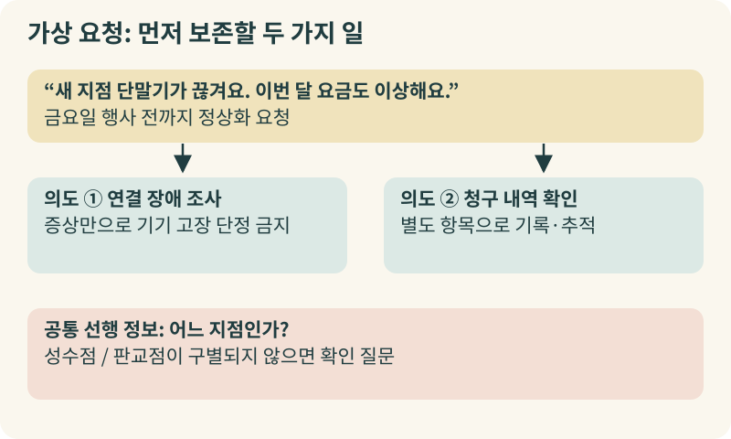
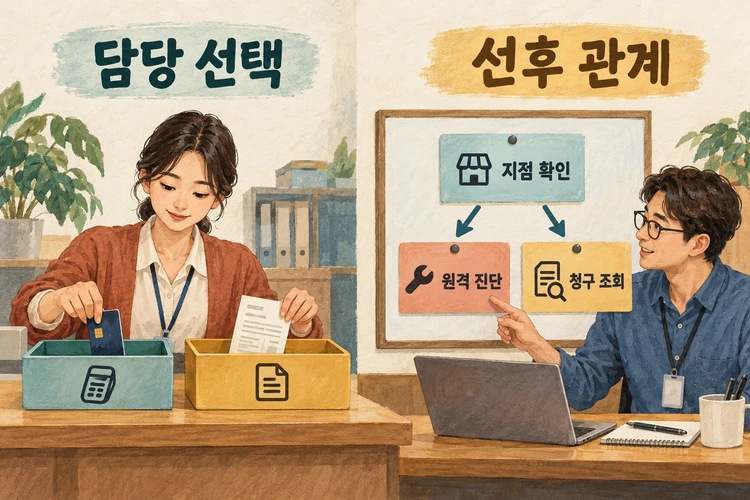
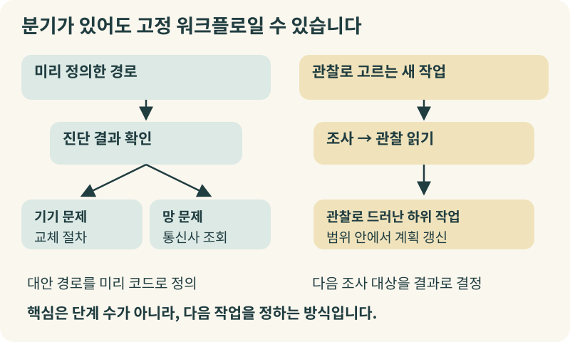
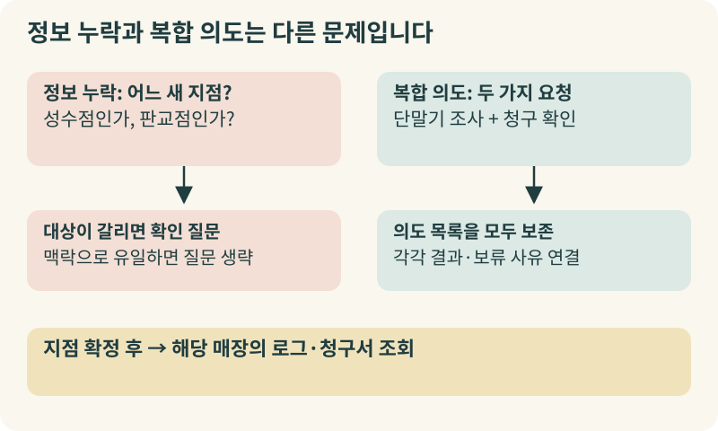
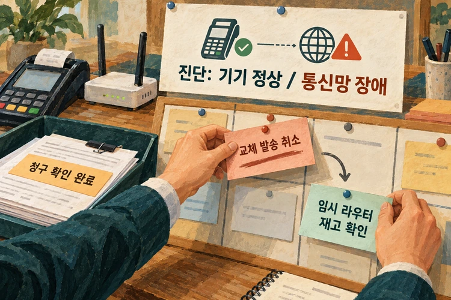
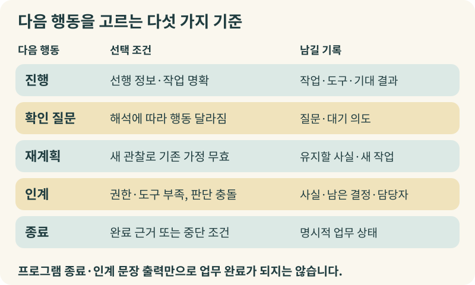
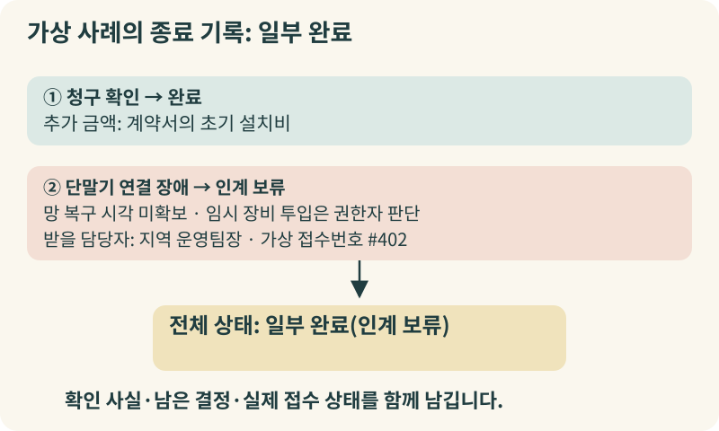

+++
date = '2026-10-24T00:00:00+09:00'
draft = false
title = 'AI가 담당자는 잘 찾는데, 왜 일은 끝나지 않을까요?'
description = '업무 특성에 맞춰 AI의 라우팅(Router)과 계획(Planner)을 구분하고, 확인 질문·재계획·인계·종료 기준을 세우는 실무 가이드'
tags = ['ax', 'ai', 'agent', 'planner', 'router']
authors = ['geoff']
slug = 'planner-router'
audio = []
vedios = []
series = []
toc = true
featured_image = 'thumbnail.webp'
images = ['thumbnail.webp']
+++

## 들어가며

이해를 돕기 위해 가상의 상황을 하나 가정해 보겠습니다. 전국에 매장을 운영하는 한 유통 기업이 사내 업무 지원용 AI 에이전트를 도입했습니다. 월요일 아침, 한 매니저가 다급하게 메시지를 보냅니다.

"새로 오픈한 지점인데 결제 단말기가 자꾸 끊깁니다. 그리고 이번 달 통신비 청구서 금액도 평소보다 이상하게 나왔어요. 금요일 오픈 행사 전까지는 무조건 정상화해 주세요."

잠시 후 AI가 답장을 보냅니다. 단말기 장애 접수 부서로 분류해 교체용 단말기 발송을 요청했고 처리를 완료했다는 안내였습니다. 얼핏 보면 AI가 담당 부서를 찾아 빠르게 일을 처리한 것처럼 보입니다.

하지만 이 가상 사례에서는 일이 끝난 게 아닙니다. 우선 '새로 오픈한 지점'이 이번 달 문을 연 두 매장 중 어디인지 확인하지 않았습니다. 함께 물어본 통신비 청구서 확인 요청은 흔적도 없이 사라졌습니다. 무엇보다 단말기 기기 불량이 아니라 매장 주변 통신망 문제라면, 새 단말기를 보내봤자 금요일 행사 날에도 결제는 똑같이 끊길 것입니다.

개별 도구나 전문 에이전트를 잘 만들어 두고도 전체 업무 연결에서 이런 빈틈이 생길 수 있습니다. 모델의 지능이 부족해서라기보다는 요청이 들어왔을 때 "누가, 어떤 기준으로 다음 행동을 결정할 것인가"를 구분해 설계하지 않은 데서 나타날 수 있는 문제입니다.

이번 글에서는 AI가 적합한 담당 도구를 고르는 라우팅(Routing)과 작업 의존성과 방향을 조율하는 계획(Planning)이 어떻게 다른지, 그리고 실무에서 질문·재계획·인계·종료 기준을 어떻게 세워야 하는지 경영진의 시선에서 짚어보겠습니다.

## 접수 창구와 프로젝트 매니저는 하는 일이 다릅니다: 라우터와 플래너

업무 요청을 처리하는 두 가지 역할을 떠올려 보면 구분이 쉽습니다. 바로 '접수 창구(Router)'와 '프로젝트 매니저(Planner)'입니다.

접수 창구는 찾아온 사람의 요청을 듣고 "단말기 점검은 기술지원 창구로, 요금 문의는 정산 창구로 가세요"라고 분류해 보냅니다. 이처럼 들어온 입력을 분류해 적합한 전문 작업이나 도구로 연결하는 기능이 라우팅(Routing)입니다. [Anthropic이 2024년 12월 공개한 에이전트 설계 가이드](https://www.anthropic.com/research/building-effective-agents)는 라우팅이란 입력을 분류해 특화된 후속 작업으로 보내는 패턴이라고 정의하며 분류 수단으로 거대언어모델(LLM)뿐 아니라 전통적인 분류 알고리즘이나 규칙도 쓸 수 있다고 설명합니다.

반면 프로젝트 매니저는 창구 안내로 끝내지 않습니다. 목표를 달성하기 위해 어떤 하위 작업이 필요한지 나누고 선후 의존 관계를 따져 순서를 잡습니다. 그리고 현장에서 돌아온 중간 결과를 보고 "통신망 문제라면 기기 교체를 멈추고 임시 라우터 재고부터 확인하자"라며 다음 행동을 고칩니다. 이처럼 작업 의존성을 나누고 새로운 관찰 결과에 맞춰 행동 계획을 갱신하는 기능이 계획(Planning)입니다. 추론과 외부 행동을 번갈아 수행하며 관찰한 정보로 행동 계획을 유도·추적·수정하는 원리는 2022년 10월 공개된 [ReAct 논문 초록](https://arxiv.org/abs/2210.03629)이 제시한 개념과도 이어집니다.

라우터와 플래너가 반드시 별도의 AI 모델이거나 서로 다른 소프트웨어 제품이어야 하는 것은 아닙니다. 시스템 조직도보다 지금 이 순간 다음 행동을 결정하는 기능이 무엇인지가 중요합니다.

단순 문의는 라우터가 분류해 담당 작업으로 보내면 충분하고 경로가 복잡한 요청은 계획 기능으로 작업을 나눈 뒤 라우터가 단계별 도구를 고를 수 있습니다. 또한 [OpenAI Agents SDK의 멀티에이전트 문서](https://openai.github.io/openai-agents-python/multi_agent/)가 구분하듯, 중앙 관리자가 대화 주도권을 쥔 채 전문 에이전트를 도구처럼 호출하는 방식과 대화 주도권 자체를 넘기는 인계(handoff) 방식은 이후 흐름을 누가 통제하는지에서 차이가 납니다.

## 정해진 절차로 충분한 일, 결과를 보며 계획을 바꿔야 하는 일

AI 도입을 검토할 때 "우리 업무도 AI가 스스로 계획을 짜는 동적 구조로 가야 합니까?"라는 질문이 나올 수 있습니다. 하지만 거쳐야 할 단계가 많거나 중간 진단 결과를 확인해야 한다고 해서 무조건 동적 계획이 필요한 것은 아닙니다.

앞서 인용한 Anthropic 가이드와 현행 [LangGraph의 워크플로·에이전트 문서](https://docs.langchain.com/oss/python/langgraph/workflows-agents)는 미리 정의한 코드 경로를 따르는 '고정 워크플로(Workflows)'와 모델이 처리 과정과 도구 순서를 동적으로 정하는 '에이전트(Agents)'를 구분합니다.

여기서 두 가지를 구별해야 합니다. 첫째, 고정 워크플로에도 조건 분기, 반복, LLM 호출이 들어갈 수 있습니다. 진단 결과에 따른 대안 경로들을 미리 코드로 적어 둘 수 있다면 고정 워크플로의 조건 분기만으로도 대응할 수 있습니다. 동적 계획은 앞 단계 결과를 봐야만 다음 조사 대상이나 하위 작업이 드러나고 그 갈래를 사전에 다 적어 둘 수 없을 때 필요합니다. 둘째, 제어 경로가 정해졌다는 것과 LLM 생성 결과가 결정론적(항상 같은 답)이라는 것은 다릅니다. 정해진 단계 안에서도 문안 작성이나 분류에 LLM을 호출하면 그 출력 자체는 확률적으로 달라질 수 있습니다. 단지 다음 단계로 넘어가는 전이 규칙을 개발자가 미리 정해 두었을 뿐입니다.

기업들이 자체 발표한 두 사례를 대조해 보면 적용 조건의 차이가 잘 드러납니다.

첫째는 **업무 순서가 알려진 경우**입니다. 2026년 10월 19일 [Meta 엔지니어링 블로그가 발표한 'Thin Orchestrator' 사례](https://engineering.fb.com/2026/10/19/ml-applications/thin-orchestrator-ai-agent-architecture/)는 운영 주체의 자기 보고입니다. Meta는 추천 시스템의 데이터 컬럼 온보딩에 7단계 프로토콜(1~5단계와 7단계는 결정론적 절차)을 두고 중앙 계층은 입력 수집·검증과 위임만 맡기며 도메인 추론은 전문 에이전트에 넘겼다고 설명합니다. 컬럼 온보딩, 이벤트 온보딩, 파이프라인 이전처럼 업무가 달라도 매번 경로를 새로 계획하지 않고 단계 순서만 달리한 워크플로 템플릿으로 같은 전문 에이전트들을 재사용했습니다. 다만 Meta가 "라우팅은 결정론적이어야 한다"고 권고한 것은 절차가 명확한 이 설계 범위의 원칙이지, 모든 자연어 라우터에 적용되는 보편 법칙은 아닙니다.

둘째는 **돌아온 결과를 봐야 다음 작업이 정해지는 경우**입니다. 2025년 6월 13일 [Anthropic이 공개한 멀티에이전트 Research 시스템 구축 설명](https://www.anthropic.com/research/multi-agent-research-system)은 공급사의 당시 구현 사례입니다. 주 에이전트(`LeadResearcher`)가 조사 전략을 세워 하위 작업을 나누어 맡기고 돌아온 결과를 종합해 추가 조사가 필요한지, 전략을 수정할지 판단합니다. 당시 Anthropic은 모호한 지시 탓에 중복 조사와 누락이 생겼기 때문에 위임 시 목표, 출력 형식, 도구·출처, 작업 경계를 분명히 적도록 개선했다고 보고했습니다.

도입 전에 어떤 구성을 먼저 검토할지 이 글에서 제안하는 실무 판단표를 정리했습니다.

| 업무에서 확인할 조건 | 먼저 검토할 구성 (실무 제안) | 도입 전에 물을 질문 |
| :--- | :--- | :--- |
| 필요한 입력과 예외별 다음 단계가 알려져 있음 | 고정 워크플로 | 기존 절차로 처리하지 못한 실제 예외는 무엇인가? |
| 유형별 담당 작업은 다르지만 처리 순서는 알려져 있음 | 라우터 + 유형별 워크플로 | 겹치는 유형이나 어느 유형에도 맞지 않는 요청은 어떻게 처리하는가? |
| 결과를 읽어야 다음 조사 대상·하위 작업이 드러남 | 제한된 동적 계획 | 어떤 관찰이 어떤 다음 행동을 바꾸는가? |
| 정보가 빠져 목표나 대상을 확정할 수 없음 | 확인 질문 | 답을 받으면 실제 실행 경로가 달라지는가? |
| AI가 판단 근거를 확보할 수 없거나 담당 범위를 벗어남 | 사람에게 인계 | 넘겨받을 담당자와 남은 판단 사항이 명확한가? |

## 모호한 요청과 복합 의도는 전혀 다른 문제입니다

다시 글 머리의 가상 사례로 돌아가 보겠습니다. "새 지점의 단말기가 자꾸 끊깁니다. 이번 달 요금도 이상하고, 금요일 행사 전에 정상화해 주세요."라는 요청이 어긋난 이유는 '복합 의도(다중 과업)'와 '모호함(정보 누락)'을 구분하지 않고 하나의 분류표만 붙였기 때문입니다.

먼저 **복합 의도**는 처리해야 할 일이 둘 이상이라는 뜻입니다. 이 메시지에는 ① 단말기 연결 장애 조사와 ② 이번 달 청구 내역 확인이라는 두 가지 의도가 들어 있습니다. 만약 접수 라우터를 요청마다 가장 가까운 의도 하나만 고르도록 설정해 두었다면, 단말기 장애만 기술지원 흐름으로 넘어가고 청구 확인 요청은 기록 없이 사라집니다.

이는 고정 워크플로 자체의 한계가 아니라 단일 라벨만 고르게 한 분류 설정의 문제입니다. 따라서 이 글에서는 복합 요청이 들어올 때 이를 의도 목록으로 분해해 보존하고 각 의도에 진행 결과나 보류 사유를 개별 연결하는 구성을 제안합니다.

반면 **모호함**은 작업을 실행할 대상이나 완료 기준이 빠진 상태입니다. 예시에서 '새 지점'이 어디인지, '정상화'의 기준이 무엇인지 불명확한 것이 여기에 해당합니다.

모호함을 다룰 때도 기준이 필요합니다. 이전 대화 맥락이나 계정 정보만으로 요청 대상 지점이 단 하나로 명확히 특정된다면(예컨대 발신자가 성수점 한 곳만 전담하고 타 지점 대리 접수가 없는 경우) 다시 묻지 않아도 됩니다. 하지만 단순히 발신자의 소속 정보만 있을 뿐 이번 달 새로 문을 연 성수점과 판교점 중 어느 지점의 일인지 확정할 수 없다면, 대상을 가르는 확인 질문을 먼저 해야 합니다. 대상 지점이 특정되어야만 그 매장의 단말기 로그와 해당 지점 청구서를 정확히 조회할 수 있기 때문입니다.

또한 어느 범주에도 맞지 않는 요청을 억지로 분류하지 않는 장치도 필요합니다. 예를 들어 [Google Cloud Dialogflow CX의 인텐트 문서](https://docs.cloud.google.com/dialogflow/cx/docs/concept/intent)에 따르면 분류 점수가 기준치에 못 미치면 `no-match` 이벤트가 발생합니다. 이처럼 '해당 없음' 경로를 따로 두어야 하며 특히 LLM이 출력에 적은 자신감 점수를 검증된 정답 확률로 취급하거나 모든 의도를 다 파악했다는 증거로 삼아서는 안 됩니다.

## 관찰 결과가 가정을 뒤집을 때: 다음 행동을 고르는 다섯 가지 기준

이제 가상의 요청이 관찰 결과에 따라 어떻게 전개되는지 끝까지 따라가 보겠습니다. (이 시나리오와 사내 규정, 티켓 처리는 의사결정 기준을 설명하기 위한 가상 예시이며 실제 장애 대응 지침이나 고객 사례가 아닙니다.)

확인 질문으로 대상 매장이 '성수점'임을 확정했습니다. 이 가상 기업의 업무 규칙상 지점이 특정된 뒤에는 단말기 원격 진단과 지점 청구서 확인이 서로 의존하지 않으므로 함께 진행할 수 있습니다.

정산 도구가 성수점 청구서를 조회한 결과, 추가 금액은 계약서에 명시된 초기 설치비로 확인되었습니다. 이로써 '요금 이상 확인' 의도는 완료됩니다.

한편 기술 도구는 초기 계획(기기 불량 확인 후 교체품 발송)에 따라 성수점 단말기를 원격 진단합니다. 그런데 진단에서 새로운 관찰 결과가 나옵니다. 단말기 하드웨어는 정상이고 해당 지역 통신망 구간에서 간헐적 장애가 발생하고 있었습니다.

이처럼 새 관찰이 '단말기 고장'이라는 기존 가정을 무효화하면 **재계획**이 필요합니다. 이때 두 가지 기준을 적용합니다.
1. **이미 확인한 사실은 유지합니다:** 방금 마친 '성수점 청구서 확인 완료'와 '단말기 하드웨어 정상' 기록은 그대로 보존합니다.
2. **무효화된 가정에 의존하는 후속 작업만 바꿉니다:** 불필요해진 '교체 단말기 발송'을 취소하고 '통신사 복구 예정 시각 확인'과 '행사 대비용 임시 무선 라우터 재고 조회'로 다음 행동을 고칩니다.

이어진 조회에서 금요일 행사 전까지 통신망 복구 시각을 확보하지 못했고 가상 회사 규정상 임시 장비 긴급 투입은 지역 운영팀장의 판단이 필요하다고 해봅시다. 이제 AI는 사람에게 인계해야 합니다.

여기서 소프트웨어의 실행 종료와 실제 업무 완료를 구분해야 합니다. 예를 들어 [OpenAI Agents SDK의 에이전트 실행 문서](https://openai.github.io/openai-agents-python/running_agents/)를 보면 실행기는 모델이 최종 출력을 내놓으면 종료하고 최대 턴 수를 넘기면 `MaxTurnsExceeded` 예외를 일으키며 멈춥니다. 하지만 프로그램이 최종 응답을 반환했거나 실행 한도에 도달했다는 사실이 곧 업무 완료는 아닙니다. 마찬가지로 AI가 "담당자에게 인계하겠습니다"라는 문장을 출력한 것만으로 실제 사람에게 접수가 완료됐다고 볼 수도 없습니다.

실무에서 다음 행동을 통제할 수 있도록 이 글에서 제안하는 다섯 가지 선택 기준을 표로 정리했습니다.

| 다음 행동 선택 | 발동 조건 (실무 제안) | 시스템에 남길 결과 |
| :--- | :--- | :--- |
| **진행** | 선행 정보가 있고 실행할 전문 작업이 명확함 | 선택 작업, 담당 도구, 기대 결과 |
| **확인 질문** | 둘 이상의 해석이 다음 행동·완료 기준을 바꿈 | 구별할 질문, 대기 중인 의도 목록 |
| **재계획** | 새 관찰이 기존 가정이나 선행 조건을 무효화함 | 바뀐 가정, 유지할 완료 작업, 새 다음 행동 |
| **인계** | 적합한 도구·권한이 없거나 판단 충돌을 해소하지 못함 | 확인 사실, 시도 결과, 미해결 결정, 받을 담당자 |
| **종료** | 모든 의도의 완료 근거가 있거나 취소·한도·진척 정체에 도달함 | 완료 / 일부 완료 / 보류 / 실패 중 명시적 상태 |

이 기준에 따라 가상 사례의 AI는 전체 요청을 '완료'로 덮지 않습니다. "① 성수점 요금 내역은 초기 설치비로 확인 완료되었습니다. ② 단말기 끊김은 지역 통신망 장애로 파악되어, 금요일 행사 전 임시 장비 투입 결정을 지역 운영팀장(가상 접수번호 #402)에게 인계했습니다"라고 안내하고 전체 상태를 '일부 완료(인계 보류)'로 기록합니다.

## 나가며

AI 에이전트를 도입할 때 "우리 AI는 몇 단계까지 자율 실행하나요?"부터 묻기 쉽습니다. 하지만 실무에서 먼저 따져볼 질문은 "이 결과를 받으면 다음 행동이 무엇으로 바뀌며, 그 결정을 누가 내리는가?"입니다.

절차와 예외 분기를 미리 정의할 수 있는 업무라면 정해진 워크플로와 라우팅부터 검토하는 편이 합리적입니다. 반대로 앞 단계의 결과를 봐야만 다음 조사 대상과 작업 순서가 드러나는 업무라면 관찰에 따라 계획을 고치는 구조를 고려할 수 있습니다. 어느 쪽이든 복합 의도를 빠뜨리지 않는 목록 관리와 '진행·확인 질문·재계획·인계·종료'의 기준을 사전에 업무 규칙으로 설계해야 합니다.

도입 범위를 구체화하고 싶다면 최근 처리한 업무 몇 건을 골라 현업 담당자와 엔지니어가 함께 나란히 놓아 보시기 바랍니다. 평범한 정상 건, 두 가지 요구가 섞인 복합 요청, 정보가 빠져 되물어야 했던 건, 중간 결과 때문에 계획을 바꾼 건을 놓고 각 전환점에서 기대하는 다음 행동을 적어 보면 필요한 구성을 판단하는 데 도움이 됩니다.

물론 현업의 업무 기준을 라우터와 플래너, 그리고 실제 인계·종료 상태 관리로 옮기는 과정에는 도메인 이해와 엔지니어링 설계가 함께 필요합니다. 우리 조직의 업무에 어떤 의사결정 구조가 맞을지 고민하고 계신다면 언제든 엡실론델타(contact@epsilondelta.ai)로 편하게 연락해 주십시오. 여러분의 업무 맥락에 맞는 에이전트 설계와 운영 기준을 함께 고민하고 도와드리겠습니다.
