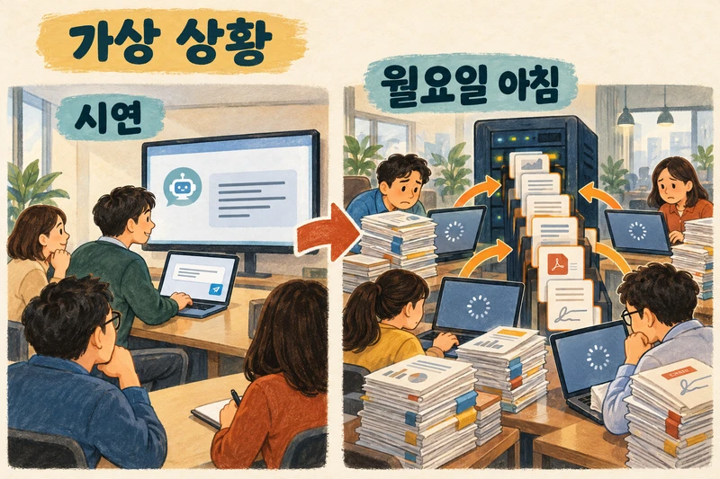
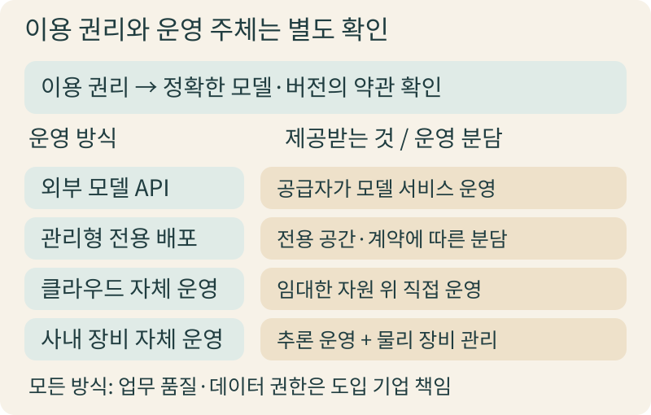
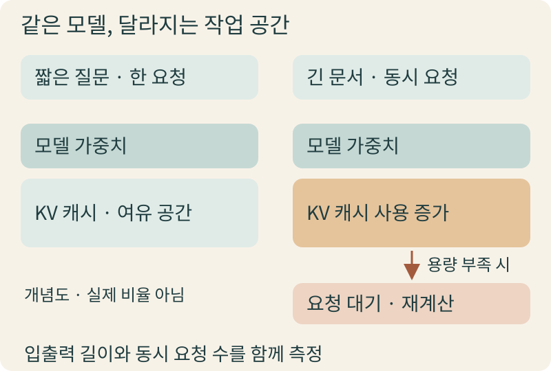
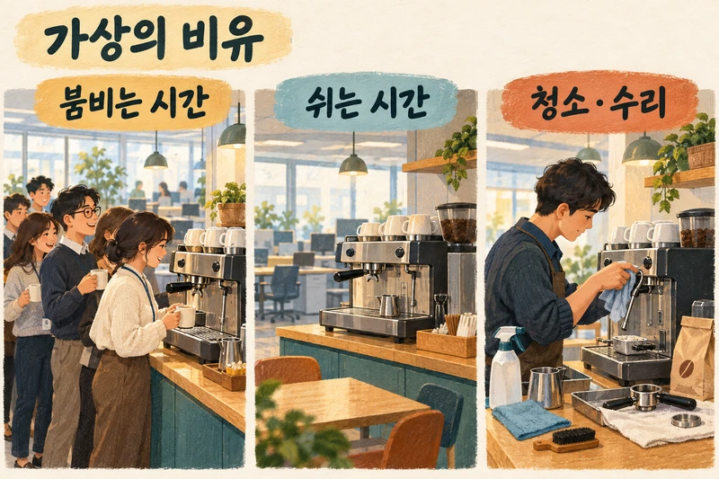
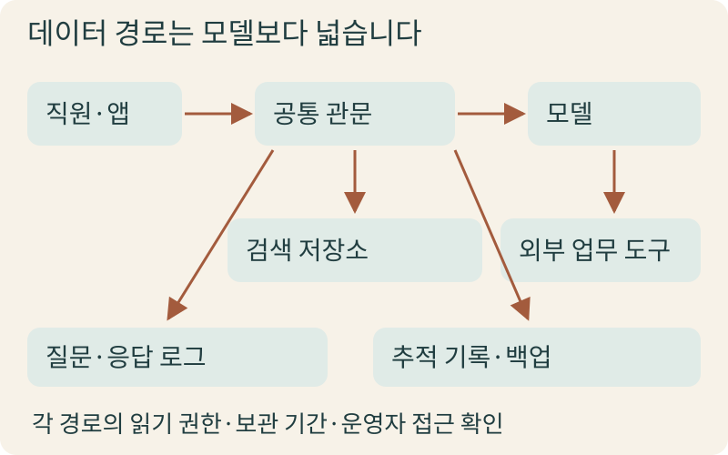
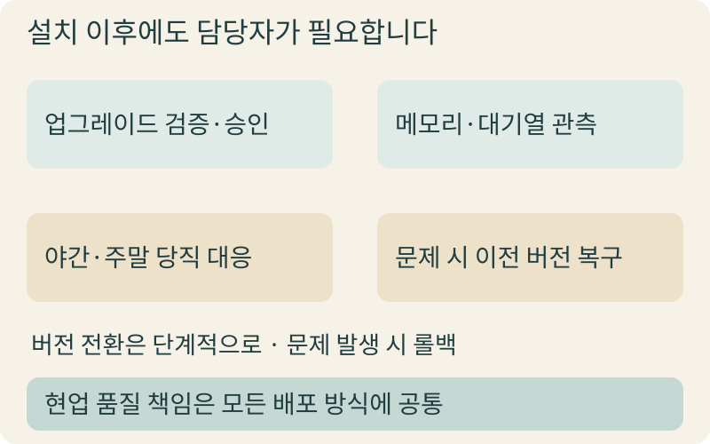
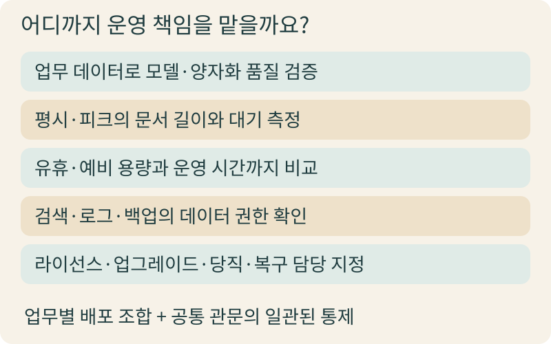

+++
date = '2026-10-26T00:00:00+09:00'
draft = false
title = '무료로 공개된 AI 모델, 사내에 직접 띄우면 정말 유리할까요?'
description = '외부 API, 관리형 전용 배포, 자체 운영 사이에서 경영진이 확인해야 할 다섯 가지 서비스 책임과 의사결정 기준'
tags = ['ax', 'ai', 'self-hosting', 'open-weights']
authors = ['geoff']
slug = 'self-hosted-models'
audio = []
vedios = []
series = []
toc = true
featured_image = 'thumbnail.webp'
images = ['thumbnail.webp']
+++

## 들어가며

가상의 시연 장면을 먼저 떠올려 보겠습니다. 사내 개발팀이 회의실 화면에 대화창 하나를 띄웁니다. 인터넷에 공개된 대규모 언어 모델 파일을 내려받아 사내 테스트 서버에 올린 뒤 업무 질문을 하나 입력합니다. 잠시 후 화면에 매끄러운 답변이 한 줄씩 찍힙니다. 지켜보던 임원진 사이에서 자연스럽게 반가운 질문이 나옵니다. "공개된 모델을 가져다 쓰면 외부 사용료도 아끼고 우리 데이터도 회사 밖으로 나가지 않으니, 앞으로는 전부 사내에서 직접 돌리면 되는 것 아닐까요?"

이제 시계를 조금만 앞으로 돌려 이 모델을 전사 시스템에 연결한 뒤 맞이한 가상의 월요일 오전 8시 50분을 상상해 보겠습니다. 9시 주간 회의를 앞두고 여러 부서에서 수십 쪽짜리 보고서와 계약서 초안을 동시에 올리며 요약을 요청합니다. 시연 자리에서는 질문 한 건에 곧바로 첫 줄이 뜨던 화면이 이날은 한참 동안 멈춘 듯 돌아갑니다. 답답해진 직원들은 새로고침을 누르고 사내 메신저에는 "AI 시스템이 멈췄습니다"라는 문의가 잇따라 올라옵니다.

시연 때 잘 돌아가던 모델이 왜 실제 업무 시간에는 발목을 잡을까요? 우리가 내려받은 것은 인공지능의 계산 규칙이 담긴 가중치 파일일 뿐, 수백 명의 직원이 동시에 접속해도 끊김 없이 돌아가는 서비스 그 자체가 아니기 때문입니다. 외부 모델 API를 쓸 때도 애플리케이션의 데이터 권한 관리나 업무 품질 검증, 장애 시 현업 대응 판단은 도입 기업의 몫입니다. 그런데 자체 운영을 택하는 순간에는 추론 서버의 대기열 관리와 장비 여유분 확보, 추론 엔진 업데이트와 인프라 당직까지 우리 조직의 운영 책임으로 더해집니다. 그동안은 공급자가 맡아주던 일입니다. 결국 공개 모델 도입은 파일을 어디에 설치할지의 문제가 아니라 서비스를 지탱하는 책임을 누가 어디까지 맡을 것인가의 결정입니다. 이번 글에서는 경영진이 반드시 짚어보아야 할 다섯 가지 서비스 책임과 현실적인 선택 기준을 함께 살펴보겠습니다.

## 공개 모델을 가져온다는 것의 의미: 이용 권리와 운영 주체 나누기

보고서에서 흔히 오픈소스 모델이라고 묶어 부르는 대상부터 정확히 나누어 볼 필요가 있습니다. 여기서 다루는 공개 가중치(Open Weights) 모델은 학습된 파라미터 파일을 내려받아 실행할 수 있는 모델을 뜻합니다. 학습이 끝난 신경망 숫자 값 파일이 공개되어 있어 허용된 조건 아래 가져다 구동할 수 있지만 학습 데이터나 코드까지 모두 공개됐다는 뜻은 아닙니다. 반면 오픈소스 이니셔티브(OSI, 오픈소스 기준을 관리하는 국제 비영리 기구)의 [오픈소스 AI 정의 1.0](https://opensource.org/ai/open-source-ai-definition)은 가중치 파일을 열어두는 것만으로는 충족할 수 없습니다. 사용·연구·수정·공유의 네 가지 자유를 보장하고 학습 데이터에 관한 충분한 정보와 실행·학습 코드까지 함께 제공할 것을 요구합니다.

무료로 내려받을 수 있다고 해서 어떤 목적으로든 제한 없이 써도 된다는 뜻은 아닙니다. 그래서 이 구분이 중요합니다. 공개 가중치 모델은 저마다 고유한 이용 약관을 두고 있으며 같은 모델 계열이라도 버전에 따라 적용 문서가 달라지기도 합니다. 예컨대 구글의 [Gemma 이용 약관](https://ai.google.dev/gemma/terms) 페이지는 기본 약관이 적용되는 모델 부록과 Gemma 4를 위한 별도 약관 링크를 구분해 안내하고 금지 용도나 재배포 시의 의무 사항을 따로 다룹니다. 따라서 도입 전에는 실무진에게 몇 가지 확인 질문을 넘겨야 합니다. 우리가 쓰려는 정확한 모델 버전과 배포처 약관은 무엇인지, 사내 내부 업무용 사용과 외부 고객 대상 서비스 제공이 각각 허용되는지, 수정본이나 재배포 시 지켜야 할 고지 의무나 제한 조건이 무엇인지를 해당 문서로 확인해야 합니다.

이용 권리를 짚어보았다면 다음은 누가 운영하느냐를 구분할 차례입니다. 흔히 외부 API를 쓸지 사내에서 돌릴지 묻곤 하지만 여기서 API(애플리케이션 프로그래밍 인터페이스, 프로그램끼리 요청과 응답을 주고받는 연결 창구)는 호출 방식일 뿐입니다. 모델을 우리가 직접 띄워도 사내 시스템은 결국 API 형태로 그 서버를 호출합니다. 또한 자체 운영이 곧 회사 건물 안에 물리적 장비를 설치한다는 말도 아닙니다. 운영 주체를 기준으로 보면 외부 모델 API는 외부 공급자가 운영하는 서비스를 호출하는 방식입니다. [관리형 전용 배포](https://huggingface.co/docs/inference-endpoints/index)에서는 플랫폼 사업자가 전용 공간에 모델을 띄우고 인프라 관리를 분담합니다. 클라우드 자체 운영은 클라우드 장비를 빌려 서빙 환경을 직접 구축하고 사내 장비 자체 운영은 물리 장비까지 직접 보유합니다.

| 배포 방식 | 제공받는 것 | 도입 기업이 확인·소유할 책임 |
| :--- | :--- | :--- |
| 외부 모델 API | 공급자가 실행하는 모델의 호출 창구 | 업무 품질, 요청 데이터, 접근 권한, 사용 한도, 장애 시 업무 대응 |
| 관리형 전용 배포 | 선택 모델용 전용 공간과 관리형 서비스 | 모델·버전 선택, 복제본·지역·접근 설정, 품질 검증, 계약상 운영 분담 |
| 클라우드 자체 운영 | 임대한 연산·저장·네트워크 자원 | 추론 엔진·스케줄러·관측·업데이트·용량과 서비스 장애 대응 |
| 사내 장비 자체 운영 | 직접 소유·통제하는 물리 장비 환경 | 위 책임에 장비 수명·전력·냉각·교체·현장 대응까지 예산화 |

## 한 사람의 시연과 동시 부하의 간극: 작업 메모리와 대기열

시연 자리에서 한 명이 짧은 질문을 던질 때와 여러 부서가 동시에 긴 문서를 올릴 때는 연산 장치인 GPU(대규모 병렬 연산을 처리하는 장치) 안에서 일어나는 일이 전혀 다릅니다. 보통 모델 가중치 파일 크기만 보고 장비 사양을 어림잡지만 실제 추론 중에는 가중치 외에도 KV 캐시라고 부르는 작업 메모리가 추가로 소모됩니다. 모델은 앞선 문맥을 바탕으로 다음 글자를 하나씩 이어 쓰는데 앞부분을 매번 처음부터 다시 계산하지 않으려고 중간 계산 결과를 메모리에 임시로 붙잡아 둡니다. 이 임시 작업 공간이 바로 KV 캐시입니다.

이 작업 메모리는 동시에 처리하는 요청 수와 입력·출력 문서 길이에 비례해 빠르게 불어납니다. 오픈소스 추론 엔진인 [vLLM의 최적화 문서](https://docs.vllm.ai/en/latest/configuration/optimization/)를 보면 이 작업 메모리 관리가 왜 핵심인지 잘 드러납니다. 한 사람이 짧은 질문을 할 때는 공간이 여유롭습니다. 그러다 회의 직전 여러 직원이 긴 보고서를 동시에 넣고 요약을 요청하면 순식간에 차오릅니다. 작업 공간이 한계에 다다르면 엔진은 이미 처리 중이던 요청을 메모리에서 잠시 밀어냈다가(선점) 나중에 다시 계산하거나 새로 들어온 요청을 대기열에 세워 두어야 합니다. 그 결과 첫 응답 대기, 즉 질문을 넣고 첫 글자가 찍히기까지 걸리는 시간이 길어집니다. 전체 답변이 완성되기까지의 완료 대기도 길어지고 피크 시간대에는 긴 대기열이 생깁니다.

메모리 부담을 줄이려고 실무에서 자주 검토하는 기법이 [양자화(Quantization)](https://docs.vllm.ai/en/latest/features/quantization/)입니다. 모델의 숫자 정밀도를 낮춰 메모리 점유량을 줄이는 방법인데 고해상도 원본 사진을 문서 첨부용으로 압축하는 것에 비유할 수 있습니다. 작업 메모리 여유를 넓혀 주는 장점은 있습니다. 다만 숫자 정밀도를 낮춘 모델이 우리 회사의 까다로운 계약서 비교나 표 해석에서도 원래 품질을 유지할지를 두고는 모든 모델에 일률적으로 적용할 공식이 없습니다. 따라서 양자화를 적용할 때는 반드시 우리 조직의 실제 업무 데이터로 품질 검증을 거쳐야 합니다.

## 원두값만 보고 들인 사무실 커피 머신: 쉬는 장비와 예비 용량의 비용

자체 운영의 비용 구조를 직관적으로 살펴보기 위해 사무실에 업소용 에스프레소 머신을 직접 들여놓는 가상의 비유를 생각해 보겠습니다. 물론 커피와 AI 인프라의 비용 구조가 같지는 않지만 숨은 운영 비용을 짚어보는 데는 좋은 출발점이 됩니다. 카페에서 사 마시는 커피 값과 원두 가격만 단순 비교하면 기계를 사는 쪽이 무조건 유리해 보입니다. 하지만 막상 사무실에 기계를 두면 오전 출근 직후와 점심 직후에 긴 줄이 생깁니다. 이 대기를 줄이려면 평소 평균이 아니라 가장 붐비는 시간대에 맞춰 큰 기계를 들여야 합니다. 반대로 늦은 오후나 야간, 주말에는 기계가 내내 쉬고 있지만 이미 치른 기계 값과 공간 비용은 그대로 나갑니다. 여기에 매일 우유 노즐을 청소하고 고장을 수리할 담당자의 시간까지 더해야 실제 비용이 나옵니다.

모델 자체 운영의 셈법도 이와 닮았습니다. 외부 API는 사용한 만큼 내는 구조에 가깝지만 자체 운영은 피크 시간대의 응답 속도를 맞추기 위한 예비 용량과 한산한 시간대의 유휴 장비를 함께 안고 가야 합니다. 그렇다면 관리형 전용 배포(유지보수 서비스가 포함된 장비 계약에 비유할 수 있는 방식)에서 요청이 없을 때 장비를 0대로 줄이는 기능을 쓰면 어떨까요? [Hugging Face의 자동 확장 가이드](https://huggingface.co/docs/inference-endpoints/guides/autoscaling)를 보면 여기서도 현실적인 절충이 필요합니다. 무활동 시 복제본을 0으로 줄여(Scale-to-Zero) 과금을 멈출 수는 있지만 다시 요청이 들어왔을 때 모델을 메모리에 새로 올리는 동안 수 분의 대기와 연결 오류가 생깁니다. 그래서 가이드는 즉각적인 응답이 필요한 앱에는 이 기능을 권하지 않습니다. 또한 추론 서버에 부하가 걸릴 때 GPU 사용률이 높게 유지되면 복제본 확장 시점을 세밀하게 나누기 어려운 경우가 있습니다. 같은 가이드는 이런 경우를 고려해 작업 메모리(KV 캐시) 사용률이나 대기 중인 요청 수를 자동 확장의 주요 신호로 함께 활용할 수 있도록 안내합니다.

비용을 비교할 때는 동일한 답변 품질과 동일한 응답 대기 시간이라는 같은 기준선 위에서 쉬는 시간의 유휴 용량과 피크 대비 예비 용량, 장비 또는 클라우드 비용, 그리고 운영 담당자의 시간까지 모두 포함해야 합니다. 단순 토큰 요금이나 장비 단가만 나란히 놓아서는 안 됩니다.

## 모델이 사내에 있어도 데이터는 혼자 움직이지 않습니다

자체 운영을 검토할 때 가장 흔히 나오는 말이 "외부 API는 우리 데이터를 무조건 학습에 쓰고, 사내 운영은 무조건 안전하다"는 통념입니다. 하지만 실제 기업용 서비스 조건과 시스템 구조를 뜯어보면 두 설명 모두 사실과 다릅니다. 외부 모델 API는 공급자별 기업 계약과 설정을 통해 요청 데이터의 보관이나 학습 사용 여부를 개별적으로 확인하고 통제해야 하며 [Hugging Face 관리형 전용 배포의 보안 안내](https://huggingface.co/docs/inference-endpoints/security)처럼 관리형 서비스에서도 사설 네트워크 연결과 접근 제어 구성을 별도로 제공합니다. 반대로 모델만 사내에 두었다고 데이터 보호가 저절로 끝나지도 않습니다.

업무용 AI 시스템에서 데이터는 모델 바깥으로 훨씬 넓게 흐릅니다. 직원이 질문을 입력하면 사내 앱과 게이트웨이(관문 서버)를 거쳐 사내 문서를 찾아 답변 근거로 붙여 주는 검색 저장소(벡터 데이터베이스 등)를 조회하고 추론 뒤에는 외부 업무 도구를 호출하기도 합니다. 이 모든 구간에서 질문·응답 로그와 성능 추적 기록, 백업 파일이 갈라져 나옵니다. 만약 모델은 사내에 두었지만 검색 저장소의 문서 접근 권한을 부서별로 나누지 않았다면 다른 부서의 기밀 내용이 검색되어 답변에 섞일 수 있습니다. 평문으로 남은 로그와 백업 파일이 내부 유출 통로가 될 수도 있습니다.

실제 운영 사례에서도 모델의 위치와 함께 공통 관문의 통제 설계가 핵심입니다. [Uber가 2024년 7월 공개한 GenAI Gateway 혼합 운영 사례](https://www.uber.com/us/en/blog/genai-gateway/)를 보면 OpenAI·Vertex AI 같은 외부 모델과 Uber가 자체 호스팅하는 모델을 하나의 관문 뒤에 함께 연결해 운영합니다. 외부로 요청을 보내기 전에 PII(개인식별정보, 이름이나 연락처 등 개인을 특정하는 정보)를 가명 표시자로 바꾸었다가 응답에서 복원합니다. 보안팀은 사용 사례별 데이터 취급 기준을 심사해 권한을 부여하며 인증과 감사 로그는 관문 계층에 통합했습니다. 이처럼 모델을 어디에 띄우든 검색 저장소, 로그, 백업, 외부 도구, 운영자 접근 권한까지 각 지점의 보관 기간과 읽기 주체를 따로 점검해야 합니다.

## 설치는 시작일 뿐입니다: 업그레이드, 모니터링, 장애 대응의 주인 정하기

모델 서버를 처음 띄우는 일은 상시 운영의 시작일 뿐 구축의 끝이 아닙니다. 모델 버전과 추론 엔진 소프트웨어는 수시로 갱신되며 그때마다 호환성과 성능을 다듬는 작업이 뒤따릅니다. [LinkedIn이 2025년 8월 공개한 자체 추론 인프라 운영 사례](https://www.linkedin.com/blog/engineering/ai/how-we-leveraged-vllm-to-power-our-genai-applications)는 이 과정을 잘 보여줍니다. LinkedIn은 채용 보조와 구직 검색 등 자사 생성형 AI 서비스를 뒷받침하기 위해 vLLM 기반 자체 추론 인프라를 운영했습니다. 그 과정에서 초기의 오프라인 처리를 비동기 동시 처리 엔진으로 전환하고 스케줄러 설정을 노출해 조율하며 엔진 버전을 단계적으로 높여 갔습니다. 특히 추론 엔진이 바뀌어도 상위 서비스가 영향을 받지 않도록 통신을 담당하는 서버 계층(gRPC라는 고속 서버 통신 규격 기반)과 아래쪽 추론 엔진을 분리해 유지보수 부담을 줄였습니다.

이처럼 자체 추론 인프라 운영은 설치 이후의 버전 전환과 구조 관리를 감당할 엔지니어링 투자를 전제로 합니다. 운영 중인 모델을 업데이트할 때는 예상치 못한 지연이나 품질 변화가 생길 수 있어 [AWS의 프로덕션 모델 업데이트 가드레일 안내](https://docs.aws.amazon.com/sagemaker/latest/dg/deployment-guardrails.html)처럼 트래픽을 조금씩 옮기거나 문제 발생 시 이전 버전으로 되돌리는 장치를 설계해야 합니다. 그리고 이러한 기술적 안전장치는 조직 안에서 누군가 기준을 세우고 책임을 맡아야만 제때 작동합니다.

따라서 저는 자체 운영이나 전용 배포를 결정하기 전에 네 가지 실무 담당자를 먼저 지정하시기를 제안합니다. 첫째는 모델과 엔진의 업그레이드 여부를 검증하고 승인할 담당자, 둘째는 작업 메모리와 대기열 지표를 상시 살필 모니터링 담당자, 셋째는 야간이나 주말에 장애가 났을 때 연락을 받고 대응할 당직 담당자, 넷째는 문제 발생 시 즉시 이전 버전으로 되돌릴 복구 담당자입니다. 아울러 현업 품질 책임은 어떤 배포 방식을 선택하든 사라지지 않는다는 점도 분명히 해두어야 합니다. 답변이 실제 업무에 적합한지 판단하고 다듬는 책임입니다.

## 나가며

공개 가중치 모델을 사내에서 직접 돌릴 것인가는 우리 조직이 서비스 운영 책임을 어디까지 직접 인수할 것인가를 정하는 경영적 판단이지 단순한 장비 구매 품의가 아닙니다. 가중치 파일을 가져오는 순간 작업 메모리와 대기열 관리, 유휴·예비 용량 부담, 모델 바깥의 데이터 경로 통제, 라이선스 검토, 그리고 상시 업데이트와 장애 대응이 모두 우리 몫이 되기 때문입니다. 모든 업무를 하나의 방식으로 통일할 필요도 없습니다. 업무 특성과 응답 속도 요구에 따라 외부 API, 관리형 전용 배포, 자체 운영을 조합하되 공통 관문에서 권한과 로그를 일관되게 통제하는 접근이 훨씬 현실적입니다.

결정을 앞두고 계신다면 실무진과 함께 다섯 가지 질문을 먼저 점검해 보시기 바랍니다. 우리 업무 데이터로 품질을 검증한 모델과 양자화 조합이 있는지, 평시와 피크 시간대의 입출력 길이와 대기 시간을 측정했는지, 유휴·예비 용량과 운영 인력 시간을 포함해 같은 기준으로 비교했는지, 검색 저장소와 로그·백업까지 데이터 흐름과 권한을 그렸는지, 그리고 라이선스 확인과 업그레이드·당직·복구 담당자가 정해져 있는지입니다.

우리 조직의 현재 인력과 보안 여건에 비추어 어느 선까지 직접 운영 책임을 가져가는 것이 합리적인지 고민되신다면, 저희 엡실론델타와 함께 짚어보셔도 좋습니다. 막연한 절감 기대 대신 현업에서 안정적으로 돌아가는 배포 구조와 운영 거버넌스를 설계하는 데 실무적인 도움을 드리겠습니다. 언제든지 contact@epsilondelta.ai로 편하게 문의해 주시기 바랍니다.
