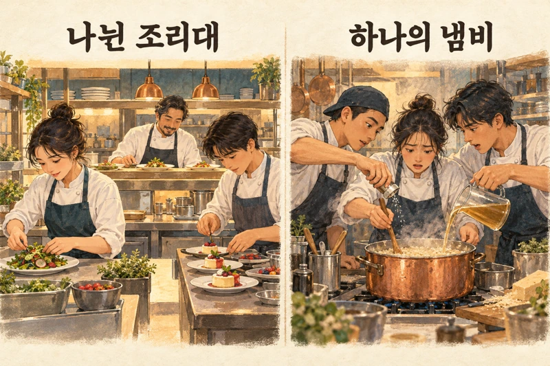
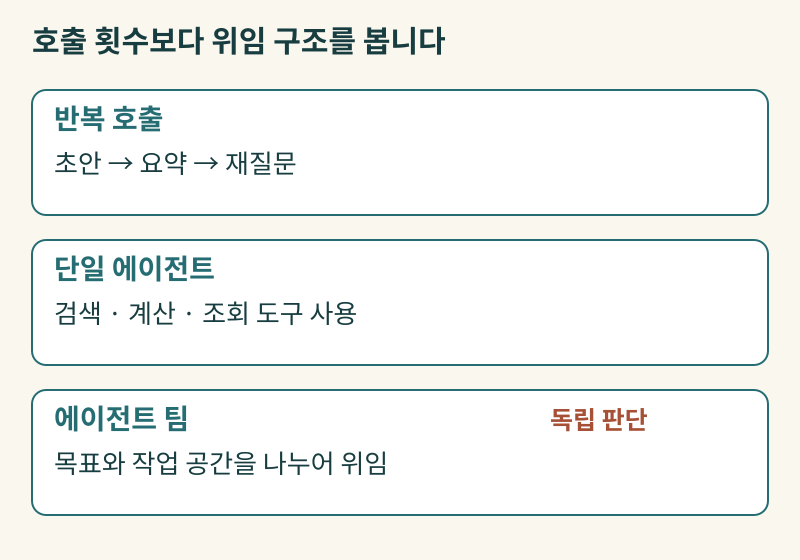
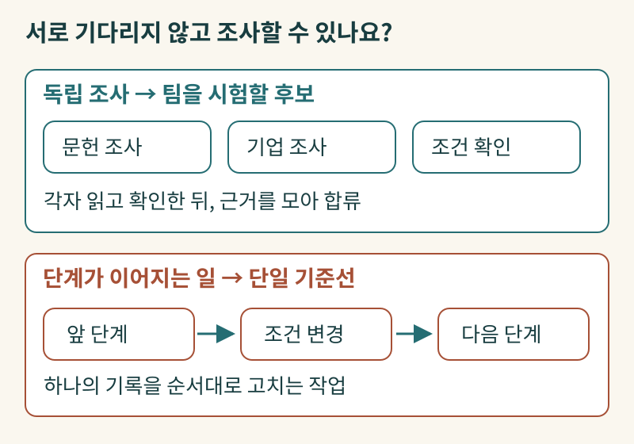
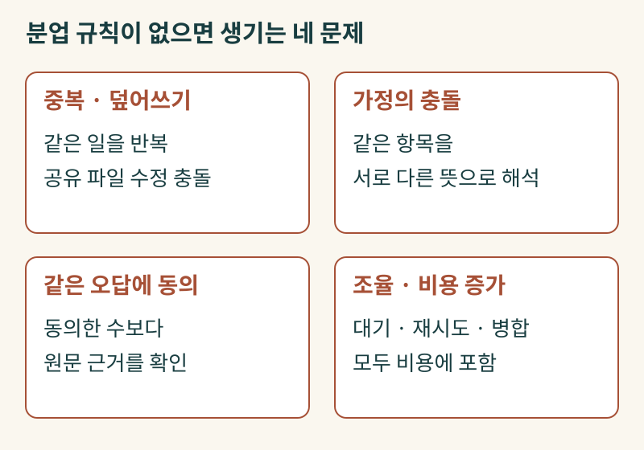
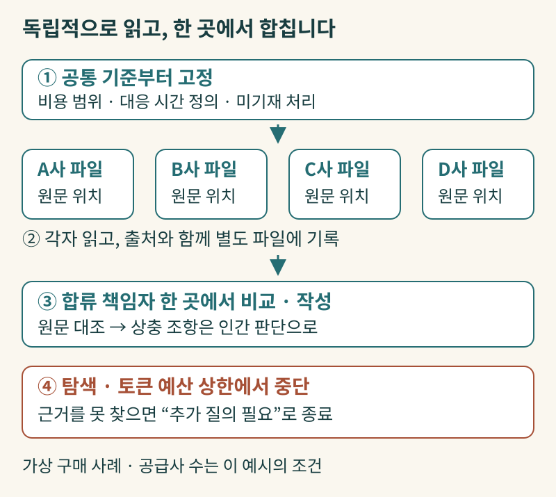
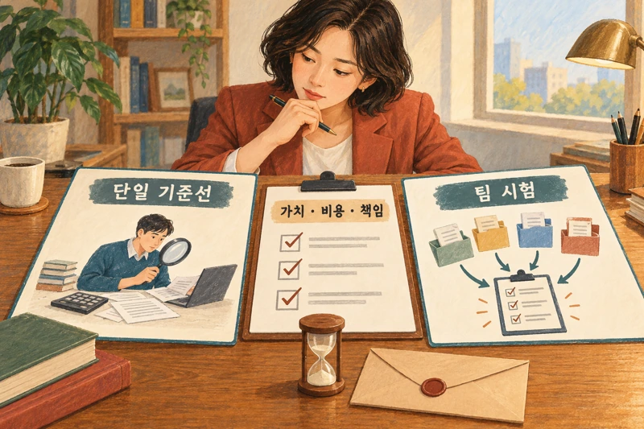

+++
date = '2026-10-28T00:00:00+09:00'
draft = false
title = 'AI 에이전트도 팀을 꾸리면 일을 더 잘할까요?'
description = '단일 에이전트와 멀티에이전트 팀 사이에서 경영진이 확인해야 할 업무 분할 기준, 병합 책임, 그리고 비용의 셈법'
tags = ['ax', 'ai', 'multi-agent', 'agent', 'orchestration']
authors = ['geoff']
slug = 'multi-agent-teams'
audio = []
vedios = []
series = []
toc = true
+++

## 들어가며

주방에서 손님 스무 명에게 낼 코스 요리를 준비한다고 생각해 보겠습니다. 전채와 수프, 메인 요리와 디저트 조리대가 나뉘어 있고 마지막에 헤드셰프가 접시 상태를 확인해 내보낸다면 요리사 네 명을 두는 게 훨씬 빠릅니다. 하지만 한 냄비에서 끓여야 하는 리소토 하나를 두고 요리사 네 명이 동시에 소금과 육수를 넣기 시작하면 어떻게 될까요? 요리는 빨라지지도 않고 간만 뒤죽박죽이 되고 맙니다.

기업에서 AI 에이전트를 도입할 때도 비슷한 일이 벌어집니다. 가상의 구매 제안서 비교 상황을 하나 떠올려 보죠. 한 제조 기업의 구매팀장이 신규 물류 설비 입찰에 참여한 공급사 네 곳(A, B, C, D사)의 제안서 수백 쪽을 검토해야 합니다. 이때 실무진이 "AI 에이전트 네 개를 동시에 띄워서 팀으로 돌리면 하루 만에 비교표가 나옵니다"라고 건의합니다. 사람 네 명에게 제안서를 한 권씩 나눠주면 네 배 빨라질 것이라는 익숙한 직관 때문이죠.

그런데 막상 에이전트 네 개를 돌려보니 결과물이 영 미덥지 않습니다. A사 제안서를 맡은 에이전트는 유지보수 응답 시간을 '장애 접수 후 현장 출동 시간' 기준으로 적었는데 B사 담당 에이전트는 '최종 수리 완료 시간' 기준으로 표를 채웠습니다. 게다가 네 에이전트가 하나의 공유 비교표 문서를 동시에 고치다 보니, 한 에이전트가 정리해 둔 단가 내역을 다른 에이전트가 이전 버전 위로 덮어써 버리는 일까지 생겼습니다. 결국 실무자가 원문을 다시 대조해야 했고 시간은 기대만큼 줄지 않았는데 API 사용량 청구서만 훌쩍 불어났습니다.

왜 이런 일이 생길까요? 사람을 더 뽑아 팀을 꾸리는 것과 AI 에이전트를 여러 개 묶는 것은 고려해야 할 조건이 사뭇 다르기 때문입니다. 언제 단일 에이전트로 충분하고 언제 팀을 꾸려야 하는지, 그리고 에이전트 팀이 제대로 일하게 만들려면 경영진이 어떤 기준을 세워야 하는지 같이 짚어보겠습니다.

## 도구를 여러 개 쓰는 것과 에이전트 팀은 무엇이 다를까요?

솔루션 소개 자료나 내부 기획서를 보다 보면 복합 AI 시스템과 멀티에이전트 팀이라는 용어가 자주 섞여 쓰입니다. 더 넓은 개념은 [UC 버클리 연구진이 정리한 복합 AI 시스템(Compound AI Systems)](https://bair.berkeley.edu/blog/2024/02/18/compound-ai-systems/)입니다. 언어 모델 하나에 의존하지 않고 검색기, 계산기, 데이터베이스 조회나 여러 번의 모델 호출을 조합해 문제를 푸는 시스템 전체를 뜻합니다. 여기에는 정해진 코드 순서대로 움직이는 흐름도 들어가고 상황에 맞춰 다음 행동을 고르는 자율적인 에이전트도 포함됩니다.

복합 시스템 안에서도 실제로 일을 처리하는 방식은 다양합니다. 현장에서 자주 마주치는 세 가지 경우를 예로 들어보겠습니다. 첫째는 한 모델에게 초안을 쓰게 한 뒤 다시 요약을 시키거나 같은 질문을 반복해 던지는 여러 번의 모델 호출입니다. 호출 횟수가 늘었다고 해서 자율적인 팀원이 생긴 것은 아닙니다. 둘째는 여러 도구를 쓰는 단일 에이전트입니다. 직원 한 명이 책상 위에 전자계산기와 사내 규정집, 번역기를 놓고 번갈아 쓰며 보고서를 쓴다고 해서 직원이 세 명인 것은 아니듯, 에이전트 하나가 검색 도구와 단가 계산기를 차례로 호출하는 것 역시 단일 에이전트의 작업입니다.

셋째가 바로 이 글에서 다룰 위임받은 에이전트들의 협업, 즉 에이전트 팀입니다. [Anthropic의 에이전트 설계 가이드](https://www.anthropic.com/engineering/building-effective-agents)에서 다루듯, 이 구조에서는 상위 에이전트나 시스템이 하위 작업자 에이전트에게 구체적인 목표와 분리된 작업 공간(컨텍스트)을 나눠줍니다. 각 작업자는 맡은 범위 안에서 도구를 써보고 그 결과에 따라 다음에 무엇을 더 확인할지 스스로 판단한 뒤 핵심 결과만 추려서 돌려줍니다.

실무에서 에이전트 팀을 설계할 때는 보통 네 가지 역할을 구분합니다. 독립 조사자는 서로의 결론을 미리 보지 않은 채 각자 맡은 자료나 범위를 파고듭니다. 전문 담당자는 재무 수치나 법무 조항처럼 특정 데이터와 검증 기준을 전담합니다. 조정자는 작업 범위와 연산 예산을 배분하고 합류 책임자는 각 작업자가 가져온 결과를 대조해 원문 근거를 확인한 뒤 최종 결론을 하나로 묶습니다. 조정과 합류는 한 리더 에이전트가 함께 맡기도 합니다. 프롬프트에 그럴듯한 직함만 여러 개 붙인다고 해서 분업 효과가 저절로 생기지는 않습니다.

## 에이전트 팀이 유리한 업무와 단일 에이전트가 나은 업무

그렇다면 어떤 업무에서 에이전트 팀이 단일 에이전트보다 나은 성과를 낼까요? 과제가 복잡할수록 에이전트를 여러 명 붙이면 더 잘 풀 것 같죠. 그런데 실제 운영 보고와 통제 실험을 보면 과제의 난이도 못지않게 업무를 서로 독립된 조각으로 쪼갤 수 있는지가 중요하게 작용합니다.

팀 구조가 효과를 낸 제품 운영 사례로는 2025년 6월 공개된 [Anthropic의 Research 시스템 엔지니어링 보고서](https://www.anthropic.com/engineering/multi-agent-research-system)가 있습니다. 당시 모델인 Claude Opus 4가 리드 역할을 맡아 조사 계획을 세우고 여러 Claude Sonnet 4 작업자 에이전트가 각자 다른 갈래의 정보를 병렬로 탐색한 뒤 인용 출처를 묶어내는 구조입니다. 당시 자체 리서치 평가에서는 단일 Opus 4 구성 대비 개선을 보고했습니다. 다만 경영진이 주목할 대목은 특정 내부 평가 수치보다 분업이 작동한 조건입니다. 여러 산업군이나 기업, 문헌을 동시에 넓게 훑는 폭 우선(breadth-first) 조사에서는 각 작업자 에이전트가 다른 작업자의 검색 기록에 방해받지 않고 깨끗한 작업 공간에서 자기 몫만 깊게 파고든 뒤 요약본을 가져오는 방식이 잘 맞았습니다. 반면 같은 보고서에서도 모든 참여자가 동일한 맥락을 시시각각 공유해야 하는 작업에는 이 구조가 적합하지 않다고 설명합니다.

이러한 방향은 조건을 고정해 비교한 학술 통제 실험에서도 나타납니다. 2026년 4월 공개된 [에이전트 시스템 스케일링에 관한 연구 논문(v3)](https://arxiv.org/html/2512.08296v3)에서는 당시 GPT-5 계열, Gemini 2.0·2.5 계열, Claude Sonnet 3.7·4·4.5 계열 모델을 바탕으로 260개 에이전트 구성과 6개 벤치마크 과제군을 비교했습니다. 그 결과 기업 재무 지표를 항목별로 나누어 살핀 뒤 합칠 수 있는 금융 추론 과제에서는 멀티에이전트 구성이 단일 에이전트 기준선보다 나은 성과를 냈습니다. 앞 단계의 행동이 다음 단계의 조건을 곧바로 바꾸는 순차 계획 과제에서는 오히려 멀티에이전트의 성과가 크게 떨어졌습니다.

물론 특정 시점의 벤치마크 실험 결과를 모든 기업 업무의 고정된 법칙으로 옮겨 적을 수는 없습니다. 하지만 판단의 출발점은 분명합니다. 앞선 단서를 꼬리에 꼬리를 물고 이어가야 하는 추론이나 하나의 기록을 순서대로 고치는 일이라면 단일 에이전트를 먼저 기준선으로 삼는 편이 합리적입니다. 반대로 조사 범위가 넓고 각 갈래를 독립적으로 읽고 확인한 뒤 나중에 합칠 수 있는 업무라면 에이전트 팀을 시험해 볼 만한 후보가 됩니다.

## 분업 규칙 없이 에이전트 수만 늘릴 때 생기는 네 가지 문제

업무를 쪼개는 기준이나 합치는 규칙 없이 에이전트 머릿수만 늘려 놓으면 어떤 일이 벌어질까요? 현장의 연구 시제품과 실무 기록을 살펴보면 경영진이 주의해야 할 네 가지 문제가 반복해서 나타납니다.

### 1. 중복 작업과 공유 상태 충돌

2026년 2월 공개된 [Anthropic 연구자의 병렬 C 컴파일러 제작 보고서](https://www.anthropic.com/engineering/building-c-compiler)는 Claude Opus 4.6 에이전트 16개를 약 2주 동안 약 2만 달러 남짓의 API 비용으로 가동한 벤더 연구 시제품 사례입니다. 상용 컴파일러를 대체하거나 동일 예산의 단일 에이전트와 우열을 가린 대조 실험은 아니지만 병렬 작업의 난점은 생생하게 드러납니다. 분리된 작은 테스트들을 고칠 때는 16개 에이전트가 각자 진도를 나갔으나, 리눅스 커널 빌드라는 단일 거대 과제를 만나자 16개가 똑같은 버그 하나에 몰려가 중복 수정을 하고 공유 저장소에 변경 사항을 덮어쓰며 충돌을 일으켰습니다. 결국 연구자가 기존 GCC 컴파일러를 비교 기준 삼아 테스트를 파일 단위로 쪼개 준 뒤에야 다시 분업이 돌아갔습니다.

### 2. 암묵적 가정의 충돌

코딩 에이전트 공급사인 [Cognition이 2025년 6월 공개한 기술 에세이](https://cognition.com/blog/dont-build-multi-agents)와 [2026년 4월 후속 운영 글](https://cognition.com/blog/multi-agents-working)은 엔지니어링 현장의 실무 시각을 전합니다. 자료를 찾아 읽는 하위 에이전트나 결과물을 사후 검증하는 구조는 현업에서 유용하게 쓰이지만 여러 에이전트가 동시에 결과물을 작성하게 하면 각자 빈칸을 메우며 내린 암묵적 결정들이 서로 부딪힌다는 지적입니다. 앞서 본 가상 구매 비교 장면에서 A사 담당 에이전트와 B사 담당 에이전트가 '유지보수 응답 시간'의 정의를 제각각 다르게 잡아 표를 채운 것이 바로 이런 충돌입니다.

### 3. 상관된 오류와 다수결의 착시

에이전트 세 개가 같은 결론을 가져오면 경영진은 안심하기 쉽지만 병렬 실행이 곧 통계적 독립을 뜻하지는 않습니다. 2025년 발표된 [거대언어모델의 상관 오류 연구](https://arxiv.org/abs/2506.07962)에서는 수백 개 모델의 객관식 과제 응답을 분석했습니다. 모델들이 틀릴 때 무작위로 틀리는 것이 아니라 같은 오답으로 몰리는 경향이 강했고 모델 공급사를 달리해도 이 상관은 사라지지 않았습니다. 사내 조사에서도 에이전트들이 똑같이 잘못된 원문 문서나 검색 결과를 참조하면 다 같이 같은 오답을 내놓습니다. 또한 작업자들이 초안을 일찍 공유하며 서로의 답을 참고하게 두면 각자 찾았던 단서마저 흐려지고 비슷한 결론으로 쏠리기 쉽습니다. 여러 에이전트가 동의했다는 사실은 근거가 될 수 없으며 다수결이 진실을 보장하지도 않습니다.

### 4. 조율 부담과 비용 증가

에이전트 여러 개를 엮으면 작업 지시가 어긋나거나 종료 조건을 놓쳐 같은 단계를 반복하고 반대로 검증 없이 성급하게 작업을 끝내버리는 일도 자주 생깁니다. 병렬화는 전체 대기 시간을 줄여줄 가능성이 있습니다. 다만 가장 늦게 끝나는 작업자를 기다리는 시간과 에이전트 간 인계, 재시도, 최종 병합 과정까지 포함하면 총 연산 자원은 크게 늘어날 수 있습니다. 앞서 언급한 [Anthropic의 Research 보고서](https://www.anthropic.com/engineering/multi-agent-research-system)에서도 단일 에이전트와의 직접 비교는 아니지만 멀티에이전트 구성이 일반 채팅 상호작용보다 훨씬 많은 토큰을 소모했다고 밝히고 과제 가치가 그 비용을 감당할 수 있을 때만 써야 한다고 짚었습니다.

## 가상 구매 제안서 비교를 바꾸는 네 가지 운영 설계

글머리에 살펴본 가상의 물류 설비 공급사 네 곳(A, B, C, D사) 제안서 비교 업무를 혼선 없이 처리하려면 어떻게 판을 다시 짜야 할까요? 아래 네 가지 원칙은 우리가 에이전트 팀에 일을 맡길 때 직접 세워야 할 실무 운영 설계 제안입니다. 특정 솔루션이 자동으로 보장해 주는 기능은 아닙니다. 읽기와 추출은 독립적으로 나누고 비교와 최종 작성은 한 곳이 책임지는 방식입니다.

첫 번째 장치는 작업 전에 고정하는 공통 비교 기준표입니다. 네 개의 조사 에이전트에게 "제안서를 읽고 핵심 조건을 요약해 오라"고 뭉뚱그려 지시하면 각자 다른 잣대로 요약해 옵니다. 대신 조사를 시작하기 전에 항목별 정의를 먼저 못 박아 둡니다. 예컨대 이번 비교에서 쓸 '3년 비교 비용'은 설비 도입가와 3년 치 필수 유지보수비를 합산한 금액으로 정의하고 전력비·소모품비·폐기 비용 같은 운영 및 종료 비용은 별도 칸으로 분리하도록 합니다. 장애 대응 조건은 '접수 후 현장 도착 시간'과 '최종 복구 완료 시간'을 나누어 적게 하고 제안서에 수치가 없으면 임의로 추정하지 말고 '제안서 미기재'로 남기게 합니다. 판단의 눈금을 이렇게 통일해 둡니다.

두 번째는 분리된 결과 파일과 원문 출처 연결입니다. 조사 에이전트 네 개는 서로 대화를 나누거나 다른 공급사 요약본을 보지 않은 채 각자 맡은 공급사 제안서 하나씩만 읽습니다. 이때 네 에이전트가 최종 비교표 파일 하나에 동시에 손을 대게 해서는 안 됩니다. A사 담당 에이전트는 A사 전용 추출 파일에만 결과를 기록하고 모든 숫자와 조건 옆에는 제안서 몇 페이지 몇 번째 표나 문단에서 가져왔는지 원문 위치와 인용 문구를 함께 적어 넣습니다. 이렇게 하면 공유 파일을 덮어쓰는 충돌을 피할 수 있고 다른 에이전트의 초안에 휩쓸리는 일도 줄일 수 있습니다.

세 번째 장치는 단일 합류 책임자 지정입니다. 네 개의 개별 추출 파일이 모이면, 최종 비교표를 작성하고 수정할 권한은 한 명의 합류 책임 에이전트에게만 줍니다. 이 합류 책임자는 네 파일을 나란히 놓고 앞서 정한 공통 기준표대로 항목이 채워졌는지, 인용된 원문 문구와 요약 내용이 일치하는지 대조합니다. 만약 C사 제안서의 납기 지연 배상 상한선이 본문과 부록에서 서로 다르게 적혀 있어 결론이 충돌한다면, 합류 책임자는 이를 임의로 뭉개거나 다수결에 부치지 않습니다. 대신 두 조항의 원문 위치를 나란히 표시해 인간 구매팀장이 최종 판단을 내릴 수 있도록 쟁점 목록으로 올립니다.

마지막 장치는 예산 상한과 명확한 중단 조건입니다. 제안서에 애초에 적혀 있지 않은 부품별 세부 단가를 찾겠다며 에이전트가 수십 번씩 문서를 다시 읽고 헛도는 일을 막아야 합니다. 이를 위해 각 조사 에이전트가 사용할 수 있는 최대 탐색 횟수와 토큰 예산 상한을 미리 설정합니다. 지정된 횟수 안에 원문 근거를 찾지 못하면 재시도를 멈추고 '추가 질의 필요' 상태로 작업을 종료하도록 규칙을 세웁니다. 이 네 가지 운영 규칙이 맞물려야 병렬 조사의 속도 이점을 살리면서도 결과물의 신뢰도를 지킬 수 있습니다.

## 나가며

우리 회사 업무에 단일 에이전트를 쓸지, 아니면 멀티에이전트 팀을 꾸릴지 결정하는 일은 업무 구조와 책임을 설계하는 경영 판단입니다. 유행하는 기술을 고르는 문제와는 다릅니다. 어떤 과제든 처음부터 복잡한 팀 구조를 얹기보다는 명확한 지시와 필요한 도구를 갖춘 단일 에이전트를 기준선으로 삼는 편이 실용적입니다. 어디까지 해결되는지 먼저 확인하는 것이죠.

단일 에이전트만으로 다루기 벅찬 넓은 조사나 복합 업무를 만나 에이전트 팀 구성을 검토하실 때는 다음 네 가지 질문을 먼저 던져보시기 바랍니다.

1. 이 업무는 앞 단계의 결과를 기다리지 않고 독립적으로 읽고 조사할 수 있는 조각들로 나뉘는가?
2. 각 작업자가 빈칸을 제멋대로 해석하지 않도록 공통 비교 기준과 원문 출처 기록 규칙이 정의되어 있는가?
3. 여러 갈래의 조사 결과를 한데 모아 원문을 대조하고 상충하는 결론을 정리할 단일 합류 책임자가 지정되어 있는가?
4. 가장 느린 작업자 대기 시간, 재시도, 병합 과정까지 포함한 총 연산 비용과 시간을 측정했을 때 결과물의 가치가 이를 상쇄하는가?

AI 에이전트를 여러 개 띄우는 것은 성실한 실무자 여러 명을 각자 다른 방에 넣어두는 것과 비슷합니다. 방마다 명확한 과제 경계와 공통 양식을 건네주고 밖에서 결과를 취합해 검증할 단일 주체와 중단 규칙을 세워두지 않으면 청구서만 두꺼워지고 사람의 재검토 부담만 늘어납니다.

우리 조직의 어떤 업무를 단일 에이전트로 처리하고, 어떤 핵심 조사와 분석 업무를 에이전트 팀 구조로 설계해야 비용 대비 실질적인 효과를 얻을 수 있을지 고민하고 계신가요? 현업의 실제 문서 흐름과 의사결정 기준에 맞춘 에이전트 아키텍처 설계와 운영 기준 수립이 필요하시다면 언제든 엡실론델타가 함께하겠습니다. contact@epsilondelta.ai로 편하게 메일 주시면 여러분의 조직과 업무 환경에 맞는 실질적인 AX 해법을 성심껏 도와드리겠습니다.
