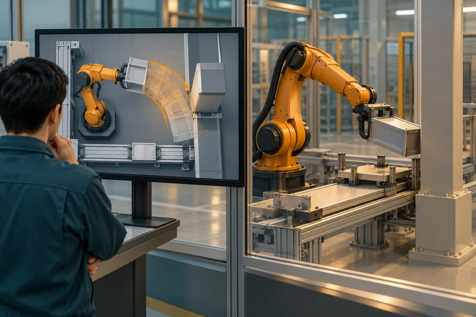
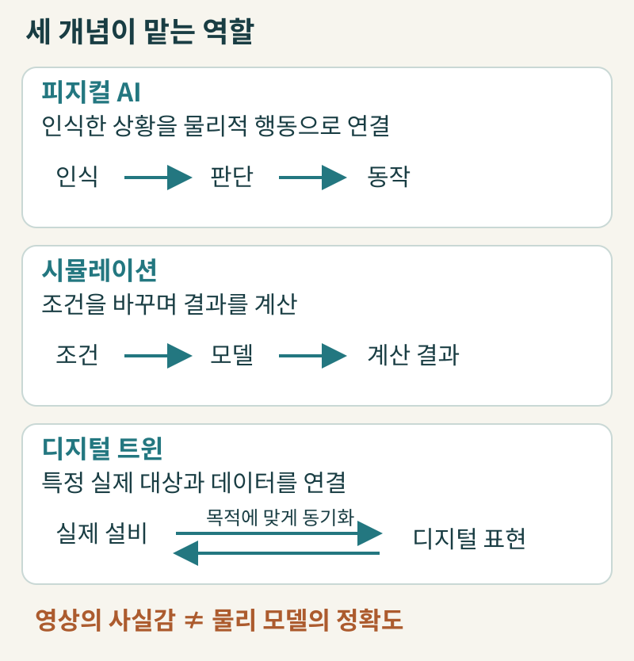
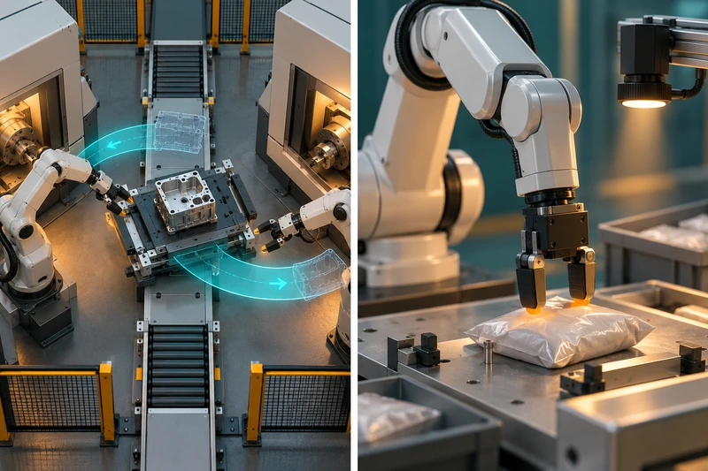
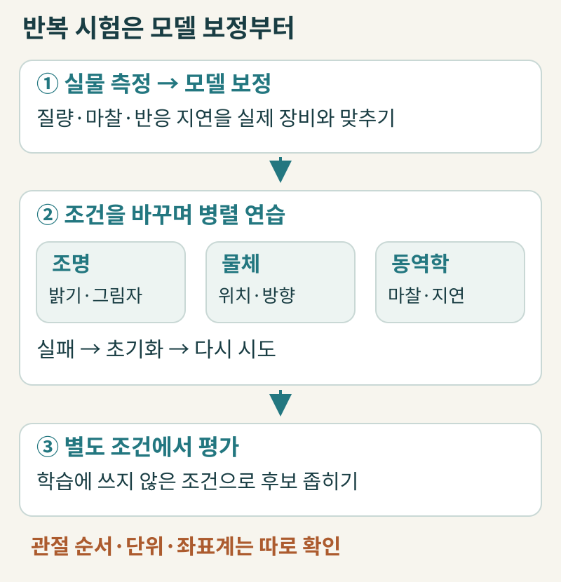
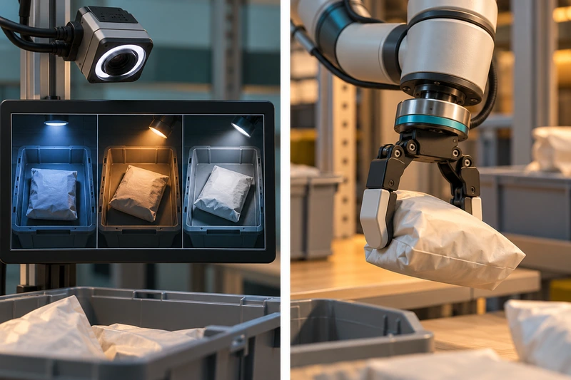
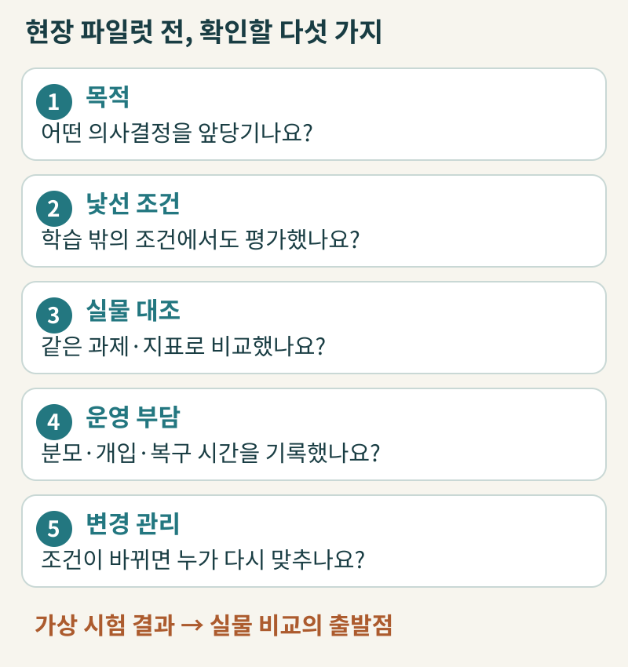
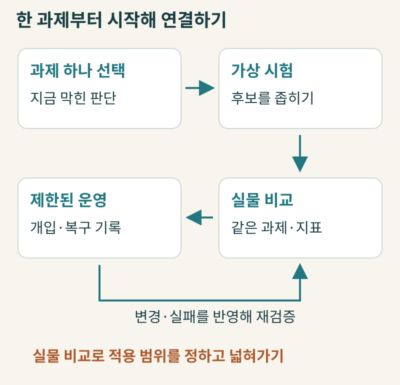

+++
date = '2026-10-30T00:00:00+09:00'
draft = false
title = '공장에 로봇을 들이기 전에 왜 가상 공장에서 먼저 돌려볼까요?'
description = '피지컬 AI와 디지털 트윈이 앞당기는 의사결정의 범위, 그리고 가상 시험에서 현장 투입으로 넘어갈 때 반드시 확인해야 할 실물 검증 기준을 살펴봅니다.'
tags = ['ax', 'physical-ai', 'digital-twin', 'simulation']
authors = ['geoff']
slug = 'physical-ai-simulation'
audio = []
vedios = []
series = []
toc = true
featured_image = 'thumbnail.webp'
images = ['thumbnail.webp']
+++

## 들어가며

### 첫 번째 상황 : 도면에서는 분명히 맞았는데 막상 옮겨보니 안 들어갑니다
우리 회사가 신제품 양산을 앞두고 생산 라인의 로봇과 운반 설비 배치를 바꾼다고 가정해봅시다. 설계 도면으로 치수를 쟀을 때는 분명히 여유가 있어 보였습니다. 그래서 주말 동안 라인을 세우고 장비를 옮겨 설치했는데 막상 시운전 전원을 켜보니 차체가 회전하는 구간에서 설비와 기둥 사이에 간섭이 생깁니다. 결국 가동을 미루고 장비를 다시 배치해야 합니다.

### 두 번째 상황 : 컴퓨터 안에서 잰 99%인가요, 우리 창고에서 잰 99%인가요?
이번에는 물류 현장에 다품종 상품을 집어 옮기는 AI 로봇을 시범 도입하기로 했다고 해봅시다. 공급사는 매끄러운 3D 시연 영상을 보여주면서 가상 환경에서 충분히 학습해 작업 성공률이 99%에 달한다고 설명합니다. 이때 현장 운영 임원이 손을 들고 묻습니다. “그 99%는 컴퓨터 안에서 잰 숫자인가요, 아니면 포장 비닐이 구겨지고 조명이 수시로 달라지는 우리 창고에서 실제로 집어보고 잰 숫자인가요?”

### 왜 가상 시험의 역할과 한계를 함께 봐야 할까요?
비행기 조종사를 훈련할 때 처음부터 실제 여객기에 태워 엔진 화재나 강풍 착륙을 겪게 할 수는 없습니다. 그래서 비행 시뮬레이터 안에서 위험한 시행착오를 먼저 겪으며 연습합니다. 하지만 시뮬레이터 점수가 높다고 해서 실제 비행 검증 없이 곧바로 기장으로 임명하지는 않습니다.

산업 현장의 피지컬 AI(Physical AI)도 마찬가지입니다. 현실에서 직접 부딪혀보며 찾기에는 비용과 시간이 많이 드는 문제를 가상 공간에서 먼저 걸러내되, 실제 현장으로 넘어갈 때는 화면이 대신해 줄 수 없는 실물 검증을 거쳐야 합니다. 지금부터 왜 피지컬 AI를 가상 공간에서 먼저 시험하는지, 같은 가상 공장이라도 의사결정 목적에 따라 무엇이 달라지는지, 그리고 현장 투입 전에 어떤 기준을 확인해야 하는지 같이 알아보겠습니다.

## 화면이 진짜 같다는 말과 물리적으로 정확하다는 말은 다릅니다

현업에서 로봇이나 스마트 팩토리 과제를 논의하다 보면 피지컬 AI, 시뮬레이션, 디지털 트윈이라는 세 단어가 거의 같은 뜻처럼 섞여 쓰이곤 합니다. 하지만 투자 결정을 내리는 입장에서는 세 개념의 역할을 먼저 구분해 두어야 예산과 목표가 흐려지지 않습니다.

먼저 **피지컬 AI**는 카메라나 힘 센서 등으로 주변을 인식하고 그 판단을 물리적 행동으로 연결하는 AI 시스템입니다. [Microsoft Research의 연구 소개](https://www.microsoft.com/en-us/research/collaboration/physical-ai-research/)가 짚듯, 핵심은 로봇이 사람 모양의 휴머노이드인가 하는 외형이 아니라 지각과 판단, 물리적 동작이 하나로 이어지는가입니다. 반면 **시뮬레이션**은 대상의 일부 특성과 규칙을 모델로 만들어 조건을 바꿨을 때의 결과를 계산하는 방법입니다. **디지털 트윈**은 특정 실제 대상에 대응하며 목적에 맞는 데이터와 동기화 관계를 맺은 디지털 표현입니다.

여기서 흔히 빠지는 함정이 있습니다. 컴퓨터 화면 속 3D 그래픽이 영화처럼 사실적이면 그 안의 물리적 결과도 현실과 똑같을 것이라고 믿는 것입니다. 거실에 큰 소파를 새로 들일 때 인테리어 앱으로 가죽 질감과 색상을 아무리 사진처럼 그려 넣어도, 현관문 폭을 잘못 재거나 바닥 마찰을 반영하지 못하면 소파를 들여놓을 수 없는 것과 같습니다.

[미국 국립표준기술연구소(NIST)의 디지털 트윈 사례 보고서(AMS 400-2)](https://nvlpubs.nist.gov/nistpubs/ams/NIST.AMS.400-2.pdf) 2.1절은 디지털 트윈에서 중요한 것이 단순한 3D 시각화가 아니라 목적에 맞는 표현과 데이터 동기화라고 설명합니다. 설비 간섭을 확인하는 트윈과 운전 상태를 추적하는 트윈은 필요한 정보와 갱신 주기가 다릅니다. 모든 트윈에 똑같은 실시간 주기를 강제할 필요도 없지만 반대로 3D 설계 파일 하나를 띄워 놓았다고 해서 실제 현장의 마찰, 무게중심, 센서 노이즈, 제어 지연까지 자동으로 맞춰지는 것도 아닙니다.

## 같은 가상 공장이라도 설비 배치 검증과 로봇 학습은 전혀 다른 일입니다

경영진이 “우리도 가상 공장 트윈을 구축하자”라고 한 묶음으로 안건을 올리면 부서마다 생각하는 결과물이 달라지기 쉽습니다. 가상 공간에서 하는 일은 크게 공장·설비 배치 계획 검증과 로봇의 인식·행동 정책 학습으로 나뉘고 이 둘은 필요한 데이터와 검증 방식이 전혀 다르기 때문입니다.

### 설비 배치와 공정 간섭을 미리 확인하는 가상 계획
첫 번째는 공장을 짓거나 라인을 바꿀 때 설비 간섭과 동선을 미리 맞춰보는 용도입니다. 대표적인 사례가 [BMW 그룹이 2025년 6월 발표한 가상 공장(Virtual Factory) 확대 적용](https://newsroom.bmwgroup.com/global/bmw-group-scales-virtual-factory/)입니다.

BMW의 설명에 따르면, 새 차종을 투입할 때 3D 스캔 데이터와 설계 데이터를 결합해 차체가 이동·회전하는 동안 주변 설비와 부딪히지 않는지 가상 공간에서 검사합니다. 과거 실제 차체로 거의 4주가 걸리던 특정 차체 충돌 검사를 3일짜리 가상 시험으로 바꿨다고 밝히며 향후 생산 계획 비용을 최대 30%까지 줄일 수 있을 것으로 전망합니다. 또한 [2025년 9월 공개된 BMW 데브레첸(Debrecen) 공장 개장 자료](https://newsroom.bmwgroup.com/global/bmw-groups-newest-most-innovative-production-site-officially-opens-in-debrecen/)에는 차체 공장의 산업용 로봇 약 1,000대 배치와 공정을 사전에 시뮬레이션했다는 내용이 나옵니다. 가상 계획 검증은 이렇게 설비가 정해진 경로로 움직일 때 공간적 간섭이 없는지 미리 확인해 현장 재작업을 줄이는 일입니다.

### 스스로 판단해 움직이는 능력을 키우는 로봇 학습
두 번째는 행동 정책(Policy) 학습입니다. 고정된 좌표로만 움직이던 로봇이 센서로 상황을 파악해 어떤 동작을 취할지 결정하도록 가르치는 일입니다. 데브레첸 공장에서 로봇 1,000대의 배치와 공정을 시뮬레이션했다는 말이 곧 1,000대의 로봇이 인공지능 강화학습으로 동작을 스스로 깨우쳤다는 뜻은 아닙니다.

로봇 학습은 조명이나 가림이 달라도 대상을 찾아내는 인식 학습과, 물체를 어떤 각도와 힘으로 다룰지 결정하는 동작 학습으로 나뉩니다. 설비 배치 검증에서는 외형 치수와 이동 경로가 중요하지만 로봇 행동 학습에서는 물체의 질량, 표면 마찰, 구동기 반응, 센서 지연 같은 물리·제어 특성이 성패를 가릅니다. 따라서 예산을 세울 때부터 설비 배치 검증인지 로봇 정책 학습인지 목적을 분리해야 합니다.

## 왜 굳이 가상 공간에서 먼저 구르고 실패하게 만들까요?

그렇다면 로봇의 인식이나 동작 정책을 가르칠 때 왜 처음부터 실제 설비에서 하지 않고 가상 공간을 거칠까요? 현실의 생산 라인은 AI가 마음껏 실패하며 배우도록 기다려주지 않기 때문입니다. 학습 초기에는 로봇이 허공을 집거나 물건을 떨어뜨리고 주변 구조물과 부딪히기 일쑤입니다. 실제 하드웨어로 이 시행착오를 겪으면 장비가 파손될 뿐 아니라, 떨어진 물건을 사람이 다시 제자리에 놓아주는 데만 많은 시간과 인력이 듭니다.

[NVIDIA Isaac Lab의 Sim-to-Real 기술 문서](https://docs.nvidia.com/learning/physical-ai/getting-started-with-isaac-lab/latest/robot-learning-fundamentals/08-simulation-to-reality.html)가 설명하듯, 가상 공간의 핵심 이점은 반복 초기화와 병렬 시험입니다. 현실에서는 매번 작업대를 손으로 정돈해야 하지만 가상 환경에서는 실패 직후 초기 상태로 되돌리는 과정을 반복하며 여러 가상 환경을 병렬로 시험할 수 있습니다. 현장에 가져갈 후보 정책을 안전하게 좁혀주는 셈입니다.

### 조금씩 다른 조건에서 연습시키는 도메인 랜덤화
하지만 시뮬레이터 안의 세상은 현실보다 지나치게 깔끔하고 일정합니다. 고정된 조명과 마찰 조건에서만 연습한 AI는 실제 현장의 그림자 변화나 부품 표면의 미세한 미끄러짐만 만나도 쉽게 실패합니다.

이 간극을 줄이려고 쓰는 기법이 도메인 랜덤화(Domain Randomization)입니다. 한 가지 기본 설정에만 의존하지 않도록 연습할 때마다 조명, 물체 위치와 방향, 배경을 바꾸거나([Tobin 등의 시각적 도메인 랜덤화 연구](https://arxiv.org/abs/1703.06907)), 물체의 질량과 마찰, 반응 지연 같은 동역학 조건을 넓혀 학습시키는 방법입니다([Peng 등의 동역학 랜덤화 연구](https://arxiv.org/abs/1710.06537)).

### 도메인 랜덤화가 모델 보정을 대신하지는 못합니다
공급사로부터 “도메인 랜덤화로 충분히 학습했으니 현장에서도 바로 작동한다”는 설명을 들을 때는 두 가지 한계를 함께 점검해야 합니다.

첫째, 도메인 랜덤화가 실제 장비의 측정과 모델 보정(시스템 식별)을 대체하지는 못합니다. 실제 로봇의 질량이나 마찰, 반응 특성을 측정해 모델을 먼저 맞춘 뒤 남는 불확실성을 랜덤화로 보완해야 합니다. 모델 보정 없이 랜덤화 범위만 넓히면 동작이 지나치게 느리고 보수적으로 변하거나 학습 부담만 커질 수 있습니다.

둘째, 잘못된 인터페이스 연결은 랜덤화 학습으로는 못 고칩니다. 관절 순서나 단위, 좌표계, 제어 주기가 실제 장비와 어긋나 있다면 가상 공간에서 아무리 반복 학습해도 오류는 그대로 남습니다. 따라서 “얼마나 오래 학습했는가”보다 “실제 장비에서 무엇을 측정해 보정했고 어떤 변수를 바꿨는가”를 물어야 합니다.

## 가상 학습과 현장 데이터는 어떻게 역할을 나눌까요?

가상 시뮬레이션의 이점과 한계를 함께 놓고 보면 “어디까지 가상 자료를 쓰고, 어디서부터 실제 현장 자료를 써야 하는가”라는 질문이 따라옵니다. 아마존(Amazon)의 물류 로봇 벌칸(Vulcan)과 BMW의 휴머노이드 파일럿 사례를 보면 이 경계가 어디쯤인지 드러납니다.

### 아마존 벌칸(Vulcan) : 시각 인식에는 합성 영상, 접촉 동작에는 실물 피드백
아마존 물류센터의 보관함(Bin)은 여러 상품이 빽빽하게 들어차 있고 앞쪽에 탄성 밴드가 쳐져 있습니다. 로봇이 여기에 물건을 넣거나 빼려면 보관함 내부를 보는 눈과, 물건이 부딪힐 때의 저항을 읽는 촉각이 함께 필요합니다.

[2025년 5월 공개된 Amazon Science의 기술 설명](https://www.amazon.science/blog/how-amazons-vulcan-robots-use-touch-to-plan-and-execute-motions)과 [아마존의 벌칸 소개 자료](https://www.aboutamazon.com/news/operations/amazon-vulcan-robot-pick-stow-touch)를 보면 가상 자료와 실물 자료의 역할이 뚜렷하게 나뉩니다. 보관함 내부를 파악하는 시각 인식 알고리즘 학습에는 탄성 밴드를 추가한 합성 보관함 이미지를 사용했습니다. 반면 물건을 밀어 넣고 빼낼 때의 물리 동작과 접촉 학습에는 실제 촉각·힘 피드백과 수천 건의 현실 예시를 썼습니다. 아마존은 시뮬레이션만으로는 이 접촉 감각을 가르칠 수 없었다고 설명합니다. 인식용 합성 데이터와 물리 접촉용 실물 데이터가 맡아야 할 역할이 이렇게 다릅니다.

### BMW 휴머노이드 파일럿 : 가상 검증과 현장 운영 기록을 구분해 읽기
자동차 공장의 휴머노이드 사례도 다르지 않습니다. [Figure의 2025년 11월 발표](https://www.figure.ai/news/production-at-bmw)와 [BMW 그룹의 2026년 9월 라이프치히 공장 파일럿 자료](https://www.bmwgroup.com/en/news/general/2026/humanoid-robot-in-leipzig.html)는 스파턴버그 공장에 투입됐던 Figure 02가 약 1,250시간 운전하며 9만 개 이상의 부품을 다뤘고 X3 3만 대 이상 생산에 기여했다고 보고합니다(운전 기간은 BMW가 10개월, Figure가 11개월로 각각 설명합니다).

다만 이 수치는 특정 부품 투입 과제의 누적 기여 기록일 뿐, 그중 시뮬레이션이 만든 인과적 효과나 사람 개입 없는 무개입 운전율을 입증하는 자료가 아닙니다. 또한 BMW는 이 파일럿에서 안전 개념 보완과 5G 통신 개선 같은 현장 통합 과제를 주요 교훈으로 확인했습니다. 계획 단계의 가상 충돌 검사와 실제 현장의 로봇 파일럿 기록은 서로 다른 단계의 근거로 구분해 읽어야 합니다.

## 가상 시험에서 현장 투입으로 넘어갈 때 던져야 할 5가지 질문

가상 시험 통과가 곧 현장 운전 승인을 뜻하지는 않습니다. [NIST의 제조 디지털 트윈 신뢰성 연구(2022)](https://www.nist.gov/publications/credibility-consideration-digital-twins-manufacturing) 역시 트윈의 신뢰성은 사용 목적에 맞춘 검증과 불확실성 평가에서 나온다고 강조합니다. 가상 공간의 결과를 보고 현장 파일럿으로 넘어갈지 판단할 때 실무진과 공급사에게 던져볼 다섯 가지 경영 검토 질문을 제안합니다.

### 1. 이번 가상 시험으로 앞당기려는 의사결정이 정확히 무엇인가요?
설비 간섭을 확인하는 배치 검증인지, 카메라 인식 모델을 보강하는 학습인지, 로봇 팔의 접촉 동작을 학습시키는 과제인지부터 하나로 좁혀야 합니다. 어떤 의사결정을 뒷받침하느냐에 따라 필요한 모델 정밀도와 검증 지표가 달라집니다.

### 2. 학습에 쓰지 않은 낯선 조건에서도 평가해 보았나요?
연습할 때 쓴 것과 똑같은 가상 장면에서 얻은 성공률만으로는 새로운 조건에서 성능이 어떤지 알 수 없습니다. 조명이나 물체 위치, 표면 상태를 바꾼 별도 평가 조건에서도 시험했는지, 그리고 주로 어떤 조건에서 실패했는지 함께 확인해야 합니다.

### 3. 가상 환경의 결과와 실제 장비의 결과를 같은 기준으로 비교했나요?
모델에 넣은 값 가운데 실제 현장에서 측정한 값과 임의로 가정한 값을 구분해야 합니다. 또한 현장에 넓게 배포하기 전에 격리된 소규모 실물 환경에서 동일한 과제와 지표로 가상 결과와 실물 결과를 나란히 대조해 봐야 합니다.

### 4. 성공률 뒤에 숨은 분모와 사람 개입 부담을 함께 기록했나요?
성공률 숫자만 보지 말고 전체 시도 횟수(분모), 품질 결과, 사람의 개입 횟수, 실패 후 복구 시간을 함께 봐야 합니다. 100번 중 95번 성공하더라도 나머지 5번 때문에 작업자가 매번 라인에 들어가 재설정해야 한다면 상시 운영으로 넘어가기 어렵습니다.

### 5. 현장의 부품이나 설비가 바뀔 때 누가 모델을 다시 맞추나요?
제품 사양이나 포장재, 그리퍼, 소프트웨어가 바뀌면 기존의 가상 모델과 현실 사이에 다시 틈이 벌어집니다. 현장 조건이 달라질 때 어느 담당자가 모델을 갱신하고 어떤 검증을 다시 수행할지 변경 관리 절차를 미리 정해두어야 합니다.

물론 이 다섯 가지 질문은 투자와 전환 단계를 점검하기 위한 경영 관점의 제안입니다. 실제 장비의 물리적 안전 확보와 제어 적합성, 현장 운전 승인은 해당 제어·로봇·생산·안전 엔지니어링 전문가가 직접 설계하고 검증해야 합니다.

## 나가며

피지컬 AI를 현장에 투입하기 전에 가상 공간에서 먼저 시험하는 이유는 현실에서 겪기에는 너무 비싸고 번거로운 시행착오를 미리 줄이고 실물에 가져갈 후보를 좁히기 위해서입니다. 하지만 가상 시험의 결과는 현장 검증을 시작할 출발선이지 최종 성적표가 아닙니다.

공장 전체를 통째로 복제하는 거창한 사업부터 시작할 필요는 없습니다. 신규 라인의 설비 간섭 확인이든 특정 공정의 시각 인식 오류 개선이든, 지금 가장 병목이 되는 의사결정 하나를 골라 가상 시험과 실물 비교의 연결 고리를 만드는 편이 훨씬 현실적입니다.

우리 현장의 어떤 과제를 가상 시험으로 먼저 풀어야 할지 고르는 일부터, 공급사의 시연 지표를 현업 기준의 파일럿 검증 질문으로 정리하고 운영 체계를 설계하는 과정까지 고민이 있으시다면 언제든지 엡실론델타(contact@epsilondelta.ai)로 연락해 주시기 바랍니다. 여러분의 조직과 현장에 맞는 AX 방향을 함께 고민하고 도와드리겠습니다.
