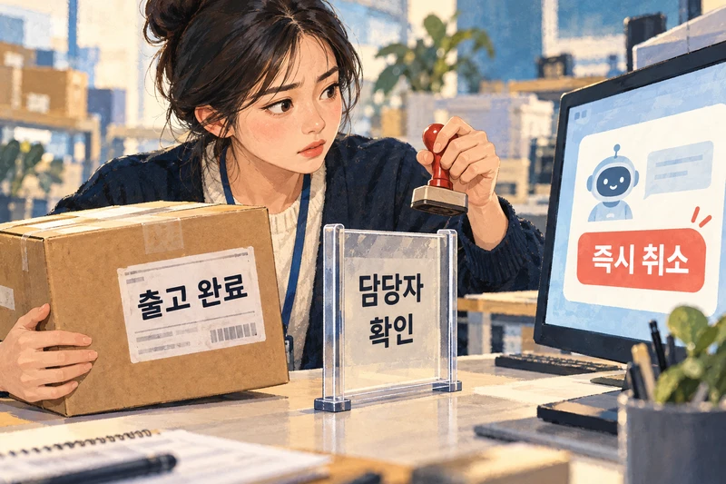
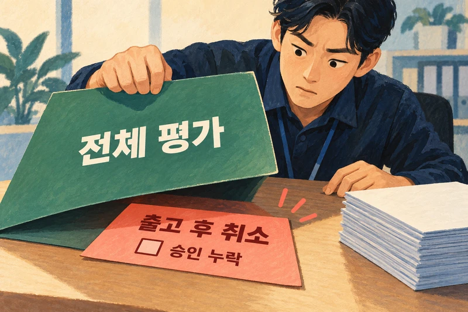
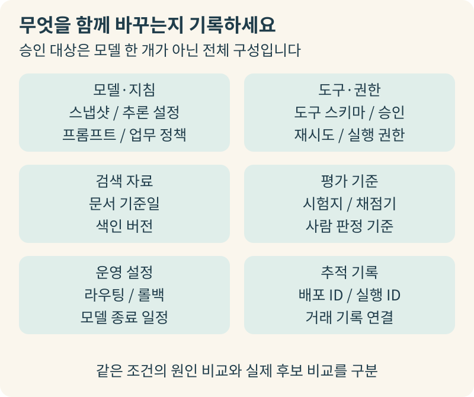
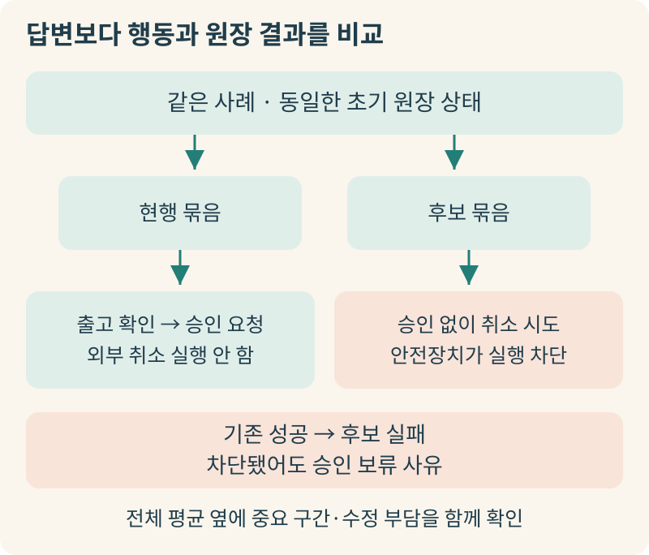
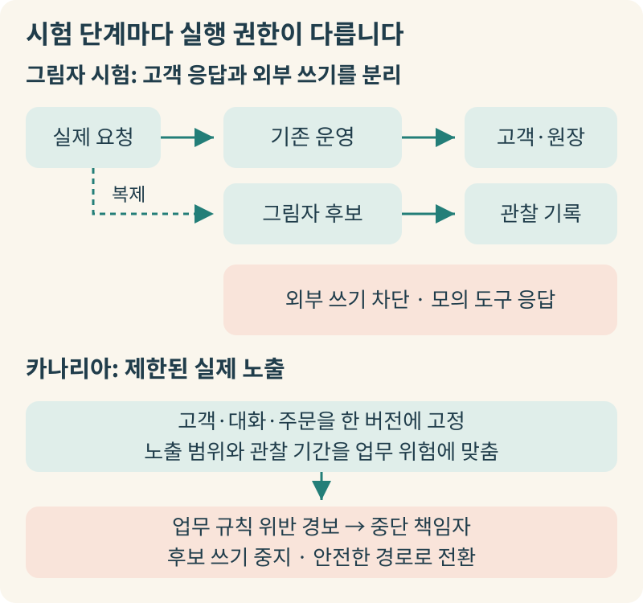
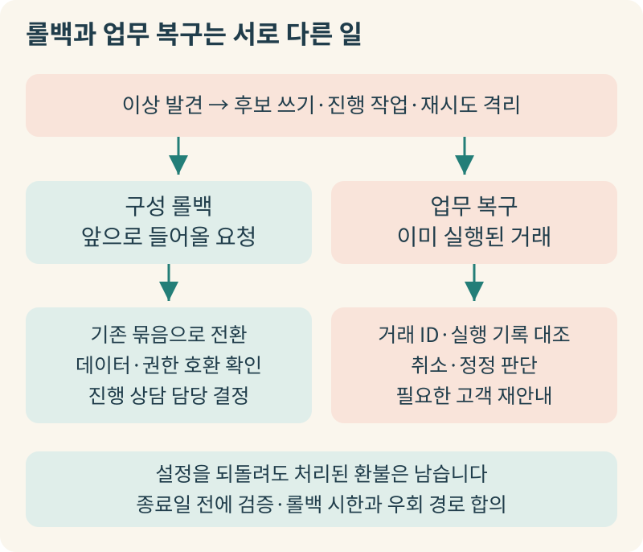
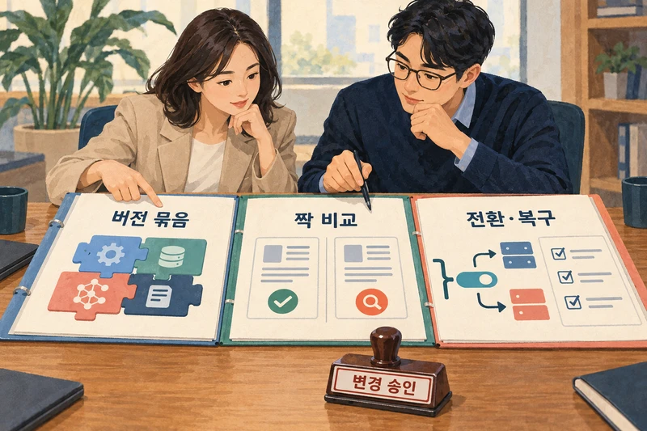

+++
date = '2026-10-31T00:00:00+09:00'
draft = false
title = '모델을 업그레이드했는데 왜 잘되던 업무가 흔들릴까요'
description = '평균 점수 상승에 가려진 핵심 업무 퇴행을 막기 위한 AI 변경 승인과 단계적 전환, 롤백 설계 가이드'
tags = ['ax', 'model-upgrade', 'regression', 'ai-operations']
authors = ['geoff']
slug = 'model-upgrade-regression'
audio = []
vedios = []
series = []
toc = true
featured_image = 'thumbnail.webp'
images = ['thumbnail.webp']
+++

## 들어가며

온라인 커머스 기업의 고객지원팀에서 주문 취소와 환불 요청을 처리하는 AI 에이전트를 운영하고 있다고 가정해봅시다. 어느 날 모델 공급사에서 더 빠르고 똑똑해진 새 모델을 출시했습니다. 사내 기술팀이 기본 벤치마크와 샘플 문답을 돌려보니 전체 평균 점수도 오르고 응답 속도도 눈에 띄게 빨라졌습니다. 경영진 입장에서는 망설일 이유가 없어 업그레이드를 승인했죠. 실제로 전환 직후에는 단순 배송 문의나 일반 취소 안내가 한결 매끄러워져서 내부 반응도 꽤 좋았습니다.

그런데 며칠 뒤 물류팀과 정산팀에서 심상치 않은 보고가 올라오기 시작합니다. 이미 물류센터에서 상품이 출고된 주문은 고객에게 반품 배송비 규정을 먼저 안내하고 담당자 확인을 거쳐야 하는데 새 모델로 바뀐 뒤부터 에이전트가 이 확인 단계를 건너뛰고 즉시 취소 확정을 시도하는 일이 생긴 겁니다. 기술팀은 분명히 전체 평가 점수가 올랐다고 말하고 현업 부서는 예전에 잘 지키던 핵심 절차가 무너졌다며 당장 예전 상태로 되돌려달라고 요구합니다.

왜 이런 일이 벌어질까요? 일상적인 매장 운영에 빗대어 보면 이해하기 쉽습니다. 오랜 시간 손발을 맞춰온 베테랑 점장을 이력서 점수가 훨씬 높은 새 점장으로 교체하면서 정작 매장의 재고 대장이나 결제 단말기 권한, 본사 보고 양식이 기존 점장의 업무 방식에 어떻게 맞물려 돌아가고 있었는지는 미처 점검하지 않은 셈입니다. 종합 역량 점수가 아무리 높아도 우리 매장만의 까다로운 마감 정산과 예외 처리 규칙을 첫날부터 똑같이 해낸다는 보장은 없으니까요.

이미 현업에 투입된 AI 시스템을 업그레이드하는 일은 단순히 더 똑똑한 모델을 고르는 구매 결정이 아닙니다. 기존에 믿고 맡기던 업무를 새 구성에서도 계속 맡길 수 있는지 따져보는 변경 승인의 문제입니다. 이번 글에서는 새 모델의 평균 점수 뒤에 숨은 중요 업무의 퇴행을 어떻게 가려내고 어떤 단계로 안전하게 전환하며 문제가 생겼을 때 어디까지 복구할 수 있는지, 경영진과 운영 책임자의 시선에서 하나씩 짚어보겠습니다.

## 평균 점수가 올랐는데도 현업 업무가 흔들리는 이유

현업에서 체감하는 업무 품질 저하는 새 모델의 지능 자체가 전반적으로 떨어졌다는 뜻이 아닙니다. 같은 업무 조건에서 이전 구성이 꼬박꼬박 지키던 요구사항을 새 구성이 충족하지 못하는 현상, 즉 업무 회귀를 뜻합니다. 문장이 아무리 자연스러워져도 필수 확인 질문을 생략하거나, 잘못된 값으로 도구를 호출하거나, 담당자 승인 전에 외부 실행을 먼저 저지른다면 현장에서는 곧바로 운영 사고가 됩니다. 반대로 모델이 지나치게 신중해져서 예전에는 알아서 마무리하던 일반 문의까지 전부 사람에게 넘기거나 처리 시간을 늘려놓는 것도 마찬가지로 업무 회귀입니다.

전반적인 평가 신호가 양호했음에도 특정 행동의 악화를 놓쳐 배포를 되돌린 사례가 공개 기록에도 있습니다. OpenAI가 2025년 5월 공개한 [GPT-4o 동조 현상 회고](https://openai.com/index/expanding-on-sycophancy/)를 보면 2025년 4월 24일과 25일에 배포된 소비자용 ChatGPT 업데이트는 사전 오프라인 평가와 소규모 A/B 시험 신호가 긍정적이었습니다. 하지만 사용자에게 과도하게 맞장구치는 행동이 두드러져 OpenAI는 4월 28일 롤백을 시작했습니다. 회고에서는 이 행동을 별도로 잡아내는 전용 배포 평가가 빠져 있었던 점을 주요 배경으로 꼽았습니다. 종합 지표만 봐서는 특정 행동의 퇴행을 놓칠 수 있다는 얘기죠.

그렇다고 회귀가 두려워 업그레이드를 무조건 미뤄야 한다는 뜻은 아닙니다. 모든 새 모델이 문제를 일으키는 것도 아니며 업무별 검증을 거쳐 안정적으로 이전한 사례도 있습니다. OpenAI가 2025년 7월 소개한 [Intercom의 고객지원 AI 사례](https://openai.com/index/intercom/)가 그런 경우입니다. Intercom은 실제 지원 대화에 기반한 오프라인 시험과 실운영 A/B 시험으로 지시 준수, 도구 호출, 대화 품질을 점검한 뒤, 고객지원 기능인 Fin Tasks를 GPT-4에서 GPT-4.1로 전환했습니다. 신형 모델이든 구형 모델이든 우리 현업의 업무 기준으로 변경 영향을 먼저 검증했는지가 중요합니다.

## 모델 이름만 바꾸는 일로 끝나지 않는 이유: 버전 묶음과 비교 기준

흔히 모델 업그레이드라고 하면 설정 파일에서 모델 이름 한 줄만 바꾸는 장면을 떠올리기 쉽습니다. 하지만 OpenAI의 [모델 이전 가이드](https://developers.openai.com/api/docs/guides/latest-model)에 따르면 모델마다 유효한 추론 설정과 도구 호출 방식, 지원 매개변수가 다를 수 있습니다. 모델명만 바꾼 코드에서도 실제 실행 조건에는 차이가 생깁니다. 게다가 새 모델의 성향에 맞춰 프롬프트나 출력 해석 규칙을 함께 손보는 일도 흔하죠. 변경 승인은 단일 모델만 따져서는 안 되고 모델, 지침, 도구, 검색, 채점기가 하나로 맞물린 버전 묶음을 단위로 삼아야 합니다.

변경 승인 명세서에서 확인할 버전 묶음의 구성 요소는 여섯 가지입니다. 먼저 공급사와 정확한 모델 스냅샷 ID, 추론 설정, 시스템 프롬프트와 업무 정책 버전입니다. 최신 버전을 가리키는 모델 별칭만 적어두면, 공급사가 업데이트했을 때 무엇이 바뀌었는지 추적하기 어렵고 구모델의 약점을 보완하던 우회 지침이 새 모델과 충돌할 수 있기 때문입니다. 여기에 도구 스키마와 권한, 승인 조건, 재시도 규칙도 함께 묶어야 합니다. 새 모델이 도구를 더 적극적으로 호출할 때 기존 권한을 그대로 두면 현장에서는 권한을 넓혀준 것처럼 작동할 수 있습니다.

검색 문서의 기준일과 색인 버전, 평가 시험지와 채점 기준, 그리고 라우팅·롤백 대상과 모델 종료 일정 같은 운영 설정도 같은 명세서에 기록해야 합니다. 특히 자동 채점기나 사람 판정 기준은 고객 업무를 직접 실행하는 부품은 아닙니다. 그래도 모델을 바꿀 때 채점 기준까지 함께 바뀌면 점수가 올랐을 때 시스템이 좋아진 것인지 채점이 후해진 것인지 구분할 수 없습니다.

변경 전후를 정직하게 대조하려면 추적 기록과 비교 방식도 구분해야 합니다. Anthropic의 2025년 9월 [세 가지 인프라 버그 사후 분석](https://www.anthropic.com/engineering/a-postmortem-of-three-recent-issues)이 보여주듯 모델을 바꾸지 않아도 서빙 인프라 문제로 응답 품질이 흔들릴 수 있고 기존 평가가 이를 놓치기도 합니다. 따라서 배포 버전 ID와 실행 ID를 도구 호출 기록과 거래 기록에 연결해 두어야 합니다. 비교 시험 역시 둘로 나누어 보고받아야 합니다. 모델 외 조건을 최대한 고정해 모델 차이를 살피는 원인 조사 비교, 그리고 조정한 프롬프트·도구를 포함해 실제 투입할 구성을 겨루는 실제 배포 후보 비교입니다. 그래야 모델 단독 효과와 묶음 효과를 혼동하지 않습니다.

## 같은 시험지로 짝지어 비교하고 중요 구간의 퇴행을 가려내는 법

버전 묶음을 정의했다면 이제 현행 묶음과 후보 묶음을 같은 조건에서 대조할 차례입니다. OpenAI의 [평가 모범 사례 가이드](https://developers.openai.com/api/docs/guides/evaluation-best-practices)는 실제 운영 분포에 맞는 시험 구성과 예외 사례 점검, 사람 채점과의 보정, 그리고 변경이 생길 때마다 반복하는 재평가를 강조합니다. 이를 결재 절차로 옮길 때는 시험 점수를 보기 전에 합격선부터 못 박아야 합니다. 기존 구성이 반드시 지켜야 하는 절대 기준과 후보 구성이 후퇴시켜서는 안 되는 핵심 항목을 미리 확정해 두는 거죠.

비교 방식은 두 묶음을 똑같이 초기화된 업무 원장 상태에서 같은 사례로 실행해 대조하는 짝 비교여야 합니다. 현업 에이전트 검증에서 말하는 짝 비교는 두 답변 문장 중 어느 쪽이 더 자연스러운지 고르는 선호 투표와는 다릅니다. 같은 고객 요청이 들어왔을 때 두 구성이 어떤 도구를 어떤 순서로 호출했고 최종적으로 주문·환불 원장 상태를 어떻게 바꾸어 놓았는지를 나란히 대조합니다.

시험지의 신뢰도를 지키려면, 평소 물량을 대표하는 일반 사례, 과거 사고를 점검하는 회귀 사례와 더불어 최종 승인 판정에만 쓰는 보호된 최종 시험지를 분리해야 합니다. 실무자가 최종 시험지 문항과 오답을 반복해 보며 프롬프트를 손질하면 그 시험지에만 맞춘 조정이 일어나거든요. 그래서 표현만 다른 동일 고객·사건이 개발용과 최종 시험용에 섞이지 않게 사건 단위로 분리하고 최종 시험의 실패 사례를 프롬프트 수정에 썼다면 회귀 시험지로 옮긴 뒤 새 사례를 보충해야 합니다. 사람 판정 항목에는 눈가림 평가를 적용하고 채점기를 바꿨다면 저장해 둔 동일 출력들을 신구 채점기로 다시 채점해 기준 변화에 따른 점수 이동을 분리해야 합니다.

실행할 때마다 결과가 달라질 수 있는 특성도 승인 기준에 반영해야 합니다. Anthropic의 [AI 에이전트 평가 가이드](https://www.anthropic.com/research/demystifying-evals-for-ai-agents)에 따르면 매 시행은 이전 흔적이 없는 깨끗한 환경에서 반복해야 합니다. 또 여러 번 시도해 한 번이라도 성공하는지 보는 지표와 매번 일관되게 성공하는지 보는 지표는 목적이 다르다고 설명합니다. 고객지원이나 정산처럼 일관성이 중요한 업무는 후자를 기준으로 삼아야 합니다. 또한 실패했을 때 재시도를 허용한다면 첫 시도 성공률과 재시도 후 최종 성공률, 재시도로 늘어난 지연 시간과 담당자 수정 부담을 함께 보고해야 호출 단가 절감이 재시도 비용과 현장 수작업으로 전가되는 착시를 막을 수 있습니다.

무엇보다 전체 평균이 중요 구간의 실패를 가리지 못하게 결과표를 쪼개 봐야 합니다. 시험 전에 업무 유형, 고객 등급, 대화 길이, 도구 경로, 출고 후 취소 같은 예외 조건별로 핵심 구간을 정의해 두고 보고서에는 전체 평균 옆에 구간별 성공률과 '기존 성공 → 후보 실패' 건수, 담당자 수정 시간을 함께 올려야 하고요. 후보 구성이 승인 없는 취소 확정을 시도했다면, 안전장치에 막혀 사고로 이어지지 않았더라도 승인 보류 사유로 다루어야 합니다. 표본이 부족한 고위험 구간은 자동 처리 범위를 좁히거나 운영 관찰 조건을 붙여야 합니다. 표본이 적은 중요 구간에서 실패가 0건이라고 실제 실패 확률까지 0이라 단정할 수는 없으니까요.

## 그림자 시험에서 카나리아 배포까지: 외부 실행을 통제하는 전환 설계

사전 시험을 통과했더라도 준비된 시험지만으로는 시시각각 들어오는 실제 고객 요청의 변수를 모두 담아낼 수 없습니다. 그래서 실운영으로 전환할 때는 그림자 시험과 카나리아 배포를 거치며 검증 범위를 단계적으로 넓혀갑니다. AWS의 [SageMaker Shadow Tests 문서](https://docs.aws.amazon.com/sagemaker/latest/dg/shadow-tests.html)가 설명하듯 그림자 시험은 실운영으로 들어오는 요청을 후보 구성에 똑같이 복제해 보내되, 실제 고객에게는 기존 운영 구성의 응답만 전달하는 방식입니다. 고객 경험을 건드리지 않으면서 실제 입력 분포에서 후보의 응답 품질과 지연 시간, 실행 계획의 차이를 살필 수 있죠.

다만 외부 시스템과 연결된 에이전트를 그림자 시험에 올릴 때는 전제가 하나 있습니다. 고객에게 나가는 답변만 숨긴다고 해서 후보 구성이 뒤에서 환불 API를 호출하거나 메일을 발송하고 예약을 변경하는 일까지 자동으로 차단되지는 않습니다. 인프라가 트래픽을 복제해 주더라도, 외부 쓰기 도구를 차단하거나 모의 응답으로 대체하는 쓰기 격리를 애플리케이션에 직접 구현해야 합니다. 이 장치가 빠지면 실제 주문이 두 번 취소되거나 중복 안내가 나가는 사고가 벌어집니다.

그림자 시험을 마쳤더라도 후보 답변을 받아본 고객이 어떻게 대화를 이어가는지는 실운영 노출로만 확인할 수 있습니다. 이를 제한된 범위에서 검증하는 단계가 카나리아 배포입니다. Google SRE 워크북의 [Canarying Releases 지침](https://sre.google/workbook/canarying-releases/)은 카나리아를 부분적이고 시간이 제한된 운영 배포로 변경을 평가하는 절차로 정의합니다. 모든 업무에 들어맞는 황금 트래픽 비율이나 고정 관찰 기간, 무사고 보장은 없습니다. 대신 업무의 사고 위험도와 오처리 발견 소요 시간, 수작업으로 전환했을 때 감당 가능한 처리 여력을 기준으로, 초기 노출 범위와 즉시 중단 책임자를 정해야 합니다.

카나리아를 운영할 때는 두 가지 안전장치가 필요합니다. 하나는 고객·대화·주문 단위를 하나의 버전 묶음에 고정하는 장치입니다. 한 취소 상담의 앞뒤를 구버전과 신버전이 나누어 맡으면 상태 해석이 꼬이고 문제가 생겼을 때 책임 소재도 가릴 수 없습니다. 다른 하나는 서버 오류나 응답 지연 같은 기술 경보에 더해, 출고 완료 건의 즉시 취소 시도나 담당자 이관 급증처럼 업무 규칙 위반을 잡는 업무 경보를 중단 조건에 직접 연결하는 장치입니다.

## 설정을 되돌리는 롤백과 이미 벌어진 업무의 복구, 그리고 종료 시한

전환 중 이상을 발견해 되돌려야 한다면 롤백 계획은 두 갈래여야 합니다. 앞으로 들어올 요청을 기존 묶음으로 돌리는 구성 롤백과, 후보 구성이 이미 실행한 주문·정산·발송 결과를 바로잡는 업무 복구입니다. Microsoft의 [보상 트랜잭션 패턴 지침](https://learn.microsoft.com/en-us/azure/architecture/patterns/compensating-transaction)에 따르면 외부 시스템 상태가 이미 바뀌고 고유한 업무 규칙이 얽힌 작업은 설정을 되돌린다고 원상복구되지 않습니다. 모델을 구버전으로 돌려도 이미 처리된 환불이나 발송된 메일이 저절로 취소되지는 않기 때문입니다.

사고가 났을 때 복구 절차는 순서가 명확해야 합니다. 먼저 후보 구성의 외부 쓰기 권한을 멈추고 진행 중인 작업과 자동 재시도 대기열을 격리해 추가 실행을 막습니다. 이어서 거래 ID와 실행 기록을 대조해 완료된 작업을 추려낸 뒤, 건별로 취소·정정과 고객 재안내 여부를 결정합니다. 이때 응답이 끊겼다는 이유만으로 같은 작업을 무작정 재실행해선 안 됩니다. 중복 요청 방지 키 역시 동일 요청의 중복 실행만 막을 뿐 잘못 판단해 실행된 업무를 바로잡아주지는 못합니다. 또한 구버전으로 롤백할 때 신버전에 맞춘 데이터 형식이나 도구 권한이 충돌하지 않는지, 진행 중이던 상담은 어느 버전이 마무리할지도 미리 정해두어야 합니다.

공급사의 버전 종료 일정도 변경 승인 계획의 핵심 변수로 다루어야 합니다. OpenAI의 [모델 종료 안내 문서](https://developers.openai.com/api/docs/deprecations)를 보면 `gpt-4o-2024-08-06`이나 `gpt-4.1-2025-04-14` 같은 특정 스냅샷은 공지된 일정에 따라 2027년 1월 14일에 API 접근이 종료됩니다. 이처럼 고정해 둔 스냅샷에도 사용 시한이 있으므로 무기한 구버전에 머물거나 언제든 구버전으로 롤백하겠다는 계획은 종료일 이후에는 성립하지 않습니다.

공급사가 안내하는 권장 대체 모델 역시 우선 시험해 볼 후보일 뿐, 우리 회사의 업무 규칙까지 통과한다는 보증서는 아닙니다. 따라서 변경 승인 메모에는 현재 스냅샷의 종료일과 사내 검증 완료 목표일, 구버전 롤백 가능 시한을 함께 적어두어야 합니다. 만약 종료 시한 전까지 새 묶음이 중요 구간의 승인 기준을 통과하지 못한다면, 위험 구간의 자동 처리를 줄이고 담당자 확인으로 우회할 비상 운영 경로까지 미리 합의해 두어야 일정에 쫓긴 무리한 전환을 막을 수 있습니다.

## 나가며

처음에 가정했던 고객지원팀의 주문 취소 에이전트 상황으로 돌아가 봅시다. 다음번 모델 업그레이드 결재 자리에서 경영진이 요청해야 할 자료는 전체 평균 점수가 적힌 요약표 한 장이 아니라 세 가지 질문에 대한 답입니다. 첫째, 모델 스냅샷부터 프롬프트·도구·검색·채점 기준까지 무엇을 왜 함께 바꾸는지 기록한 버전 묶음 명세서가 있는가입니다. 둘째, 보호된 최종 시험지와 동일한 초기 원장 상태에서 반복 실행해 중요 구간의 퇴행 여부와 '기존 성공 → 후보 실패' 사례, 담당자 수정 부담을 짝 비교 성적표로 확인했는가입니다. 셋째, 전환·복구 계획서가 준비되어 있는가입니다. 외부 쓰기를 차단한 그림자 시험과 카나리아 전환 범위, 구성 롤백 담당자와 이미 실행된 거래의 업무 복구 책임자, 그리고 공급사 모델 종료 시한까지 반영된 계획서 말입니다.

현업의 복잡한 예외 규칙을 깊이 이해하면서 동시에 버전 묶음 관리, 격리된 짝 비교 시험 환경, 쓰기 격리형 그림자 시험과 단계적 롤백·복구 체계까지 사내 인력만으로 촘촘히 갖추기란 현실적으로 쉽지 않습니다. 저희 엡실론델타는 조직의 실제 업무 기준에 맞춘 평가 설계부터 모델 업그레이드 검증, 에이전트 오케스트레이션 및 안정적인 AI 운영 체계 구축까지 현업과 엔지니어링 양면을 아울러 지원하고 있습니다. 운영 중인 AI 시스템의 업그레이드 승인 기준이나 안전한 전환 설계가 고민되신다면 언제든지 contact@epsilondelta.ai로 메일 주시기 바랍니다. 여러분의 조직이 모델 변화 앞에서도 흔들림 없이 AI를 운영할 수 있도록 함께 돕겠습니다.
