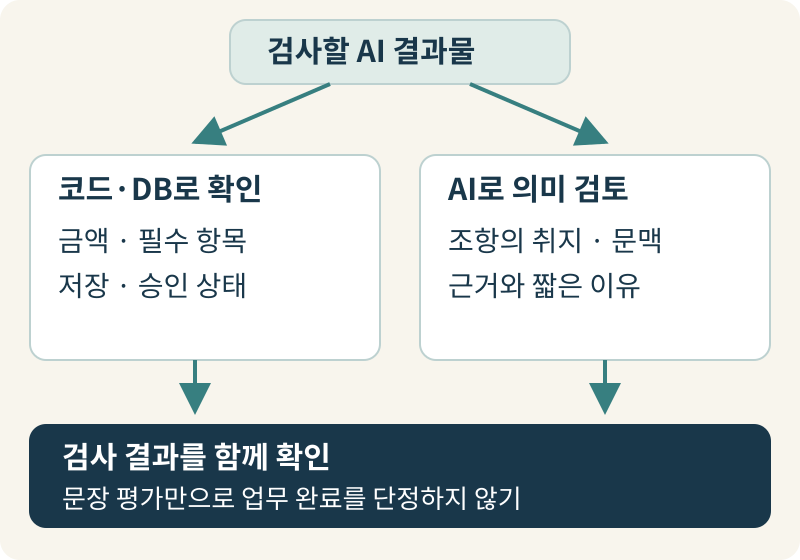
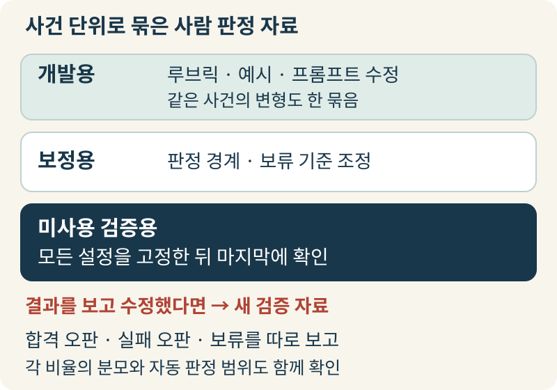
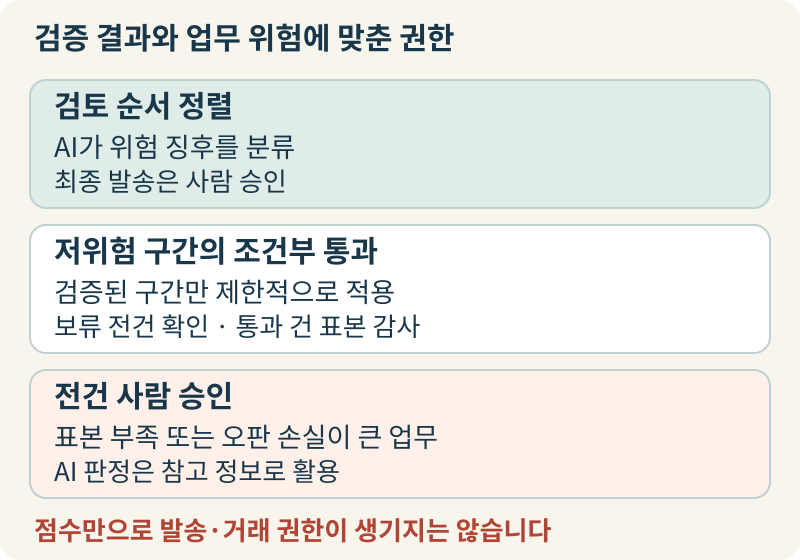

+++
date = '2026-11-01T00:00:00+09:00'
draft = false
title = 'AI 채점자의 합격 판정, 어디까지 믿고 맡길 수 있을까요?'
description = 'AI 결과물을 다른 AI로 검수할 때 생기는 합격 오판의 위험과, 사람 기준 정렬부터 검증 데이터 격리·권한 설정까지 채점자 자체를 검증하는 원칙을 살펴봅니다.'
tags = ['ax', 'llm-as-a-judge', 'calibration', 'ai-evaluation']
authors = ['geoff']
slug = 'llm-judge-calibration'
audio = []
vedios = []
series = []
toc = true
featured_image = 'thumbnail.webp'
images = ['thumbnail.webp']
+++

## 들어가며

우리 회사 고객지원팀이 거래처의 계약 변경과 위약금 감면 조건을 안내하는 이메일 초안을 AI로 작성한다고 가정해봅시다. 그 초안이 사내 규정에 맞는지는 또 다른 AI를 채점자로 붙여 검수합니다. 하루에 작성하는 초안이 수백 건으로 늘어나면서 실무자가 모든 문장을 일일이 읽기가 버거워졌기 때문입니다. 한 달 뒤 도입 팀은 반가운 보고서를 올립니다. AI 채점자의 판정이 현업 담당자의 판단과 90% 일치하며 전체 초안의 95%가 합격 판정을 받는다는 내용입니다.

보고서를 받은 경영진 입장에서는 자연스럽게 다음 질문이 떠오릅니다. 이제 AI 채점자가 합격 도장을 찍은 이메일은 사람이 보지 않고 거래처에 바로 발송해도 괜찮을까요? 만약 이 안내문 시나리오에서 채점자가 규정에 맞는 정상 초안을 불합격으로 잘못 막는 **실패 오판(False Fail)을** 자주 내린다면, 실무자의 재검토 부담이 늘어나고 거래처 회신이 지연될 수 있습니다. 반대로 채점자가 결함이 있는 초안에 합격 도장을 찍어주는 **합격 오판(False Pass)을** 내린다면 어떨까요? 승인 범위를 벗어난 위약금 감면 조건이나 잘못된 정산 기한을 거르지 못하고 거래처에 발송해 정정 안내를 내거나 계약 조건을 다시 협의해야 해서 비용이 들 수 있습니다.

이 문제는 식품 공장의 출하 라인에 새로 배치한 품질 검수원을 떠올려 보면 이해가 빠릅니다. 공장장이 신입 검수원에게 출하 승인 도장을 맡기려면 보고서를 얼마나 유창하게 쓰는지만 봐서는 안 됩니다. 실제로 불량품이 섞여 들어왔을 때 놓치지 않고 잡아내는지, 검수원을 가르치는 고참 반장들끼리는 불량 기준을 똑같이 적용하고 있는지, 그리고 금속 탐지기나 저울로 정확히 재야 할 영역을 검수원의 눈대중에만 맡기고 있지는 않은지 먼저 확인해야 합니다.

AI 채점자(LLM-as-a-Judge)를 도입하는 일도 마찬가지입니다. 지금부터 AI 채점자 자체를 어떻게 검증하고 보정해야 하는지, 그리고 우리 업무에서 어떤 판정까지 믿고 권한을 맡길 수 있는지 하나씩 살펴보겠습니다.

## 1. 매끄러운 문장과 실제 업무 완수는 다릅니다

AI 채점자를 처음 설계할 때는 서로 다른 평가를 하나의 점수로 섞는 함정에 빠지기 쉽습니다. 문장이 읽기에 자연스럽고 친절한지 보는 평가와, 사실관계가 맞고 실제 시스템 처리가 끝났는지 보는 평가가 그렇습니다. 언어모델은 본래 문맥의 매끄러움이나 어조를 읽는 데는 강합니다. 그렇다고 글이 그럴듯하다는 평가가 곧 계약 조건의 정확성이나 업무 완료를 뜻하지는 않습니다.

공개된 연구에서도 이 차이는 분명히 드러납니다. [2023년 MT-Bench 연구](https://arxiv.org/html/2306.05685v4)는 다중 턴 대화에서 GPT-4 채점자와 사람의 일치도를 조사했습니다. 당시 시험한 모델과 질문 조건에서는 높은 선호 일치율을 보고했습니다. 다만 이는 두 답변 중 사람이 어느 쪽을 더 선호하는지를 비교한 결과였지 사실 정확도나 업무 완수율을 증명한 것이 아니었습니다. 같은 연구는 동률 처리 조건에 따라 일치율이 달라진다는 점, 그리고 답변 제시 순서를 바꾸거나 문장을 길게 늘이는 것만으로도 판정이 흔들리는 편향까지 함께 확인했습니다. [2024년 JudgeBench 연구](https://arxiv.org/html/2410.12784v2)는 선호도가 아니라 정답 여부가 명확히 검증되는 어려운 지식·추론·수학·코딩 문제들로 채점자를 시험했습니다. 여기서도 사람 선호에 맞춘 기본 채점 방식은 미묘한 사실·논리 오류를 가려내는 데 뚜렷한 한계를 보였습니다. 사람 눈에 읽기 좋은 답을 고르는 능력과 사실 오류를 잡아내는 능력은 별개로 검증해야 한다는 뜻입니다.

검수 체계를 세울 때는 문장 채점자에게 맡길 일과 기계적으로 먼저 확인할 일을 분리해야 합니다. [Anthropic의 에이전트 평가 가이드](https://www.anthropic.com/research/demystifying-evals-for-ai-agents)는 에이전트가 대화창에 “예약을 완료했습니다”라고 답했더라도 그 문구만 보고 성공으로 채점하지 말라고 권고합니다. 대신 실제 데이터베이스에 예약 기록이 생성되었는지 최종 상태를 직접 조회하라고 합니다. 기계가 확실히 판정할 수 있는 항목은 결정적(deterministic) 코드 검사로 처리하고 의미를 읽어야 하는 영역만 모델 채점자에게 넘기라는 원칙입니다.

대규모 개발 도구를 운영하는 팀도 이 경계선을 분명하게 긋습니다. [GitHub Copilot 엔지니어링 팀의 사례](https://github.blog/ai-and-ml/generative-ai/how-we-evaluate-models-for-github-copilot/)를 보면 이 팀은 4,000개 이상의 오프라인 시험을 운영합니다. 코드 수정 능력은 약 100개의 컨테이너화된 저장소에서 일부러 깨뜨린 단위 테스트가 다시 통과하는지 결정적 시험으로 측정합니다. 참·거짓으로 단순화하기 어려운 복잡한 기술 채팅 답변만 다른 언어모델로 채점합니다. 우리 업무에서도 금액과 세율 계산, 필수 항목 누락 여부, 정형화된 개인정보 패턴, 시스템 저장 및 승인 상태는 코드와 데이터베이스 조회로 먼저 확인해야 합니다. AI 채점자는 그다음 단계에서 안내문이 약관 조항의 취지를 왜곡하지 않았는지, 혹은 문맥상 민감한 정황이 드러나지 않았는지처럼 의미를 해석해야 하는 판단에 집중시키는 편이 바람직합니다.

## 2. 채점자를 고치기 전에 사람의 기준부터 맞춰야 합니다

코드로 검사할 항목을 분리한 뒤 정성적인 판단을 AI 채점자에게 맡기려 할 때, 정작 사람 검토자들 사이의 기준이 정리되어 있지 않아 막히는 경우가 생깁니다. AI 채점자의 판정이 일관되지 않다고 생각했는데 막상 같은 부서의 숙련된 담당자 두 명에게 똑같은 AI 초안 스무 건을 주고 각자 채점해 보라고 하면 두 사람의 판정부터 서로 엇갈립니다.

사람 사이의 불일치는 연구와 실무 가이드도 반복해서 지적하는 문제입니다. 앞서 언급한 [MT-Bench 연구](https://arxiv.org/html/2306.05685v4)에서도 같은 답변 쌍을 두고 사람 평가자끼리 의견이 일치한 비율은 동률 제외 시 81%, 동률 포함 시 63%에 머물렀습니다. [OpenAI의 평가 모범 사례 문서](https://developers.openai.com/api/docs/guides/evaluation-best-practices)도 평가를 설계할 때 겪는 주요 과제로 전문가들 사이의 불일치를 꼽습니다. 그러면서 명확하고 구체적인 루브릭(채점 기준표)을 세우고 비용이나 속도를 최적화하기 전에 사람 라벨과의 일치를 먼저 검증하라고 안내합니다.

담당자 두 명이 같은 답변을 다르게 채점했다면, 프롬프트를 고치기 전에 어느 기준에서 갈렸는지부터 세 가지로 나누어 살펴봐야 합니다. 하나는 한 사람이 원천 문서의 세부 조항이나 사실관계를 놓친 경우로, 이때는 참조할 근거 문서를 명확히 지정해 주면 됩니다. 또 하나는 루브릭 문구 자체가 모호한 경우입니다. 기준표에 “친절하고 정확하게 답할 것”이라고만 적혀 있거나 4점과 5점의 경계가 불분명하면 검토자마다 다른 잣대를 쓰게 됩니다. 마지막은 우리 회사의 업무 지침 자체가 그 예외 상황에 대해 아직 결론을 내리지 못한 경우입니다.

사내 규정이 모호해서 생긴 실무자 간 이견은 검토자들의 단순 다수결로 확정하면 안 됩니다. 세 명 중 두 명이 통과를 줬다는 이유만으로 그 초안을 정답지에 넣으면 규정의 빈틈이 채점 기준에 그대로 굳어집니다. 정책 해석이나 승인 기준이 갈리는 사안은 해당 업무의 책임자가 개입해 공식 기준으로 정리해야 합니다. 끝내 결론짓기 어려운 경계 사례는 억지로 합격·불합격 정답지에 넣지 말고 보류 사례로 분리해 두어야 합니다.

이렇게 정리한 기준은 모호한 다단계 점수보다 조건별 **통과·실패·판정 보류**로 적는 편이 현업 결정과 연결하기 쉽습니다. 예를 들어 “핵심 주장마다 유효한 원천 조항이 뒷받침되면 통과, 원천 문서에 없는 예외 조건을 단정하면 실패, 기준일을 확인할 수 없어 규정 적용이 불가능하면 보류”처럼 정의하는 식입니다. [Anthropic의 평가 가이드](https://www.anthropic.com/research/demystifying-evals-for-ai-agents)에서도 근거가 부족할 때 모델 채점자가 판정을 유보(Unknown)할 수 있게 하면 억지 추측을 줄일 수 있다고 설명합니다. 채점자가 판정과 함께 참조 문서의 근거 구절과 짧은 이유를 남기게 하면, 그 이유 자체가 정답을 보증하진 않더라도 나중에 사람 판정과 어긋났을 때 원인을 빠르게 추적할 수 있습니다.

## 3. 평균 일치율의 착시와 검증 데이터 분리

사람의 기준을 정리해 루브릭을 세웠다면, 이제 AI 채점자가 그 기준대로 판정하는지 시험해 볼 차례입니다. 이때 보고서에서 가장 주의 깊게 봐야 할 대목이 '사람과의 전체 일치율 90%' 같은 단일 평균 수치입니다. 정상 결과물이 대다수를 차지하는 업무에서는 전체 일치율 하나만 보면 심각한 합격 오판을 놓치기 쉽습니다.

예를 들어 고객 안내문 100건 중 92건은 규정에 맞는 정상 초안이고 8건은 잘못된 위약금 조건이 적힌 결함 초안이라고 해봅시다. 만약 AI 채점자가 결함을 전혀 가려내지 못해 100건 모두에 무조건 '합격'을 주는 상태라도, 정상 초안 92건은 사람과 판정이 같으니 전체 일치율은 92%가 됩니다. 평균 숫자만 보면 훌륭해 보이지만 실제로는 잡아내야 할 결함 8건을 한 건도 걸러내지 못한 셈입니다.

따라서 채점자의 성적표를 받을 때는 전체 평균 대신 세 가지 질문을 나누어 확인해야 합니다. 첫째, 실제로는 결함이 있어 막아야 할 초안 가운데 채점자가 통과시켜 버린 비율(합격 오판율)이 얼마인지, 그리고 채점자가 통과 도장을 찍은 결과물 가운데 실제 결함이 섞여 있는 비율이 얼마인지 각각 봐야 합니다. 전자는 채점자가 불량을 얼마나 놓치는지를, 후자는 현업이 통과 표시를 믿고 결과물을 넘겨받았을 때 불량이 섞여 들어올 위험을 보여줍니다. 둘째, 문제가 없는 정상 초안을 불합격으로 돌려보낸 비율(실패 오판율)을 확인해 불필요한 재작업과 응대 지연이 얼마나 생기는지 따져봐야 합니다. 셋째, 전체 물량 중 채점자가 판정을 확정한 범위와 판단을 보류해 사람에게 넘긴 비율을 함께 봐야 합니다. 보류 건을 제외하고 확정 건만의 정확도를 계산하는 방식 자체는 쓸 수 있습니다. 다만 그때도 전체 중 몇 퍼센트를 자동 판정했고 몇 퍼센트를 보류했는지 나란히 보고해야 하며 보류 건을 슬그머니 합격에 합산해서는 안 됩니다.

지표를 나누어 보는 것만큼, 채점자를 다듬는 데 쓴 연습 문제와 최종 실력을 재는 시험 문제를 격리하는 일도 중요합니다. 어제 학원에서 풀어본 기출문제만 다시 풀어 100점을 받은 학생이 내일 처음 보는 시험에서도 만점을 받을 것이라고 단정할 수는 없습니다. [LangSmith의 평가기 개선 가이드](https://docs.langchain.com/langsmith/improve-judge-evaluator-feedback)가 설명하듯, 실무에서는 사람 판정과 채점기 결과가 어긋난 사례를 보며 프롬프트를 수정하되, 그 프롬프트가 기존 사례에만 과적합되지 않았는지 별도의 추가 사례로 검증해야 합니다.

사람이 라벨을 붙인 데이터는 루브릭과 예시를 고치는 개발용 자료, 판정 경계선과 보류 기준을 조정하는 보정용 자료, 그리고 모든 설정을 고정한 뒤 마지막에 성능을 확인하는 **미사용 검증 자료(Held-out Validation Set)로** 분리해야 합니다. 이때 같은 고객의 후속 문의나 표현만 바꾼 동일 사건이 양쪽에 나뉘어 들어가면 시험지가 미리 새어 나간 것과 같습니다. 그래서 반드시 사건 단위로 묶어 분리합니다. 만약 미사용 검증 자료의 결과를 보고 프롬프트를 다시 고쳤다면, 그 자료는 이미 개발용으로 쓰인 셈이니 최종 승인 전에는 새로운 검증 자료로 다시 확인해야 합니다.

## 4. 검증된 만큼만 권한을 주고 통과 건도 감사해야 합니다

미사용 검증 자료로 오판율과 보류 비율까지 확인했다면, 이제 그 성적에 맞춰 채점자에게 어디까지 권한을 줄지 결정해야 합니다. 간혹 채점자 하나로는 불안하니 여러 AI 채점자를 붙여 만장일치가 나오면 바로 믿어도 되지 않겠느냐는 의견이 나오기도 합니다. 하지만 여러 채점 모델이 똑같이 개정 전 참고 문서를 보고 있거나 같은 도메인 규칙을 놓치고 있다면, 세 모델의 만장일치가 곧 독립된 세 번의 사실 검증을 뜻하지는 않습니다. 채점자를 하나만 쓰든 여러 개를 조합하든 권한 범위는 우리 회사의 미사용 검증 자료에서 합격 오판이 실제로 얼마나 나오는지를 기준으로 정해야 합니다.

모든 기업과 업무에 똑같이 적용되는 '일치율 몇 퍼센트 이상이면 자동화 가능'이나 '표본 몇 건이면 충분' 같은 보편적 기준선은 없습니다. 업무 책임자는 해당 업무에서 합격 오판 한 건 때문에 드는 비용과 검증 표본에서 확인한 수치의 불확실성을 고려해 허용 가능한 오판 수준을 결정해야 합니다. 실무에서는 검증 결과에 따라 판정 권한을 세 단계로 나누어 설정할 수 있습니다.

첫째는 **검토 우선순위 정렬과 초벌 분류**입니다. 채점자는 명백한 형식 결함을 걸러내거나 위험 징후가 있는 초안을 실무자 검토 목록 상단으로 올리는 역할만 맡습니다. 최종 발송 승인은 사람이 유지합니다. 둘째는 **제한된 구간의 조건부 자동 통과와 표본 감사**입니다. 정형화된 단순 안내처럼 위험도가 낮은 구간이 대상입니다. 그중에서도 미사용 검증 자료에서 합격 오판과 실패 오판이 모두 감당 가능한 수준으로 확인된 구간에 한해 자동 통과를 허용합니다. 대신 보류 건은 전량 사람이 확인하고 통과 건도 무작위 표본으로 상시 감사합니다. 셋째는 **전건 사람 승인 유지**입니다. 검증 표본이 아직 부족하거나 단 한 건의 합격 오판도 중대한 계약·재무 손실로 이어질 수 있는 구간에서는 AI 채점 결과를 참고 정보로만 활용합니다.

한 번 검증해 투입한 채점자도 시간이 흐르면 기준이 흔들릴 수 있다는 점도 염두에 두어야 합니다. 사내 정책과 고객 질문이 바뀌고 채점 모델이나 프롬프트가 수정되면서 판정 성향이 달라지기 때문입니다. [Dropbox의 기술 블로그](https://dropbox.tech/machine-learning/practical-blueprint-evaluating-conversational-ai-at-scale-dash)는 대화형 AI 서비스 Dash의 평가 운영을 공개했습니다. 이들은 AI 채점자를 설계·보정·시험·버전 관리가 필요한 소프트웨어 모듈로 다룹니다. 그리고 몇 주마다 사람이 표본을 직접 채점해 변화를 점검하고 릴리스 회귀 시험의 일부도 사람이 검토했다고 설명합니다. 앞서 살펴본 [GitHub Copilot 팀](https://github.blog/ai-and-ml/generative-ai/how-we-evaluate-models-for-github-copilot/) 역시 채점 LLM의 출력을 정기적으로 감사하며 사람 검토자와의 정렬을 유지하는 일을 지속적인 과제로 관리합니다.

이런 운영 감사를 할 때는 채점자가 불합격이나 보류로 분류한 건만 살펴봐서는 안 됩니다. 반드시 **채점자가 합격으로 통과시킨 결과물 가운데서도 무작위 표본을 뽑아 사람이 직접 재검토**해야 합니다. 불합격 건만 들여다보면 채점자가 과도하게 반려한 사례는 고칠 수 있어도, 결함을 놓치고 조용히 통과시켜 버린 합격 오판은 발견할 수 없기 때문입니다.

## 나가며

AI가 만든 결과물을 다른 AI로 채점하는 방식은 반복 검토 부담을 줄여주는 유용한 도구입니다. 다만 경영진이 도입을 승인할 때 결정해야 할 단위는 채점 모델의 이름이 아니라, **우리 회사의 특정 업무·루브릭·참조 자료 위에서 검증된 판정 권한**이어야 합니다.

실무 팀이 AI 채점자 도입 보고서를 가져왔다면 다음 네 가지를 먼저 확인해 보시기 바랍니다. 첫째, 숫자 계산이나 시스템 처리 상태처럼 코드로 확인할 항목을 문장 채점자에게 맡기지 않았는가? 둘째, 현업 담당자들끼리 먼저 채점해 보고 기준이 갈리는 지점을 업무 책임자가 정리했는가? 셋째, 프롬프트 수정에 쓰지 않은 미사용 검증 자료에서 합격 오판, 실패 오판, 보류 비율을 각각의 분모와 함께 확인했는가? 넷째, 채점 모델과 루브릭을 버전으로 관리하며 통과된 결과물도 무작위 표본으로 상시 감사하고 있는가?

현업의 승인 기준을 통과·실패·보류 루브릭으로 구체화하고, 결정적 코드 검사와 검증 데이터 격리, 운영 감사 체계를 함께 설계하는 일은 업무 맥락에 대한 이해와 엔지니어링 역량이 동시에 필요한 작업입니다. 사내 AI 에이전트의 결과물을 어떻게 검수할지, 혹은 AI 채점자의 판정을 어디까지 믿고 자동화할지 고민하고 계신다면 언제든지 `contact@epsilondelta.ai`로 연락해 주십시오. 엡실론델타가 여러분의 조직 상황에 맞는 평가 기준 수립과 신뢰할 수 있는 검수 체계 설계를 함께 고민하고 도와드리겠습니다.
