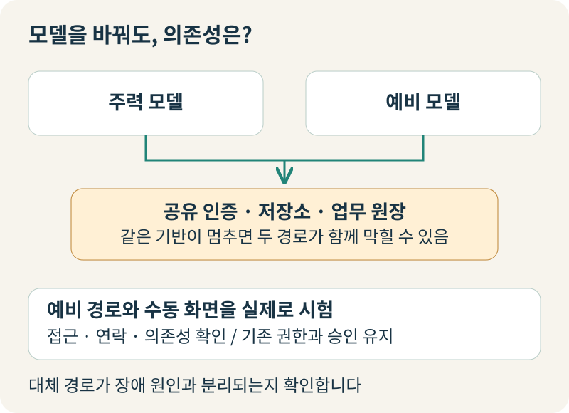
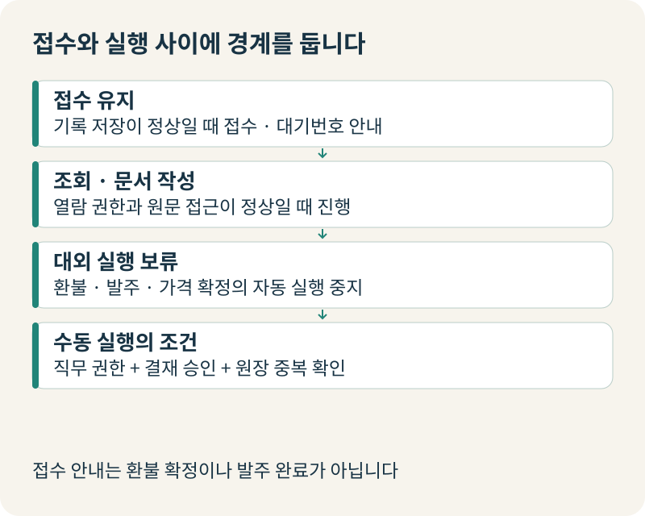
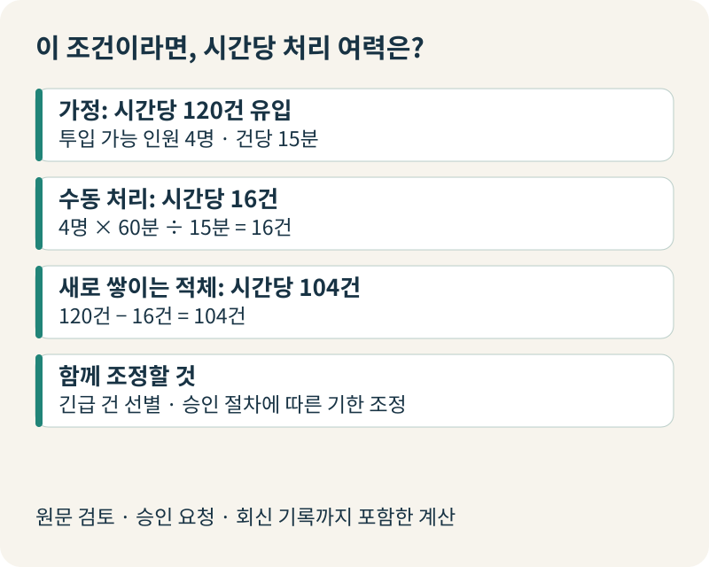
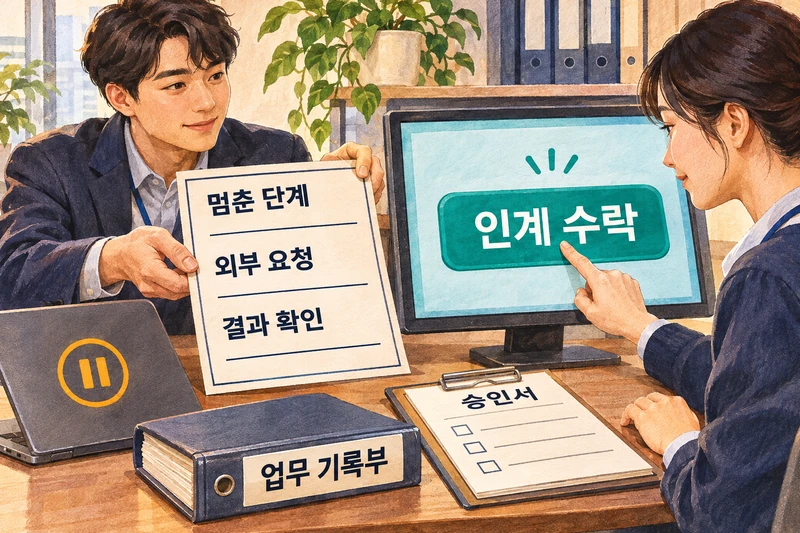
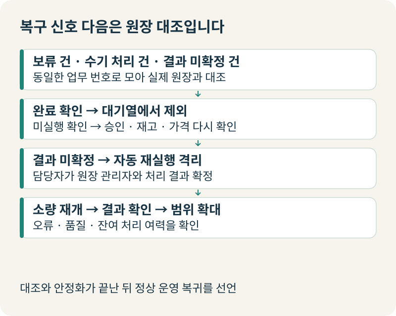
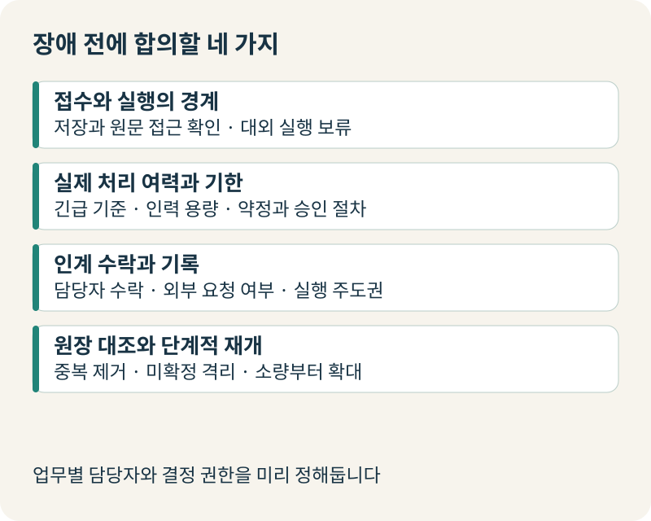

+++
date = '2026-11-03T00:00:00+09:00'
draft = false
title = '사내 AI가 멈춘 날, 어떤 업무를 계속하고 무엇을 멈춰야 할까요?'
description = 'AI 에이전트와 연결 시스템이 중단되었을 때 경영진이 결정해야 할 축소 운영, 대외 실행 보류, 수동 인계 용량, 복구 후 원장 대조 기준을 정리합니다.'
tags = ['ax', 'ai', 'business-continuity', 'ai-operations']
authors = ['geoff']
slug = 'ai-continuity'
audio = []
vedios = []
series = []
toc = true
featured_image = 'thumbnail.webp'
images = ['thumbnail.webp']
+++

## 들어가며

월요일 오전 열 시, 고객 문의를 분류하고 환불 심사와 거래처 발주서 초안 작성을 돕던 사내 AI 에이전트가 갑자기 응답을 멈췄다고 가정해봅시다. 상담 화면에는 시간 초과 알림만 뜨고 문의함에는 미처리 접수 건이 매분 쌓여갑니다. 현업 부서장들의 메신저에는 "지금 들어오는 환불 요청은 수기로 처리해도 되나요?", "방금 에이전트가 발주 버튼을 눌렀는지 모르겠는데 다시 넣을까요?" 같은 질문이 쏟아집니다.

이런 순간 경영진이 기술 조직에 먼저 던지는 질문은 대체로 비슷합니다. "우리 예비 모델 안 붙여뒀습니까?", "언제 복구됩니까?" 하지만 장애 현장에서 회사의 손실과 고객 신뢰를 가르는 기준은 업무를 어떻게 운영하느냐에 있습니다.

지금 당장 축소 모드로 계속 받을 업무와 즉시 보류할 대외 실행은 무엇일까요? AI가 하던 일을 사람에게 넘긴다면 누가 그 인계를 정식으로 수락하고 한 시간에 실제로 몇 건이나 처리할 수 있을까요? 또 시스템이 복구되었을 때 보류된 건과 수기로 처리한 건은 어떻게 대조해 재개해야 할까요?

AI 도입 초기에는 모델의 정확도와 응답 속도에 시선이 쏠리기 쉽습니다. 하지만 에이전트가 핵심 업무 흐름에 들어온 뒤부터는 대비의 단위가 '모델'이 아니라 '업무'가 되어야 합니다. 외부 AI 공급사나 사내 에이전트, 혹은 그와 연결된 인증·업무 시스템은 언제든 멈출 수 있기 때문입니다.

AI가 멈춘 날에도 어떤 업무를 이어가고 어떤 위험한 실행을 잠글지, 그리고 사람과 시스템이 어떻게 운전대를 주고받을지를 경영진의 언어로 미리 정해두는 일이 핵심입니다. 사내 AI가 멈췄을 때 경영진과 현업 리더가 내려야 할 업무 연속성의 의사결정 기준을 하나씩 짚어보겠습니다.

## "폴백 모델을 붙여뒀습니다"라는 보고가 현장에서 무너지는 이유

임원 회의에서 AI 장애 대비책을 물었을 때 "주력 모델이 멈추면 다른 모델로 넘어가도록 폴백(fallback)을 설정해 두었습니다"라는 보고를 받으면 마음이 놓이실지도 모릅니다. 고속도로가 막히면 옆 국도로 차를 돌리면 된다는 말처럼 들리기 때문입니다. 하지만 실제 장애 사후보고서를 보면 서류상의 폴백 설정과 사고 당일의 작동은 적지 않게 어긋납니다.

[Zendesk의 2026년 6월 19일 AI Agents 장애 사후보고](https://support.zendesk.com/hc/en-us/articles/10932821917082-Service-Incident-June-19-2026-AI-Agents-OpenAI-service-delays-and-error-issues)에서 그 차이를 확인할 수 있습니다. 이날 Zendesk의 AI Agents 고객들은 외부 모델 공급사인 OpenAI의 서비스 저하로 AI 메시지 작성 및 보강 기능에서 지연과 오류를 겪었습니다. 사고 이후 Zendesk가 정리한 사후 개선 과제를 보겠습니다.

Zendesk는 API 공급사와의 자동 페일오버(failover) 방안을 검토하고 기존의 전역 폴백 설정을 서비스별 폴백 설정으로 교체하며 Azure OpenAI 폴백 옵션이 실제로 올바르게 설정되어 있는지 확인하겠다는 항목을 개선 과제로 올렸습니다. 아울러 사고 당시 온콜(on-call) 담당 팀에 전화가 닿지 않은 원인을 조사해 알림 절차를 개선하겠다는 과제도 포함했습니다. 폴백 설정이 존재한다는 보고만으로는 현장의 서비스 중단이나 비상 연락 실패가 저절로 해결되지 않습니다.

장애가 AI 모델 바깥의 '공통 의존성'에서 터질 때도 마찬가지입니다. [Cloudflare의 2025년 6월 12일 장애 사후보고](https://blog.cloudflare.com/cloudflare-service-outage-june-12-2025/)를 보면 기반 저장소 장애로 Workers KV가 2시간 28분 동안 제대로 동작하지 못했고 이에 의존하던 Workers AI 추론 요청이 모두 실패했습니다. 동시에 사용자 신원과 접근 정책을 확인하는 Cloudflare Access도 같은 저장소에 의존하고 있었는데 신원을 확인할 수 없으면 접근을 차단(fail-closed)하도록 설계되어 있어 신원 기반 로그인까지 함께 막혔습니다.

게다가 [Cloudflare의 2025년 8월 8일 Workers KV 재설계 회고](https://blog.cloudflare.com/rearchitecting-workers-kv-for-redundancy/)에 따르면, 과거에 쓰던 보조 저장소는 기반 인프라와 코드가 즉시 재가동할 수 있는 상태가 아니어서 사고 당일 곧바로 켤 수 없었습니다. 이 기록은 공급사의 인프라 사고와 복구 과정을 다루지만 우리 사내 운영에도 비추어 볼 수 있습니다. 만약 사내 AI가 멈췄을 때 현업 직원이 열어야 하는 수동 처리 화면이나 사내 인증까지 장애 원인과 같은 기반에 묶여 있다면, 정작 비상시에 수동 전환조차 시작하지 못할 수 있습니다.

## 멈출 것과 계속할 것의 경계: 접수는 열어두고 대외 실행은 잠급니다

그렇다면 AI나 연결 시스템이 멈췄을 때 회사는 어떤 업무를 계속하고 무엇을 멈춰야 할까요? 장애가 나면 두 가지 극단적인 유혹에 빠지기 쉽습니다. 하나는 복구될 때까지 모든 업무를 멈추는 것이고 다른 하나는 고객이 기다리니 AI가 맡던 점검을 건너뛰고 일단 처리부터 내보내는 것입니다. 모두 멈추면 영업이 불필요하게 서고 점검 없이 내보내면 금전·계약 사고를 부를 수 있습니다.

이 경계를 나누려면 업무 흐름을 '접수 → 기초 자료 조회 → AI 요약·초안 작성 → 내부 승인 → 대외 실행(환불·발주·계약 확정) → 완료 확인' 단계로 쪼개어 보아야 합니다. 경영진이 내릴 결정은 회사 전체의 문을 닫느냐 여느냐가 아니라, **접수는 조건부로 열어두되 되돌리기 어려운 대외 실행은 잠그는 것**입니다.

특정 검증이나 차단 통제가 작동하지 않을 때 통제 없이 행위를 그대로 통과시키는 방식을 '페일오픈(fail-open)', 확인할 수 없으면 해당 동작을 막는 방식을 '페일클로즈드(fail-closed)'라고 부릅니다. 간혹 "AI가 멈췄을 때 업무를 축소 모드로 계속하거나 사람이 수동 처리하는 것이 페일오픈 아닌가?"라고 생각하기 쉽지만 둘은 전혀 다릅니다.

예컨대 이상 거래 점검이 멈췄는데도 환불금 송금이나 거래처 발주를 점검 없이 내보낸다면 통제 공백을 감수하는 페일오픈입니다. 반면 우리가 지향해야 할 연속성 대책은 **통제를 유지한 부분 저하 운영과 수동 전환**입니다. 물론 AI가 빠졌다고 해서 내부 업무가 무조건 안전한 것은 아닙니다. 접수 기록이 정상적으로 저장된다는 조건 아래 일반 문의를 받아 대기번호를 안내하는 일, 그리고 기존의 열람 권한과 원문 문서 접근이 정상 작동할 때 직원이 표준 양식을 직접 열어 문서를 작성하는 일만 축소 모드로 이어갈 수 있습니다.

반대로 환불 지급, 물품 발주, 고객별 가격 확정처럼 회사 밖으로 효력이 나가는 실행은 자동 처리를 즉시 보류해야 합니다. 급한 건을 현업 담당자가 수동으로 이어받더라도 평소의 직무 권한, 결재 승인선, 그리고 실제 거래 원장(Source of Truth)에서 중복 여부를 확인하는 절차는 그대로 유지해야 합니다. 또한 장애 중 접수 안내가 '환불 확정'이나 '발주 완료' 약속으로 읽히지 않도록 문구를 엄격히 분리해야 합니다.

## 사람이 이어받는다는 말의 진짜 무게: 실제 처리 여력과 마감 기한을 함께 조정해야 합니다

비상 대응 계획서에 "AI 장애 시 담당자 수작업 처리로 즉시 전환"이라는 한 줄만 적혀 있다고 가정해봅시다. 문장으로는 간단하지만 이 한 줄이 현장에서 작동하려면 냉정한 산수가 필요합니다. 막힌 고속도로의 차량을 수용 능력도 재보지 않은 채 좁은 우회도로로 한꺼번에 밀어 넣으면 우회도로마저 곧바로 마비되기 때문입니다.

사람으로 넘어가는 수동 전환도 구조가 똑같습니다. 어떤 기업의 운영팀에서 AI 에이전트가 시간당 120건의 거래처 변경 요청과 정산 문의를 1차 검토해 오던 중 갑자기 멈췄다고 해봅시다. 현업 팀원들에게도 그날 원래 처리해야 할 고유 업무가 있습니다. 장애 대응에 즉시 투입할 수 있는 인원이 4명이고 한 사람이 AI 도움 없이 원문 계약서와 ERP 원장을 직접 열어 검토·승인 요청·회신 기록까지 마치는 데 건당 15분이 걸린다면 어떨까요?

이 팀의 실제 수동 처리 여력은 시간당 16건(`4명 × 60분 ÷ 15분`)뿐입니다. 시간당 120건이 계속 유입된다면 아무리 직원들이 매달려도 매시간 104건(`120건 - 16건`)의 미처리 적체가 쌓입니다.

따라서 수작업 전환이 현장에서 성립하려면 '접수 우선순위 선별'과 '기한 조정 절차'가 함께 움직여야 합니다. 비AI 공공 시스템 사례이지만 [2025년 9월 27일 중앙재난안전대책본부의 국가정보자원관리원 화재 관련 공식 브리핑](https://www.korea.kr/briefing/policyBriefingView.do?newsId=156722004)에서 비슷한 대응을 확인할 수 있습니다. 2025년 9월 26일 대전 본원 화재로 직접 영향 약 70개를 포함해 총 647개 행정정보시스템이 중단됐습니다. 정부는 1등급 정보시스템 장애 시 서비스 연속성 계획에 따라 수기 접수 처리 체계와 대체 사이트 안내를 즉시 취하도록 각 기관에 협조를 요청했습니다. 동시에 시스템 정상화 이전에 도래하는 세금 납부와 서류 제출 기한은 정상화 이후로 연장하도록 유관기관에 안내하고 협조를 구했습니다.

이 브리핑은 실제 수기 처리 완료 건수를 측정한 성적표가 아니라 정부가 발동한 공식 협조 요청과 조치 안내입니다. 그래도 수작업 전환 시 기한 조정이 왜 필요한지는 이 사례에서 잘 드러납니다. 기업에서도 "사람이 직접 처리하라"는 지시만 내려서는 현장이 버티지 못합니다. 당장 수기로 처리할 긴급 건의 기준을 정하고 내부 보고 마감은 경영진 판단으로 늦춰야 합니다. 아울러 고객이나 거래처에 약속한 대외 회신·처리 기한은 관리자가 임의로 바꿀 수 없으므로, 사전 약정된 서비스 기준이나 권한자의 승인 절차에 따라 상대방에게 지연을 공식 안내하고 기한 조정 합의를 구하는 절차를 함께 가동해야 합니다.

## 아무 기록 없이 넘기면 두 번 사고가 납니다: 인계 수락과 멈춘 자리의 기록

수동 처리 인력과 기한 조정 기준을 세웠다면, 다음 고비는 '어떻게 넘겨줄 것인가'입니다. 장애가 났을 때 시스템이 뒤에서 끝없이 재시도를 반복하거나 아무런 맥락 없이 담당자에게 알림만 던져놓으면 현장은 곧바로 혼란에 빠집니다.

우선 언제 기다림을 끝내고 사람이나 보류 대기열로 넘길지 선을 그어야 합니다. 일시적인 지연이라면 짧은 시차를 두고 한두 번 다시 호출해 볼 수 있지만 모든 오류가 재시도로 풀리지는 않습니다. [OpenAI의 API 오류 코드 가이드](https://developers.openai.com/api/docs/guides/error-codes)가 안내하듯, 청구·지출 한도나 할당량 오류는 아무리 재시도해도 접근이 복구되지 않습니다. 실패할 호출을 계속 반복하면 업무 마감 시간만 허비하고 복구 중인 시스템에 부하를 얹게 됩니다. 정해진 횟수 안에 응답이 없거나 계정·한도 오류가 확인되면 즉시 자동 호출을 차단하고 관리자 확인 및 수동 인계 경로로 넘겨야 합니다.

업무가 사람에게 넘어올 때는 **'배정(assignment)'과 '인계 수락(acceptance)'을 구분**해야 합니다. 앞서 본 Zendesk의 2026년 6월 19일 장애 사후보고에서도 온콜 팀에 전화가 닿지 않은 이유를 조사 과제로 삼았듯, 알림을 보냈다는 사실과 담당자가 실제로 그 일을 맡았다는 사실은 다릅니다. 담당자가 명시적으로 '인계 수락'을 누르기 전까지는 미인수 대기 상태로 추적해야 교대 시간대에 구멍이 나지 않습니다. 사람이 인계를 수락하는 순간에는 뒤늦게 회복한 AI가 같은 업무를 동시에 건드리지 못하도록 실행 주도권을 한 사람에게 잠가야 합니다.

이어받는 사람 손에 쥐여주는 '인계 기록'도 구체적이어야 합니다. [OpenAI의 2026년 10월 14일 공급자 간 페일오버 설계 지침](https://developers.openai.com/blog/designing-failover-across-openai-model-providers)은 읽기 전용 평가 요청과 달리 여러 단계를 거치는 지속형 세션은 공급자를 바꾼다고 해서 이전 상태가 저절로 복원되지 않는다고 설명합니다. AI에서 사람으로 넘어갈 때도 다르지 않습니다. 업무 고유 번호, 고객 요청 원문 위치, 멈춘 단계, 결재 승인의 유효 여부, 그리고 **외부 시스템에 이미 실행 요청을 보냈는지와 그 결과 확인 여부**가 인계표에 명확히 남아 있어야 이중 환불이나 이중 발주를 막을 수 있습니다.

## 불이 다시 켜진 뒤를 조심해야 하는 이유: 보류·수기·미확정 업무 대조와 단계적 재개

공급사 상태 페이지에 '정상 복구'라는 초록불이 켜진 직후에도 긴장을 늦추지 말아야 합니다. 몇 시간 동안 멈춰 있던 AI가 다시 응답하기 시작하면 현업과 기술 조직 모두 급한 마음에 보류해 두었던 대기열을 한꺼번에 풀고 평상시 자동화 모드로 즉시 돌아가고 싶어집니다. 하지만 복구 직후의 전환 과정을 통제하지 않으면 또 다른 사고로 이어질 수 있습니다.

장애가 진행되는 동안 회사의 업무는 세 갈래로 갈라집니다. 첫째는 대기열에 쌓여 있던 **보류 건**, 둘째는 현업 담당자가 직접 원장을 보고 처리한 **수기 처리 건**, 셋째는 AI가 멈추기 직전 외부 결제망이나 ERP에 요청을 보냈으나 응답이 끊겨 처리 여부를 알 수 없는 **결과 미확정 건**입니다. 이 세 가지를 정리하지 않고 에이전트 스위치를 다시 올리면, 사람이 이미 수기로 지급한 환불을 AI가 대기열에서 꺼내 한 번 더 지급하거나 이미 발주된 물량을 중복 실행할 위험이 있습니다.

따라서 **원장 대조와 단계적 재개**를 반드시 거친 뒤에 정상 운영 복귀를 선언해야 합니다. 먼저 장애 동안 유입된 건, 수기로 처리한 건, 멈추기 직전 실행 중이던 건을 동일한 업무 번호로 모아 실제 거래 원장과 대조합니다. 원장에서 완료로 확인된 건은 대기열에서 빼고 미실행이 확인된 보류 건은 그사이 승인 유효기간이나 재고·가격 조건이 바뀌지 않았는지 다시 점검합니다. 결과가 불분명한 미확정 건은 자동 재실행 대상에서 격리해 담당자가 원장 관리자와 결과를 먼저 확정해야 합니다.

대조가 끝난 뒤에도 처리 물량은 서서히 늘려야 합니다. 앞서 인용한 OpenAI의 페일오버 설계 지침 역시 주 경로가 복구되었을 때 트래픽을 한 번에 되돌리지 말고 점진적으로 늘리며 오류율과 잔여 용량을 확인하도록 권고합니다. 처음에는 소량만 AI 경로로 흘려보내 처리 결과와 품질을 표본 확인하고 적체 물량을 소화할 여력이 충분한지 점검한 뒤 자동화 범위를 넓히는 것이 안전합니다. 비상 기간에 조정했던 접수·회신 기한 안내를 평상시 기준으로 원복하는 공지도 이 안정화가 확인된 뒤에 나가야 합니다.

## 나가며

사내 AI의 업무 연속성은 두꺼운 규정집에서 나오지 않습니다. 내일 오전 우리 회사의 핵심 AI 에이전트가 두 시간 동안 멈춘다고 가정했을 때, 현장에서 즉각 꺼내 쓸 수 있는 네 가지 실전 합의가 준비되어 있는지가 핵심입니다.

첫째, 원문 접근과 접수 저장이 살아 있는지 확인하며 **접수를 유지할 일과 대외 실행을 보류할 일**을 나눈 결정표가 있어야 합니다. 둘째, 수동 전환 시에도 권한·승인·원장 확인을 유지하되 **현업 인력의 시간당 실제 처리 여력과 약정 절차에 따른 기한 조정 기준**을 준비해 두어야 합니다. 셋째, 재시도 한계선과 함께 담당자가 명시적으로 인계를 수락하고 **외부 요청 여부를 포함한 인계 기록**을 주고받는 절차를 마련해야 합니다. 넷째, 복구 직후 **보류 건·수기 처리 건·결과 미확정 건을 원장과 대조한 뒤 단계적으로 재개하는 기준**이 서 있어야 합니다.

AI를 업무에 도입할 때는 정상 작동할 때의 효율만큼이나 멈춘 날에도 흔들리지 않는 운영 기준을 함께 세워두는 것이 중요합니다. 우리 조직의 핵심 업무 흐름에서 어디를 열어두고 어디를 잠글지, 현업이 실제로 감당할 수 있는 수동 인계와 복구 후 원장 대조 절차를 어떻게 설계해야 할지 고민하고 계신다면 엡실론델타(EpsilonDelta)가 함께 해답을 찾아드리겠습니다. 기술 아키텍처와 현업 운영을 빈틈없이 연결하는 AI 업무 연속성 설계가 필요하시다면 언제든지 contact@epsilondelta.ai로 편하게 연락해 주시기 바랍니다.
