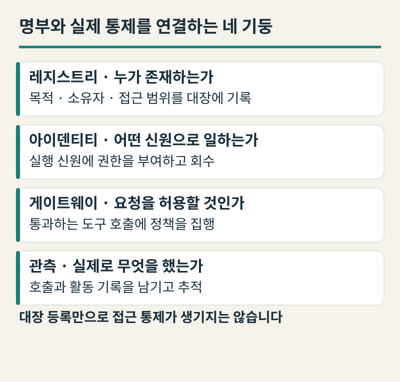
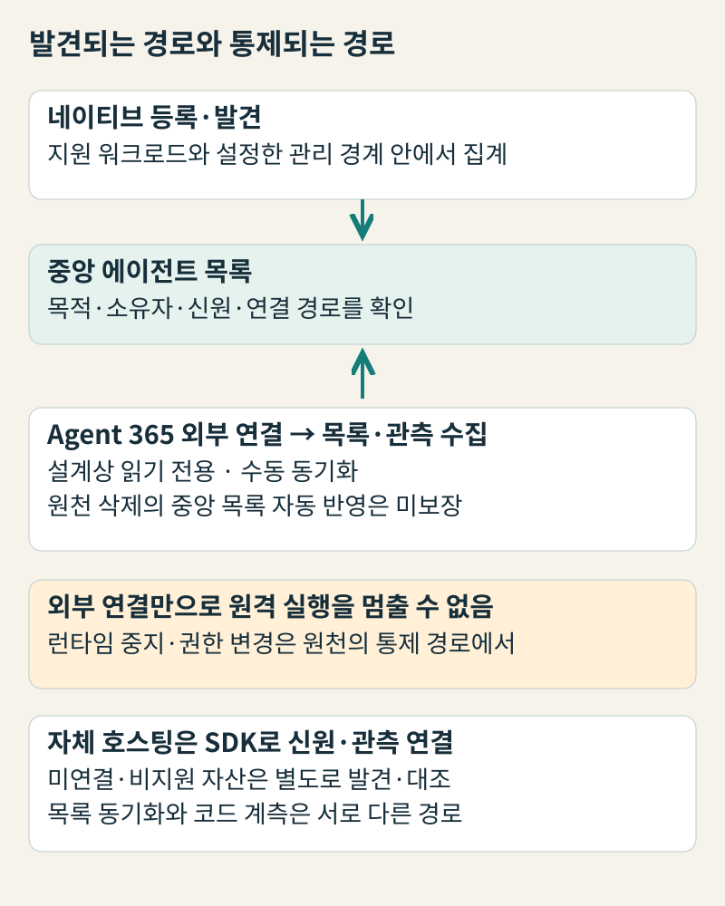
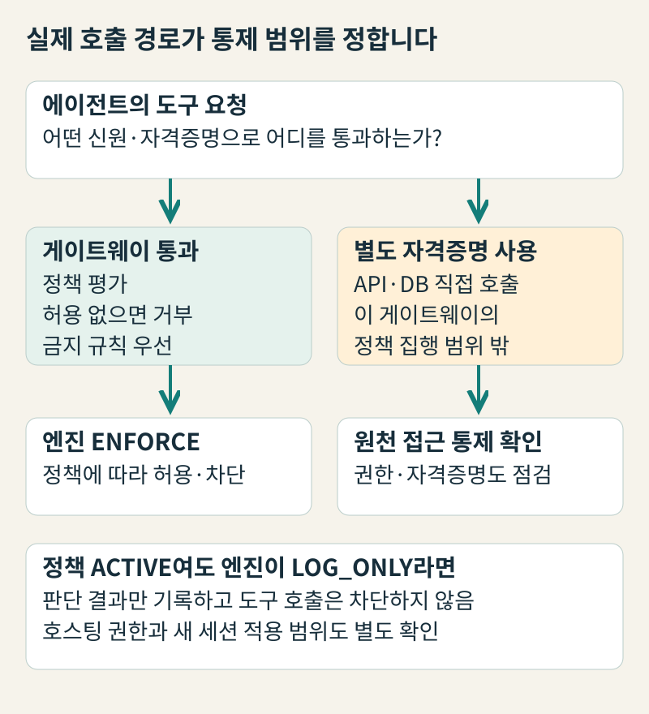
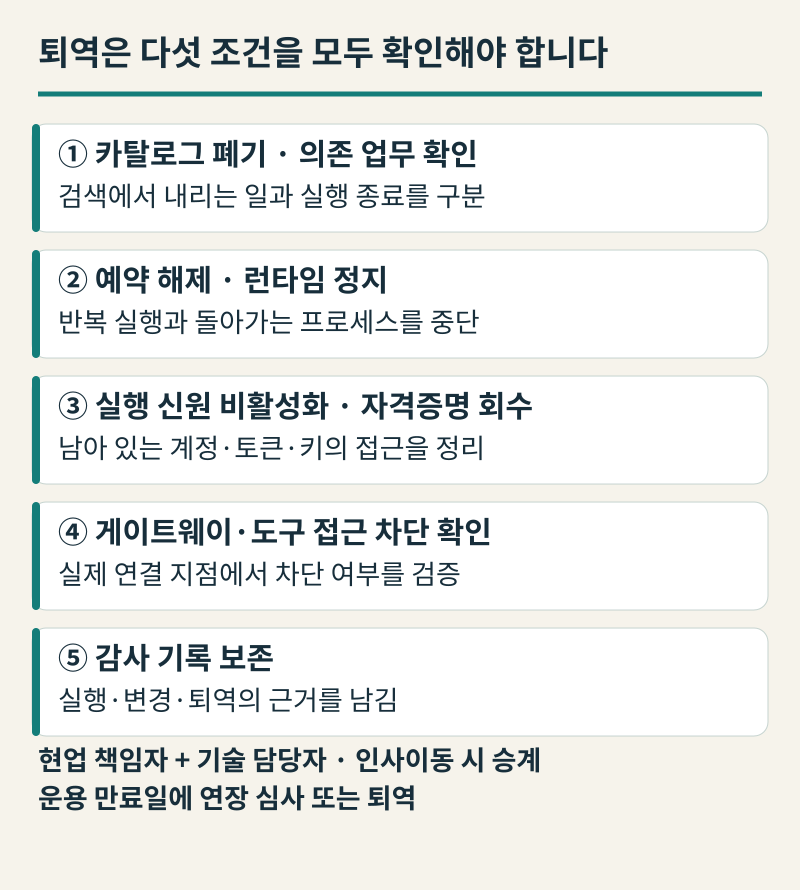
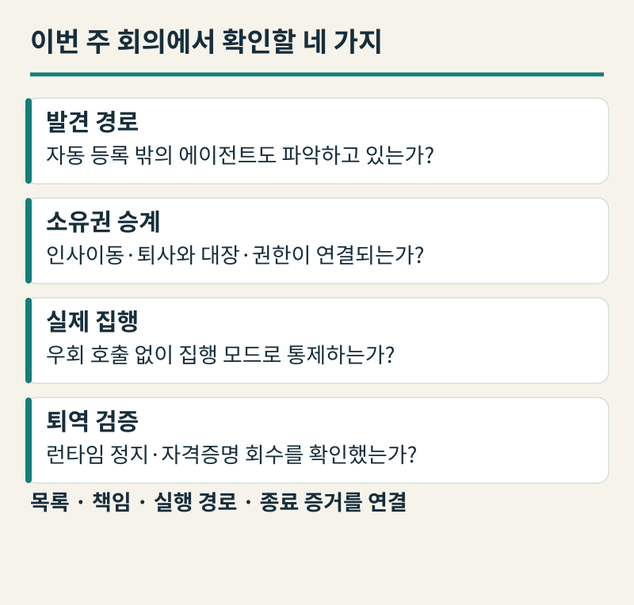

+++
date = '2026-11-04T00:00:00+09:00'
draft = false
title = '부서마다 늘어난 AI 에이전트, 누가 책임지고 언제 끌 수 있을까요?'
description = '부서별로 도입한 AI 에이전트가 방치되거나 통제 밖에서 돌아가지 않도록 발견·목록화·소유자·실행 신원·게이트웨이 집행·퇴역 절차를 연결하는 에이전트 컨트롤 플레인(Agent Control Plane)의 설계 기준을 짚어봅니다.'
tags = ['ax', 'ai-agent', 'agent-control-plane', 'ai-governance']
authors = ['geoff']
featured_image = 'thumbnail.webp'
images = ['thumbnail.webp']
slug = 'agent-control-plane'
audio = []
vedios = []
series = []
toc = true
+++

## 들어가며

우리 회사 구매팀이 워크플로 자동화 도구로 거래처 견적 비교 에이전트를 만들고 인사팀이 사내 로우코드 빌더로 복리후생 안내 에이전트를 띄우며 데이터팀이 클라우드 기반 위에 주간 영업 보고서 생성 에이전트를 각각 올렸다고 가정해봅시다. 처음 몇 달 동안은 부서마다 반복 업무가 눈에 띄게 줄어드니 임원 회의에서도 모범 사례로 꼽힙니다.

그런데 반년 뒤 조직 개편과 인사이동이 겹치면서 예상치 못한 질문이 터져 나옵니다. 구매팀에서 에이전트를 설계했던 실무자는 해외 법인으로 발령이 났고 인사팀 담당자는 퇴사해 사내 계정이 삭제되었습니다. 어느 날 재무팀에서 “지난달 외부 모델 호출과 데이터 조회 비용이 왜 평소보다 세 배나 나왔느냐”고 묻고 영업 현장에서는 “이미 종료된 프로모션 안내가 왜 매주 월요일마다 자동으로 거래처에 발송되느냐”고 항의합니다. 급히 기술 조직을 불러 “지금 회사에서 돌아가는 에이전트가 총 몇 개이고, 관리 책임자는 누구이며, 당장 어디서 멈출 수 있느냐”고 물어도 한 번에 답하는 사람이 없습니다.

지금까지 많은 기업이 AI 에이전트를 도입하면서 고민의 초점을 둔 곳은 ‘한 에이전트의 개별 작업’을 어떻게 통제할 것인가였습니다. 민감한 도구 호출 전에 건별 결재를 받게 하거나, 에이전트가 코드를 돌리는 샌드박스 실행 공간을 격리하고 장애가 난 날에 대비해 수동 전환 절차를 세우는 일들입니다. 하지만 현업 부서마다 노코드 빌더와 외부 클라우드 도구를 써서 수십 개의 에이전트를 각자 만들어 쓰기 시작하면 문제의 차원이 달라집니다. 개별 작업실 문단속으로는 끝나지 않고 회사 전체에 흩어진 에이전트 자산을 누가 파악하고 책임지며 언제 퇴역시킬 것인가라는 전사 자산 관리의 과제가 시작되기 때문입니다.

업계에서는 이처럼 조직 전체의 에이전트 목록(레지스트리), 소유권, 실행 신원(아이덴티티), 정책 집행 지점, 활동 관측, 그리고 수명주기와 퇴역 절차를 하나로 묶는 전사 운영 계층을 **에이전트 컨트롤 플레인(Agent Control Plane)이라고** 부릅니다. 모델이나 오케스트레이터가 실제로 업무를 수행하는 ‘실행 계층’이라면, 컨트롤 플레인은 어떤 에이전트가 회사 안에 존재해도 되는지와 누가 책임을 지고 언제 권한을 거두어들일지를 다루는 ‘운영·통제 계층’입니다. 중앙 관리 화면에 에이전트 이름이 보인다는 사실과 실제로 그 에이전트를 멈출 수 있다는 사실은 왜 다른지, 경영진이 챙겨야 할 설계 기준을 하나씩 짚어보겠습니다.

## 출입증 명부와 보안 게이트는 다릅니다: 컨트롤 플레인의 네 기둥

컨트롤 플레인을 구성하는 레지스트리, 아이덴티티, 게이트웨이, 관측이라는 네 가지 요소는 사옥에 외부 협력사 인력을 들여와 일하게 하는 총무·보안 업무에 비유하면 구분하기 쉽습니다. 건물에 들어와 일하는 외부 인력을 관리하려면 먼저 누가 어느 부서 요청으로 들어와 무슨 일을 하는지 적어둔 ‘출입 인력 명부(레지스트리)’가 있어야 합니다. 하지만 명부에 이름을 적어두었다고 해서 출입이 저절로 통제되지는 않습니다.

실제로 문을 통과하려면 몇 층까지만 갈 수 있는지 권한을 입력한 ‘전자 출입증(아이덴티티)’을 개개인에게 발급해야 합니다. 전산실 앞에는 출입증을 찍었을 때 자격을 검사해 문을 열어주거나 가로막는 ‘보안 게이트(게이트웨이 및 정책 엔진)’도 서 있어야 합니다. 여기에 건물 안 동선을 살피는 ‘출입 기록(관측)’이 돌아가야 하며 계약이 끝나면 명부에서 이름을 지우는 데서 그치지 말고 출입증을 회수하고 계정을 잠그는 ‘퇴소 절차(퇴역)’까지 마쳐야 관리가 완결됩니다.

[Microsoft 클라우드 도입 프레임워크(CAF)의 AI 에이전트 거버넌스 가이드](https://learn.microsoft.com/en-us/azure/cloud-adoption-framework/ai-agents/governance-security-across-organization)도 에이전트 거버넌스의 첫 영역으로 컨트롤 플레인을 제시하며 그 역할을 모든 에이전트의 소유권, 아이덴티티, 수명주기 관리, 관측 가능성을 정의하는 것으로 설명합니다. “존재를 모르는 에이전트는 거버넌스할 수 없다”는 원칙 아래 모든 에이전트를 단일 인벤토리에 기록해 소유권과 목적, 접근 범위를 조직 자산으로 추적하라고 권고합니다.

여기서 경영진은 **자산 대장(레지스트리)에 이름을 올리는 일과 실행 신원(아이덴티티)으로 접근을 통제하는 일이 별개**임을 먼저 구분해야 합니다. [Microsoft Entra Agent ID와 Agent 365 레지스트리 수렴 문서](https://learn.microsoft.com/en-us/entra/agent-id/agent-registry-convergence)를 보면, Microsoft는 Agent 365를 통합 인벤토리로, Entra Agent ID를 신원·접근 통제 기반으로 나눕니다. Entra 에이전트 신원이 없는 에이전트도 Agent 365 인벤토리 목록에는 올라올 수 있지만 조건부 액세스 같은 보안 통제를 실제로 걸려면 Entra Agent ID가 부여되어 있어야 합니다. 방문객 명부에 이름이 적혀 있다고 해서 모두에게 사내 전산망 계정과 전자 출입증이 발급되지는 않는 것과 같습니다.

다수의 에이전트를 운영하는 기업들이 왜 개별 에이전트 개발보다 이러한 공통 기반부터 묶는지는 [AWS가 공개한 Cox Automotive 고객 사례](https://aws.amazon.com/solutions/case-studies/cox-auto-case-study/)에서도 확인할 수 있습니다. 공급사가 게시한 이 사례에서 Cox Automotive는 57개 아이디어를 평가해 17개 운영(프로덕션) 에이전트 솔루션을 배포하면서 Amazon Bedrock AgentCore의 런타임(Runtime), 신원(Identity), 관측(Observability)을 공통 기반으로 삼았습니다. 런타임이 배포와 오류 처리·보안 패턴을 맡고 신원 서비스가 역할 기반 접근 제어와 세분화된 권한 관리를 제공합니다. 관측 서비스는 모든 상호작용을 기록해 다단계 추론 실패를 디버깅하도록 뒷받침하는 구조입니다. 다만 이 사례는 한 클라우드 플랫폼 위에서 운영하는 에이전트들에 공통 실행·신원·관측 인프라를 적용한 예이지, 여러 부서가 각자 다른 도구로 만든 에이전트를 전사적으로 발견하고 퇴역시키는 절차까지 저절로 해결해 준다는 뜻은 아닙니다.

## “한 화면에 다 보입니다”라는 보고의 함정: 발견 경로와 읽기 전용 연결

임원 회의에서 “이번에 전사 에이전트 관리 포털을 도입해 외부 플랫폼의 에이전트까지 한 화면에 연결했습니다”라는 보고를 받으면, 회사 안의 모든 에이전트를 중앙에서 파악하고 즉시 제어할 수 있다고 생각하기 쉽습니다. 하지만 컨트롤 플레인이 에이전트를 포착하고 개입할 수 있는 수준은 에이전트가 어떤 경로로 등록되었는지에 따라 크게 달라집니다.

가장 매끄럽게 관리되는 경로는 **해당 플랫폼 안에서 에이전트를 직접 만들 때 작동하는 네이티브 자동 등록**입니다. 예를 들어 [Microsoft Entra 에이전트 신원 문서](https://learn.microsoft.com/en-us/entra/agent-id/what-are-agent-identities)에 따르면, Copilot Studio에서 에이전트를 만들 때마다 Entra 테넌트에 에이전트 신원이 생성되고 만든 사용자가 스폰서(sponsor)로 자동 기록됩니다. [Google Cloud의 Agent Registry 개요 문서](https://docs.cloud.google.com/agent-registry/overview) 역시 관리 경계(management boundary)를 폴더나 조직 단위에 설정하면 그 경계 안 모든 멤버 프로젝트에서 발견된 지원 에이전트와 MCP 서버를 자동 집계합니다. 다만 관리 경계를 설정하지 않으면 거버넌스 프로젝트 안의 지원 워크로드만 자동 발견됩니다. 경계 밖 컴포넌트나 비지원 워크로드는 관리자가 직접 원격 컴포넌트로 수동 등록해야 합니다.

현업에서 가장 흔히 오해하는 경로는 **외부 플랫폼 커넥터 연결**입니다. 여러 부서가 쓰는 타사 클라우드 에이전트를 중앙 레지스트리에 연결하면 어디까지 통제할 수 있을까요? [Microsoft Agent 365의 외부 연결 플랫폼(Connected platforms) 공식 문서](https://learn.microsoft.com/en-us/microsoft-agent-365/admin/connected-platforms)는 이 경계를 명확히 밝혀 둡니다. Amazon Bedrock, Google Vertex AI, Salesforce Agentforce 등의 에이전트를 연결해 목록과 관측 데이터를 가져올 수 있지만 이 연결은 **설계상 읽기 전용(read-only by design)입니다**. Agent 365는 원천 플랫폼의 에이전트를 호출·실행하지 않으며 리소스를 수정하거나 삭제하지도 않습니다. 문서에 명시된 유일한 예외는 관리자가 별도의 선택적 삭제 권한을 부여받아 동기화된 에이전트를 명시적으로 제거하는 동작뿐입니다. 원격에서 외부 에이전트의 실행을 멈추거나 권한을 바꾸는 식의 런타임 제어는 커넥터 경로에 없습니다.

게다가 같은 문서의 한계 항목을 보면, 이 연결은 일정에 따른 자동 동기화 없이 **수동 동기화만 지원**하며 **원천 플랫폼에서 삭제된 에이전트가 중앙 레지스트리에서 자동으로 지워진다고 보장하지도 않습니다(삭제 조정 미보장)**. 또한 자체 개발해 호스팅하는 에이전트에 코드 수준의 신원과 관측 기능을 붙이려면 [Microsoft의 통합 옵션 선택 가이드](https://learn.microsoft.com/en-us/microsoft-agent-365/developer/choose-integration-option)가 구분하듯 단순 레지스트리 동기화로는 부족하고 개발자가 직접 심는 **SDK 계측** 경로를 택해야 합니다. 중앙 화면의 ‘전체 에이전트 수’ 뒤에는 자동 등록된 자산, 수동으로 동기화한 읽기 전용 자산, 그리고 아직 연결되지 않아 분모에서조차 빠진 미관리 자산이 섞여 있다는 점을 알아야 합니다.

## 목록에 있다고 멈출 수 있는 건 아닙니다: 게이트웨이 집행과 기록 모드의 차이

에이전트가 허용되지 않은 사내 시스템을 건드리려 할 때 실제로 그 행동을 가로막는 브레이크는 어디에 있을까요? 레지스트리 목록이 아니라 에이전트의 도구 호출이 통과하는 **게이트웨이(Gateway)와** **호스팅 플랫폼의 권한 설정**에 있습니다.

[Amazon Bedrock AgentCore Policy의 핵심 개념 문서](https://docs.aws.amazon.com/bedrock-agentcore/latest/devguide/policy-core-concepts.html)를 보면, 정책 엔진은 AgentCore Gateway에 연결되어 에이전트가 도구를 호출할 때마다 Cedar 정책으로 허용 여부를 평가합니다. 명시적 허용이 없으면 기본 거부(default-deny)하고 금지 규칙을 우선(forbid-wins)하는 구조입니다. 하지만 이 정책 평가의 범위는 어디까지나 **해당 게이트웨이를 통과하는 도구 호출**입니다. 부서에서 만든 에이전트가 별도 자격증명을 써서 게이트웨이를 거치지 않고 외부 API나 데이터베이스를 직접 호출하도록 작성되었다면 정책 엔진은 그 요청을 막을 수 없습니다.

게이트웨이를 통과하도록 설계했더라도 정책이 ‘기록’만 하고 있는지 실제로 ‘차단’하고 있는지를 확인해야 합니다. [AWS의 정책 집행 모드 문서](https://docs.aws.amazon.com/bedrock-agentcore/latest/devguide/policy-enforcement-modes.html)와 [LOG_ONLY 모드 테스트 가이드](https://docs.aws.amazon.com/bedrock-agentcore/latest/devguide/policy-test-a-policy.html)는 개별 정책의 활성화 상태(`ACTIVE` 또는 `LOG_ONLY`)와 정책 엔진 전체의 모드(`ENFORCE` 또는 `LOG_ONLY`)를 두 층으로 나눕니다. 개별 정책을 `ACTIVE`로 두었더라도 상위 정책 엔진이 기록 전용인 `LOG_ONLY` 모드이면, 시스템은 판단 결과만 로그에 남기고 실제 도구 호출은 차단하지 않습니다. 그래서 새 정책을 시험할 때 켜둔 기록 모드를 실제 집행(`ENFORCE`) 모드로 전환했는지, 그리고 게이트웨이 설정 변경 권한을 누가 갖고 있는지를 함께 점검해야 합니다.

에이전트가 돌아가는 호스팅 플랫폼 자체의 권한 기본값도 살펴봐야 합니다. [Anthropic의 Claude Managed Agents(베타) 권한 정책 문서](https://platform.claude.com/docs/en/managed-agents/permission-policies)에 따르면, 내장 에이전트 툴셋의 기본값은 항상 허용(`always_allow`)인 반면 MCP 툴셋은 항상 확인(`always_ask`)이 기본입니다. 서버가 호출마다 평가하는 `auto` 정책에 대해 문서는 “`auto`는 사람의 체크포인트가 아니다. 사람이 검토해야 하는 도구라면 `always_ask`를 설정하라”고 안내합니다. 또한 애플리케이션이 직접 실행하는 커스텀 도구는 이 권한 정책 대상에서 제외되며 정책을 수정하더라도 이미 실행 중인 세션에는 적용되지 않고 이후 새로 생성되는 세션부터 반영됩니다. 중앙 목록에 등록된 에이전트라도 기반 플랫폼의 기본 권한이 열려 있으면 그 안쪽의 도구 실행까지는 카탈로그가 대신 막아주지 못합니다.

## 주인 잃은 에이전트와 반쪽짜리 폐기: 소유권 승계와 퇴역 절차

컨트롤 플레인 운영에서 가장 자주 구멍이 나는 구간은 담당자가 바뀔 때의 **소유권 승계와 퇴역(Retirement)입니다**. 사람 직원은 부서를 옮기거나 퇴사할 때 업무를 인계하고 사원증과 법인카드를 반납합니다. 그런데 직원이 만들어 둔 에이전트는 담당자가 떠나도 기존 권한과 예약 스케줄을 안은 채 계속 돌아갑니다.

[Microsoft 365 관리 센터의 에이전트 레지스트리 개요 문서](https://learn.microsoft.com/en-us/microsoft-agent-365/admin/agent-registry-overview)를 보면, 대시보드 요약 카드에 전체 에이전트 수와 별도로 **‘소유자 없는 에이전트(Agents without owners)’와** **‘비관리 에이전트(Unmanaged agents)’** 수를 집계해 보여줍니다. 공유 에이전트를 만든 사용자의 계정이 조직에서 삭제되면 소유자 없는 에이전트로 잡히는 구조입니다. 다만 [에이전트 거버넌스 및 수명주기 작업 문서](https://learn.microsoft.com/en-us/microsoft-agent-365/admin/agent-actions)가 밝히듯, 관리 센터에서 소유자를 다시 지정하는 기능은 Agent Builder와 Copilot Studio의 공유 에이전트에만 가능하며 기본 제공(1st-party) 에이전트는 재지정할 수 없습니다. 차단이나 삭제가 미치는 범위도 에이전트 생성 도구와 환경에 따라 다릅니다.

목록에서 내리는 일과 실제 실행을 끄는 일의 차이도 명확히 구분해야 합니다. [AWS Agent Registry 개발자 가이드](https://docs.aws.amazon.com/bedrock-agentcore/latest/devguide/registry.html)는 에이전트가 해체되거나 새 버전으로 대체될 때 큐레이터가 레코드를 **폐기(deprecate)하여** 검색·발견 대상에서 제거한다고 설명합니다. 이는 카탈로그에서 신규 노출을 막는 상태 변경일 뿐, 돌아가고 있는 런타임을 중지하거나 자격증명을 회수하는 동작이 아닙니다. [ServiceNow의 2026년 8·9월 AI Control Tower 업데이트 공지](https://www.servicenow.com/community/si-control-tower-articles/what-s-new-in-ai-control-tower-for-august-amp-september-2026/ta-p/3597749)가 변경·퇴역 워크플로와 함께 자격증명 회수, 런타임 정지, 단기 인증 토큰을 발급하는 AI Gateway(9월 10일 정식 출시)를 별도 기능으로 연결해 설명하는 것도 같은 맥락입니다. 이 기능들 역시 원천 시스템에 수집기와 SDK, 신원 제공자, 게이트웨이가 실제로 연결되어 있어야 작동합니다.

따라서 경영진은 에이전트를 배포할 때부터 **복수 책임자 지정과 5단계 퇴역 검증 기준**을 운영 원칙으로 세워야 합니다. 우선 모든 운영 에이전트에 업무 존폐를 판단하는 ‘현업 책임자’와 권한·인프라를 관리하는 ‘기술 담당자’를 함께 지정하고 인사 이동·퇴사 시 오프보딩 절차에 에이전트 소유권 인계를 필수 항목으로 넣어야 합니다. 또 모든 에이전트에 정기 ‘운용 만료일’을 부여해 연장 심사를 거치지 않으면 퇴역 절차로 넘어가게 해야 합니다. 그리고 퇴역 완료는 단순 목록 삭제가 아니라 **① 카탈로그 폐기 및 의존 업무 확인 → ② 예약 스케줄 해제 및 런타임 정지 → ③ 실행 신원 비활성화 및 자격증명 회수 → ④ 게이트웨이·도구 접근 차단 확인 → ⑤ 감사 기록 보존**이 모두 확인된 상태로 정의해야 합니다.

## 나가며

부서마다 AI 에이전트가 늘어나는 시대에 컨트롤 플레인을 갖춘다는 것은 통합 대시보드 제품을 하나 도입하는 일이 아닙니다. 사내외 에이전트들이 어떤 경로로 포착되고 누구의 책임 아래 어떤 신원으로 일하며 문제가 생겼을 때 실제로 어디서 멈출 수 있는지를 운영 규칙과 기술 경로로 일치시키는 일입니다.

이번 주 임원 회의에서 실무 조직에 다음 네 가지 질문을 던져 보시기를 권합니다. 첫째, **자동 등록되는 에이전트 외에 현업이 개별 도구로 만든 에이전트를 어떻게 파악하며, 수동·읽기 전용 연결의 한계를 누가 정기 대조하고 있습니까?** 둘째, **소유자 없는 에이전트와 만료일 없는 권한을 막기 위해 인사 이동·퇴사 절차가 에이전트 대장과 연결되어 있습니까?** 셋째, **도구 호출이 게이트웨이를 우회하지 않고 기록 모드(`LOG_ONLY`)가 아닌 실제 집행 모드(`ENFORCE`)로 통제되고 있습니까?** 넷째, **퇴역 완료를 목록 삭제가 아니라 런타임 정지와 자격증명 회수로 실증하고 있습니까?**

부서별로 흩어진 AI 에이전트 현황을 전사 차원에서 어떻게 묶고, 우리 조직에 맞는 소유권 체계와 게이트웨이 집행, 퇴역 절차를 어떻게 설계할지 고민하고 계신다면 언제든 엡실론델타(contact@epsilondelta.ai)로 문의해 주세요. 현업의 자율성을 살리면서도 실제로 작동하는 에이전트 컨트롤 플레인과 운영 거버넌스를 함께 설계하고 구현해 드리겠습니다.
