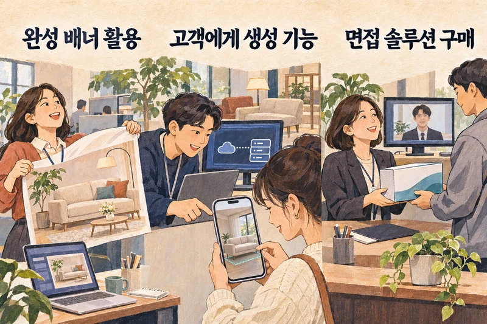
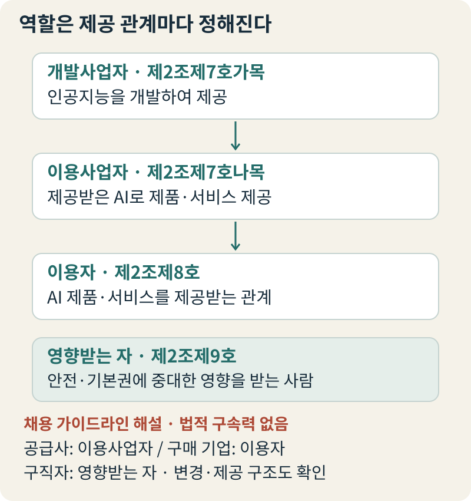
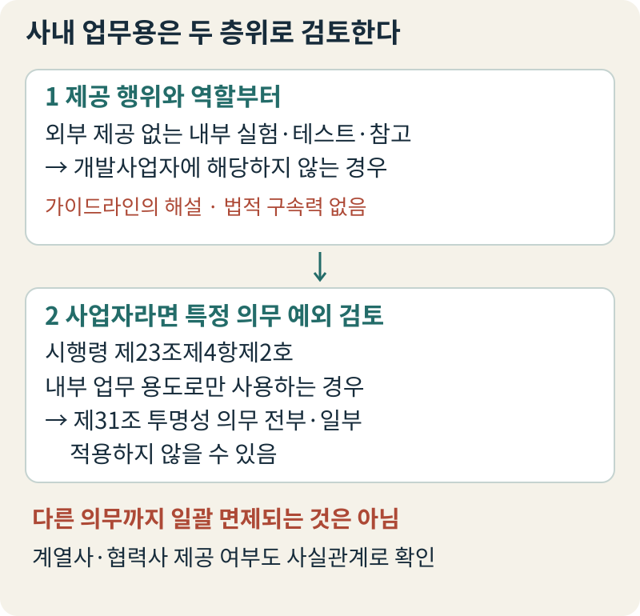
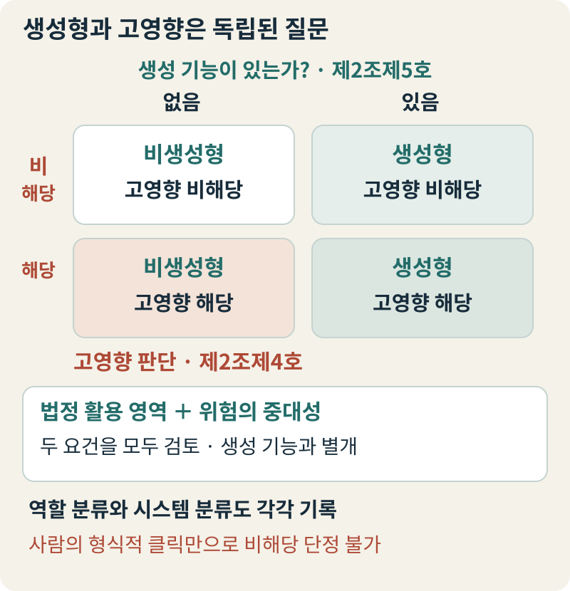
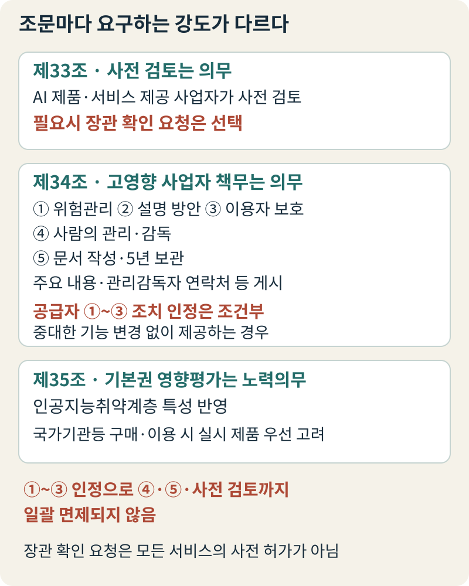
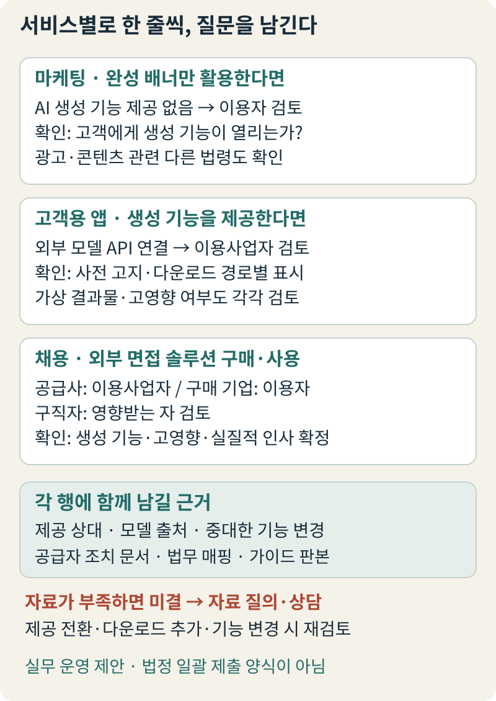
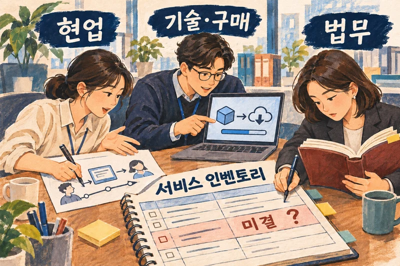

+++
date = '2026-11-19T00:00:00+09:00'
draft = false
title = '한국 AI 기본법, 우리 회사에는 어떤 질문을 던지나?'
description = '업종이나 기술 유무가 아니라 서비스별 제공 관계와 역할 분류로 시작하는 AI 기본법 실무 인벤토리 설계'
tags = ['ai-basic-act', 'ai-governance', 'ax', 'service-inventory', 'compliance']
authors = ['geoff']
slug = 'korea-ai-basic-act'
audio = []
vedios = []
series = []
toc = true
featured_image = 'thumbnail.webp'
images = ['thumbnail.webp']
+++

## 들어가며

커머스 플랫폼을 운영하는 회사라면 이런 풍경을 쉽게 떠올릴 수 있습니다. 마케팅팀은 외부 이미지 생성 도구를 구독해 광고 배너 이미지를 만듭니다. 모바일 앱 개발팀은 외부 생성형 AI API를 자사 앱에 연결해 고객이 직접 방 사진에 가구를 배치해 보는 이미지 생성 기능을 제공합니다. 인사팀은 외부 솔루션 업체의 AI 면접 시스템을 구매해 채용 전형에 활용하고 있죠.

세 부서 모두 업무에 AI를 씁니다. 그런데 임원 회의에서 “우리 회사도 AI를 쓰니까 전부 AI 기본법상 사업자 의무를 지는 것 아닌가?”라는 질문이 나오거나 반대로 “외부 솔루션을 가져다 쓰는 것뿐이니 공급사가 다 알아서 처리하는 것 아닌가?”라는 이야기가 오간다면 어느 쪽도 정확한 답이 되지 못합니다. 한국 AI 기본법은 회사의 업종이나 AI 기술 보유 여부로 의무를 일괄 배정하지 않기 때문입니다. 같은 회사 안에서도 개별 서비스와 업무 용도 단위로 ‘무엇을 개발·변경하여 누구에게 제공하는가’를 먼저 물어야 법이 우리 회사를 어떤 주체로 보는지 드러납니다.

이 글의 기준일은 2026년 11월 19일(한국시간)입니다. 2026년 1월 22일 최초 시행된 이후 현재 효력을 갖는 통합 본문은 [인공지능 발전과 신뢰 기반 조성 등에 관한 기본법(법률 제21311호, 2026. 1. 20. 공포, 2026. 7. 21. 시행 통합본)](https://www.law.go.kr/LSW/lsInfoR.do?lsiSeq=282791&efYd=20260721)과 [같은 법 시행령(대통령령 제36580호, 2026. 8. 18. 공포, 2026. 8. 20. 시행)](https://www.law.go.kr/LSW/lsInfoR.do?lsiSeq=288781&efYd=20260820)입니다. 2026년 10월 20일 공포된 [일부개정법률(법률 제22076호)](https://www.law.go.kr/LSW/lsInfoR.do?lsiSeq=291229&efYd=20270421)은 2027년 4월 21일 시행 예정인 학습용데이터 통합제공시스템(제15조의2) 신설 등이므로, 지금 기업이 점검해야 할 현행 사업자 의무와는 구분해 살펴보겠습니다.

## 첫 번째 질문: 각 서비스에서 우리는 개발사업자인가, 이용사업자인가, 이용자인가

AI 기본법을 읽을 때는 ‘AI를 활용하는 기업 = 인공지능이용사업자’가 아니라는 사실을 가장 먼저 짚어야 합니다. 법률이 정의하는 역할은 회사의 고정된 신분이 아니라 개별 제공 관계에 따라 정해집니다.

법 제2조제7호는 인공지능을 개발하여 제공하는 자를 **인공지능개발사업자**(가목), 개발사업자가 제공한 인공지능을 이용하여 인공지능제품 또는 인공지능서비스를 제공하는 자를 **인공지능이용사업자**(나목)로 정의합니다. 반면 제공된 인공지능제품 또는 인공지능서비스를 제공받는 자는 그 제공받는 관계에서 **이용자**(제8호)가 되며 그 제품·서비스에 의해 자신의 생명·신체의 안전 및 기본권에 중대한 영향을 받는 자는 **영향받는 자**(제9호)입니다. 따라서 한 회사라도 어떤 거래에서는 솔루션을 제공받는 이용자이면서 다른 서비스에서는 고객에게 AI 기능을 제공하는 이용사업자나 개발사업자가 될 수 있습니다.

과학기술정보통신부와 유관기관은 법상 의무 이행을 지원하기 위해 법적 구속력 없는 해설서를 공개했습니다. [인공지능 투명성 확보 가이드라인(2026. 1. 26. 수정본)](https://www.nia.or.kr/common/board/Download.do?bcIdx=28987&cbIdx=99835&fileNo=14)과 [고영향 인공지능 판단 가이드라인(2026. 4. 29. 수정본)](https://www.nia.or.kr/common/board/Download.do?bcIdx=28987&cbIdx=99835&fileNo=27)은 이 경계를 다음과 같은 기준으로 설명합니다.

하나는 **AI 기능 자체를 제공하는가, 아니면 AI가 만든 완성 결과물만 활용하는가**입니다. 디에이징(De-aging)·CG 기술을 개발한 회사는 개발사업자, 이를 제작용 솔루션으로 제공하는 회사는 이용사업자이지만 그 도구로 CG를 넣어 완성된 영화를 배급하는 영화제작사는 생성 결과물을 자기 사업에 활용한 이용자로 분류됩니다(투명성 가이드라인 본문 p.2~3, 판단 가이드라인 본문 p.16). 반면 파운데이션 모델 개발사의 API를 연결해 고객이 직접 문장이나 이미지를 생성하게 하는 회사는 최종 이용자에게 AI 서비스를 제공하는 이용사업자에 해당합니다.

다른 하나는 **가치사슬 내 위치와 기능 변경 범위**입니다. 채용 가치사슬 예시(판단 가이드라인 본문 p.13~16)에서 영상·음성 분석 AI 모델 개발사는 개발사업자, AI 면접 시스템 공급사는 이용사업자이지만 그 시스템을 구매해 자사 채용에 사용하는 기업은 그 관계에서 이용자, 구직자는 영향받는 자로 구분됩니다. 다만 외부 모델을 사용하더라도 단순 설정·프롬프트 조정이나 미세조정(파인튜닝)이라는 기술 명칭과 별개로, 본래 목적·기능에 ‘중대한 기능의 변경’을 초래하는 수정·변경·개량을 거쳐 제공하는 경우에는 개발사업자 지위를 가질 수 있으므로(판단 가이드라인 본문 p.14), 모델 출처와 변경 정도, 제공 상대를 함께 확인해야 합니다.

## 두 번째 질문: ‘사내 업무용’이라면 어떤 조건에서 무엇이 달라지는가

다음으로 회의 테이블에 오를 법한 질문은 “고객에게 파는 서비스가 아니라 사내에서 쓰는 시스템이라면 법 적용 대상에서 아예 빠지는 것 아닌가?”입니다. 법과 시행령 본문에는 ‘사내 시스템은 이 법을 적용하지 않는다’는 포괄 조항이 없습니다. 법 전체의 적용 제외를 다룬 법 제4조제2항은 국방 또는 국가안보 목적만을 위하여 개발·이용되는 인공지능에 한정됩니다.

내부 업무용 도구는 두 층위로 나누어 보아야 합니다. 한 층위는 **제공 행위가 없어서 애초에 사업자 정의에 해당하지 않는 경우**입니다. 판단 가이드라인(본문 p.13~14)은 법 제2조제7호의 개발사업자와 이용사업자 모두 ‘제공 행위’가 필수적이라고 설명합니다. 인공지능을 자체 개발하더라도 외부에 제공하지 않고 내부적인 실험·테스트 또는 참고 목적으로만 활용하는 경우에는 개발사업자에 해당하지 않습니다. 외부 개발사업자에게 AI를 제공받았더라도 자사 제품·서비스 개발에 활용할 뿐 이용자에게 AI 제품·서비스를 제공하는 것으로 볼 수 없다면 이용사업자가 아닌 이용자에 해당할 수 있습니다.

다른 한 층위는 **사업자에 해당하더라도 특정 의무의 적용 예외를 받는 경우**입니다. 시행령 제23조제4항제2호는 “인공지능사업자의 내부 업무 용도로만 사용되는 경우”에 법 제31조의 투명성 확보 의무(사전 고지 및 생성 결과물 표시)의 전부 또는 일부를 적용하지 않을 수 있다고 규정합니다. 즉, 이 조항은 사업자 지위를 전제로 한 투명성 조항의 한정 예외이지, 사업자 지위 자체나 법상의 다른 검토 의무까지 일괄 면제하는 조항이 아닙니다. 따라서 별도 법인인 계열사나 협력사에 기능을 제공하는 구조인지, 채용·인사 평가처럼 개인의 권리·의무 관계에 중대한 영향을 미치는 영역에서 누가 개발·제공 주체인지 사실관계를 먼저 구분해 적어야 합니다.

## 세 번째 질문: 생성형과 고영향, 두 개의 독립된 축을 어떻게 나누어 볼까

역할과 제공 관계를 확인했다면 서비스의 성격을 분류할 차례입니다. ‘생성형 인공지능’과 ‘고영향 인공지능’은 서로 독립된 두 개의 질문입니다. 생성형은 입력을 모방해 결과물을 만들어 내는 기능 축이고 고영향은 법정 활용 영역과 생명·안전·기본권에 대한 위험의 중대성 축입니다. 생성형이면서 고영향일 수도 있고 생성 기능은 전혀 없는 분석·점수화 모델이지만 고영향일 수도 있습니다.

먼저 **생성형 인공지능**(법 제2조제5호)을 이용한 제품·서비스를 제공하는 사업자에게는 법 제31조와 시행령 제23조가 세 갈래 투명성 의무를 부과합니다. ①제품·서비스가 생성형(또는 고영향) AI에 기반해 운용된다는 사실을 약관·계약서·화면 등을 통해 미리 알리는 **사전 고지**(제31조제1항), ②사람이 인식할 수 있는 방식이나 기계 판독 방식(메타데이터·워터마크 등, 이 경우 문구·음성 등으로 1회 이상 안내 동반)으로 표시하는 **생성 결과물 표시**(제31조제2항), ③실제와 구분하기 어려운 가상의 음향·이미지·영상을 이용자 조건을 고려해 명확히 알리는 **가상 결과물 고지·표시**(제31조제3항, 예술·창작물은 향유를 저해하지 않는 방식이 허용될 뿐 표시 의무 자체가 사라지는 것은 아님)입니다. 투명성 확보 가이드라인(본문 4장)은 서비스 화면 안에서만 소비되는 결과물과 파일 다운로드·공유로 외부 반출되는 결과물을 구분해 표시 방식을 설계하도록 안내합니다.

반면 **고영향 인공지능**(법 제2조제4호)은 두 단계 요건을 모두 충족해야 해당됩니다. 첫째, 채용·대출 심사 등 개인의 권리·의무 관계에 중대한 영향을 미치는 판단·평가를 비롯해 [법 제2조제4호 각 목](https://www.law.go.kr/LSW/lsInfoR.do?lsiSeq=282791&efYd=20260721)이 열거한 법정 영역에 활용되어야 합니다. 둘째, 그 영역에서 사람의 생명·신체의 안전 및 기본권에 중대한 영향을 미치거나 위험을 초래할 우려(시행령 제25조제2항에 따른 위험의 영향·중대성·빈도와 영역별 특수성 고려)가 있어야 합니다.

이때 “마지막에 사람이 승인 버튼 한 번만 누르면 무조건 고영향에서 제외된다”고 일반화해서는 안 됩니다. 판단 가이드라인(본문 p.76)의 채용 분야 예시를 보면, 지원자 제출 정보를 분석해 점수·등급을 매기고 정당한 권한을 가진 사람의 실질적인 개입 없이 그 결과만으로 합불을 결정·통보하는 시스템은 고영향 해당으로 분류됩니다. 반면 AI가 입사시험 문제를 생성·채점하더라도 인사담당자가 문제를 사전에 감수·결재하고 채점 결과를 직접 확인·수정·보완해 최종 확정하는 구조는 비해당 예시로 제시됩니다. 형식적인 클릭 여부가 아니라 영역별 위험과 실질적 검증·수정 권한을 함께 검토해야 합니다.

## 네 번째 질문: 사전 검토, 사업자 책무, 영향평가의 법적 강도는 어떻게 다른가

서비스가 고영향 후보와 연결된다면 법 제33조부터 제35조까지가 정한 의무의 강도를 정확히 구별해야 합니다. 조문마다 ‘하여야 한다(의무)’, ‘요청할 수 있다(선택)’, ‘노력하여야 한다(노력의무)’가 뚜렷이 나뉘어 있습니다.

**고영향 해당 여부의 사전 검토는 의무이고 장관 확인 요청은 선택입니다(법 제33조제1항, 시행령 제25조).** AI 또는 이를 이용한 제품·서비스를 제공하는 사업자는 고영향 인공지능에 해당하는지 **사전에 검토하여야** 하며 필요한 경우 과기정통부 장관에게 확인을 **요청할 수 있습니다.** 모든 AI 서비스를 출시 전에 정부로부터 허가받아야 하는 사전 승인제가 아닙니다.

**고영향 사업자 책무는 필수 이행 의무이며 공급자 선행 조치 인정에는 한계가 있습니다(법 제34조제1항, 시행령 제27조).** 고영향 AI 또는 관련 제품·서비스를 제공하는 사업자는 ①위험관리방안 수립·운영, ②최종결과·주요 기준·학습용데이터 개요 설명 방안, ③이용자 보호 방안, ④사람의 관리·감독, ⑤안전·신뢰 조치 문서의 작성 및 5년 보관 등을 **이행하여야** 하고 주요 내용과 관리감독자 성명·연락처를 홈페이지 등에 게시해야 합니다. 상류 개발사업자가 제1~3호 조치를 이행한 시스템을 받아 이용사업자가 ‘중대한 기능 변경 없이’ 서비스를 제공하면 그 제1~3호 조치를 이행한 것으로 인정받습니다(시행령 제27조제3항). 하지만 사람의 관리·감독(제4호)과 문서 작성·5년 보관(제5호), 그리고 법 제33조제1항의 사전 검토까지 일괄 면제되는 것은 아닙니다.

**기본권 영향평가는 노력의무이지만 공공조달과 연결됩니다(법 제35조, 시행령 제28조).** 고영향 AI 제품·서비스를 제공하는 사업자는 사전에 기본권에 미치는 영향을 평가하기 위해 **노력하여야** 하며 2026년 7월 21일 시행된 제35조제1항 후단에 따라 인공지능취약계층의 특성이 반영되어야 합니다. 비록 노력의무이나 국가기관등이 고영향 AI를 구매·이용할 때 영향평가를 실시한 제품을 우선 고려하도록 규정(제35조제2항)하고 있어 공공 시장에서는 실질적인 기준이 됩니다.

## 실무 제안: 세 가지 서비스로 그려 보는 분류 인벤토리

법 제33조제1항의 사전 검토 기록을 남기고 서비스별 의무를 혼선 없이 배정하려면, 모델 이름이 아니라 **제공되는 서비스·업무 용도 단위**로 한 줄씩 적는 인벤토리(분류 대장)가 유용합니다. 법령이 모든 기업에 아래 양식의 대장 제출을 명령하는 것은 아니며 현업·기술·법무가 같은 사실관계를 놓고 법적 분류를 진행하기 위해 제안하는 실무 운영 방식입니다.

도입부의 세 가지 시나리오를 세 칸짜리 인벤토리 요약 표에 올려 보면 서비스마다 물어야 할 질문이 분명하게 갈라집니다.

| 서비스·업무 시나리오 | 제공 관계와 역할 검토 | 다음에 확인할 핵심 질문 |
|---|---|---|
| **1. 마케팅팀 광고 배너 제작** (외부 이미지 생성 도구 활용) | 완성 배너만 노출하고 AI 기능 제공이 없다면 해당 관계에서 **이용자** 검토 | 고객에게 생성 기능을 여는 동선이 없는지, 기본법 외 다른 법령 검토 사항은 무엇인지 확인 |
| **2. 앱 내 고객용 홈스타일링** (외부 모델 API 기반 이미지 생성) | 고객(B2C)에게 이미지 생성·다운로드 기능을 직접 제공하므로 **이용사업자** 검토 | 사전 고지·반출 경로별 결과물 표시(제31조제1·2항), 가상 이미지(제3항) 및 고영향 사전 검토 |
| **3. 인사팀 AI 면접 시스템** (외부 공급사 솔루션 구매·활용) | 공급사는 이용사업자, 구매·사용 기업은 그 관계에서 **이용자**, 구직자는 **영향받는 자** 검토 | 중대한 기능 변경 여부, 시스템 자체의 생성형·고영향 해당성 및 인사담당자의 실질적 확정 구조 확인 |

이 세 행을 실제로 점검할 때는 몇 가지 세부 경계를 함께 기록해야 합니다.

1번 시나리오처럼 외부 도구의 생성 결과물만 활용하는 경우(투명성 가이드라인 본문 p.2~3)에는 소비자에게 AI 생성 기능 자체를 열어 주는 동선이 없는지 사실관계를 확인합니다. 기본법상 사업자 의무와 별개로 광고·콘텐츠 관련 다른 법령상 검토 사항도 점검합니다. 2번 시나리오처럼 고객에게 생성 기능을 직접 제공하는 서비스는 화면 내 조회와 파일 다운로드(외부 반출) 경로를 나누어 표시·1회 이상 안내 방식을 설계하고 실제와 구분하기 어려운 가상 이미지(제31조제3항) 생성 가능성과 고영향 해당 여부 사전 검토(제33조제1항)를 함께 진행해야 합니다.

특히 3번 시나리오에서는 구매 기업이 그 거래에서 이용자 위치(판단 가이드라인 본문 p.16)라는 점과 면접 시스템 자체의 분류를 분리해서 적어야 합니다. 시스템이 영상·음성 분석 점수화 기능만 제공하는지 면접 질문 생성 기능까지 포함하는지에 따라 생성형 해당 여부가 달라집니다. 채용 평가 영역(제2조제4호사목)에서 AI 점수만으로 합불을 자동 확정하는지 인사담당자가 결과를 실질적으로 확인·수정·확정하는지(판단 가이드라인 본문 p.76)에 따라 시스템의 고영향 판단이 달라집니다. 또한 구매 기업이 중대한 기능 변경을 가해 제3자에게 제공하는 구조가 없는지, 공급사가 제공한 설명·위험관리 자료가 무엇인지도 함께 확인해 두어야 합니다.

인벤토리가 살아 있는 문서로 작동하려면 ①현업(제공 상대·의사결정 용도), 기술·구매(모델 출처·중대한 기능 변경 여부·외부 반출 경로·공급자 제1~3호 조치 문서), 법무(역할·조문 매핑 및 [공식 가이드라인 공개 자료실](https://www.nia.or.kr/site/nia_kor/ex/bbs/View.do?cbIdx=99835&bcIdx=28987&parentSeq=28987)의 참조 판본 날짜)의 작성 칸을 나누고 ②사실관계가 부족한 항목은 근거 없이 ‘비해당’으로 닫지 말고 ‘미결’로 남겨 공급자 자료 질의나 AI기본법 지원데스크 실무 상담, 필요한 경우 법 제33조제1항의 장관 확인 요청으로 연결하며 ③사내 도구의 계열사·외부 제공 전환, 다운로드 기능 추가, 중대한 기능 변경, 법정 고영향 영역 진입 시 해당 행을 재검토하도록 배포 절차에 묶어 두는 것이 좋습니다.

## 나가며

이번 주에 각 부서에서 현재 운영 중이거나 출시를 준비 중인 AI 활용 업무를 하나씩만 가져와 위 인벤토리의 세 칸을 채워 보시기 바랍니다. 그 과정만으로도 당장 약관과 화면에 사전 고지·표시를 설계해야 할 고객용 서비스, 공급사 문서와 사람의 실질적 검토 절차를 확인해야 할 업무, 그리고 사실관계를 보완해 미결 질문을 풀어야 할 후보가 한눈에 정리될 것입니다.

다만 실제로 서비스 인벤토리를 작성하려 하면 현업 부서는 자신이 쓰는 SaaS나 API의 기술적 변경 범위를 설명하기 어렵고, 법무·준법 부서는 각 서비스의 모델 결합 구조나 화면 내 결과물 반출 동선을 일일이 파악하기 막막한 경우가 적지 않습니다. 우리 회사의 AI 서비스와 에이전트 아키텍처, 데이터·화면 흐름을 현업·엔지니어링 관점에서 함께 정리하고 법무 검토와 바로 연결할 수 있는 서비스 인벤토리와 운영 거버넌스 틀을 설계해야 한다면, 언제든 **엡실론델타**([contact@epsilondelta.ai](mailto:contact@epsilondelta.ai))로 문의해 주시기 바랍니다. 기술과 업무 흐름을 정확히 번역하는 단계부터 함께 고민하고 도움을 드릴 수 있습니다.
