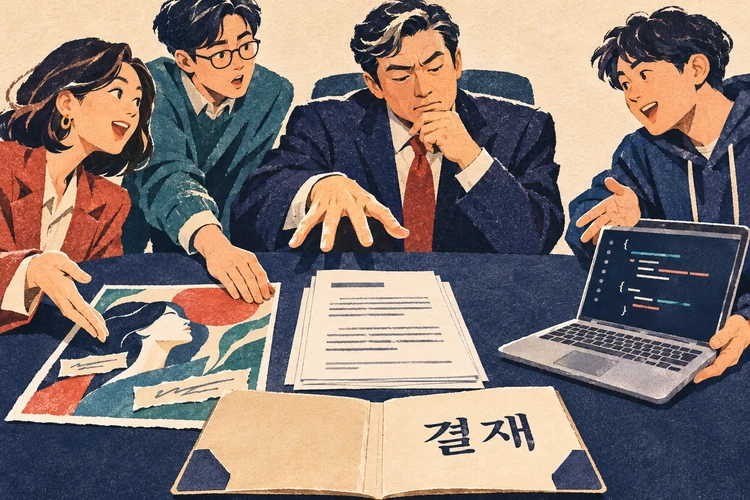
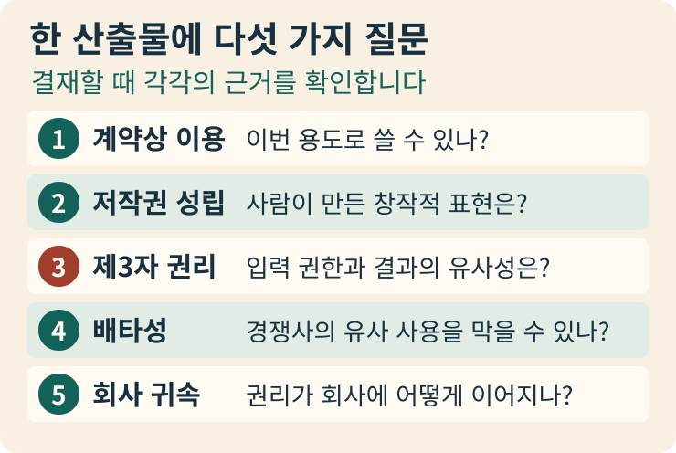
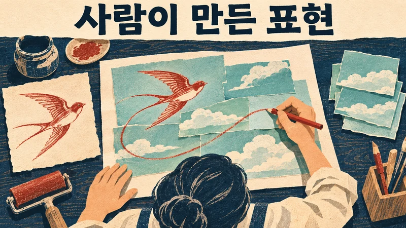
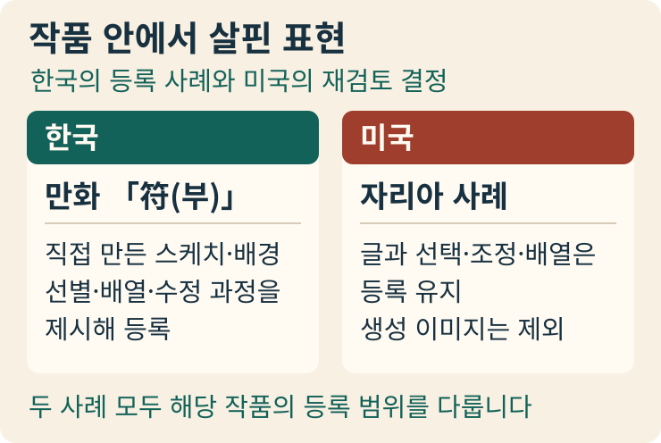
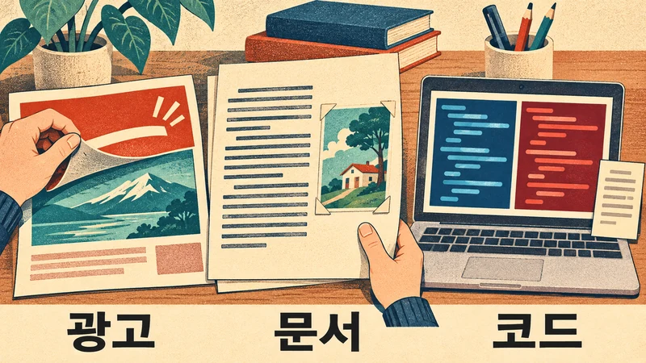
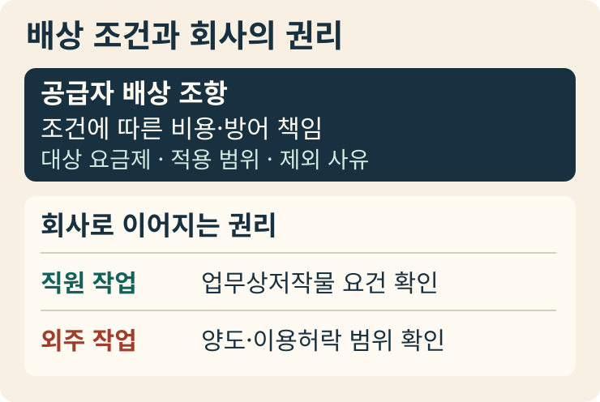
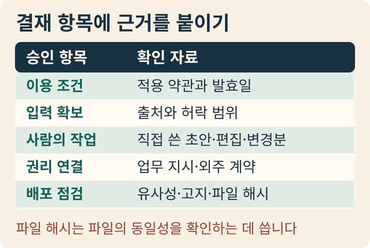

+++
date = '2026-11-22T00:00:00+09:00'
draft = false
title = 'AI로 만든 광고·문서·코드, 어디까지 우리 회사 권리일까요?'
description = '생성형 AI 결과물의 상업적 이용권, 저작권 성립, 제3자 권리 비침해, 회사 귀속까지 경영진이 결재 전에 구분해야 할 다섯 가지 기준을 정리합니다.'
tags = ['ax', 'ai-copyright', 'ai-governance', 'enterprise-ai', 'intellectual-property']
authors = ['geoff']
slug = 'ai-output-rights'
audio = []
vedios = []
series = []
toc = true
featured_image = 'thumbnail.webp'
images = ['thumbnail.webp']
+++

## 들어가며

하반기 신제품 출시를 앞두고 마케팅팀과 기획팀, 개발팀이 나란히 결재를 올렸다고 가정해봅시다. 마케팅팀은 생성형 AI로 뽑은 배경 이미지에 카피를 얹어 광고 시안을 만들었고 기획팀은 사내외 자료를 AI로 정리한 시장 보고서를 가져왔습니다. 개발팀은 AI 코딩 도구로 작성한 함수를 상용 서비스에 반영하겠다고 보고합니다. 결과물을 보던 임원이 이렇게 물었다고 해봅시다.

"이거 다 회사 유료 계정으로 만든 거죠? 그러면 권리는 전부 우리 회사 것 맞나요?"

생성형 AI 결과물을 사업에 활용하려는 기업이라면 자연스럽게 떠올릴 법한 질문입니다. 얼핏 '맞다'거나 '아니다'로 답할 수 있을 것 같지만 실제로는 이 짧은 물음 하나에 다섯 가지 다른 질문이 겹쳐 있습니다. 약관상 상업적 이용이 허용되는지, 법적인 저작권이 성립했는지, 타인의 권리를 침해하지 않았는지, 경쟁사의 유사 사용을 막을 수 있는지, 그리고 그 권리가 회사로 연결되어 있는지가 모두 별개의 판단이기 때문입니다.

공방에서 작업 도구를 빌려 작품을 만드는 상황에 비유해 보면 이해하기 쉽습니다. 공방에 사용료를 내고 전동 공구를 상업용으로 쓸 허락을 받은 것과, 완성품에 내가 직접 표현한 창작성이 담겨 저작물로 보호받는 것, 그리고 작업 과정에서 타인의 재료를 무단으로 쓰지 않은 것은 따로따로 확인해야 합니다. 도구 제공자가 도구 사용을 허락하고 결과물에 대한 자신의 권리를 넘긴다고 해서 법이 요구하는 인간의 창작성을 대신 채워 주거나 타인의 재료 사용까지 허락해 줄 수는 없기 때문입니다.

결국 파일을 누가 내려받았는지는 결재선에서 확인할 핵심이 아닙니다. 광고와 문서, 코드를 사업에 안전하게 쓰고 회사 자산으로 관리하려면 무엇을 구분해 물어야 하는지 하나씩 짚어보겠습니다.

## '우리 회사 것'이라는 한마디에 숨은 다섯 가지 질문

실무자가 "유료 기업용 요금제를 썼으니 문제없습니다"라고 답했다고 칩시다. 그 답변은 다섯 가지 질문 가운데 첫 번째에만 해당할 가능성이 큽니다. 경영진이 의사결정을 내릴 때는 다음 다섯 가지를 하나하나 확인해야 합니다.

첫째는 **서비스 계약상 이번 사업 용도로 쓸 수 있는가**입니다. 기업·개발자 대상인 [OpenAI Services Agreement](https://openai.com/policies/services-agreement/)를 보면, 당사자 사이에서 법이 허용하는 범위 내로 출력물에 대한 권리·소유권·이권을 고객에게 양도(assign)하여 귀속시킵니다. 다만 적용 약관의 허용 범위는 먼저 확인해야 합니다. 이 양도는 서비스 제공자와 고객 사이의 계약상 권리 배분이며 요금제·기능·지역에 따라 이용 조건이 달라질 수 있기 때문입니다.

둘째는 **그 결과물에 저작권법이 보호하는 창작성이 생겼는가**입니다. 계약에서 출력물을 고객에게 귀속시킨다고 정했더라도, 법률상 저작물 요건을 갖추지 못하면 배타적인 저작권은 성립하지 않습니다. 2026년 10월 29일 시행 기준 현행 [저작권법](https://www.law.go.kr/LSW/lsLinkProc.do?chrClsCd=010202&joLnkStr=%EC%A0%9C46%EC%A1%B0&lsNm=%EC%A0%80%EC%9E%91%EA%B6%8C%EB%B2%95&mode=11)은 저작물을 '인간의 사상 또는 감정을 표현한 창작물'로 정의합니다. 한국에서 저작권은 창작과 동시에 발생하며 등록이 발생 요건은 아니지만 인간이 표현한 창작적 부분이 있어야 보호받습니다.

셋째는 **다른 사람의 권리를 침해하지 않는가**입니다. 한국저작권위원회의 [생성형 인공지능 결과물에 의한 저작권 분쟁 예방 안내서](https://www.copyright.or.kr/information-materials/publication/research-report/download.do?brdctsno=54252&brdctsfileno=25589)가 짚듯, 출력물이 기존 타인 저작물에 의거해 실질적으로 유사한지, 혹은 참고 자료를 적법한 권한 없이 입력해 결과물에 반영되게 했는지는 별도로 점검해야 합니다. [OpenAI Services Agreement](https://openai.com/policies/services-agreement/) 역시 입력 자료의 권리 확보와 출력물의 비침해 검토 책임을 고객에게 둡니다.

넷째는 **경쟁사가 유사한 결과물을 쓰는 것을 막을 수 있는가**입니다. 생성형 AI는 다른 사용자에게도 유사한 출력을 내놓을 수 있으며 약관도 이를 명시합니다. 경쟁사의 모방을 막으려면 사람이 직접 만든 창작적 표현이 어디까지인지 특정해야 합니다. AI가 생성한 영역 자체에는 배타적 저작권이 인정되지 않을 수 있기 때문입니다.

다섯째는 **생긴 권리가 회사로 연결되어 있는가**입니다. 사람의 창작적 기여로 저작권이 발생한 부분이 있더라도, 작업 주체가 사내 직원인지 외주 파트너인지에 따라 귀속 근거가 다릅니다. [저작권법](https://www.law.go.kr/LSW/lsLinkProc.do?chrClsCd=010202&joLnkStr=%EC%A0%9C46%EC%A1%B0&lsNm=%EC%A0%80%EC%9E%91%EA%B6%8C%EB%B2%95&mode=11)상 업무상저작물 요건을 충족하거나 외주 계약에 권리 양도 혹은 목적에 맞는 이용허락 조항이 있어야 회사가 적법하게 활용할 수 있습니다.

## 프롬프트에 들인 시간보다 '사람이 만든 표현'을 찾아야 합니다

실무자가 "프롬프트 한 줄만 친 게 아니라 이틀 동안 수백 번 고쳐 쓰며 결과물을 골라냈는데, 이 정도 노력이면 사람이 창작한 것 아닌가요?"라고 물었다고 해 보죠.

실무자의 수고와 기획 의도가 들어간 것은 분명하지만 투입한 시간이나 프롬프트 횟수가 곧바로 창작성 점수가 되지는 않습니다. 문화체육관광부와 한국저작권위원회의 [생성형 인공지능 활용 저작물의 저작권 등록 안내서](https://www.copyright.or.kr/information-materials/publication/research-report/download.do?brdctsno=54253&brdctsfileno=25590)는 일반적인 프롬프트 지시나 오탈자 교정, 사소한 크기·색상 변경만으로는 인간의 창작적 기여를 인정하기 어렵다고 설명합니다. 몇 퍼센트 이상 고치면 인정된다는 공식 대신, 최종 결과물의 구체적 표현 가운데 무엇을 사람이 직접 만들었는지를 개별적으로 살핍니다.

한국 안내서가 설명하는 인간의 창작적 기여는 세 갈래입니다. 사람이 직접 작성한 문장이나 스케치 같은 '입력 표현'이 결과물에 남아 있는 경우가 첫째입니다. 둘째는 생성 결과물에 사람이 창작적인 수정·가공 등 '추가 작업'을 더한 경우입니다. 생성물들을 창작적으로 '선택·배열·구성'해 편집저작물로서의 창작성이 나타나는 경우가 셋째입니다. 다만 편집저작물로 보호받더라도 그 선택과 배열이 보호될 뿐, 개별 AI 생성 소재 자체에 저작권이 새로 생기는 것은 아닙니다.

해외의 분석도 참고할 만합니다. 미국 저작권청의 2025년 보고서인 [Copyright and Artificial Intelligence, Part 2: Copyrightability](https://www.copyright.gov/ai/Copyright-and-Artificial-Intelligence-Part-2-Copyrightability-Report.pdf) 역시 현재 일반적으로 이용 가능한 기술에서 프롬프트만으로 충분한 표현 통제가 성립하지 않는다고 분석합니다. 사람이 만든 표현과 창작적 편집·수정은 구분해 보호할 수 있다고 봅니다. 미국 보고서는 한국 법의 근거가 아니지만 프롬프트 분량보다 최종 표현에 남은 사람의 기여를 본다는 방향은 분명합니다.

한편 2026년 10월 발표된 [지식재산위원회의 AI 활용 지식재산권 안내서 점검 브리핑](https://m.korea.kr/briefing/pressReleaseView.do?newsId=156784631)은 2025년의 저작권 등록·분쟁 예방 안내서와 2026년의 학습 공정이용 안내서를 구분해 다루었습니다. 학습에 관한 새 안내서가 나왔다고 해서 출력물의 권리 귀속 기준이 새로 바뀐 것은 아닙니다.

## 한 작품 안에서도 보호받는 부분과 아닌 부분이 나뉩니다

실제 사례에서는 사람의 기여와 AI 생성 부분을 어떻게 가려낼까요? 한국과 미국의 대표 사례 두 가지를 보면 한 작품 안에서도 보호 범위가 나뉜다는 점이 또렷해집니다.

한국 사례는 [생성형 인공지능 활용 저작물의 저작권 등록 안내서](https://www.copyright.or.kr/information-materials/publication/research-report/download.do?brdctsno=54253&brdctsfileno=25590) 32쪽에 소개된 강보현 작가의 단편 만화 「符(부)」(등록번호 C-2024-010508, 2024년)입니다. 직접 만든 스케치·배경과 생성 이미지를 연결하고 여러 요소를 선별·배열·수정한 제작 과정을 구체적으로 제시해 등록된 사례라 사람의 작업을 구체적인 표현 단위로 설명하기 좋습니다. 다만 이 만화는 안내서에 실린 등록 사례일 뿐 법원의 침해 판결은 아닙니다. 등록되었다고 해서 그 안의 개별 AI 생성 픽셀 전체가 사람의 독점 창작물로 인정된다는 뜻도 아닙니다.

미국에서는 저작권청이 2023년 2월에 낸 [Zarya of the Dawn 등록 재검토 결정 서한](https://www.copyright.gov/docs/zarya-of-the-dawn.pdf)이 같은 경계를 보여줍니다. 저작권청은 작가가 쓴 텍스트와 시각·문자 요소의 선택·조정·배열은 보호 대상으로 유지하면서도 Midjourney 생성 이미지는 제외해 기존 등록을 더 제한된 등록으로 대체했습니다. 'AI를 썼으니 전부 등록 불가'라는 오해와 '책이 등록됐으니 모든 이미지가 독점 보호'라는 오해를 동시에 바로잡은 행정 결정입니다.

## 광고·문서·코드, 현업 결재에서 짚어야 할 포인트가 다릅니다

이 기준을 현업 결재에 적용하면 광고와 문서, 코드 모두 기본적인 권리 점검은 필요하지만 더 챙겨야 할 질문의 무게는 각각 다릅니다.

**광고와 브랜드 비주얼**부터 보겠습니다. 광고팀이 생성 이미지를 배경으로 쓰고 사람이 카피와 레이아웃을 완성한 상황을 떠올려 봅시다. 약관상 이용 조건, 입력 이미지 사용 근거, 기존 저작물과의 유사성, 회사로의 권리 연결은 기본적으로 확인해야 합니다. 여기에 더해 독점이 중요한 핵심 브랜드 자산이라면 사람이 직접 쓴 카피와 그래픽, 창작적 레이아웃 배열을 먼저 특정해 두어야 합니다. 생성 배경 이미지의 모든 픽셀을 사람 작품으로 확대해 주장할 수는 없기 때문입니다.

**기획 문서와 시장 보고서**는 어떨까요. 기획팀이 AI로 시장 보고서 초안을 만들고 수치를 검수했다고 가정해봅시다. [저작권법](https://www.law.go.kr/LSW/lsLinkProc.do?chrClsCd=010202&joLnkStr=%EC%A0%9C46%EC%A1%B0&lsNm=%EC%A0%80%EC%9E%91%EA%B6%8C%EB%B2%95&mode=11)상 사실·수치의 정확성 확인과 표현의 창작성은 별개입니다. 사실을 담았다고 문서 전체가 비보호 대상이 되는 것도 아니지만 숫자를 검산했다고 해서 AI가 생성한 문장 전체의 저작자가 되는 것도 아닙니다. 사람이 직접 다시 쓴 설명과 창작적 구성을 구분하고 외부에서 옮긴 표·도판·인용문은 각각의 이용 근거를 확인해야 합니다.

마지막은 **소프트웨어 코드**입니다. 개발팀이 AI가 제안한 함수를 제품에 포함했다고 해봅시다. 기능 구현이나 테스트 통과가 소유권·비침해 판단을 대신하지는 않습니다. [저작권법](https://www.law.go.kr/LSW/lsLinkProc.do?chrClsCd=010202&joLnkStr=%EC%A0%9C46%EC%A1%B0&lsNm=%EC%A0%80%EC%9E%91%EA%B6%8C%EB%B2%95&mode=11)은 구체적인 창작적 프로그램 표현과 프로그램 언어·규약·해법을 구별합니다. OpenAI의 [Service terms](https://openai.com/policies/service-terms/)도 코드 출력에 제3자 오픈소스 라이선스가 적용될 수 있음을 안내합니다.

따라서 배포용 코드라면 사람이 구현·수정한 변경분(diff)과 함께 공개 코드 매칭 여부를 확인해야 합니다. GitHub 공식 문서인 [Copilot 공개 코드 매칭 안내](https://docs.github.com/en/copilot/how-tos/copilot-in-your-ide/copilot-for-common-tasks/find-matching-code?tool=vscode)에 따르면 지원 제품·설정에 따라 매칭 코드의 출처 저장소와 라이선스를 볼 수 있습니다. 이때 라이선스 미확인 상태인 `NOASSERTION`을 자유 이용으로 읽어서는 안 됩니다. 매칭 도구가 미검출 코드의 부재까지 증명하지는 않는다는 점도 유의해야 합니다. 만약 [MIT 라이선스](https://opensource.org/license/mit)가 적용되는 코드를 사용한다면 사본이나 상당 부분에 저작권·허가 고지를 포함해야 하며 실제 일치 코드별 라이선스 조건을 각각 확인해야 합니다.

## 약관의 면책 조항과 외주 계약, 어디까지 믿을 수 있을까요?

약관의 배상(면책) 조항과 회사의 내부·외주 권리 귀속 계약을 읽을 때도 두 가지 세부 조건을 살펴야 합니다.

첫째, **배상 조항은 권리 성립이나 무침해 인증서가 아니라 문제가 생겼을 때의 조건부 비용·방어 책임 배분**입니다. 공급자마다 문언이 다르므로 개별 문서를 확인해야 합니다. OpenAI의 [Service terms](https://openai.com/policies/service-terms/)를 보면 제3절 제목에 Business가 나와도 실제 배상 대상인 Enterprise 정의에는 Enterprise·Edu·Healthcare가 열거되어 있습니다. 제목만 보고 Business 등의 보장을 확정해서는 안 됩니다.

또한 해당 [Service terms](https://openai.com/policies/service-terms/)의 출력 배상에는 침해 인지, 관련 안전·인용 기능 미사용, 출력 수정·변형·외부 결합, 입력 권리 부재, 상거래상 상표 청구, 제3자 제공 콘텐츠 등의 예외가 있고 베타 및 특정 음성 기능(Prompt-to-Voice)에는 별도 제외가 있습니다. 창작적 편집은 저작권 검토에 의미가 있을 수 있지만 특정 약관에서는 출력 수정이 배상 제외 사유가 될 수 있습니다. 그래서 사람의 창작성 판단과 배상 범위 판단은 따로 문서화해야 합니다.

둘째, **직원과 외주로부터 회사로 이어지는 권리 연결**입니다. 사내 직원의 작업물이 [저작권법](https://www.law.go.kr/LSW/lsLinkProc.do?chrClsCd=010202&joLnkStr=%EC%A0%9C46%EC%A1%B0&lsNm=%EC%A0%80%EC%9E%91%EA%B6%8C%EB%B2%95&mode=11)상 업무상저작물이 되려면 회사의 기획, 업무 종사자의 업무상 작성, 컴퓨터프로그램의 예외를 제외한 회사 명의 공표 및 계약·근무규칙을 확인해야 합니다. 외주는 대금 지급만으로 권리 이전을 단정하지 말고 계약상 양도·이용 범위를 확인합니다. 저작재산권과 일신전속적인 저작인격권은 구별되며 전부 양도 시 2차적저작물작성권의 추정도 일반 저작물과 프로그램이 다릅니다. 물론 모든 외주에서 양도가 필수인 것은 아니며 실제 용도에 맞는 이용허락(라이선스)이나 양도 범위가 계약에 반영되어 있으면 됩니다.

## 나가며: 결재선에 올릴 '다섯 줄 승인 기록'부터 시작합시다

법적 의무 양식은 아니지만 기업 내부의 결재 품질을 높이기 위한 운영 제안을 하나 드립니다. 배포용 광고·문서·코드 승인 문서에 '독점 권리 확보 완료' 같은 단일 체크박스 대신 다음 다섯 가지 항목을 한 장의 승인 묶음으로 남기는 방법입니다.

1. **이용 조건**: 서비스·기능·요금제·계약자·지역, 생성일, 적용 약관 사본과 발효일
2. **입력 확보**: 원본 출처, 라이선스·구매 계약, AI 입력 및 수정·배포 허락 범위
3. **사람의 작업**: 직접 쓴 초안·스케치, 편집 레이어, 변경 비교(diff), 구성 결정
4. **권리 연결**: 업무 지시·근무규칙 또는 외주 계약상의 양도·이용허락·재사용 범위
5. **배포 점검**: 유사 표현 검토, 코드 출처·고지, 검토자·승인일·최종 파일 해시

프롬프트와 생성 기록은 작업 흐름을 설명하는 자료로 보관하되 분량을 창작성 점수로 바꾸지 않는다는 점, 그리고 파일 해시 역시 파일의 동일성 확인을 도울 뿐 최초 창작자나 권리의 유효성을 인증하거나 법적 판단을 대신하지 않는다는 점을 분명히 해 두어야 합니다. 이 다섯 줄을 구분해 두면 승인 보류 사유가 생겨도 '입력 허락 미확인', '외주 권리 범위 불명확', '매칭 코드 라이선스 미확인'처럼 해결 가능한 항목으로 관리할 수 있습니다.

우리 회사의 광고·문서·코드 제작 흐름에 맞춰 실무에 바로 적용할 수 있는 AI 산출물 확인 기준과 결재 프로세스를 설계하고 싶으시다면, 언제든지 저희 엡실론델타(`contact@epsilondelta.ai`)로 문의해 주시기 바랍니다. 조직의 현업 속도를 살리면서 다섯 가지 질문을 결재 흐름에 녹여내는 운영 설계를 함께 도와드리겠습니다.