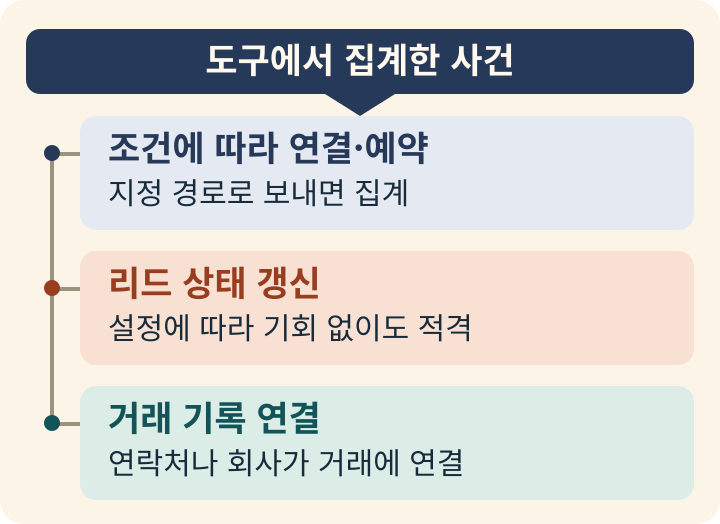
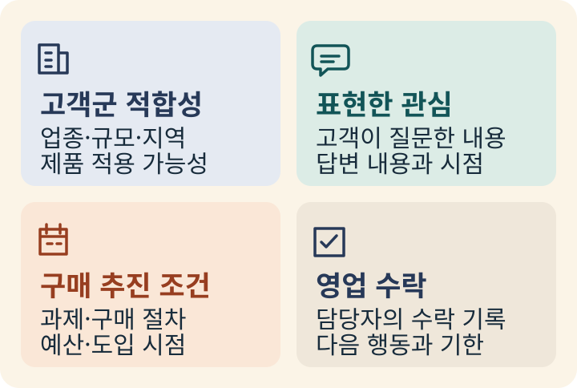
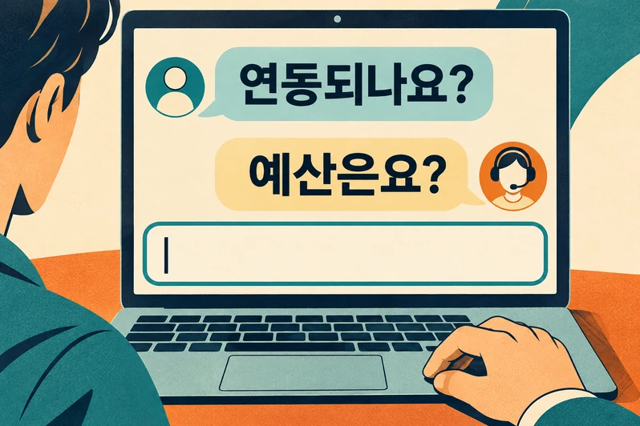
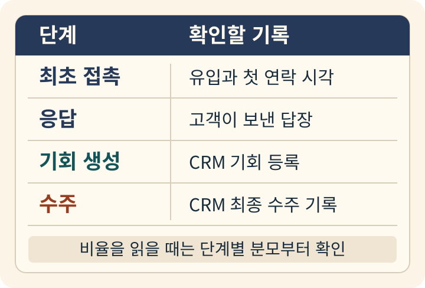
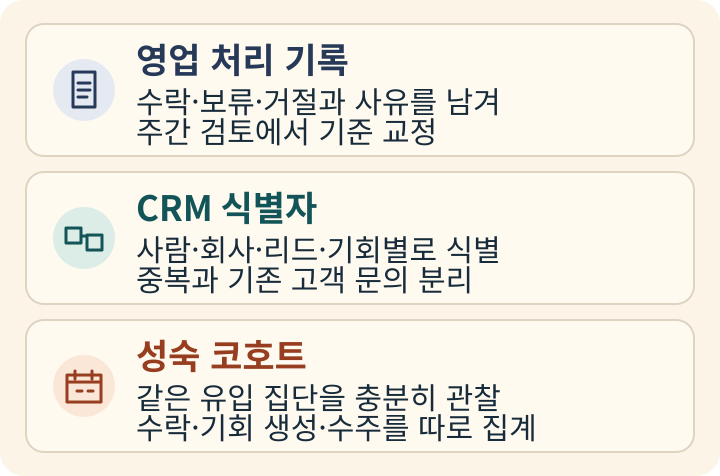
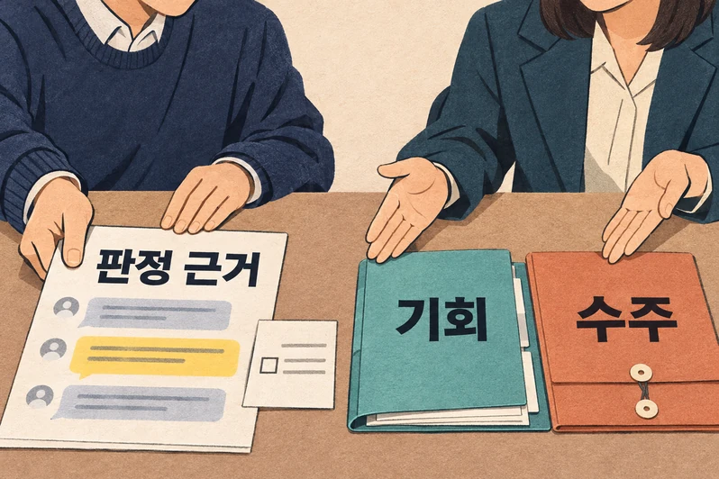

+++
date = '2026-11-25T00:00:00+09:00'
draft = false
title = '영업 AI가 가져온 잠재고객은 정말 영업 기회일까요?'
description = 'AI 에이전트의 자격 판정(Qualified) 건수와 실제 CRM 영업 기회 사이의 간극을 줄이고, 영업 수락률과 하류 수주 성과까지 연결하는 운영 및 측정 기준을 살펴봅니다.'
tags = ['ax', 'sales-ai', 'lead-qualification', 'crm', 'b2b-sales', 'agent']
authors = ['geoff']
slug = 'sales-lead-qualification'
audio = []
vedios = []
series = []
toc = true
images = ['thumbnail.webp']
+++

## 들어가며: 대시보드의 '적격 리드 100건'과 영업 현장의 온도차

B2B 솔루션을 판매하는 기업이 웹사이트 채팅과 문의 응대에 영업 AI 에이전트를 도입했다고 가정해봅시다. 한 달 뒤 운영 조직은 AI 자격 판정을 통과한 적격 리드(Qualified Lead)가 100건 발생했다고 보고합니다. 하지만 영업팀이 검토해보니 기존 고객 문의나 동일 담당자의 중복 유입이 섞여 있었고 실제 미팅을 거쳐 CRM에 정식 영업 기회(Opportunity)로 등록된 건수는 열 건 남짓이었다고 해봅시다.

반대로 잠재고객이 제품 연동 방식을 물은 뒤 예산 확정 여부 질문에는 답하지 않고 창을 닫았다고 가정해봅시다. 아직 구매 의도를 판단할 정보가 부족한 상태인데 시스템이 이를 조건 불충족(Disqualify)으로 닫아버리면, 영업팀은 후속 확인으로 실제 기회 여부를 가려볼 가능성 자체를 잃게 됩니다.

대시보드 숫자와 영업 현장의 체감이 어긋나는 이유는 AI 도구가 집계하는 '자격 판정(Qualified)&#8217; 건수와, 영업 담당자가 시간을 투입해 계약을 추진할 '진짜 영업 기회'가 서로 다른 단계의 사건이기 때문입니다. 박람회 부스 입구에서 설문에 체크한 방문객 명단과, 담당자가 도입 환경을 확인해 제안 프로젝트를 열기로 확정한 상태가 같을 수 없는 이치입니다. 이번 글에서는 영업 AI가 분류한 잠재고객을 실제 영업 기회와 구분하고 영업팀의 수락과 수주까지 연결하는 기준을 살펴보겠습니다.

## 같은 'Qualified'라도 도구마다 뜻하는 사건이 다릅니다

보고서를 볼 때는 대시보드의 'Qualified'가 무엇을 뜻하는지 먼저 확인합니다. 2026년 11월 25일 확인 기준으로 주요 플랫폼 문서를 비교하면 같은 단어가 서로 다른 사건을 가리킵니다.

Intercom의 [Fin for Sales FAQ 문서](https://www.intercom.com/help/en/articles/13927115-fin-for-sales-faqs)와 [에이전트 과금 결과 문서](https://www.intercom.com/help/en/articles/8205718-fin-ai-agent-outcomes)에서 'Qualification'은 사용자가 설정한 조건에 잠재고객을 대조해 담당자 연결이나 미팅 예약 같은 지정 경로로 라우팅한 과금 사건입니다. 채팅·이메일 대화당 1건만 과금할 때 Qualification은 9.99달러, 조건 불충족(Disqualification)·질문 해결(Resolution)·셀프서브 안내는 0.99달러입니다. 판정 후 고객지원팀으로 연결해도 Qualification으로 집계될 수 있습니다. 셀프서브 토글에 따라 미팅 예약 노출과 요율도 달라집니다. 즉 이 숫자는 조건 분기를 통과한 과금 사건이지 영업팀의 수락이나 수주 보장이 아닙니다.

HubSpot의 [라이프사이클 단계 문서](https://knowledge.hubspot.com/records/use-lifecycle-stages)에서 'Opportunity'는 해당 제품 내 정의로, 연락처나 회사가 거래(Deal) 레코드에 연결된 상태를 뜻합니다. 영업 적격 리드(SQL) 내부에서도 세부 리드 상태를 따로 관리합니다. HubSpot [고객 에이전트 성과 분석 문서](https://knowledge.hubspot.com/customer-agent/analyze-your-customer-agents-performance)는 리드가 적격·부분 적격·부적격 중 어느 값으로 분류되든 대화를 즉시 '해결됨(Resolved)&#8217;으로 합산하므로 해결률만 보면 지원 해결과 영업 분류가 섞일 수 있습니다.

Microsoft Dynamics 365의 [리드 자격 판정 및 기회 전환 문서](https://learn.microsoft.com/en-us/dynamics365/sales/qualify-lead-convert-opportunity-sales)는 리드를 qualify한다는 것이 진짜 영업 기회(genuine sales opportunity)임을 검증하는 과정이라고 설명합니다. 그러면서도 설정에 따라 기회 레코드 없이 리드 상태만 Qualified가 될 수도 있고 한 리드에서 최대 다섯 개의 기회를 만들 수도 있다고 명시합니다. [Sales Qualification Agent 개요 문서](https://learn.microsoft.com/en-us/dynamics365/sales/sales-qualification-agent)와 [인계 리드 처리 문서](https://learn.microsoft.com/en-us/dynamics365/sales/use-sales-qualification-agent)는 조사 후 이메일 초안만 쓰는 모드(Research-only)와 이메일 발송 및 후속 대화를 포함하는 모드(Research and engage)를 구분합니다. 두 문서 모두 에이전트가 사람의 판단을 대체하지 않고 담당자가 검토해 적절한 경우 최종 자격 판정(qualify if appropriate)을 내리도록 안내합니다. 결국 도구별 정의를 구분하지 않고 합격 건수를 파이프라인으로 환산하면 착오가 생깁니다.

## '우리 고객군에 맞는가'와 '지금 살 마음이 있는가'는 다른 질문입니다

다음은 AI가 잠재고객을 평가할 기준을 나눌 차례입니다. 고객사의 외형적 조건과 당장의 구매 의사를 하나의 합산 점수로만 다루면 우선순위를 판단하기 어렵습니다.

HubSpot의 [리드 스코어링 도구 문서](https://knowledge.hubspot.com/scoring/understand-the-lead-scoring-tool)는 기업 규모·직무 같은 속성 기반 적합도(Fit)와 방문·클릭 같은 행동 기반 참여도(Engagement)를 분리해 두 점수를 따로 볼 수 있게 합니다. Dynamics 365의 [Sales Qualification Agent 개념 문서](https://learn.microsoft.com/en-us/dynamics365/sales/sales-qualification-agent-concepts)도 대상 고객 프로필 일치도(적합도), 수신 이메일에서 파악한 구매 관심, 예산·권한·필요·시점(BANT)을 구분합니다. 단, 구매 관심과 BANT 평가 여부는 선택한 운영 모드와 관리자 설정에 따라 달라집니다.

이때 Microsoft 문서의 '높은 적합도(High fit)&#8217;는 대상 프로필 속성과 70% 초과 일치한다는 정의일 뿐 수주 확률 70%가 아닙니다. 같은 문서는 "가격만 알고 싶고 당장 살 계획은 없다&#8221;는 발화를 부정적 구매 관심 예시로 듭니다. 대상 업종과 규모에 맞는 방문자가 가격표를 요청했다고 가정해봅시다. 적합성과 가격 관심은 관찰됐지만 예산·일정은 아직 모릅니다. 반대로 "다음 달 도입하고 싶다&#8221;고 했어도 지원 불가 지역이면 통과시키기 어렵습니다.

따라서 판정 기준을 설계할 때는 아래 네 가지 질문을 분리해 운영하기를 제안합니다.

| 구분 질문 | 확인해야 할 근거 | 이 단계만으로 알 수 없는 것 |
|---|---|---|
| 우리 고객군에 맞는가 | 업종, 기업 규모, 지원 지역, 제품 적용 가능성 | 실제 구매 프로젝트 진행 여부 |
| 관심을 표현했는가 | 고객이 보낸 질문·답변과 시점 | 예산 확정, 구매 권한, 계약 가능성 |
| 구매 추진 조건이 있는가 | 해결 과제, 구매 절차, 예산 상태, 도입 시점 | 경쟁 승패와 최종 계약 체결 |
| 영업팀이 맡기로 했는가 | 담당자의 수락과 다음 행동·기한 | 기회 레코드 생성 이후의 수주 완료 |

공급 불가 지역·필수 연동 부재 같은 절대 배제 조건은 가산 점수와 분리하고 모든 항목을 첫 대화의 필수 조건으로 묶지 말아야 합니다.

## '아직 모른다'를 '자격 미달'로 버리지 않는 판정 설계

고객이 아직 답하지 않은 정보를 '조건 불충족'으로 처리해 조기 탈락시키는 것도 피해야 합니다. 잠재고객 실무자가 내부 품의 전 기능부터 확인하려고 대화를 시작했다고 가정해봅시다. 첫 대화에서 예산이나 승인자를 답하지 않았다는 이유로 부적격(Disqualified) 처리하면 후속 확인 기회를 잃게 됩니다.

Dynamics 365의 [인계 리드 처리 문서](https://learn.microsoft.com/en-us/dynamics365/sales/use-sales-qualification-agent)와 [핸드오프 기준 설정 문서](https://learn.microsoft.com/en-us/dynamics365/sales/configure-sales-qualification-agent-handoff-criteria)는 구매 의도를 감지하지 못했거나 질문에 답하지 못해 막힌(Blocked) 경우에도 탈락 대신 사람에게 넘겨 확인하게 합니다. 입력의 완전성과 신뢰도를 뜻하는 신호 강도(Signal strength)로는 정보 부족과 관심 부족을 구별합니다.

Salesforce가 게시한 [Siemens의 Agentforce 구축 블로그](https://www.salesforce.com/blog/autonomous-lead-qualification-agentforce)는 주당 최대 3,000건의 인바운드 리드를 처리하는 특정 구현 사례입니다. 초기 생성형 오케스트레이션이 필수 질문을 건너뛰자 핵심 BANT 질문을 먼저 묻는 명시적 상태 전이(Agent Script)로 바꿨습니다. 24시간 유예 창(Tolerance window) 후 긍정 답변 2개 이상이면 Qualified, 미만이면 '그 시점에서는 적격이 아님'으로 CRM을 갱신했습니다. 2개 답변과 24시간은 해당 기업의 구현 방식이지만 부정 판정을 시점 판정으로 다룬 점은 참고할 만합니다.

이를 확장해 우리 조직의 판정 레코드에는 제품 기본 필드가 아니더라도 조건별 상태를 네 가지로 나누어 저장하기를 제안합니다.

* **충족(Met):** 고객 발언이나 검증된 기록으로 조건 부합이 확인된 상태
* **불충족(Not met):** 예산과 도입 계획이 없다는 답변이나 공급 불가 지역임이 확인된 명시적 부정 상태
* **미확인(Unknown):** 질문을 아직 하지 않았거나 고객이 답변을 유보해 정보가 비어 있는 상태
* **상충(Conflicting):** 실무자는 이번 분기, 구매팀은 내년이라고 답하는 등 근거가 충돌하는 상태

미응답을 예산 없음으로 단정하지 않고 '미확인'으로 분리해 두어야 추가 질문이나 사람 확인 경로로 안전하게 연결할 수 있습니다.

## 공개 도입 사례를 읽는 법: 접촉 속도와 수주 성과는 별개입니다

벤더가 공개하는 도입 사례를 검토할 때는 보고된 숫자가 퍼널의 어느 단계인지 분모와 의미를 구분해야 합니다.

Salesforce가 게시한 [Equipter 고객 사례](https://www.salesforce.com/customer-stories/equipter/)는 6명의 영업팀에 매주 150~200개 리드가 유입되는 상황에서, 사람은 웹사이트 문의에 집중하고 AI는 소셜·휴면 리드를 접촉해 답장이 오면 인계한 사례입니다. 최초 접촉 지연이 수 시간에서 수 분으로 줄고 소셜 리드 응답률이 4%에서 약 10%로 약 2.5배 높아졌으며 접촉 리드(신규 소셜·휴면 합산)의 약 2%가 영업 기회로 전환되었다고 보고합니다. 여기서 2.5배는 '소셜 리드 응답률'이지 수주율이나 인과적 매출 증분이 아닙니다. 두 비율의 분모가 달라 임의로 결합할 수 없고 대조군·수주 금액도 공개되지 않았습니다.

Salesforce의 [2026년 영업 현황 발표문](https://www.salesforce.com/news/stories/state-of-sales-report-announcement-2026/)도 미접촉 리드를 AI로 처리해 4개월간 13만 개 리드에 접촉하고 3,200개 기회를 만들었다고 보고합니다. 방치된 리드 접촉 여력을 넓혔다는 가설을 뒷받침하지만 고유 리드 기준 여부와 최종 수주(Closed-won) 결과는 공개 본문에 없습니다. 인계 구성을 보여주는 [Agibank 고객 사례](https://www.salesforce.com/customer-stories/agibank/agentic-lead-qualification)처럼 대화 이력·질문과 답변·관심도·권장 다음 단계를 함께 넘기는 구조를 참고하되 수주 성과는 사내 CRM 하류 지표로 직접 검증해야 합니다.

## 대화가 진짜 영업 기회로 이어지게 만드는 세 가지 운영 장치

AI가 분류한 잠재고객을 실제 영업 기회와 수주까지 연결하려면 기술 및 영업 운영 조직에 다음 세 가지 설계 책임을 맡겨야 합니다.

### 1. 영업 담당자의 수락·거절 사유 기록과 주간 교정
알림 발송은 영업 수락이 아닙니다. Dynamics 365의 [인계 리드 처리 문서](https://learn.microsoft.com/en-us/dynamics365/sales/use-sales-qualification-agent)와 [모니터링 문서](https://learn.microsoft.com/en-us/dynamics365/sales/monitor-leads-by-sales-qualification-agent)는 판매자 처리 이력을 전용 뷰에 남기고 AI 탈락 리드도 감독자가 사유를 보고 재배정(Reassign)할 수 있게 합니다. 운영 설계에서도 인계 사유(조건 충족 / 추가 확인 / 답변 지원)를 분리하고 담당자가 **수락·보류·거절**과 거절 사유 코드(고객군 불일치, 필수 기능 부재, 구매 의도 없음, 시점 부적합, 근거 부족, 중복·기존 고객)를 기록하게 해야 합니다. 거절 기록만으로 자동 재학습이 성립하지는 않고 검토 문서에서도 자동 재학습 기능은 확인되지 않았습니다. 그래서 운영 책임자가 주기적으로 AI 판정과 사람 판정을 대조해 조건을 교정해야 합니다.

### 2. 중복 생성을 막는 CRM 식별자와 기존 고객 분리
사람·회사·리드·기회의 식별자를 각각 보존해 재방문 중복 집계를 막고 기존 고객 문의는 신규 영업 리드와 별도 트랙으로 분리해야 합니다. Intercom의 [CRM 리드 생성 연동 문서](https://www.intercom.com/help/en/articles/13128480-fin-for-sales-integrations-create-leads-in-your-crm)는 외부 키(External ID) 조건이 붙은 갱신(Upsert)과 달리 단순 생성(POST)은 매번 새 레코드를 만든다고 설명합니다. 커넥터 실행 결과도 확인하도록 안내합니다. Dynamics 365 [인계 리드 처리 문서](https://learn.microsoft.com/en-us/dynamics365/sales/use-sales-qualification-agent)도 이메일 도메인으로 자동 연결된 계정이 부정확하면 연결을 끊고 수정하도록 합니다.

### 3. 지표 이름의 착시를 피하는 성숙 코호트 측정
Intercom [리포트 문서](https://www.intercom.com/help/en/articles/13927082-analyze-and-report-on-fin-for-sales)의 'Qualification rate'는 특정 라우팅 결과에 도달한 대화 비율입니다. 반면 Dynamics 365 [모니터링 문서](https://learn.microsoft.com/en-us/dynamics365/sales/monitor-leads-by-sales-qualification-agent)의 'AI agent lead qualification rate(Engage 모드)&#8217;는 처리 리드 중 고객 전환 비율을 뜻하며 기회 생성 수(Opportunities created)와 파이프라인 예상 매출을 따로 집계합니다. 벤더 지표명을 그대로 옮기지 말고 동일한 유입 코호트와 충분한 관찰 기간을 기준으로 아래 지표를 추적하기를 권장합니다.

| 권장 지표 | 분자 / 분모 (고유 리드·기회 기준) | 함께 확인할 항목 |
|---|---|---|
| 판정 완료율 | 근거 포함 판정을 끝낸 고유 리드 / 처리 대상 고유 리드 | 미확인 및 시스템 실패 비율 |
| 예약 참석률 | 실제 참석 미팅 / 해당 기간 예정된 확정 미팅 | 취소·일정 변경·중복 예약 |
| 영업 수락률 | 수락된 고유 리드 / 검토 완료된 인계 리드 (전체 인계 대비 병기) | 미검토 적체 수와 경과 시간 |
| 기회 전환율 | 기회 ID가 생성된 고유 리드 / 처리 대상 고유 리드 | 생성된 총 기회 레코드 수 별도 |
| 성숙 코호트 수주율 | 수주(Closed-won) 고유 기회 / 평가 코호트 전체 기회 | 미결·실주 건수 및 관찰 기간 |
| 수락 리드당 비용 | (AI·데이터·연동·사람 검토 총비용) / 수락된 고유 리드 수 | 가격표 대화 단가와 구별 |
| 생성 기회당 비용 | (AI·데이터·연동·사람 검토 총비용) / 생성된 고유 기회 수 | 수락 리드 단계와 기회 생성 단계 분리 |

## 나가며: 대시보드 보고서를 받았을 때 확인해야 할 네 가지 질문

영업 AI 도입 후 성과 보고서를 받으신다면 대시보드의 '적격 리드 건수' 옆에 다음 네 가지 질문을 함께 점검해 보시기 바랍니다.

1. 이 숫자는 AI의 과금·라우팅 기준을 통과한 건수인가, 영업 담당자가 대화 근거를 보고 수락한 건수인가?
2. 예산을 아직 답하지 않은 '미확인' 잠재고객을 '부적합'으로 성급히 탈락시키고 있지는 않은가?
3. 영업 담당자의 거절 사유가 코드로 기록되어 자격 조건 재설계에 주기적으로 반영되고 있는가?
4. 중복 레코드와 기존 고객 문의를 제외한 뒤, 고유 리드가 실제 기회 생성과 성숙 코호트 수주로 얼마나 이어졌는가?

영업 AI의 목표를 '리드 숫자를 늘리는 것'에서 '영업 담당자가 근거를 보고 맡을 수 있는 기회를 늘리는 것'으로 옮길 때 대시보드와 현장 파이프라인 사이의 간극을 줄일 수 있습니다. 우리 조직의 영업 프로세스와 CRM 환경에 맞춘 AI 자격 판정 설계와 하류 성과 측정 체계 구축이 필요하시다면 언제든 엡실론델타와 상의해 주시기 바랍니다. [contact@epsilondelta.ai](mailto:contact@epsilondelta.ai)로 메일 주시면 현업 영업 맥락과 에이전트 엔지니어링을 연결하는 실질적인 해법을 함께 고민하겠습니다.