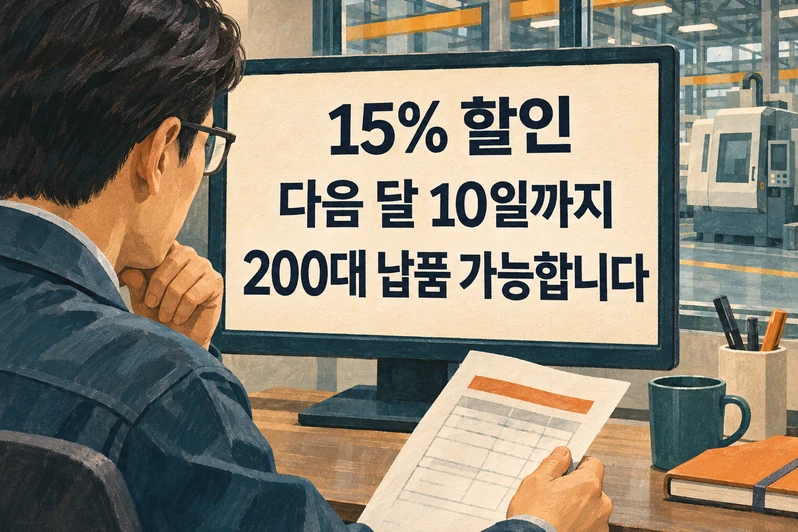
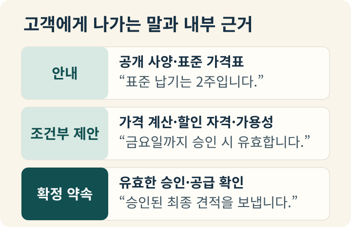
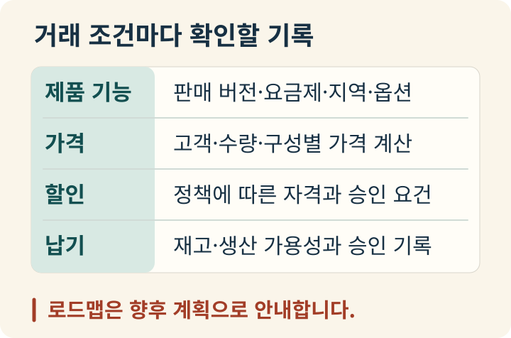
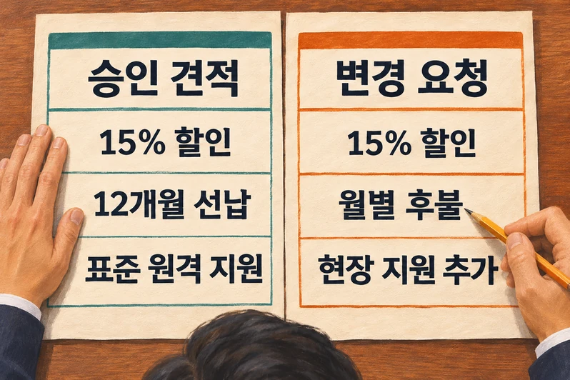
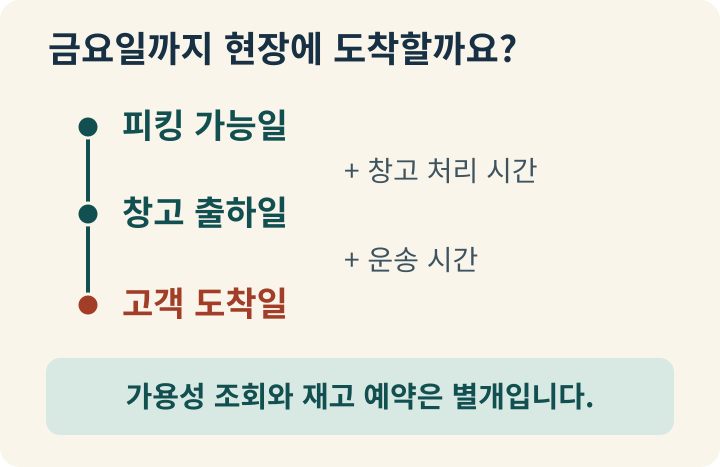
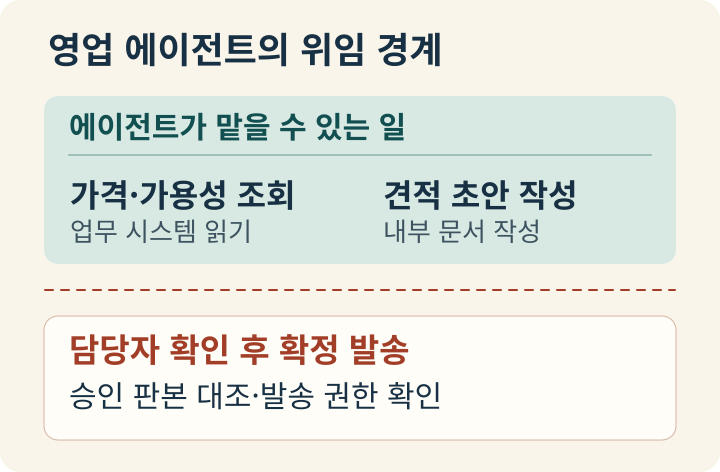

+++
date = '2026-11-26T00:00:00+09:00'
draft = false
title = '영업 에이전트가 지켜야 할 약속의 한도: 안내, 제안, 확약을 가르는 운영 기준'
description = '판매자 측 영업 에이전트가 고객에게 전달하는 견적, 할인, 납기, 제품 성능 약속의 유효 조건과 경영진이 설계해야 할 위임 경계를 살펴봅니다.'
tags = ['ax', 'ai-agent', 'sales', 'cpq', 'erp', 'governance']
authors = ['geoff']
slug = 'sales-commitment-limits'
toc = true
images = ['thumbnail.webp']
+++

## 들어가며

영업 조직에 AI 에이전트를 도입할 때 많은 기업은 빠른 고객 응대와 신속한 견적 처리를 먼저 기대합니다. 고객이 제품 사양과 가격, 납기를 물어보면 에이전트가 즉시 답하고 견적서 초안까지 만들어 주는 장면이죠. 담당자가 여러 화면을 오가며 문서를 만들던 시간을 줄여주니 분명 매력적인 변화입니다.

하지만 경영진이 진짜로 긴장해야 하는 순간은 에이전트가 말을 못 할 때보다 너무 막힘없이 대답할 때 찾아옵니다. B2B 산업용 장비를 공급하는 기업을 하나 가정해봅시다. 이 회사 영업팀은 고객 문의에 답하는 AI 에이전트를 배치했습니다. 고객사가 "다음 달 10일까지 주력 장비 200대를 납품받을 수 있나요? 이번 분기 프로모션으로 15% 할인이 가능한지도 궁금합니다&#8221;라고 문의합니다. 이때 에이전트가 지식베이스의 지난해 브로슈어와 표준 리드타임 문서를 참고해 "네, 15% 할인된 단가로 다음 달 10일까지 200대 납품 가능합니다&#8221;라고 답장을 보냈다면 어떻게 될까요?

회사 내부에서는 이 답장을 AI가 초안으로 건넨 단순 안내라고 여길지 모릅니다. 그러나 메시지를 받은 고객에게는 회사가 가격과 납기를 보증한 공식 약속으로 읽힙니다. 어떤 채널로 나간 말이든 회사가 운영하는 에이전트의 답변은 곧 회사의 표시로 받아들여지기 때문입니다. 재고는 이미 다른 거래처에 배정되어 있고 15% 할인은 선납 조건에서만 허용되는 정책이었다면, 에이전트의 친절한 한마디는 곧바로 납기 분쟁과 수익성 손실로 이어집니다.

영업 에이전트가 고객과 대화할 때 어디까지 스스로 말하게 하고 어떤 조건에서 멈추어 시스템 검증이나 사람의 승인을 거치게 할 것인가. 판매자 측 영업 에이전트가 다루는 견적, 할인, 납기, 제품 성능 약속의 한도와 유효 조건을 하나씩 짚어보겠습니다.

## 고객에게는 모두 회사의 말로 들리지만, 내부의 권한은 세 층위로 나뉩니다

은행 창구에서 기업 대출 상담을 받는 장면을 떠올려 봅시다. 창구 직원이 안내장을 보여주며 상품의 기본 금리 범위를 설명하는 일은 일반적인 안내입니다. 이어서 직원이 고객의 재무 자료를 전산에 입력한 뒤 산출된 예상 한도와 금리를 보여주며 "이 조건은 금요일까지 심사 승인을 받아야 유지됩니다&#8221;라고 말합니다. 이것은 전산 조회에 기반한 조건부 제안입니다. 마지막으로 심사부 결재를 거쳐 직인이 찍힌 대출 약정서를 발급하는 일은 은행이 자금 집행 의무를 지는 대외 확약입니다.

영업 에이전트가 고객에게 건네는 말도 조직 내부에서는 세 가지 층위로 나누어 권한과 근거를 설계해야 합니다. 아래 표의 구분은 에이전트가 권한 밖의 약속을 하지 않도록 기업이 세워야 할 운영 설계 기준입니다. 모든 CRM의 공통 사양도 아니고 법적 계약 성립을 판정하는 고정 공식도 아닙니다.

| 발화 층위 | 고객에게 전달하는 내용 | 필요한 내부 근거 | 다음 단계로 넘어가는 통제 조건 |
|---|---|---|---|
| 공개 정책 안내 | 공개된 카탈로그 사양, 표준 가격표, 일반 리드타임 소개 | 적용일·지역·버전이 명시된 공개 정책과 사양서 | 개별 거래 적용을 단정하지 않고 조건 확인으로 연결 |
| 조건부 견적 제안 | 특정 수량·기간·구성에서 산출된 가격과 예상 일정 제시 | 가격 엔진 계산값, 할인 자격, 가용성 조회 결과 | 유효기간과 전제 조건을 명시하고 승인 전 확정 표현 금지 |
| 대외 확정 약속 | 회사가 승인한 최종 견적 판본과 확정 이행 조건 전달 | 유효한 승인 레코드, 공급 확인, 발송 권한 검증 | 승인된 조건 스냅샷과 발송 본문·첨부 파일의 일치 확인 |

실제 영업 시스템도 견적의 내부 준비 상태와 대외 전달 상태를 구분합니다. Microsoft Dynamics 365 Sales의 [견적 생성 및 편집 문서](https://learn.microsoft.com/en-us/dynamics365/sales/create-edit-quote-sales)는 견적을 내부에서 작성하는 초안(Draft) 상태와 고객에게 전달할 때 전환하는 활성(Active) 상태로 나눕니다. 활성 견적은 초안과 달리 이후 기본 가격표가 바뀌어도 가격을 자동으로 다시 맞추지 않고 제시 당시의 판본을 유지합니다.

현장에서 놓치기 쉬운 사각지대는 문서 상태와 대화 문장이 따로 놀 때 생깁니다. 그래서 통제 대상은 데이터베이스의 상태값에 더해 고객에게 나가는 문장과 첨부 파일의 조합 전체가 되어야 합니다. CRM에 저장된 견적서는 아직 초안인데 에이전트가 메일 본문에 "그 가격으로 금요일까지 드리겠습니다&#8221;라고 적어 보내면 운영상 약속이 먼저 밖으로 나가버리기 때문입니다.

## 오래된 브로슈어와 언어 모델의 기억만으로는 결정할 수 없는 네 가지

사내 문서를 검색해 답하는 에이전트에 브로슈어와 과거 제안서를 넣어두면 고객 질문에 유창하게 답합니다. 하지만 브로슈어는 상품 소개의 출발점일 뿐, 지금 이 거래의 조건을 증명하는 권위 있는 입력이 될 수 없습니다. 조건부 제안이나 확약을 만들려면 업무 시스템이 검증한 네 가지 원천 레코드가 뒷받침되어야 합니다.

첫째는 **현재 판매 가능한 제품 버전과 구성 규칙**입니다. Salesforce의 [Agentforce 견적 에이전트 교육 자료](https://trailhead.salesforce.com/content/learn/projects/quick-start-build-an-agent-to-create-quotes-fast/build-your-first-agentforce-quoting-agent)는 가격 데이터 동기화를 전제로 제품 카탈로그와 이행 규칙을 따라 유효한 제품만 견적에 담도록 안내합니다. 또한 [Salesforce CPQ 제품 규칙 문서](https://trailhead.salesforce.com/content/learn/modules/product-rules-in-salesforce-cpq/get-started-with-product-rules)가 구분하듯 화면에 경고만 띄우는 규칙(Alert)과 저장을 차단하는 검증 규칙(Validation)은 효력이 다릅니다. 제품 기능·성능 약속도 마찬가지입니다. 고객이 구매할 버전·요금제·지역·필수 옵션이 확인된 사양 문서에만 연결해야 합니다.

다음은 **거래 맥락이 반영된 실시간 가격 산출**입니다. Microsoft Dynamics 365 Business Central의 [품목 가용성 미리보기(preview) 문서](https://learn.microsoft.com/en-us/dynamics365/business-central/sales-order-agent-item-availability)는 고객, 품목 변형, 수량, 단위, 장소, 날짜 맥락을 유지하면서 임시 판매 문서의 표준 가격 엔진으로 고객별 가격을 산출한다고 설명합니다. 품목 카드에 적힌 정가만 읽어 오는 단순 조회와는 구조가 다릅니다.

셋째는 **정책 엔진이 판정한 할인 자격**입니다. Business Central의 [Sales Order Agent FAQ](https://learn.microsoft.com/en-us/dynamics365/business-central/faqs-sales-order-taker-agent)는 가격과 기본 할인은 자체 업무 로직이 계산하고 가격·할인 변경 요청은 담당 사용자에게 넘긴다고 명시합니다. 할인의 허용 범위와 승인 필요 여부는 정책 규칙의 산출물이어야 합니다. 언어 모델이 협상해서 정할 일이 아닙니다.

마지막은 **가용성에 기반한 납기 계산과 승인 레코드**입니다. 브로슈어의 '표준 납기 2주'는 안내 문구일 뿐입니다. 특정 거래의 약속이 되려면 재고·생산 가용성 조회 결과와 유효한 승인 기록이 함께 존재해야 합니다.

## 승인은 할인율 숫자 하나가 아니라 조건의 묶음에 붙습니다

많은 조직이 영업 승인 규정을 "할인율 10% 이하는 자동, 10% 초과는 본부장 승인&#8221;처럼 단일 숫자로만 다루곤 합니다. 그러나 실제 B2B 거래에서 승인은 할인율 하나가 아니라 수량, 계약 기간, 결제 방식, 기술 지원, 납품 조건이 맞물린 '조건의 묶음'에 부여됩니다.

한 고객사에게 12개월 선납, 표준 원격 지원, 지정 창고 출고를 전제로 15% 할인 견적을 승인받았다고 가정해봅시다. 며칠 뒤 고객이 "할인율 15%와 단가는 그대로 두고, 결제만 월별 후불로 바꾸고 현장 지원을 추가해 달라&#8221;고 요청합니다. 할인율 숫자는 그대로지만 회사가 감당할 현금흐름과 원가는 전혀 다른 거래가 되었습니다. 에이전트가 "15% 할인은 이미 승인됐으니 수정 견적을 바로 확정 발송하겠습니다&#8221;라며 동작한다면 내부 통제는 무너집니다.

이를 막으려면 [Salesforce CPQ 고급 승인 모듈](https://trailhead.salesforce.com/content/learn/modules/advanced-approvals-for-admins/manage-approval-logic-with-approval-rules-conditions-and-variables)이 다루듯 여러 조건을 논리식으로 결합해 제출 이후의 필드 변화를 추적해야 합니다. 여기서 경영진이 구분해야 할 개념이 '시스템의 조건 재평가'와 '사람의 재승인'입니다. 조건이 바뀌었다고 모든 경우에 사람이 처음부터 다시 결재해야 하는 것은 아닙니다. Salesforce의 [Smart Approvals 변경 평가 문서](https://trailhead.salesforce.com/content/learn/modules/advanced-approvals-for-admins/use-smart-approvals-to-evaluate-changes)를 보면 재제출 시 이전 스냅샷과 새 값을 비교합니다. 금액이 8만 달러에서 7만 달러로 낮아진 예시에서는 기승인한 재무팀·영업 부사장 단계는 자동 통과시키고 거절했던 CEO에게만 새 요청을 보냅니다. 반대로 20만 달러로 높아지면 재무팀과 부사장도 다시 승인해야 합니다. 또한 조건 값이 바뀌어도 규칙 전체 조건식이 거짓이면 요청이 가지 않습니다. 관리자가 개별 재평가 옵션(Reevaluate Smart Approvals Individually)을 켜야 조건 변경마다 승인자에게 요청이 전달됩니다.

승인 시점의 조건 스냅샷(품목, 수량, 단가, 할인율, 결제, 납기, 유효기간)을 묶어 기록하되, 변경이 생기면 규칙 재평가를 거치게 해야 합니다. 할인율 인상이나 결제 기한 연장처럼 위험이 커지는 변경은 사람의 재승인을 요구하고 허용 범위 내 조정은 자동 통과시키는 기준도 회사가 직접 정의해야 합니다. 내부 가격 조건이나 정책이 개정되었다고 해서 이미 고객에게 발송한 유효기간 내의 견적을 시스템이 조용히 덮어써서는 안 됩니다. 이미 나간 약속은 해당 판본으로 보존하고 변경이 필요하면 새 개정 판본을 발행해 합의해야 합니다.

## 납기와 가격 계산에서 시스템의 침묵이나 기본값을 확약으로 착각하지 않으려면

에이전트가 ERP나 공급망 관리 도구를 호출해 오류 없이 응답을 받아왔다고 해서, 그 숫자를 곧바로 확정 약속으로 전달해도 안전한 것은 아닙니다. 시스템의 계산 방식과 기본 동작에 에이전트가 오해하기 쉬운 지점이 있기 때문입니다.

먼저 고정 리드타임과 가용성 기반 약속을 구분해야 합니다. Microsoft Dynamics 365 Supply Chain Management의 [주문 약속(Order Promising) 문서](https://learn.microsoft.com/dynamics365/supply-chain/sales-marketing/delivery-dates-available-promise-calculations)는 납기 산정 방식을 재고나 수요·공급을 보지 않는 고정 영업 리드타임과, 미약정 재고 및 계획 입출고를 반영하는 ATP(가용 약속 가능 수량), 자재와 생산 능력을 함께 보는 CTP로 나눕니다. 또한 Business Central의 [주문 약속 일자 계산 문서](https://learn.microsoft.com/en-us/dynamics365/business-central/sales-how-to-calculate-order-promising-dates)는 물품을 피킹할 수 있는 출고 가능일(shipment date)에 출고 창고 처리 시간을 더해 계획 출하일(planned shipment date)을 구합니다. 여기에 운송 시간을 더하면 고객에게 도착하는 계획 납품일(planned delivery date)이 나옵니다. 고객이 "금요일까지 현장 도착&#8221;을 요청했다고 해 봅시다. 시스템 결과가 '금요일 피킹 가능'이나 '금요일 창고 출하'인데 에이전트가 이를 고객 도착일로 잘못 전달하면 정확한 데이터를 읽고도 틀린 약속을 하게 됩니다. 가용성 단순 조회와 실제 재고 예약 완료 역시 별개 상태로 구분해야 합니다.

시스템 기본값의 비대칭성과 예외 상태도 점검해야 합니다. 앞서 인용한 Dynamics 365 주문 약속 문서는 주문이 갱신될 때 기존 약속 일자를 지킬 수 없는 경우에만 납기를 자동 재계산한다고 설명합니다. 수량이 늘어 기한을 못 맞추면 늦춰진 날짜로 바뀌지만 고객이 수량을 줄여 더 빠른 납품이 가능해져도 시스템은 기존 일자를 유지합니다. 더 빠른 납기를 제안하려면 명시적 재계산 호출이 필요합니다. 또한 앞서 본 Business Central의 품목 가용성 미리보기 문서는 가용성 확인 옵션이 꺼져 있으면 부족한 수량으로도 견적이 생성되고 확장 기능 충돌 시 계산 가격이 '0'으로 반환될 수 있다고 안내합니다. 견적 생성 성공만으로 재고 검증이 끝났다고 보거나 계산 오류로 나온 0원을 무료 정책으로 오해하지 않도록 도구 응답 검증 계층을 두어야 합니다.

## 영업 에이전트에게 어디까지 맡길 것인가: 경영진이 정해야 할 위임 경계

경영진의 과제는 "에이전트가 견적서를 만들 수 있는가&#8221;가 아니라, "어느 행동까지 에이전트에게 맡기고 어디서부터 사람의 확인을 거치게 할 것인가&#8221;를 정하는 일입니다. OpenAI의 [에이전트 구축 실무 가이드](https://cdn.openai.com/business-guides-and-resources/a-practical-guide-to-building-agents.pdf)는 도구를 읽기·쓰기 여부, 되돌릴 수 있는지(가역성), 재무적 영향에 따라 낮음·중간·높음 위험 등급으로 나눕니다. 되돌리기 어렵거나 이해관계가 큰 고위험 행동에는 가드레일 검사와 사람의 감독을 두라고 권고합니다.

상용 영업 에이전트 설계에서도 이러한 권한 분리가 확인됩니다. Salesforce의 [Agentforce SDR 구현 가이드(2025년 5월 기준)](https://www.salesforce.com/en-us/wp-content/uploads/sites/4/documents/guides/Agentforce-for-Sales-Development-Implementation-Guide.pdf)를 보면 잠재고객 발굴 단계 에이전트의 기본 액션은 첫 연락, 후속 메일, 미팅 요청, 수신 거부 처리로 한정되어 있고 견적이나 할인 액션은 포함되어 있지 않습니다. 앞서 본 Salesforce 견적 에이전트 교육 자료 역시 견적 단계에서 카탈로그와 가격 데이터를 바탕으로 견적 초안을 구성하더라도 최종 검토와 고객 발송은 영업 담당자의 몫으로 남깁니다. 가격·가용성 조회(읽기)와 초안 작성(내부 쓰기), 대외 확정 발송(고위험 외부 행위)의 권한을 분리한 구조입니다.

도입 성과를 평가하는 지표도 작성 속도와 약속의 정확성을 구분해야 합니다. Salesforce는 [자사 내부 Agentforce 도입 사례](https://www.salesforce.com/customer-stories/agentforce-for-sales/?bc=OTH)에서 내부 CRM(Org62) 견적 업무에 자연어 에이전트를 적용해 견적 작성 속도가 75% 빨라지고 클릭 수가 87% 줄었다고 자체 보고합니다. 담당자의 화면 조작과 초안 작성 부담을 줄여준다는 점을 보여주는 수치이지만 공급사의 자체 보고일 뿐입니다. 고객에게 나간 약속의 오류율이 줄었다거나 매출이 늘었다는 독립 검증 근거는 아닙니다.

따라서 경영진은 작성 시간 단축 같은 효율성 지표 옆에 '승인·확정 레코드 없이 발송된 무근거 확약률', '승인 스냅샷과 실제 발송 판본의 불일치율', '약속 납기와 실제 도착일의 괴리율' 같은 약속 품질 지표를 나란히 세워야 합니다. 매출 조직은 상업 조건과 할인 위임 한도를, 제품 조직은 판매 가능 사양 매트릭스를, 공급망 조직은 ATP/CTP 계산과 물류 시간 데이터를 각자 책임질 때 에이전트가 안전한 영업 도구로 작동합니다.

## 나가며

훌륭한 영업 에이전트를 가르는 기준은 유창한 말솜씨가 아닙니다. 지금 고객에게 건네는 문장이 공개 정책을 소개하는 '안내'인지, 시스템 계산값에 유효기간을 붙인 '조건부 제안'인지, 회사가 이행 책임을 지는 '대외 확정 약속'인지를 구분하고 근거 레코드가 확인될 때만 다음 단계로 넘어가는 제어 구조가 그 기준입니다.

영업 에이전트 도입이나 고도화를 앞두고 계신다면 다음 네 가지 질문을 먼저 점검해 보시기 바랍니다.

1. 에이전트가 말하는 가격과 날짜 뒤에 유효한 가격 레코드, 가용성 계산 시각, 견적 유효기간이 반드시 연결되어 있는가?
2. 할인 승인 이후 수량, 결제 방식, 지원 범위, 배송지가 바뀔 때 어떤 변경을 자동 재평가로 넘기고 어떤 변경에 사람의 재승인을 요구할지 기준표가 있는가?
3. 피킹 가능한 출고 가능일과 창고 출하일, 고객 현장 도착일, 그리고 계산 실패로 반환된 0과 실제 무료 정책을 구분하는 도구 응답 검증이 마련되어 있는가?
4. 이미 고객에게 전달한 견적 판본을 내부 기준 변경으로 조용히 덮어쓰지 않고 개정 이력을 투명하게 추적하고 있는가?

우리 회사의 CRM, CPQ, ERP 환경에 맞춰 이러한 에이전트 위임 경계와 검증 파이프라인을 설계하는 일은 프롬프트 조정으로 끝나지 않고 비즈니스 규칙과 시스템 아키텍처까지 정교하게 맞물리는 과제입니다. 영업 에이전트가 속도를 높이면서도 회사가 지킬 수 있는 약속만 정확하게 전달하도록 거버넌스와 오케스트레이션을 구축하고 싶으시다면 언제든지 엡실론델타(contact@epsilondelta.ai)로 연락해 주시기 바랍니다. 여러분 조직의 영업 현장과 데이터 구조에 꼭 맞는 해법을 함께 설계해 드리겠습니다.
