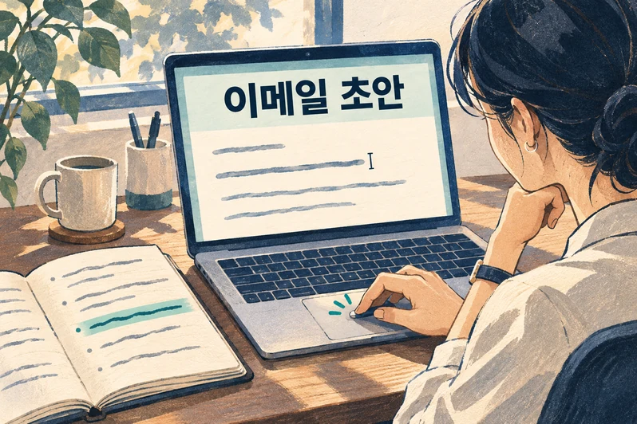
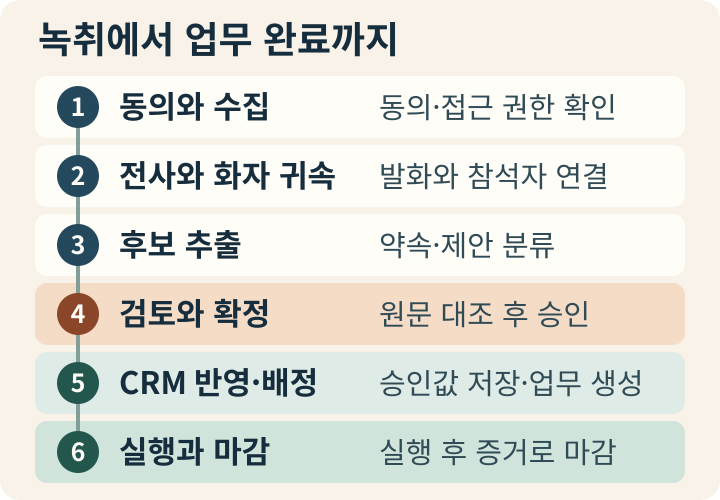
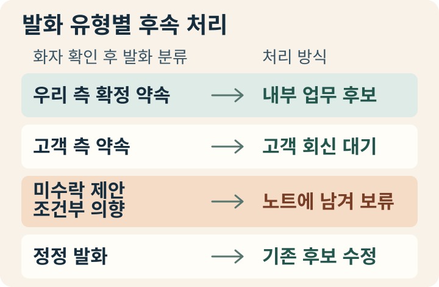
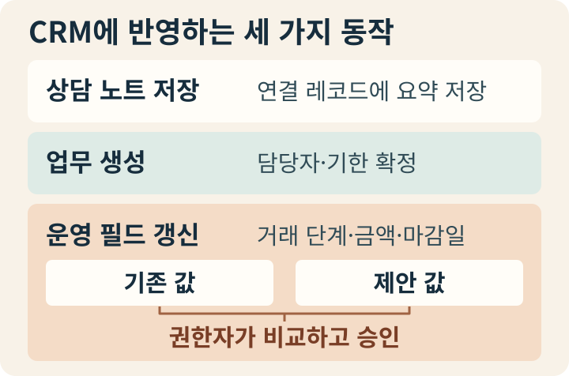
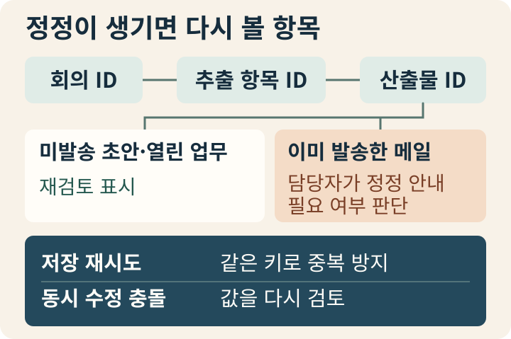
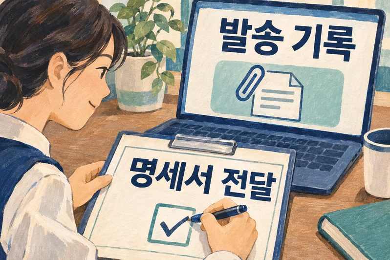

+++
date = '2026-11-27T00:00:00+09:00'
draft = false
title = '상담 녹취 요약만으로는 부족합니다: 대화 기록이 CRM과 후속 업무 완료로 이어지려면'
description = '회의와 고객 상담 녹취를 신뢰할 수 있는 CRM 데이터 갱신과 담당자·기한이 확정된 후속 업무로 전환하기 위한 운영 및 아키텍처 설계 기준을 짚어봅니다.'
tags = ['ax', 'crm', 'meeting-transcription', 'sales-automation', 'agent-operations']
authors = ['geoff']
slug = 'meeting-to-crm'
audio = []
vedios = []
series = []
toc = true
images = ['thumbnail.webp']
+++

## 들어가며

### 회의 요약은 잘 나오는데 CRM 파이프라인은 그대로인 이유
기업용 솔루션을 공급하는 한 B2B 기업의 영업 조직이 화상 상담에 AI 회의 요약 도구를 도입했다고 가정해봅시다. 한 시간짜리 상담이 끝나면 몇 분 만에 대화 요약본이 정리되어 나와 초기 호응이 높았습니다. 그런데 분기 마감 회의를 앞두고 CRM을 열어본 영업 본부장은 당황스러운 풍경을 마주했습니다. 수백 건의 상담 요약본이 만들어졌는데도 주요 영업 기회의 예상 수주일과 금액은 예전 값 그대로 멈춰 있었습니다. 게다가 한 고객사 상담에서 금요일까지 보안 명세서를 보내기로 약속했는데 배석했던 영업 대표와 기술 엔지니어가 서로 상대방이 챙길 일이라고 여겨 아무도 자료를 보내지 않은 사실이 뒤늦게 드러났습니다.

### 자동 반영을 켰더니 조건부 발언이 확정 일정으로 바뀌었습니다
이번에는 또 다른 영업 팀이 수작업을 줄이려고 녹취에서 추출한 항목을 CRM과 업무 도구에 곧바로 밀어 넣도록 연동했다고 가정해봅시다. 얼마 지나지 않아 현장에서 불만이 터져 나왔습니다. 고객사 담당자가 지나가듯 던진 "다음 달 예산 위원회 승인이 나면 2차 도입도 검토해볼 수 있겠네요&#8221;라는 발언이 영업 담당자가 당장 수행할 확정 과제로 등록되어 버렸기 때문입니다. 고객이 희망 사항으로 언급한 연말 개통 일정이 영업 대표가 입력해 둔 CRM의 공식 예상 마감일을 덮어쓰면서 분기 매출 예측 숫자가 흔들리는 일도 벌어졌습니다.

### 왜 이런 일들이 벌어질까요?
상담 내용을 읽기 좋게 요약하는 일과 조직의 기준 원장인 CRM을 고치고 고객과의 약속을 실제 완료 상태로 만드는 일은 전혀 다른 문제입니다. 비유하자면 회의 요약본은 설계 미팅에 배석한 속기사가 작성한 회의록과 같고 CRM과 후속 업무 시스템은 현장 소장이 자재를 발주하고 작업자를 배치하는 공식 공정표 및 작업 지시서와 같습니다. 속기사의 메모가 아무리 매끄럽더라도 현장 소장의 검토와 확정 없이 그 메모가 곧바로 공식 도면의 치수를 고치거나 발주서를 날려버린다면 현장은 혼란에 빠질 수밖에 없습니다. 상담 녹취가 검토된 CRM 데이터와 완결된 후속 업무로 이어지려면 경영진이 어떤 운영 경계를 설계해야 하는지 살펴보겠습니다.

## 회의록이 남는 것과 업무가 끝나는 것은 왜 다른가

상담 후처리 흐름을 설계할 때는 요약 생성 건수를 업무 처리 성과와 동일시하는 일을 가장 먼저 경계해야 합니다. 요약본이 정확하게 생성되어도 CRM의 대상 레코드에 연결되지 않으면 개인의 참고 메모에 머뭅니다. CRM에 노트로 저장되더라도 담당자와 기한이 확정된 작업으로 이어지지 않으면 후속 실행이 일어나지 않습니다. 나아가 작업 레코드가 생성된 뒤에도 실제 산출물이 전달되고 완료가 확인되어야 고객과의 약속이 종결됩니다.

금융권에서 상담 후처리 도구를 배포한 모건스탠리(Morgan Stanley)의 사례에서도 이 단계 구분이 분명하게 나타납니다. [모건스탠리의 2024년 6월 26일 Debrief 출시 발표](https://www.morganstanley.com/press-releases/ai-at-morgan-stanley-debrief-launch)에 따르면, 이 시스템은 고객 동의를 전제로 회의 노트를 생성하고 액션 아이템을 도출한 뒤, 어드바이저가 재량에 따라 편집해 발송할 이메일 초안을 만들고 세일즈포스(Salesforce)에 노트를 저장합니다. [OpenAI가 공개한 모건스탠리 구축 사례](https://openai.com/index/morgan-stanley/) 역시 어드바이저가 AI 산출물을 검토하고 조정한 뒤에 확정한다는 점을 설명합니다.

이 사례에서 언급된 수치도 각자의 맥락에 맞게 구분해 볼 필요가 있습니다. 같은 출시 발표의 회의당 약 30분 절감은 한 어드바이저의 사용 경험이며 98% 채택률은 Debrief가 아니라 2023년 배포된 사내 질의응답 도구(Assistant)의 수치입니다. 또한 OpenAI 사례 페이지에서 후속 조치가 수일에서 수시간으로 빨라졌다는 언급은 임원의 체감 보고입니다. 즉 실제 도입 현장에서도 AI는 초안 작성과 후보 추출을 돕고 발송과 기록 확정의 책임은 담당자의 검토 단계에 두고 있습니다.

## 녹취에서 후속 업무 완료까지: 운영 설계를 위한 여섯 단계

상담 종료 시점부터 후속 조치가 끝나는 시점까지를 하나의 자동화로 묶어버리면 어느 지점에서 누락이 생기는지 파악하기 어렵습니다. 실무 책임을 명확히 나누기 위한 운영 설계 프레임워크로 다음의 여섯 가지 상태를 구분해 관리하는 방식을 제안합니다.

1. **동의와 수집**: 회의 식별자, 참가자별 동의 상태, 녹음·전사 접근 권한을 확보하는 입력 전제 단계입니다.
2. **전사와 화자 귀속**: 음성을 텍스트로 옮기고 발화 구간을 실제 참석자와 연결하는 원자료 단계입니다.
3. **후보 추출**: 요약과 함께 약속·제안·조건부 발화를 분류하고 담당자·기한 후보를 뽑는 초안(Draft) 단계입니다.
4. **검토와 확정**: 담당자가 원문 구간과 추출 후보를 대조하며 수정·승인·거절을 결정하는 검토(Reviewed) 단계입니다.
5. **CRM 반영 및 배정**: 승인된 노트와 필드 변경값을 CRM에 저장하고 업무 레코드를 생성하는 기록(Committed) 단계입니다.
6. **후속 실행과 마감**: 이메일 발송과 약속 업무를 수행하고 완료 증거를 남기는 완료(Done) 단계입니다.

상용 제품의 공개 문서도 초안 추출에서 검토를 거쳐 CRM에 기록하는 동작들을 분리해 설명합니다. [Microsoft Teams 회의 요약의 영업 인사이트 문서](https://learn.microsoft.com/en-us/microsoft-sales-copilot/view-meeting-summary-recap)는 요약 이메일 초안을 팝업이나 아웃룩(Outlook) 웹에서 검토 후 발송하는 동작, AI 노트를 필요 시 편집해 CRM에 저장하는 동작, 추천된 후속 작업 항목에서 CRM 업무(Task)를 생성하는 동작을 각각 별도 절차로 안내합니다. 또한 업무 생성을 마치면 화면의 버튼은 '업무 만들기'에서 '업무 열기'로 바뀝니다. 공개 문서는 이처럼 회의 화면에서 업무 레코드를 생성하고 여는 단계까지의 조작을 다루고 있으므로, 생성된 업무가 기한 내에 실제로 이행되었는지 확인하고 마감하는 6단계는 조직의 운영 절차로 이어 붙여야 합니다.

## 누구의 말이고 정말 약속인가: 입력 조건과 발화 구분

검토 단계에 올라오는 초안의 신뢰도를 높이려면 요약 문장력을 다듬기 전에 녹취를 처리할 수 있는지 확인하는 '동의 및 화자 귀속'과, 대화에서 진짜 해야 할 일을 가려내는 '발화 분류'를 먼저 설계해야 합니다.

### 동의 확인과 화자 실명 귀속
법적 판단은 각 기업의 법무 조직이 맡더라도, 운영상 고객 동의는 녹취 파이프라인의 출발점입니다. [Microsoft Teams의 녹음 및 전사 참가자 동의 관리 문서](https://learn.microsoft.com/en-us/microsoftteams/participant-agreement-recording-transcription)를 보면, 명시적 동의 정책을 켰을 때 녹음·전사가 시작되면 다른 참가자의 마이크와 카메라가 꺼지고 동의를 거쳐야 해제됩니다. 참가자별 동의 선택은 출석 보고서와 감사 로그에 기록됩니다. 다만 기본 정책 값은 꺼져 있고 단말기별 예외가 있으므로 모든 참가자가 같은 확인 창을 거쳤다고 가정할 수 없습니다. 따라서 녹취를 쓸 수 없는 상담에서 담당자가 검토한 수동 메모를 입력하는 대체 경로를 함께 두고 CRM에서 출처를 구분해야 합니다.

다음 장벽은 목소리를 나누는 화자 분리와 그 목소리를 직원·고객 레코드에 연결하는 실명 식별의 차이입니다. [Teams Rooms의 음성 인식 제어 문서](https://learn.microsoft.com/en-us/microsoftteams/rooms/voice-recognition)는 요약과 액션 아이템 생성에 화자 귀속이 있는 전사문이 필요하며 회의실 공용 마이크 환경에서는 음성 프로필과 회의 초대가 식별 조건이고 정책에 따라 익명 화자나 번호만 표시될 수 있다고 설명합니다. 발화자 신원이 불명확하면 담당자도 미확정이므로, 검토 화면에서는 익명 화자를 실제 인물과 먼저 연결하고 "김 과장이 확인해주면 좋겠네요&#8221;처럼 발화자와 수행자가 다른 경우를 분리해야 합니다.

### 약속과 제안, 조건부 의향의 분리
화자가 식별되었더라도 대화 속의 모든 미래형 문장을 업무로 등록하면 안 됩니다. [Microsoft의 회의 요약 기능 FAQ 문서](https://learn.microsoft.com/en-us/microsoft-sales-copilot/faqs-meeting-summary)도 요약 품질이 전사 정확도에 좌우되고 비영어 대화에서 품질 저하 가능성이 있으며 후속 작업이나 사람·회사 이름을 놓칠 수 있다고 안내합니다. 감정 분석 역시 고객 의사나 만족도를 확정하는 근거가 될 수 없다고 밝힙니다.

따라서 문장에 날짜나 이름이 있다는 이유만으로 확정 업무로 승격하지 않도록 네 가지 운영 분류를 제안합니다. 첫째, **우리 측 확정 약속**("금요일까지 명세서를 보내드리겠습니다")만 내부 업무 후보로 올립니다. 둘째, **고객 측 약속**("다음 주에 내부 검토 결과를 주겠습니다")은 고객 회신 대기 항목으로 분리합니다. 셋째, 수락 여부가 미확인된 **단순 제안**이나 "승인이 나면 진행하겠다&#8221;는 **조건부 의향**은 조건 충족 전까지 실행을 보류하고 노트로만 남깁니다. 넷째, 담당자나 기한을 고쳐 말한 **정정 발화**는 중복 업무를 만들지 않고 기존 후보 항목을 수정하도록 연결합니다.

## CRM에 반영한다는 말의 세 가지 층위

"상담 내용을 CRM에 저장했다&#8221;는 보고는 실무에서 세 가지 서로 다른 데이터 동작을 뜻합니다. 경영진이 자동화 범위를 정할 때는 서술형 노트 저장, 업무 레코드 생성, 그리고 권위 있는 구조화 필드 갱신을 분리해야 합니다.

첫째는 **서술형 상담 노트의 저장**입니다. [Teams 회의 노트의 CRM 저장 설정 문서](https://learn.microsoft.com/en-us/microsoft-sales-copilot/save-ai-notes-crm)를 보면, 관리자는 노트를 일정(Appointment 또는 Salesforce Event)의 설명 텍스트 필드나 지정 레코드 필드에 저장하도록 구성하며 세일즈포스 이벤트 기본 설명 필드는 일반 텍스트로 저장되고 서식 유지에는 리치 텍스트 필드가 필요합니다. 또한 [Outlook 이메일 및 이벤트 저장 구성 문서](https://learn.microsoft.com/en-us/microsoft-sales-copilot/save-additional-details-outlook)에 나타나듯 추가 연관 레코드가 있어도 회의 후처리는 기본 연결(Regarding)을 기준으로 동작합니다. 즉 설명 필드에 회의 요약 텍스트를 넣었다고 해서 거래 단계나 금액 같은 구조화 필드가 함께 갱신된 것은 아닙니다.

둘째는 **후속 업무(Task) 레코드의 생성**입니다. [Teams 회의 요약의 영업 인사이트 문서](https://learn.microsoft.com/en-us/microsoft-sales-copilot/view-meeting-summary-recap)에서 업무 생성 양식은 제목과 담당자를 필수로 두지만 기한과 연결 레코드는 선택 항목으로 둡니다. 생성된 업무의 기한이 모두 확정되어 있다고 가정할 수 없으므로, 운영 설계에서는 "다음 주 화요일" 같은 상대적 표현을 회의 일시와 시간대 기준의 실제 날짜로 해석해 검토자가 확정하게 해야 합니다.

셋째는 **거래 단계·금액·마감일 같은 권위 있는 운영 필드의 갱신**입니다. 이 필드들은 매출 예측의 기준 원장이므로 녹취 텍스트가 곧바로 기존 값을 덮어쓰지 않도록 통제해야 합니다. 2026년 11월 25일 갱신된 [Microsoft 365 Copilot의 Sales agent 채팅 사용 문서](https://learn.microsoft.com/en-us/microsoft-sales-copilot/use-sales-chat)에서도 에이전트가 영업 기회(Opportunity)를 수정할 때는 대상 기회를 특정하고 후보가 여러 개면 재질문하며 사용자의 변경 확인을 거친 뒤에야 CRM에 저장한다고 명시합니다. 회의 요약 화면과 채팅 기반 필드 변경을 하나의 자동 실행으로 섞지 않고 핵심 운영 필드는 기존 값과 제안 값을 나란히 비교(Diff)해 권한을 가진 담당자가 확정하는 정책을 제안합니다.

## 정정 전파와 중복 제어, 그리고 무엇을 측정할 것인가

도입 초기 시연을 넘어 실제 운영 단계로 들어가면 수정 사항의 전파와 중복·충돌 방지가 시스템의 신뢰도를 결정합니다.

먼저 **정정 전파의 연결**입니다. [Microsoft Teams 전사문 편집 안내](https://support.microsoft.com/en-us/teams/meetings/edit-or-delete-a-meeting-transcript-in-microsoft-teams)에 나와 있듯 사용자는 전사 텍스트를 수정할 수 있지만 전사문이나 노트를 고쳤을 때 파생된 CRM 업무나 이메일 초안까지 자동으로 모두 정정된다는 근거는 문서에서 확인되지 않습니다. 따라서 운영 시스템을 구축할 때는 회의 ID, 추출 항목 ID, 파생 산출물 ID를 연결해 관리하는 설계를 제안합니다. 원문이나 승인 값이 바뀌면 미발송 초안과 열린 업무에 재검토 표시를 띄우고 이미 발송된 이메일은 담당자가 정정 안내 필요 여부를 판단하도록 해야 합니다.

다음은 **중복 생성과 동시 수정 충돌의 방지**입니다. [Teams 회의 요약 문서](https://learn.microsoft.com/en-us/microsoft-sales-copilot/view-meeting-summary-recap)에서는 한 내부 참가자가 노트를 저장하면 다른 내부 참가자 화면의 저장 버튼이 레코드 URL로 바뀌고 검색창이 뜨지 않는 UI 동작을 설명합니다. 백엔드 연동에서도 재시도나 중복 처리가 새 레코드를 만들지 않도록 안정적인 회의·항목 ID를 조합해 [Dataverse의 대체 키 기반 Upsert 기능](https://learn.microsoft.com/en-us/power-apps/developer/data-platform/use-upsert-insert-update-record) 같은 수단을 적용하고 신규 연락처 반영 시에는 조직 설정에 맞는 [Salesforce의 일치 규칙 및 중복 규칙](https://trailhead.salesforce.com/content/learn/modules/sales_admin_duplicate_management/sales_admin_duplicate_management_unit_2)을 점검해야 합니다. 또한 검토 도중 다른 직원이 CRM 값을 바꿨을 때 예전 제안 값이 덮어쓰지 않도록 [Dataverse Web API의 조건부 연산 문서](https://learn.microsoft.com/en-us/power-apps/developer/data-platform/webapi/perform-conditional-operations-using-web-api)가 안내하는 `ETag`와 `If-Match` 기반 낙관적 동시성 제어를 활용해 충돌 시 재검토를 거치도록 설계할 수 있습니다.

마지막으로 **평가와 운영 지표의 전환**입니다. [OpenAI의 모건스탠리 사례](https://openai.com/index/morgan-stanley/)는 다양한 회의 유형의 평가 데이터로 중요한 액션을 오류 없이 포착하는지 검사한 접근을 소개합니다. 우리 조직에서도 한영 혼용 발화, 동명이인, 겹친 발화, 거절된 제안, 기한 정정을 포함한 평가 세트를 마련해야 합니다. 아울러 경영진은 단순 요약 생성 수 대신 검토 소요 시간, 잘못 배정된 담당자 비율, 미확정 기한 비율, 저장 재시도 중복률, 완료 증거가 연결된 기한 내 완료율을 살피고 수정 비율이 급격히 낮아진 구간에서는 추출 품질 향상인지 검토 절차의 형식화인지 함께 점검하는 체계를 갖추어야 합니다.

## 나가며

상담 녹취를 CRM과 후속 업무로 연결하는 일은 음성 인식이나 요약 모델을 도입하는 데 그치지 않고 조직의 공식 기록과 약속 이행 책임을 설계하는 운영 과제입니다. 성공적인 안착을 위해 경영진이 확정해야 할 네 가지 기준을 정리해봅니다.

첫째, 상담 노트 저장과 권위 있는 운영 필드(금액·마감일·단계) 갱신의 경계를 나누고 핵심 필드는 변경 차이를 검토해 승인된 값만 반영해야 합니다. 둘째, 화자 실명 확인과 우리 측 확정 약속 분류, 절대 기한 확정을 한 화면에서 처리하는 검토 절차를 설계해야 합니다. 셋째, 업무 레코드 생성과 실제 수행 완료를 구분하고 발송 기록이나 산출물 같은 완료 증거로 마감 여부를 관리해야 합니다. 넷째, 현업의 정정 이력과 예외 사례를 평가 데이터로 축적해 추출 품질을 지속적으로 검증해야 합니다.

현업 상담 조직의 일상 속에서 동의 경로 분리, 화자 귀속 예외 처리, CRM 스키마 매핑과 동시성 제어, 도메인별 평가 체계까지 내부 인력만으로 한 번에 설계하고 운영하기는 쉽지 않습니다. 상담 현장의 업무 흐름과 CRM 데이터 아키텍처, AI 에이전트 엔지니어링을 함께 이해하는 파트너가 필요한 이유입니다. 상담 녹취가 일회성 요약 메모에 머물지 않고 신뢰할 수 있는 CRM 자산과 후속 업무 완료로 이어지기를 원하신다면 언제든지 엡실론델타(contact@epsilondelta.ai)로 문의해 주시기 바랍니다. 여러분의 조직 환경에 맞는 실용적인 설계와 운영 체계를 함께 만들어 드리겠습니다.