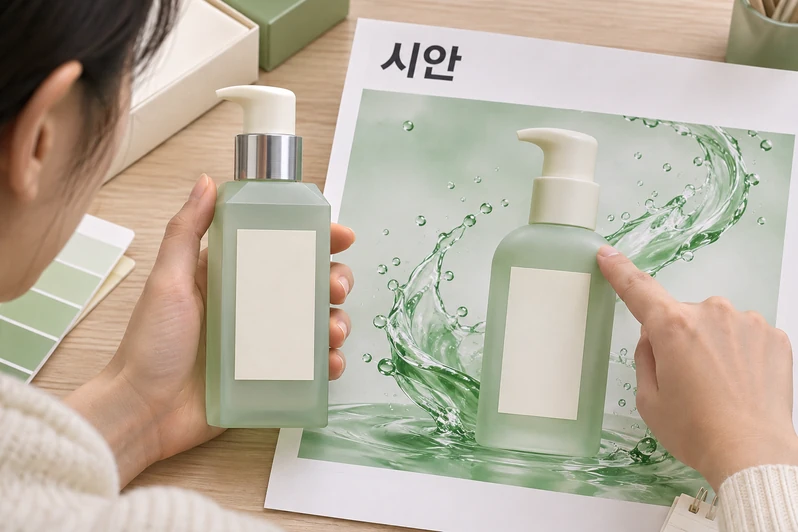
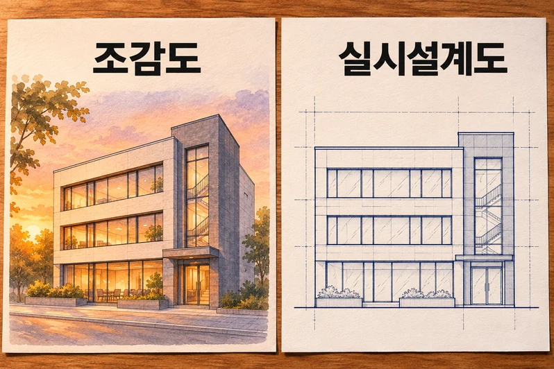
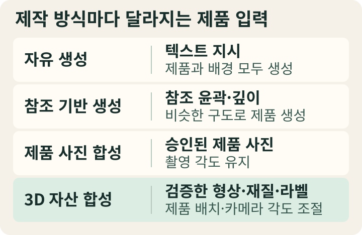
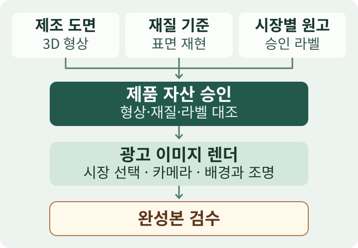
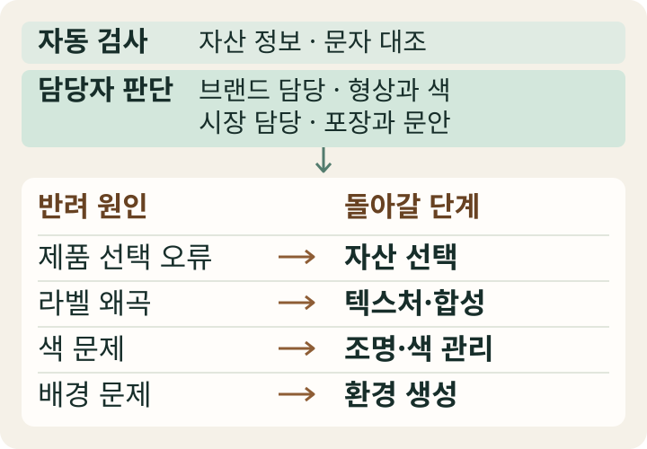
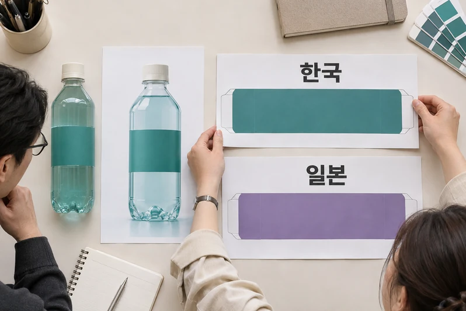

+++
date = '2026-11-28T00:00:00+09:00'
draft = false
title = 'AI 광고에서 제품의 모양과 색이 자꾸 틀어지는 이유와 해결 설계'
description = '생성형 AI 광고 제작에서 실제 판매 제품의 형상, 색상, 재질, 시장별 라벨을 정확히 보존하기 위한 디지털 트윈 파이프라인과 검수 운영 전략을 살펴봅니다.'
tags = ['ax', 'generative-ai', 'digital-twin', 'marketing-operations', 'visual-fidelity']
authors = ['geoff']
slug = 'product-visual-fidelity'
audio = []
vedios = []
series = []
toc = true
images = ['thumbnail.webp']
+++

## 들어가며

화장품 브랜드의 마케팅 임원이 신제품 에센스의 소셜 광고 소재 50종을 생성형 AI로 이틀 만에 제작했다는 보고를 받았다고 가정해봅시다. 화면에 띄워진 시안들은 배경 연출도 화려하고 물방울의 질감도 생생합니다. 그런데 출시 직전 검수에 참여한 패키징 담당자가 시안을 확대해 보더니 집행 보류를 요청합니다. 용기 어깨선의 각도가 실제 금형보다 완만하게 변형되었기 때문입니다. 펌프 목 부분의 금속 링은 사라졌고 전면 라벨의 작은 성분 표기 철자도 미세하게 뭉개져 있었습니다.

이번에는 한국과 일본, 동남아에 음료를 수출하는 기업에서 패키지 리뉴얼을 단행했다고 가정해봅시다. 국가별로 현지 언어와 용량 표기가 반영된 새 라벨이 승인되었습니다. 하지만 각 지역 담당자와 대행사는 기존에 찍어둔 제품 사진을 AI 도구에 넣고 배경만 바꾼 광고를 대량으로 만들었습니다. 그 과정에서 이미 단종된 구형 로고와 다른 국가의 용량 표기가 섞인 배너가 매체 집행 직전까지 올라왔습니다.

왜 현장에서 이런 일들이 벌어질까요? 많은 기업이 광고 제작에 생성형 AI를 도입할 때 얼마나 그럴듯한 이미지를 얼마나 빨리 많이 뽑아내는가에 먼저 주목합니다. 하지만 실제 판매하는 제품이 등장하는 상업 광고에서는 분위기보다 먼저 통과해야 할 관문이 있습니다. 광고 속 제품이 실제 매대에 놓인 제품의 형상, 색상, 표면 재질, 라벨 문구, 그리고 시장별 승인 버전과 정확히 일치하는가라는 문제입니다.

제품 외형이 실제와 달라지면 검수 단계에서 반려가 쏟아집니다. 프롬프트를 바꿔가며 수십 번씩 이미지를 다시 뽑는 재작업 비용도 불어납니다. 촬영비를 아끼려 도입한 AI가 검수와 수정 인건비를 잡아먹는 병목이 되는 셈이죠. 지금부터 AI 광고 제작에서 제품의 시각적 정확도를 다루는 네 가지 접근법의 차이를 짚어보고 글로벌 기업들의 디지털 트윈 활용 사례와 실무 검수 운영 설계안을 함께 살펴보겠습니다.

## 조감도와 실시설계도의 차이: 제품 이미지에서 지켜야 할 기준

건물을 짓기 전 투자자에게 보여주는 조감도와 시공 현장에서 자재를 발주할 때 쓰는 실시설계도는 목적이 다릅니다. 조감도에서는 창문 비례가 조금 달라지거나 외벽 색감이 노을빛에 물들어도 전체적인 인상만 전달되면 충분합니다. 그러나 실시설계도에서 치수와 자재 번호가 틀리면 현장은 멈춰 섭니다. 마케팅에서 초기 콘셉트 시안과 최종 판매용 제품 이미지의 관계도 이와 같습니다.

실무에서 판매용 제품 이미지에 승인 도장을 찍으려면 다섯 가지 기준을 구분해서 검토해야 합니다. 첫째는 **제품 식별**입니다. 그림이 아무리 정교해도 판매 국가나 SKU, 용량, 출시 버전에 맞지 않는 다른 시장의 포장이라면 반려해야 합니다. 둘째는 **형상**입니다. 병의 비율, 뚜껑과 펌프, 손잡이, 봉합선과 보이는 면이 승인된 자산과 맞아야 합니다. 셋째는 **표면 재질**로, 유광과 무광, 금속 광택, 투명도와 인쇄 질감이 기준과 일치해야 합니다. 넷째는 **색상**입니다. 표준 조명 아래의 고유 재질색과 광고 연출 조명 아래의 외관색을 나누어 판단해야 합니다. 다섯째는 **라벨과 장면**입니다. 로고와 글자, 용량, 시장별 문안을 승인 파일과 대조하고 바닥 접촉 그림자나 반사가 제품 표현을 왜곡하지 않는지 보아야 합니다.

과거처럼 한 시즌에 메인 화보 몇 장만 찍어 보정하던 시절에는 사람의 눈으로 이를 통제할 수 있었습니다. 하지만 [엔비디아의 유니레버 사례 연구](https://www.nvidia.com/en-us/case-studies/unilever/)에 따르면 오늘날 한 제품 라인은 제품 변형과 용량, 언어 조합 때문에 수천 장의 개별 비주얼을 요구합니다. 조합이 수천 개로 폭발하는 환경에서는 한 장을 잘 그리는 요령보다, 올바른 원본 자산을 시스템에 공급하고 변형을 통제하는 구조가 성패를 좌우합니다.

## 제품 외형을 다루는 네 가지 제작 방식과 통제 범위

기업이 AI 광고 제작 도구를 검토할 때는 제품의 시각 입력을 어디까지 통제하는가에 따라 네 가지 방식을 구분해 접근해야 합니다.

첫째는 **텍스트 중심의 자유 생성**입니다. 프롬프트만으로 제품과 배경을 함께 그리는 방식입니다. [엔비디아의 OpenUSD 마케팅 비주얼 기술 블로그](https://developer.nvidia.com/blog/building-a-generative-ai-openusd-app-for-brand-accurate-marketing-visuals/)는 제품의 시각적 입력에 통제가 없으면 형상과 색, 로고가 본래 모습에서 달라질 수 있다고 지적합니다. 따라서 운영상 콘셉트 탐색과 최종 판매 제품 표현을 서로 다른 승인 단계로 취급할 필요가 있습니다.

둘째는 **참조 이미지 기반 생성**입니다. 예를 들어 [어도비 파이어플라이 모바일의 구도 일치 문서](https://helpx.adobe.com/firefly/mobile/generate-images-with-text-to-image/customize-generated-images/match-image-composition-to-reference-image.html)를 보면 참조 이미지의 윤곽과 깊이를 이용해 유사 강도를 조절하는 구도 제어가 나옵니다. 이 기능은 어도비 자체 이미지 모델을 대상으로 작동하며 파트너 모델의 공통 기능은 아닙니다. 무엇보다 참조 이미지와 윤곽이 비슷하게 나왔다는 사실이 곧 같은 SKU와 용량, 승인된 라벨 문구라는 증거가 되지는 않습니다.

셋째는 **승인된 제품 사진과 생성 배경의 합성**입니다. [어도비의 오브젝트 컴포지트(Object Composites) 문서](https://helpx.adobe.com/firefly/web/work-with-enterprise-features/create-object-composites/object-composites-overview.html)는 업로드한 제품 사진을 생성 장면에 합성하는 엔터프라이즈 기능을 안내합니다. [구글 머천트 센터의 프로덕트 스튜디오 도움말](https://support.google.com/merchants/answer/13708167?hl=en)과 [아마존 애즈의 이미지 생성 안내](https://advertising.amazon.com/library/news/aspect-ratio-ai-image-generator-transformation)에도 실제 제품 이미지를 두고 배경을 생성하는 방식이 나옵니다. 원본 사진을 쓰므로 자유 생성보다 형상 오류 위험은 줄지만 기존 촬영 각도에 묶입니다. 또한 구글 문서는 해당 기능을 실험적이라고 밝히고 지원 대상 품목과 장면의 제약도 명시합니다. 사진 합성 중에도 색감이나 경계면, 글자가 달라지지 않는지 확인하는 절차가 필요합니다.

넷째는 **승인된 3D 제품 자산과 생성 환경의 결합**입니다. 제품 자체는 치수와 재질, 인쇄 라벨을 검증해 만든 3D 자산으로 배치하고 배경과 조명을 제어·합성하는 방식입니다. 제품 자산을 먼저 정확히 만들고 승인해야 하며 최종 렌더와 합성 결과도 검수해야 합니다. 그래도 다양한 각도와 시장별 패키지 변형을 대규모로 다루는 기업에서는 이 방식이 핵심 경로로 쓰이고 있습니다.

## 마케팅용 제품 디지털 트윈의 작동 조건과 도입 사례 읽는 법

이 주제에서 말하는 제품 디지털 트윈은 공장의 센서 데이터나 로봇 물리 시뮬레이션을 뜻하지 않습니다. 유니레버의 구축 파트너인 [콜렉티브 월드(Collective World)의 2025년 6월 설명](https://collectiveworld.com/collective-unilever-content-production-ai-digital-twins/)에 따르면, 마케팅용 디지털 트윈은 실제 제품의 시각적 복제본이자 제품·라벨·언어 변형을 담은 데이터베이스입니다. [엔비디아의 유니레버 사례 연구](https://www.nvidia.com/en-us/case-studies/unilever/)에는 CAD 제조 데이터를 폴리곤 메시로 변환하고 물리 기반 재질(PBR)과 인쇄용 라벨을 적용하는 제작 과정이 나옵니다. 별도 고객들을 다루는 [엔비디아의 그립(Grip) 사례 연구](https://www.nvidia.com/en-gb/case-studies/grip/)는 OpenUSD의 변형 집합(variant sets)과 스타일 레이어로 중앙에서 변형과 승인, 디지털 자산 관리(DAM) 연결을 운영하는 방식을 설명합니다.

상용 도구에서도 3D 워크플로는 명확한 사전 조건을 요구합니다. 2026년 4월 갱신된 [어도비 파이어플라이의 3D 디지털 트윈 워크플로 문서](https://helpx.adobe.com/firefly/web/work-with-enterprise-features/creative-production/use-3d-digital-twin-workflows.html)는 Enterprise 계정과 USDZ 제품 파일을 요구합니다. 실시간 미리보기와 최종 렌더를 구분해 카메라와 생성·조명 시드(seed)를 제어합니다. 2026년 11월 갱신된 [라벨 교체 및 3D 변형 생성 문서](https://helpx.adobe.com/firefly/web/work-with-enterprise-features/creative-production/swap-labels-and-create-3d-model-variants.html) 역시 3D 워크플로 노드 권한과 이름 있는 라벨 재질(named material)이 포함된 USDZ, 대상 시장용 아트워크, 환경 조명(IBL) 파일을 전제로 합니다. 이 라벨 교체는 준비된 아트워크를 넣는 절차이지 문안의 정확성을 판정하는 절차가 아닙니다.

도입 성과도 이 조건 위에서 읽어야 합니다. [2025년 3월 18일 유니레버의 공식 발표](https://www.unilever.com/news/press-and-media/press-releases/2025/unilever-reinvents-product-shoots-with-digital-twins-and-ai/)는 콜렉티브 월드와 협업한 디지털 트윈으로 제품 이미지 제작 속도 2배, 비용 50% 감소, 중복 제작 평균 5대 1 축소를 보고했습니다. 태국 트레제메 캠페인에서는 제작비 87% 감소와 구매 의향 5% 증가가, 뷰티 앤 웰빙 사업부 흐름에서는 최대 55% 비용 절감, 65% 빠른 처리, 클릭률 2배, 관심 유지 3배가 발표되었습니다. 그립 사례 연구에는 모엣 헤네시(Moët Hennessy)의 제작 속도 2배·300만 개 초과 비주얼 생산과 코카콜라·바이어스도르프의 활용이 등장합니다.

경영진은 이 숫자를 세 가지 기준으로 가려 읽어야 합니다. 우선 콜렉티브 월드의 2025년 6월 글은 트윈 라이브러리 구축을 설명하면서 트윈을 생성 배경에 통합하는 도구는 개발 중인 것으로 표현했습니다. 완료된 라이브러리 도입과 당시 개발 중이던 생성 기능을 한 시점의 완성 시스템으로 합치지 않아야 합니다. 같은 프로젝트를 다룬 유니레버·콜렉티브·엔비디아 문서를 세 건의 독립 실험으로 세어서도 안 됩니다. 다음으로 유니레버 발표의 '100% 브랜드 일관성&#8217;이나 [그립 제품 페이지](https://www.grip.tools/digitaltwins)의 '12개월 내 first-time-right 96%&#8217;는 분모와 합격 기준이 미공개된 자체 주장이므로 독립 검증된 무오류 결과로 읽지 않습니다. 모엣 헤네시의 300만 개 역시 누적 기간이 표시되지 않아 연간 실적으로 환산할 수 없습니다. 마지막으로 제작 속도·비용 개선과 클릭률·구매 의향 같은 소비자 반응은 실험 통제와 범위가 다르므로 외형 일치 기술의 직접적인 매출 인과효과로 바꾸어 해석하지 않아야 합니다.

## 재작업을 줄이는 제작·검수 운영 설계안

공개된 구현 조건들을 참고해 우리 조직에 적용할 수 있는 실무 제작·검수 설계안을 제안합니다. 이는 특정 공개 고객사가 내부적으로 동일한 데이터 스키마나 승인 조직을 운영한다는 주장이 아니라, 도입 기업이 오류와 재작업을 통제하기 위해 설정해야 할 운영 기준입니다.

첫째, **판매 기준과 승인 자산의 이력을 고정합니다.** SKU, 시장, 언어, 용량, 패키지 버전, 유효 기간을 승인된 3D 모델 ID·라벨 파일 ID·재질 버전과 해시로 연결합니다. 파일의 존재와 사용 승인은 다른 조건입니다. 선택한 시장 조합에 유효한 승인 자산이 없으면 제작 대기 상태로 돌리는 것이 기본 규칙입니다. 또한 제품에 인쇄된 문구와 외부 광고 헤드라인은 별개 필드로 분리합니다. 번역 라벨을 새로 생성하는 대신 승인된 아트워크를 배치하는 경로를 우선합니다.

둘째, **색상·재질·조명을 분리해 검수합니다.** 브랜드 색 번호 하나만으로는 색 재현 검수가 끝나지 않습니다. [어도비 서브스턴스 3D 디자이너 색상 관리 문서](https://experienceleague.adobe.com/en/docs/substance-3d-designer/using/color-management/color-management)는 보정된 디스플레이와 OCIO/ICC 설정 일치를 강조합니다. 라이브러리 HDRI가 Linear sRGB인데 장면 설정이 다른 선형 색공간이면 환경 색이 잘못 표시될 수 있다는 설명도 같은 문서에 있습니다. [서브스턴스 3D 페인터 문서](https://experienceleague.adobe.com/en/docs/substance-3d-painter/using/features/color-management/color-management)도 기본 색상(base color)과 거칠기·금속성 같은 데이터 채널을 구분합니다. 따라서 반투명 용기나 금속박, 펌프는 기준 조명의 재질색 렌더와 광고 조명 렌더를 나누어 비교해야 합니다. 라벨 손상은 축소 미리보기가 아닌 실제 납품 해상도와 채널 압축 결과에서 확인해야 합니다.

셋째, **자동 검사와 사람 판단의 책임을 나누고 반려 원인을 단계별로 되돌려야 합니다.** 메타데이터 검사로 미승인 조합을 걸러내고 광학문자인식(OCR)으로 텍스트를 대조합니다. 다만 곡면과 반사, 작은 글자에서는 오류가 날 수 있으므로 OCR을 최종 판정자로 두지 않습니다. 브랜드 담당자는 외형과 색을, 시장 담당자는 포장과 문안을 승인하도록 역할을 나눕니다. 검수에서 반려가 발생했을 때는 전체를 무작위로 재생성하지 말고 잘못된 SKU면 자산 선택으로, 라벨 왜곡이면 텍스처·합성으로, 색 문제면 조명·색 관리로, 배경 문제면 환경 생성으로 되돌려야 재작업을 통제할 수 있습니다.

넷째, **도입 시험에서는 생성 장수가 아니라 승인 기준 지표를 측정합니다.** 단색 불투명 용기, 투명 용기, 금속 표면, 작은 글자 라벨이 포함된 대표 SKU를 기존 제작과 비교합니다. 이때 측정할 지표로는 ①수정 없이 승인된 첫 검수 통과율(실패물 보관), ②SKU·형상·색·라벨별 일치 오류율, ③자산 제작비·렌더 비용·검수 및 재작업 인건비를 승인물 수로 나눈 승인물당 총비용, ④작업과 대기를 분리한 승인 소요 시간, ⑤포장 개정부터 영향받는 소재 재승인까지의 변경 대응 시간, ⑥동일 자산의 반복 사용 시장·캠페인 수가 실무적으로 유용합니다.

## 나가며

AI 광고 제작에서 제품의 모양과 색, 라벨을 지키는 일은 프롬프트를 정교하게 다듬는 개인기에만 맡길 수 없습니다. 제조와 패키징 단계에서 검증된 도면과 인쇄 원고를 어떤 형태의 승인 자산으로 공급할 것인지, 생성 모델이 연출할 영역과 원본으로 고정할 영역을 어떻게 구분할 것인지, 그리고 검수에서 걸러진 오류를 어느 단계로 되돌려 수정할 것인지를 설계하는 제작·검수 운영의 문제입니다.

기술 도입을 결정할 때는 제품 자산과 완성 이미지가 실제로 맞는지, 승인까지 드는 총비용과 시간이 줄었는지, 그리고 그 광고가 실제 구매에 기여했는지를 나누어 물어야 합니다. 우리 브랜드의 제품 라인업에 맞는 자산 구축 범위(2D 사진 합성부터 3D 디지털 트윈까지)를 정하고, 마케팅과 패키징 조직의 검수 워크플로를 설계해 승인물당 제작 비용을 실질적으로 낮추고자 하신다면 엡실론델타가 도와드리겠습니다. 파일럿 지표 설계부터 생성·검수 파이프라인 구축과 운영 정착까지 언제든지 contact@epsilondelta.ai로 문의해 주시기 바랍니다.
