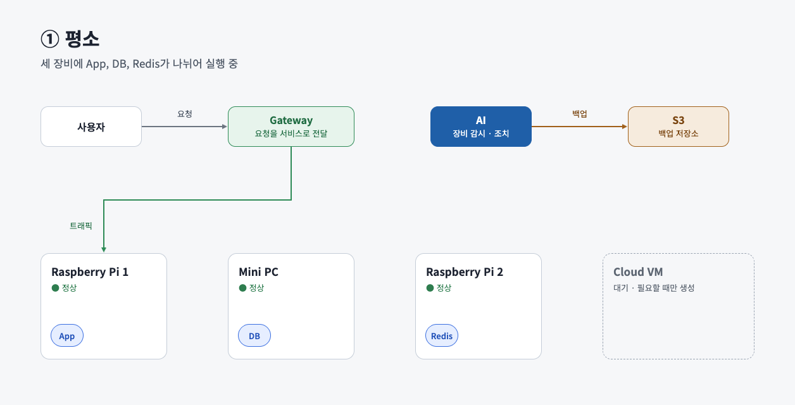
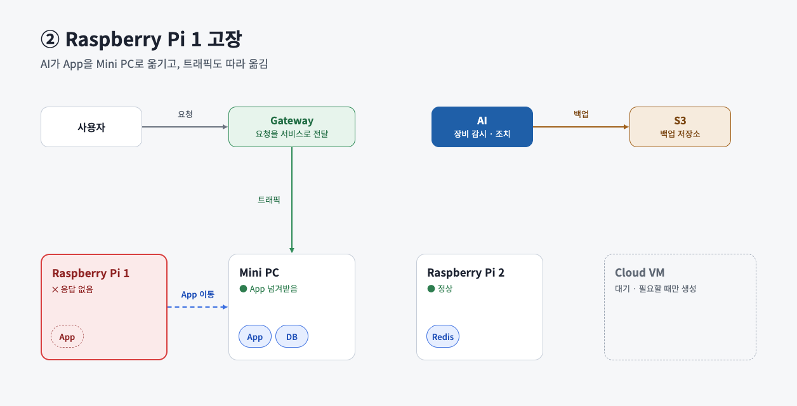
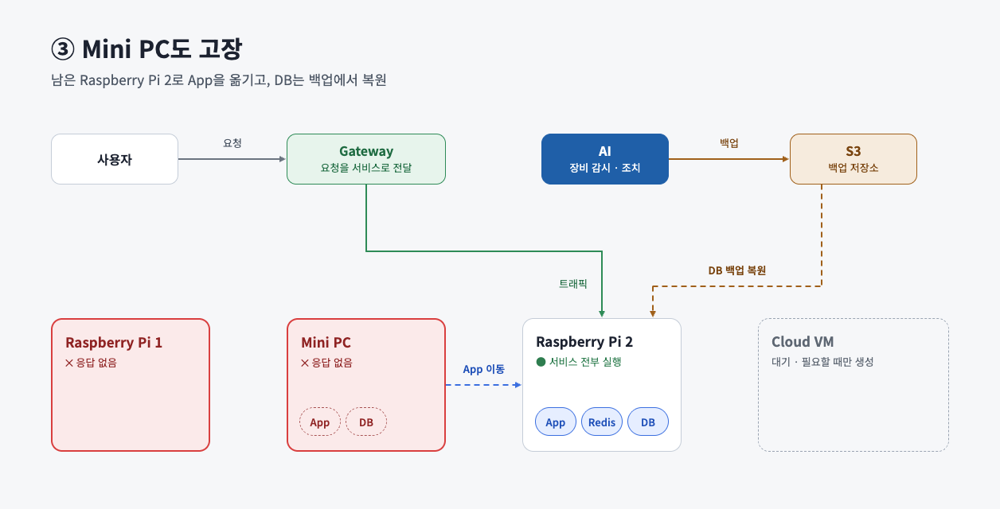
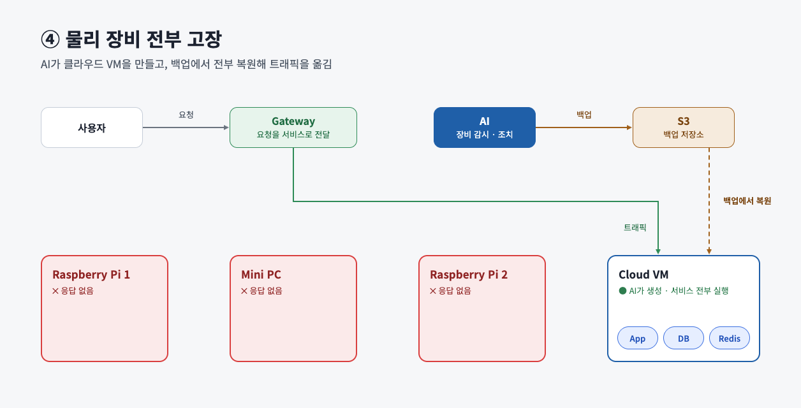
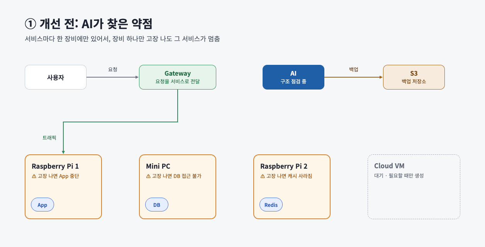
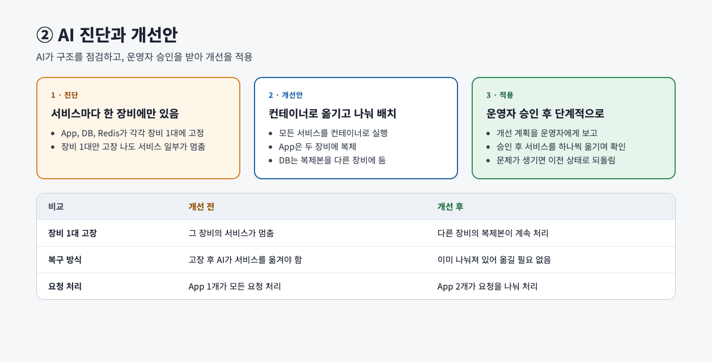
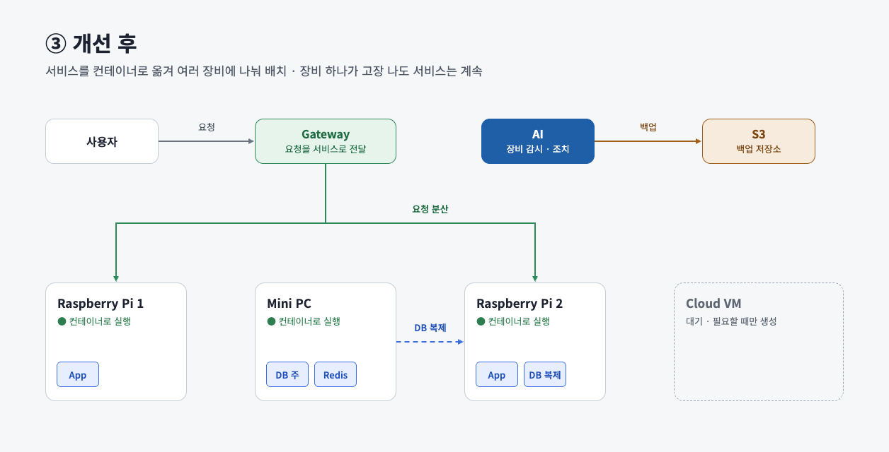
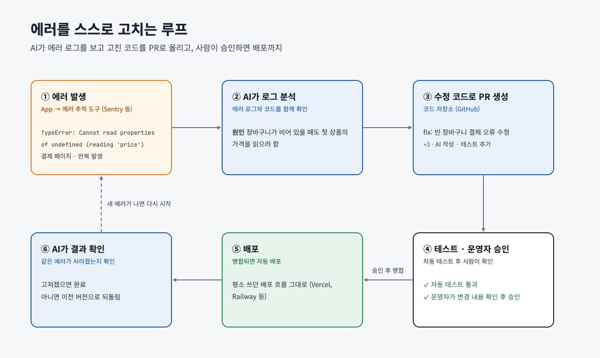
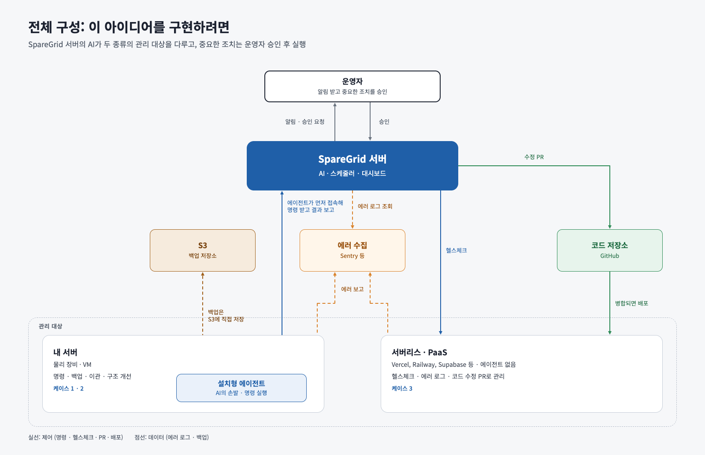

+++
date = '2026-11-06T11:00:57+09:00'
draft = false # Change to false to publish
title = 'AI를 이용한 서버 관리 - 바이브코딩으로 서비스를 만들면 끝이 아니다 5편'
description = '' # post's summary or description
tags = []
authors = ['juunini']
images = ['images/thumbnail.webp'] # e.g. ['thumbnail.png']
slug = 'server-managed-by-ai' # uri. e.g. 'awesome-post-name'
audio = []
vedios = []
series = []
+++

- [당신이 잠든 사이 서비스가 죽었다면? - 바이브코딩으로 서비스를 만들면 끝이 아니다 1편](https://tech.epsilondelta.ai/posts/service-died-while-you-were-sleeping/)
- [서비스는 살아있지만 고장났음 - 바이브코딩으로 서비스를 만들면 끝이 아니다 2편](https://tech.epsilondelta.ai/posts/my-service-is-sick/)
- [자고 일어나니 요금폭탄 - 바이브코딩으로 서비스를 만들면 끝이 아니다 3편](https://tech.epsilondelta.ai/posts/bill-explosion/)
- [서비스가 죽어도 스스로 살아나게 하는 법 - 바이브코딩으로 서비스를 만들면 끝이 아니다 4편](https://tech.epsilondelta.ai/posts/server-necromancer/)

## 이 아이디어의 출발점

처음엔 제 자신의 니즈에 의해 시작되었습니다.
저는 라즈베리파이를 몇 개 가지고 있는데,
이걸로 서버를 운영하면 항상 좀 불안한 부분이 있었죠.

[k3s로 관리도 해봤지만](https://velog.io/@juunini/diehard-on-prem-infra-under-one-dollor) 손이 은근히 많이 가며 완벽하지도 못했고
결국 더 나은 방법을 고민하게 되었습니다.

### 1. AI의 물리장비 관제 및 클라우드로 자동 이관

최근엔 AI도 많이 똑똑해졌고 어느 정도 믿을만 해졌다보니 이런 생각을 하게 됐죠.
저희 회사의 VaultWarden과 Openclaw에 적용해봤는데 꽤나 만족스러웠습니다.

이렇게, 가지고 있는 물리장비가 전부 죽으면
AI가 백업본을 가지고 클라우드에 VM을 만들어서 거기로 알아서 옮겨주는걸 말이죠.

실제로 해봤고 성공적이었습니다.
앞에 게이트웨이를 따로 둔건, DNS를 바꾸는걸 직접 시켜봤는데
DNS를 바꾼다고 유저들에게는 곧장 적용되는것이 아니기에 게이트웨이를 따로 둬야 완벽했죠.

### 2. AI의 인프라 개선

AI가 현재의 구성 상태를 확인하고
나 대신 개선을 해주는 것도 생각했습니다.

이것도 실제로 실험해봤고 꽤나 만족스러웠죠.

### 3. AI의 코드 개선

에러는 수집한다고 끝이 아닙니다.
수집하면 그걸 수정해야 하죠.

하지만 에러가 발생할 때 마다
사람이 매번 확인하고 수정하는건 매우 피곤하고 힘든 일이니
그걸 AI가 확인하고 수정까지 해준다면 어떨까 하고 구성했습니다.

위의 모든 사항들을 직접 실험했고 잘 동작했기에 꽤나 만족스러웠죠.
그리고 다른 사람들도 이런 니즈가 있지 않을까 하고 여기저기 문을 두드렸었습니다.
다만 아무도 관심이 없었죠.

## 위의 아이디어를 직접 구축하려면 어떻게 해야되나?

이 서비스가 남는 라즈베리파이나 미니 PC를 관리하기 위해서 였기 때문에
처음에 SpareGrid 라는 이름을 붙였었습니다.

그리고 아래의 그림처럼 구현했죠.

라즈베리파이나 미니PC 같은걸 관리하고 싶다면
설치형 에이전트를 넣어서, 그걸 통해 같은 네트워크가 아니더라도
AI가 명령어를 입력하고 관리할 수 있게 만들었습니다.

AI를 도입하기 전에는 고정적인 상황의 자동적인 대처만 가능했지만
AI가 도입되었기 때문에 훨씬 더 다양한 케이스에 대한 자동적인 대응이 가능합니다.

덕분에 왠만한 처리는 누워서 핸드폰으로도 가능하죠.

## 관심 있으신 분은 연락해주세요

관심이 있지 않을까 하는 사람들에게 여기저기 DM을 보내봤으나
다들 이 정도의 니즈까진 없으신지 답장을 주시는 분이 없었습니다.

단순히 개인용이 아닌 기업용으로도 괜찮으니
관심 있으신 분은 contact@epsilondelta.ai 로 연락주시기 바랍니다.